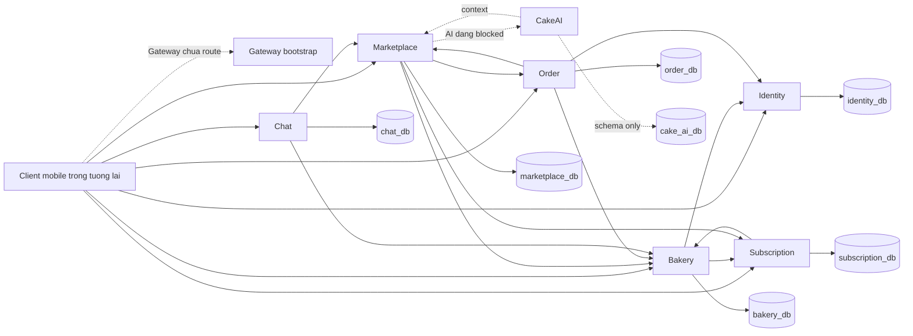
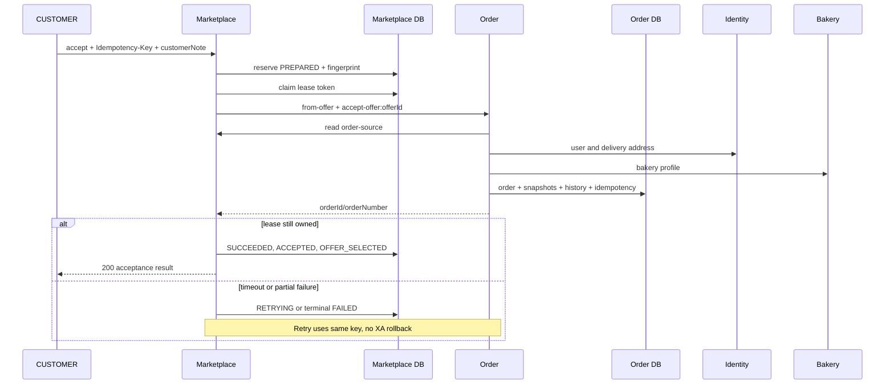
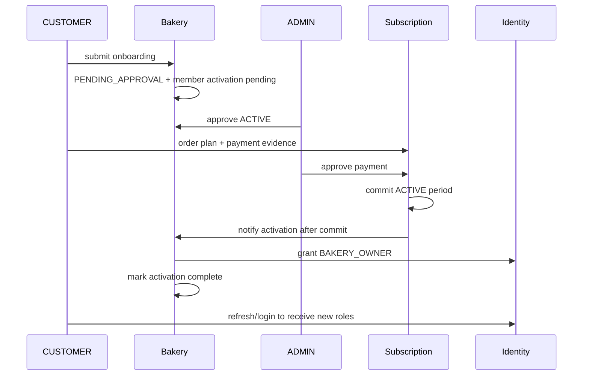
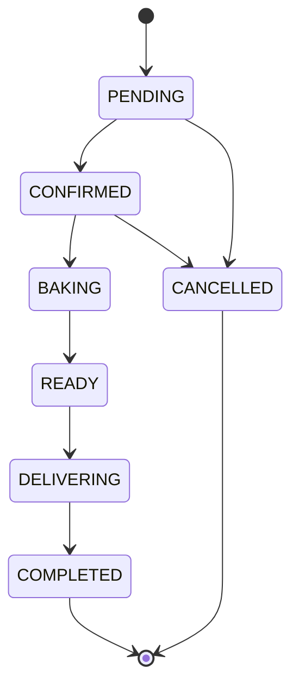
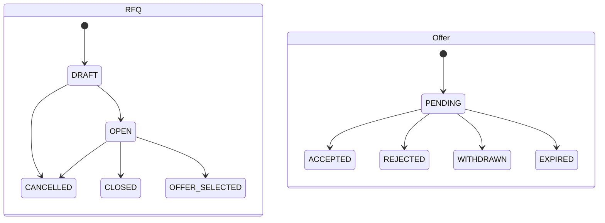
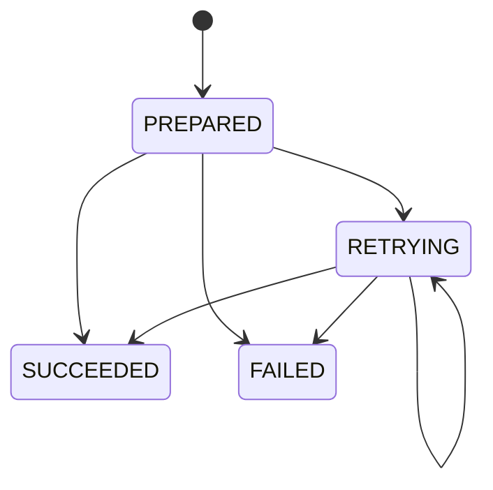
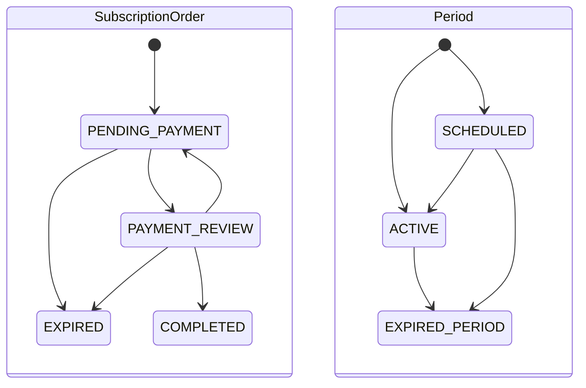
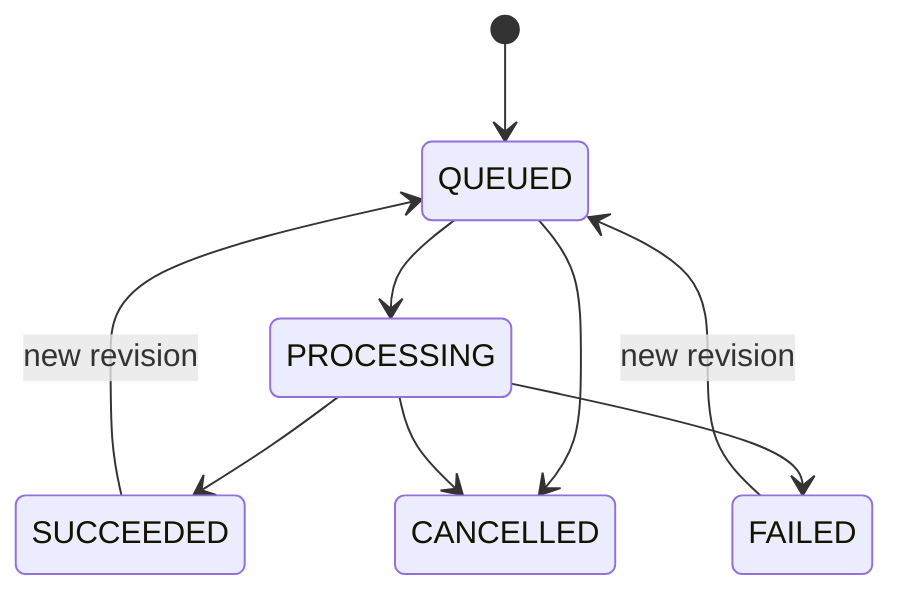
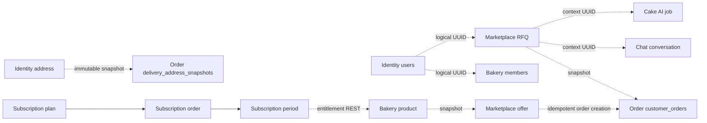

# Workflow nghiệp vụ và state machine Backend

Định nghĩa workflow là một mục tiêu hoặc vòng đời có actor, entry, trạng thái và boundary nhất quán. Nhóm các endpoint CRUD cùng aggregate để tránh đếm mỗi HTTP request như một workflow. Có **37 workflow**; không tính tính năng UI chưa có API thành workflow đã triển khai.

| Runtime category | Số workflow |
|---|---|
| BLOCKED | 6 |
| DEFECT | 2 |
| NOT_VERIFIED | 1 |
| PARTIAL | 2 |
| VERIFIED | 26 |

VERIFIED = đường đại diện của mục tiêu đã PASS, không có nghĩa tất cả branches đã test. PARTIAL = một phần flow PASS nhưng thiếu nhánh/dependency; DEFECT = lỗi triển khai đã tái hiện; BLOCKED = dependency/compile ngăn mục tiêu; NOT_VERIFIED = chỉ trace source, chưa cố tình trigger scheduler/failure window. Các category này không thay thế source coverage. 37 mục đã có source entry/trace; binding heuristic và callback limitations được nêu tại báo cáo chính.

## WF-01 — Đăng ký CUSTOMER

| # | Trường | Phân tích |
|---|---|---|
| 1 | Workflow ID | WF-01 |
| 2 | Tên | Đăng ký CUSTOMER |
| 3 | Mục đích | Đăng ký CUSTOMER theo contract nguồn hiện có, không suy rộng sang chức năng chưa triển khai. |
| 4 | Actors | anonymous |
| 5 | Điều kiện trước | Email unique; password 8..100; ACTIVE; thiếu/invalid 400, trùng 409 |
| 6 | Entry API | [IDN-006](BACKEND_API_DETAILED_SPECIFICATION_VI.md#idn-006) |
| 7 | Service tham gia | identity-service; xem remote clients bên dưới API processing trace. |
| 8 | Các bước | Chuẩn hóa email → kiểm trùng → BCrypt → ghi user/profile/role → trả summary |
| 9 | Validation | Email unique; password 8..100; ACTIVE; thiếu/invalid 400, trùng 409; DTO/type/null/default đầy đủ ở phần C từng API. |
| 10 | Database operations | roles, users; READ/WRITE/LOCK theo API-data-effects, entity cascade và SQL catalogue; không gộp remote write vào caller transaction. |
| 11 | Inter-service calls | Một @Transactional, lỗi ghi rollback tất cả; danh sách remote method cụ thể ở phần E/F các API liên quan. |
| 12 | Chuyển trạng thái | Chuẩn hóa email → kiểm trùng → BCrypt → ghi user/profile/role → trả summary; state diagrams/tables phía dưới quy định cạnh hợp lệ. |
| 13 | Điều kiện thành công | Hoàn tất mục tiêu với persisted state/response của API; runtime status VERIFIED chỉ áp đường đại diện đã có evidence. |
| 14 | Lỗi | Email unique; password 8..100; ACTIVE; thiếu/invalid 400, trùng 409; error/status theo phần H và case runtime, không coi mọi4xx là lỗi implementation. |
| 15 | Rollback/compensation | Một @Transactional, lỗi ghi rollback tất cả |
| 16 | Concurrency/idempotency | Một @Transactional, lỗi ghi rollback tất cả; header key/clientMessageId phải theo contract, không đổi payload khi retry cùng key. |
| 17 | Side effects | JWT/cookie, object storage, local histories/receipts hoặc HTTP notify tùy bước; không có evidence gửi email/ngân hàng thật. Các effect cụ thể nằm trong trace của entry API. |
| 18 | Response cuối | [IDN-006](BACKEND_API_DETAILED_SPECIFICATION_VI.md#idn-006) — phần D có nested fields/status và I có HTTP thực. |
| 19 | API liên quan | IDN-006 |
| 20 | Bảng liên quan | roles, users; bảng collection/history/lease theo phần database và scheduler. |
| 21 | Flutter | Tích hợp theo quyền/state/side effect của workflow, không suy chức năng từ demo. Chỉ dùng public application API, giữ session/key và refresh state sau mutation. |
| 22 | Nguồn | [AuthenticationController.java:41](../../backend/identity-service/src/main/java/com/se193262/identityservice/feature/authentication/AuthenticationController.java#L41); [AuthenticationService.java:11](../../backend/identity-service/src/main/java/com/se193262/identityservice/feature/authentication/AuthenticationService.java#L11); [AuthenticationServiceImpl.java:58](../../backend/identity-service/src/main/java/com/se193262/identityservice/feature/authentication/AuthenticationServiceImpl.java#L58); [ApiResponse.java:20](../../backend/identity-service/src/main/java/com/se193262/identityservice/shared/dto/ApiResponse.java#L20); [ApiResponse.java:24](../../backend/identity-service/src/main/java/com/se193262/identityservice/shared/dto/ApiResponse.java#L24); [AuthenticationServiceImpl.java:119](../../backend/identity-service/src/main/java/com/se193262/identityservice/feature/authentication/AuthenticationServiceImpl.java#L119); [UserRepository.java:11](../../backend/identity-service/src/main/java/com/se193262/identityservice/feature/user/UserRepository.java#L11); [RoleRepository.java:9](../../backend/identity-service/src/main/java/com/se193262/identityservice/feature/user/RoleRepository.java#L9); [AuthenticationServiceImpl.java:123](../../backend/identity-service/src/main/java/com/se193262/identityservice/feature/authentication/AuthenticationServiceImpl.java#L123); [User.java:94](../../backend/identity-service/src/main/java/com/se193262/identityservice/feature/user/User.java#L94); [User.java:98](../../backend/identity-service/src/main/java/com/se193262/identityservice/feature/user/User.java#L98); [UserProfileResponse.java:27](../../backend/identity-service/src/main/java/com/se193262/identityservice/feature/user/dto/UserProfileResponse.java#L27); [ApiResponse.java:32](../../backend/identity-service/src/main/java/com/se193262/identityservice/shared/dto/ApiResponse.java#L32); [CustomerProfile.java:50](../../backend/identity-service/src/main/java/com/se193262/identityservice/feature/user/CustomerProfile.java#L50); [CustomerProfile.java:58](../../backend/identity-service/src/main/java/com/se193262/identityservice/feature/user/CustomerProfile.java#L58) |
| 23 | Runtime | VERIFIED; [TC-0105](BACKEND_API_RUNTIME_VERIFICATION_VI.md#tc-0105) PASS, [TC-0107](BACKEND_API_RUNTIME_VERIFICATION_VI.md#tc-0107) PASS, [TC-0109](BACKEND_API_RUNTIME_VERIFICATION_VI.md#tc-0109) PASS, [TC-0111](BACKEND_API_RUNTIME_VERIFICATION_VI.md#tc-0111) PASS, [TC-0113](BACKEND_API_RUNTIME_VERIFICATION_VI.md#tc-0113) PASS, [TC-0227](BACKEND_API_RUNTIME_VERIFICATION_VI.md#tc-0227) PASS;  |

## WF-02 — Đăng nhập và xác minh access JWT

| # | Trường | Phân tích |
|---|---|---|
| 1 | Workflow ID | WF-02 |
| 2 | Tên | Đăng nhập và xác minh access JWT |
| 3 | Mục đích | Đăng nhập và xác minh access JWT theo contract nguồn hiện có, không suy rộng sang chức năng chưa triển khai. |
| 4 | Actors | anonymous, customerA, customerB |
| 5 | Điều kiện trước | Credential sai 401; JWT mới mới phản ánh roles; public JWK không chứa private key |
| 6 | Entry API | [IDN-002](BACKEND_API_DETAILED_SPECIFICATION_VI.md#idn-002), [IDN-004](BACKEND_API_DETAILED_SPECIFICATION_VI.md#idn-004), [IDN-001](BACKEND_API_DETAILED_SPECIFICATION_VI.md#idn-001) |
| 7 | Service tham gia | identity-service; xem remote clients bên dưới API processing trace. |
| 8 | Các bước | AuthenticationManager → account status → RS256 access → opaque refresh hash → cookie; Resource Server xác minh issuer/aud/type/exp |
| 9 | Validation | Credential sai 401; JWT mới mới phản ánh roles; public JWK không chứa private key; DTO/type/null/default đầy đủ ở phần C từng API. |
| 10 | Database operations | refresh_tokens, users; READ/WRITE/LOCK theo API-data-effects, entity cascade và SQL catalogue; không gộp remote write vào caller transaction. |
| 11 | Inter-service calls | TokenSession transaction riêng; access tự hết hạn, không blacklist; danh sách remote method cụ thể ở phần E/F các API liên quan. |
| 12 | Chuyển trạng thái | AuthenticationManager → account status → RS256 access → opaque refresh hash → cookie; Resource Server xác minh issuer/aud/type/exp; state diagrams/tables phía dưới quy định cạnh hợp lệ. |
| 13 | Điều kiện thành công | Hoàn tất mục tiêu với persisted state/response của API; runtime status VERIFIED chỉ áp đường đại diện đã có evidence. |
| 14 | Lỗi | Credential sai 401; JWT mới mới phản ánh roles; public JWK không chứa private key; error/status theo phần H và case runtime, không coi mọi4xx là lỗi implementation. |
| 15 | Rollback/compensation | TokenSession transaction riêng; access tự hết hạn, không blacklist |
| 16 | Concurrency/idempotency | TokenSession transaction riêng; access tự hết hạn, không blacklist; header key/clientMessageId phải theo contract, không đổi payload khi retry cùng key. |
| 17 | Side effects | JWT/cookie, object storage, local histories/receipts hoặc HTTP notify tùy bước; không có evidence gửi email/ngân hàng thật. Các effect cụ thể nằm trong trace của entry API. |
| 18 | Response cuối | [IDN-002](BACKEND_API_DETAILED_SPECIFICATION_VI.md#idn-002), [IDN-004](BACKEND_API_DETAILED_SPECIFICATION_VI.md#idn-004), [IDN-001](BACKEND_API_DETAILED_SPECIFICATION_VI.md#idn-001) — phần D có nested fields/status và I có HTTP thực. |
| 19 | API liên quan | IDN-002, IDN-004, IDN-001 |
| 20 | Bảng liên quan | refresh_tokens, users; bảng collection/history/lease theo phần database và scheduler. |
| 21 | Flutter | Tích hợp theo quyền/state/side effect của workflow, không suy chức năng từ demo. Chỉ dùng public application API, giữ session/key và refresh state sau mutation. |
| 22 | Nguồn | [AuthenticationController.java:50](../../backend/identity-service/src/main/java/com/se193262/identityservice/feature/authentication/AuthenticationController.java#L50); [AuthenticationService.java:13](../../backend/identity-service/src/main/java/com/se193262/identityservice/feature/authentication/AuthenticationService.java#L13); [AuthenticationServiceImpl.java:82](../../backend/identity-service/src/main/java/com/se193262/identityservice/feature/authentication/AuthenticationServiceImpl.java#L82); [AuthenticationController.java:78](../../backend/identity-service/src/main/java/com/se193262/identityservice/feature/authentication/AuthenticationController.java#L78); [AuthenticationServiceImpl.java:119](../../backend/identity-service/src/main/java/com/se193262/identityservice/feature/authentication/AuthenticationServiceImpl.java#L119); [UserRepository.java:16](../../backend/identity-service/src/main/java/com/se193262/identityservice/feature/user/UserRepository.java#L16); [UserPrincipal.java:48](../../backend/identity-service/src/main/java/com/se193262/identityservice/security/UserPrincipal.java#L48); [TokenSessionService.java:47](../../backend/identity-service/src/main/java/com/se193262/identityservice/feature/authentication/TokenSessionService.java#L47); [AuthenticationController.java:88](../../backend/identity-service/src/main/java/com/se193262/identityservice/feature/authentication/AuthenticationController.java#L88); [ApiResponse.java:12](../../backend/identity-service/src/main/java/com/se193262/identityservice/shared/dto/ApiResponse.java#L12); [ApiResponse.java:16](../../backend/identity-service/src/main/java/com/se193262/identityservice/shared/dto/ApiResponse.java#L16); [JwtTokenService.java:34](../../backend/identity-service/src/main/java/com/se193262/identityservice/feature/authentication/JwtTokenService.java#L34); [RefreshTokenGenerator.java:14](../../backend/identity-service/src/main/java/com/se193262/identityservice/feature/authentication/RefreshTokenGenerator.java#L14); [RefreshTokenHasher.java:13](../../backend/identity-service/src/main/java/com/se193262/identityservice/feature/authentication/RefreshTokenHasher.java#L13); [ApiResponse.java:32](../../backend/identity-service/src/main/java/com/se193262/identityservice/shared/dto/ApiResponse.java#L32); [AuthenticationController.java:71](../../backend/identity-service/src/main/java/com/se193262/identityservice/feature/authentication/AuthenticationController.java#L71); [AuthenticationService.java:19](../../backend/identity-service/src/main/java/com/se193262/identityservice/feature/authentication/AuthenticationService.java#L19); [AuthenticationServiceImpl.java:111](../../backend/identity-service/src/main/java/com/se193262/identityservice/feature/authentication/AuthenticationServiceImpl.java#L111); [UserProfileResponse.java:27](../../backend/identity-service/src/main/java/com/se193262/identityservice/feature/user/dto/UserProfileResponse.java#L27); [CustomerProfile.java:50](../../backend/identity-service/src/main/java/com/se193262/identityservice/feature/user/CustomerProfile.java#L50); [CustomerProfile.java:58](../../backend/identity-service/src/main/java/com/se193262/identityservice/feature/user/CustomerProfile.java#L58); [JwkSetController.java:22](../../backend/identity-service/src/main/java/com/se193262/identityservice/config/JwkSetController.java#L22) |
| 23 | Runtime | VERIFIED; [TC-0106](BACKEND_API_RUNTIME_VERIFICATION_VI.md#tc-0106) PASS, [TC-0108](BACKEND_API_RUNTIME_VERIFICATION_VI.md#tc-0108) PASS, [TC-0110](BACKEND_API_RUNTIME_VERIFICATION_VI.md#tc-0110) PASS, [TC-0112](BACKEND_API_RUNTIME_VERIFICATION_VI.md#tc-0112) PASS, [TC-0114](BACKEND_API_RUNTIME_VERIFICATION_VI.md#tc-0114) PASS, [TC-0115](BACKEND_API_RUNTIME_VERIFICATION_VI.md#tc-0115) PASS, [TC-0124](BACKEND_API_RUNTIME_VERIFICATION_VI.md#tc-0124) PASS, [TC-0132](BACKEND_API_RUNTIME_VERIFICATION_VI.md#tc-0132) PASS, [TC-0211](BACKEND_API_RUNTIME_VERIFICATION_VI.md#tc-0211) PASS, [TC-0212](BACKEND_API_RUNTIME_VERIFICATION_VI.md#tc-0212) PASS, [TC-0213](BACKEND_API_RUNTIME_VERIFICATION_VI.md#tc-0213) PASS, [TC-0214](BACKEND_API_RUNTIME_VERIFICATION_VI.md#tc-0214) PASS, [TC-0215](BACKEND_API_RUNTIME_VERIFICATION_VI.md#tc-0215) PASS, [TC-0219](BACKEND_API_RUNTIME_VERIFICATION_VI.md#tc-0219) PASS, [TC-0223](BACKEND_API_RUNTIME_VERIFICATION_VI.md#tc-0223) PASS, [TC-0225](BACKEND_API_RUNTIME_VERIFICATION_VI.md#tc-0225) PASS, [TC-0226](BACKEND_API_RUNTIME_VERIFICATION_VI.md#tc-0226) PASS, [TC-0266](BACKEND_API_RUNTIME_VERIFICATION_VI.md#tc-0266) PASS, [TC-0267](BACKEND_API_RUNTIME_VERIFICATION_VI.md#tc-0267) PASS, [TC-0268](BACKEND_API_RUNTIME_VERIFICATION_VI.md#tc-0268) PASS, [TC-0274](BACKEND_API_RUNTIME_VERIFICATION_VI.md#tc-0274) PASS, [TC-0306](BACKEND_API_RUNTIME_VERIFICATION_VI.md#tc-0306) PASS, [TC-0307](BACKEND_API_RUNTIME_VERIFICATION_VI.md#tc-0307) PASS, [TC-0308](BACKEND_API_RUNTIME_VERIFICATION_VI.md#tc-0308) PASS, [TC-0319](BACKEND_API_RUNTIME_VERIFICATION_VI.md#tc-0319) PASS, [TC-0320](BACKEND_API_RUNTIME_VERIFICATION_VI.md#tc-0320) PASS;  |

## WF-03 — Refresh rotation và logout

| # | Trường | Phân tích |
|---|---|---|
| 1 | Workflow ID | WF-03 |
| 2 | Tên | Refresh rotation và logout |
| 3 | Mục đích | Refresh rotation và logout theo contract nguồn hiện có, không suy rộng sang chức năng chưa triển khai. |
| 4 | Actors | anonymous, customerA, customerB |
| 5 | Điều kiện trước | Replay revoke mọi token active; access JWT sau logout vẫn hợp lệ |
| 6 | Entry API | [IDN-005](BACKEND_API_DETAILED_SPECIFICATION_VI.md#idn-005), [IDN-003](BACKEND_API_DETAILED_SPECIFICATION_VI.md#idn-003) |
| 7 | Service tham gia | identity-service; xem remote clients bên dưới API processing trace. |
| 8 | Các bước | Cookie → SHA256 → SELECT FOR UPDATE → revoke cũ/tạo mới; logout revoke token được gửi và clear cookie |
| 9 | Validation | Replay revoke mọi token active; access JWT sau logout vẫn hợp lệ; DTO/type/null/default đầy đủ ở phần C từng API. |
| 10 | Database operations | refresh_tokens, users; READ/WRITE/LOCK theo API-data-effects, entity cascade và SQL catalogue; không gộp remote write vào caller transaction. |
| 11 | Inter-service calls | noRollbackFor trên lỗi refresh cho phép giữ quyết định revoke; lock serializes race; danh sách remote method cụ thể ở phần E/F các API liên quan. |
| 12 | Chuyển trạng thái | Cookie → SHA256 → SELECT FOR UPDATE → revoke cũ/tạo mới; logout revoke token được gửi và clear cookie; state diagrams/tables phía dưới quy định cạnh hợp lệ. |
| 13 | Điều kiện thành công | Hoàn tất mục tiêu với persisted state/response của API; runtime status VERIFIED chỉ áp đường đại diện đã có evidence. |
| 14 | Lỗi | Replay revoke mọi token active; access JWT sau logout vẫn hợp lệ; error/status theo phần H và case runtime, không coi mọi4xx là lỗi implementation. |
| 15 | Rollback/compensation | noRollbackFor trên lỗi refresh cho phép giữ quyết định revoke; lock serializes race |
| 16 | Concurrency/idempotency | noRollbackFor trên lỗi refresh cho phép giữ quyết định revoke; lock serializes race; header key/clientMessageId phải theo contract, không đổi payload khi retry cùng key. |
| 17 | Side effects | JWT/cookie, object storage, local histories/receipts hoặc HTTP notify tùy bước; không có evidence gửi email/ngân hàng thật. Các effect cụ thể nằm trong trace của entry API. |
| 18 | Response cuối | [IDN-005](BACKEND_API_DETAILED_SPECIFICATION_VI.md#idn-005), [IDN-003](BACKEND_API_DETAILED_SPECIFICATION_VI.md#idn-003) — phần D có nested fields/status và I có HTTP thực. |
| 19 | API liên quan | IDN-005, IDN-003 |
| 20 | Bảng liên quan | refresh_tokens, users; bảng collection/history/lease theo phần database và scheduler. |
| 21 | Flutter | Tích hợp theo quyền/state/side effect của workflow, không suy chức năng từ demo. Chỉ dùng public application API, giữ session/key và refresh state sau mutation. |
| 22 | Nguồn | [AuthenticationController.java:56](../../backend/identity-service/src/main/java/com/se193262/identityservice/feature/authentication/AuthenticationController.java#L56); [AuthenticationService.java:15](../../backend/identity-service/src/main/java/com/se193262/identityservice/feature/authentication/AuthenticationService.java#L15); [AuthenticationServiceImpl.java:101](../../backend/identity-service/src/main/java/com/se193262/identityservice/feature/authentication/AuthenticationServiceImpl.java#L101); [AuthenticationController.java:98](../../backend/identity-service/src/main/java/com/se193262/identityservice/feature/authentication/AuthenticationController.java#L98); [AuthenticationController.java:78](../../backend/identity-service/src/main/java/com/se193262/identityservice/feature/authentication/AuthenticationController.java#L78); [TokenSessionService.java:63](../../backend/identity-service/src/main/java/com/se193262/identityservice/feature/authentication/TokenSessionService.java#L63); [AuthenticationController.java:88](../../backend/identity-service/src/main/java/com/se193262/identityservice/feature/authentication/AuthenticationController.java#L88); [ApiResponse.java:12](../../backend/identity-service/src/main/java/com/se193262/identityservice/shared/dto/ApiResponse.java#L12); [ApiResponse.java:16](../../backend/identity-service/src/main/java/com/se193262/identityservice/shared/dto/ApiResponse.java#L16); [RefreshTokenRepository.java:16](../../backend/identity-service/src/main/java/com/se193262/identityservice/feature/authentication/RefreshTokenRepository.java#L16); [RefreshTokenHasher.java:13](../../backend/identity-service/src/main/java/com/se193262/identityservice/feature/authentication/RefreshTokenHasher.java#L13); [RefreshToken.java:58](../../backend/identity-service/src/main/java/com/se193262/identityservice/feature/authentication/RefreshToken.java#L58); [TokenSessionService.java:94](../../backend/identity-service/src/main/java/com/se193262/identityservice/feature/authentication/TokenSessionService.java#L94); [UserRepository.java:16](../../backend/identity-service/src/main/java/com/se193262/identityservice/feature/user/UserRepository.java#L16); [User.java:122](../../backend/identity-service/src/main/java/com/se193262/identityservice/feature/user/User.java#L122); [RefreshTokenRepository.java:20](../../backend/identity-service/src/main/java/com/se193262/identityservice/feature/authentication/RefreshTokenRepository.java#L20); [RefreshToken.java:52](../../backend/identity-service/src/main/java/com/se193262/identityservice/feature/authentication/RefreshToken.java#L52); [TokenSessionService.java:47](../../backend/identity-service/src/main/java/com/se193262/identityservice/feature/authentication/TokenSessionService.java#L47); [ApiResponse.java:32](../../backend/identity-service/src/main/java/com/se193262/identityservice/shared/dto/ApiResponse.java#L32); [JwtTokenService.java:34](../../backend/identity-service/src/main/java/com/se193262/identityservice/feature/authentication/JwtTokenService.java#L34); [RefreshTokenGenerator.java:14](../../backend/identity-service/src/main/java/com/se193262/identityservice/feature/authentication/RefreshTokenGenerator.java#L14); [AuthenticationController.java:62](../../backend/identity-service/src/main/java/com/se193262/identityservice/feature/authentication/AuthenticationController.java#L62); [AuthenticationService.java:17](../../backend/identity-service/src/main/java/com/se193262/identityservice/feature/authentication/AuthenticationService.java#L17); [AuthenticationServiceImpl.java:106](../../backend/identity-service/src/main/java/com/se193262/identityservice/feature/authentication/AuthenticationServiceImpl.java#L106); [TokenSessionService.java:85](../../backend/identity-service/src/main/java/com/se193262/identityservice/feature/authentication/TokenSessionService.java#L85) |
| 23 | Runtime | VERIFIED; [TC-0220](BACKEND_API_RUNTIME_VERIFICATION_VI.md#tc-0220) PASS, [TC-0221](BACKEND_API_RUNTIME_VERIFICATION_VI.md#tc-0221) PASS, [TC-0222](BACKEND_API_RUNTIME_VERIFICATION_VI.md#tc-0222) PASS, [TC-0224](BACKEND_API_RUNTIME_VERIFICATION_VI.md#tc-0224) FAIL, [TC-0273](BACKEND_API_RUNTIME_VERIFICATION_VI.md#tc-0273) PASS;  |

## WF-04 — Service authentication và scope

| # | Trường | Phân tích |
|---|---|---|
| 1 | Workflow ID | WF-04 |
| 2 | Tên | Service authentication và scope |
| 3 | Mục đích | Service authentication và scope theo contract nguồn hiện có, không suy rộng sang chức năng chưa triển khai. |
| 4 | Actors | anonymous |
| 5 | Điều kiện trước | Service JWT không được thay user; scope vượt grant bị từ chối; thiếu correlation theo service policy |
| 6 | Entry API | [IDN-007](BACKEND_API_DETAILED_SPECIFICATION_VI.md#idn-007), [IDN-008](BACKEND_API_DETAILED_SPECIFICATION_VI.md#idn-008), [IDN-009](BACKEND_API_DETAILED_SPECIFICATION_VI.md#idn-009), [IDN-010](BACKEND_API_DETAILED_SPECIFICATION_VI.md#idn-010) |
| 7 | Service tham gia | identity-service; xem remote clients bên dưới API processing trace. |
| 8 | Các bước | ClientId/BCrypt secret → grant audience/scope → RS256 service JWT → receiver kiểm type/aud/scope/correlation |
| 9 | Validation | Service JWT không được thay user; scope vượt grant bị từ chối; thiếu correlation theo service policy; DTO/type/null/default đầy đủ ở phần C từng API. |
| 10 | Database operations | roles, user_addresses, user_roles, users; READ/WRITE/LOCK theo API-data-effects, entity cascade và SQL catalogue; không gộp remote write vào caller transaction. |
| 11 | Inter-service calls | Token không cần ghi DB; cache trong memory, hết hạn lấy lại; danh sách remote method cụ thể ở phần E/F các API liên quan. |
| 12 | Chuyển trạng thái | ClientId/BCrypt secret → grant audience/scope → RS256 service JWT → receiver kiểm type/aud/scope/correlation; state diagrams/tables phía dưới quy định cạnh hợp lệ. |
| 13 | Điều kiện thành công | Hoàn tất mục tiêu với persisted state/response của API; runtime status VERIFIED chỉ áp đường đại diện đã có evidence. |
| 14 | Lỗi | Service JWT không được thay user; scope vượt grant bị từ chối; thiếu correlation theo service policy; error/status theo phần H và case runtime, không coi mọi4xx là lỗi implementation. |
| 15 | Rollback/compensation | Token không cần ghi DB; cache trong memory, hết hạn lấy lại |
| 16 | Concurrency/idempotency | Token không cần ghi DB; cache trong memory, hết hạn lấy lại; header key/clientMessageId phải theo contract, không đổi payload khi retry cùng key. |
| 17 | Side effects | JWT/cookie, object storage, local histories/receipts hoặc HTTP notify tùy bước; không có evidence gửi email/ngân hàng thật. Các effect cụ thể nằm trong trace của entry API. |
| 18 | Response cuối | [IDN-007](BACKEND_API_DETAILED_SPECIFICATION_VI.md#idn-007), [IDN-008](BACKEND_API_DETAILED_SPECIFICATION_VI.md#idn-008), [IDN-009](BACKEND_API_DETAILED_SPECIFICATION_VI.md#idn-009), [IDN-010](BACKEND_API_DETAILED_SPECIFICATION_VI.md#idn-010) — phần D có nested fields/status và I có HTTP thực. |
| 19 | API liên quan | IDN-007, IDN-008, IDN-009, IDN-010 |
| 20 | Bảng liên quan | roles, user_addresses, user_roles, users; bảng collection/history/lease theo phần database và scheduler. |
| 21 | Flutter | Tích hợp theo quyền/state/side effect của workflow, không suy chức năng từ demo. Chỉ dùng public application API, giữ session/key và refresh state sau mutation. |
| 22 | Nguồn | [ServiceTokenController.java:16](../../backend/identity-service/src/main/java/com/se193262/identityservice/feature/authentication/ServiceTokenController.java#L16); [ServiceTokenService.java:37](../../backend/identity-service/src/main/java/com/se193262/identityservice/feature/authentication/ServiceTokenService.java#L37); [UserContextController.java:17](../../backend/identity-service/src/main/java/com/se193262/identityservice/feature/user/UserContextController.java#L17); [UserContextService.java:20](../../backend/identity-service/src/main/java/com/se193262/identityservice/feature/user/UserContextService.java#L20); [UserContextController.java:23](../../backend/identity-service/src/main/java/com/se193262/identityservice/feature/user/UserContextController.java#L23); [UserContextService.java:79](../../backend/identity-service/src/main/java/com/se193262/identityservice/feature/user/UserContextService.java#L79); [UserContextController.java:30](../../backend/identity-service/src/main/java/com/se193262/identityservice/feature/user/UserContextController.java#L30); [UserContextService.java:44](../../backend/identity-service/src/main/java/com/se193262/identityservice/feature/user/UserContextService.java#L44) |
| 23 | Runtime | VERIFIED; [TC-0229](BACKEND_API_RUNTIME_VERIFICATION_VI.md#tc-0229) PASS, [TC-0232](BACKEND_API_RUNTIME_VERIFICATION_VI.md#tc-0232) PASS, [TC-0234](BACKEND_API_RUNTIME_VERIFICATION_VI.md#tc-0234) PASS, [TC-0236](BACKEND_API_RUNTIME_VERIFICATION_VI.md#tc-0236) PASS, [TC-0238](BACKEND_API_RUNTIME_VERIFICATION_VI.md#tc-0238) PASS, [TC-0240](BACKEND_API_RUNTIME_VERIFICATION_VI.md#tc-0240) PASS, [TC-0241](BACKEND_API_RUNTIME_VERIFICATION_VI.md#tc-0241) FAIL, [TC-0242](BACKEND_API_RUNTIME_VERIFICATION_VI.md#tc-0242) PASS, [TC-0243](BACKEND_API_RUNTIME_VERIFICATION_VI.md#tc-0243) PASS, [TC-0244](BACKEND_API_RUNTIME_VERIFICATION_VI.md#tc-0244) PASS, [TC-0245](BACKEND_API_RUNTIME_VERIFICATION_VI.md#tc-0245) FAIL, [TC-0246](BACKEND_API_RUNTIME_VERIFICATION_VI.md#tc-0246) PASS, [TC-0249](BACKEND_API_RUNTIME_VERIFICATION_VI.md#tc-0249) PASS, [TC-0251](BACKEND_API_RUNTIME_VERIFICATION_VI.md#tc-0251) PASS, [TC-0253](BACKEND_API_RUNTIME_VERIFICATION_VI.md#tc-0253) PASS, [TC-0269](BACKEND_API_RUNTIME_VERIFICATION_VI.md#tc-0269) PASS, [TC-0270](BACKEND_API_RUNTIME_VERIFICATION_VI.md#tc-0270) PASS, [TC-0271](BACKEND_API_RUNTIME_VERIFICATION_VI.md#tc-0271) PASS, [TC-0272](BACKEND_API_RUNTIME_VERIFICATION_VI.md#tc-0272) PASS, [TC-0275](BACKEND_API_RUNTIME_VERIFICATION_VI.md#tc-0275) PASS, [TC-0278](BACKEND_API_RUNTIME_VERIFICATION_VI.md#tc-0278) PASS, [TC-0280](BACKEND_API_RUNTIME_VERIFICATION_VI.md#tc-0280) PASS;  |

## WF-05 — Onboarding và cấp OWNER

| # | Trường | Phân tích |
|---|---|---|
| 1 | Workflow ID | WF-05 |
| 2 | Tên | Onboarding và cấp OWNER |
| 3 | Mục đích | Onboarding và cấp OWNER theo contract nguồn hiện có, không suy rộng sang chức năng chưa triển khai. |
| 4 | Actors | anonymous, ownerA, ownerB |
| 5 | Điều kiện trước | Membership OWNER ACTIVE cùng bakery; không grant khi thiếu entitlement; external config cũ thiếu scope |
| 6 | Entry API | [BKR-006](BACKEND_API_DETAILED_SPECIFICATION_VI.md#bkr-006), [BKR-007](BACKEND_API_DETAILED_SPECIFICATION_VI.md#bkr-007), [BKR-022](BACKEND_API_DETAILED_SPECIFICATION_VI.md#bkr-022), [BKR-038](BACKEND_API_DETAILED_SPECIFICATION_VI.md#bkr-038), [IDN-009](BACKEND_API_DETAILED_SPECIFICATION_VI.md#idn-009) |
| 7 | Service tham gia | bakery-service, identity-service; xem remote clients bên dưới API processing trace. |
| 8 | Các bước | CUSTOMER submit profile/operations → PENDING_APPROVAL → admin ACTIVE → subscription ACTIVE → grant OWNER → mark activation complete → refresh JWT |
| 9 | Validation | Membership OWNER ACTIVE cùng bakery; không grant khi thiếu entitlement; external config cũ thiếu scope; DTO/type/null/default đầy đủ ở phần C từng API. |
| 10 | Database operations | bakeries, bakery_addresses, bakery_members, business_hours, roles, service_areas, user_roles, users; READ/WRITE/LOCK theo API-data-effects, entity cascade và SQL catalogue; không gộp remote write vào caller transaction. |
| 11 | Inter-service calls | Bakery transactions cục bộ; grant remote rồi mark; retry scheduler 15s, không XA; danh sách remote method cụ thể ở phần E/F các API liên quan. |
| 12 | Chuyển trạng thái | CUSTOMER submit profile/operations → PENDING_APPROVAL → admin ACTIVE → subscription ACTIVE → grant OWNER → mark activation complete → refresh JWT; state diagrams/tables phía dưới quy định cạnh hợp lệ. |
| 13 | Điều kiện thành công | Hoàn tất mục tiêu với persisted state/response của API; runtime status VERIFIED chỉ áp đường đại diện đã có evidence. |
| 14 | Lỗi | Membership OWNER ACTIVE cùng bakery; không grant khi thiếu entitlement; external config cũ thiếu scope; error/status theo phần H và case runtime, không coi mọi4xx là lỗi implementation. |
| 15 | Rollback/compensation | Bakery transactions cục bộ; grant remote rồi mark; retry scheduler 15s, không XA |
| 16 | Concurrency/idempotency | Bakery transactions cục bộ; grant remote rồi mark; retry scheduler 15s, không XA; header key/clientMessageId phải theo contract, không đổi payload khi retry cùng key. |
| 17 | Side effects | JWT/cookie, object storage, local histories/receipts hoặc HTTP notify tùy bước; không có evidence gửi email/ngân hàng thật. Các effect cụ thể nằm trong trace của entry API. |
| 18 | Response cuối | [BKR-006](BACKEND_API_DETAILED_SPECIFICATION_VI.md#bkr-006), [BKR-007](BACKEND_API_DETAILED_SPECIFICATION_VI.md#bkr-007), [BKR-022](BACKEND_API_DETAILED_SPECIFICATION_VI.md#bkr-022), [BKR-038](BACKEND_API_DETAILED_SPECIFICATION_VI.md#bkr-038), [IDN-009](BACKEND_API_DETAILED_SPECIFICATION_VI.md#idn-009) — phần D có nested fields/status và I có HTTP thực. |
| 19 | API liên quan | BKR-006, BKR-007, BKR-022, BKR-038, IDN-009 |
| 20 | Bảng liên quan | bakeries, bakery_addresses, bakery_members, business_hours, roles, service_areas, user_roles, users; bảng collection/history/lease theo phần database và scheduler. |
| 21 | Flutter | Tích hợp theo quyền/state/side effect của workflow, không suy chức năng từ demo. Chỉ dùng public application API, giữ session/key và refresh state sau mutation. |
| 22 | Nguồn | [BakeryOnboardingController.java:29](../../backend/bakery-service/src/main/java/com/se193262/bakeryservice/feature/bakery/controller/BakeryOnboardingController.java#L29); [ApiResponse.java:12](../../backend/bakery-service/src/main/java/com/se193262/bakeryservice/shared/dto/ApiResponse.java#L12); [BakeryOnboardingService.java:10](../../backend/bakery-service/src/main/java/com/se193262/bakeryservice/feature/bakery/service/BakeryOnboardingService.java#L10); [BakeryOnboardingServiceImpl.java:39](../../backend/bakery-service/src/main/java/com/se193262/bakeryservice/feature/bakery/service/impl/BakeryOnboardingServiceImpl.java#L39); [BakeryMemberRepository.java:24](../../backend/bakery-service/src/main/java/com/se193262/bakeryservice/feature/member/repository/BakeryMemberRepository.java#L24); [BakeryService.java:17](../../backend/bakery-service/src/main/java/com/se193262/bakeryservice/feature/bakery/service/BakeryService.java#L17); [BakeryServiceImpl.java:102](../../backend/bakery-service/src/main/java/com/se193262/bakeryservice/feature/bakery/service/impl/BakeryServiceImpl.java#L102); [BakeryServiceImpl.java:382](../../backend/bakery-service/src/main/java/com/se193262/bakeryservice/feature/bakery/service/impl/BakeryServiceImpl.java#L382); [BakeryServiceImpl.java:237](../../backend/bakery-service/src/main/java/com/se193262/bakeryservice/feature/bakery/service/impl/BakeryServiceImpl.java#L237); [BakeryServiceImpl.java:388](../../backend/bakery-service/src/main/java/com/se193262/bakeryservice/feature/bakery/service/impl/BakeryServiceImpl.java#L388); [BakeryAddressRepository.java:11](../../backend/bakery-service/src/main/java/com/se193262/bakeryservice/feature/bakery/repository/BakeryAddressRepository.java#L11); [ServiceAreaRepository.java:11](../../backend/bakery-service/src/main/java/com/se193262/bakeryservice/feature/bakery/repository/ServiceAreaRepository.java#L11); [BusinessHourRepository.java:11](../../backend/bakery-service/src/main/java/com/se193262/bakeryservice/feature/bakery/repository/BusinessHourRepository.java#L11); [BakeryOnboardingController.java:34](../../backend/bakery-service/src/main/java/com/se193262/bakeryservice/feature/bakery/controller/BakeryOnboardingController.java#L34); [BakeryOnboardingService.java:11](../../backend/bakery-service/src/main/java/com/se193262/bakeryservice/feature/bakery/service/BakeryOnboardingService.java#L11); [BakeryOnboardingServiceImpl.java:47](../../backend/bakery-service/src/main/java/com/se193262/bakeryservice/feature/bakery/service/impl/BakeryOnboardingServiceImpl.java#L47); [BakeryMemberRepository.java:27](../../backend/bakery-service/src/main/java/com/se193262/bakeryservice/feature/member/repository/BakeryMemberRepository.java#L27); [BakeryService.java:15](../../backend/bakery-service/src/main/java/com/se193262/bakeryservice/feature/bakery/service/BakeryService.java#L15); [BakeryServiceImpl.java:74](../../backend/bakery-service/src/main/java/com/se193262/bakeryservice/feature/bakery/service/impl/BakeryServiceImpl.java#L74); [BakeryService.java:19](../../backend/bakery-service/src/main/java/com/se193262/bakeryservice/feature/bakery/service/BakeryService.java#L19); [BakeryServiceImpl.java:108](../../backend/bakery-service/src/main/java/com/se193262/bakeryservice/feature/bakery/service/impl/BakeryServiceImpl.java#L108); [BakeryService.java:21](../../backend/bakery-service/src/main/java/com/se193262/bakeryservice/feature/bakery/service/BakeryService.java#L21); [BakeryServiceImpl.java:123](../../backend/bakery-service/src/main/java/com/se193262/bakeryservice/feature/bakery/service/impl/BakeryServiceImpl.java#L123); [BakeryService.java:23](../../backend/bakery-service/src/main/java/com/se193262/bakeryservice/feature/bakery/service/BakeryService.java#L23); [BakeryServiceImpl.java:137](../../backend/bakery-service/src/main/java/com/se193262/bakeryservice/feature/bakery/service/impl/BakeryServiceImpl.java#L137); [BakeryServiceImpl.java:80](../../backend/bakery-service/src/main/java/com/se193262/bakeryservice/feature/bakery/service/impl/BakeryServiceImpl.java#L80); [BakeryServiceImpl.java:242](../../backend/bakery-service/src/main/java/com/se193262/bakeryservice/feature/bakery/service/impl/BakeryServiceImpl.java#L242); [Bakery.java:70](../../backend/bakery-service/src/main/java/com/se193262/bakeryservice/feature/bakery/entity/Bakery.java#L70); [BakeryServiceImpl.java:251](../../backend/bakery-service/src/main/java/com/se193262/bakeryservice/feature/bakery/service/impl/BakeryServiceImpl.java#L251); [BakeryServiceImpl.java:258](../../backend/bakery-service/src/main/java/com/se193262/bakeryservice/feature/bakery/service/impl/BakeryServiceImpl.java#L258); [BakeryServiceImpl.java:262](../../backend/bakery-service/src/main/java/com/se193262/bakeryservice/feature/bakery/service/impl/BakeryServiceImpl.java#L262); [BakeryServiceImpl.java:293](../../backend/bakery-service/src/main/java/com/se193262/bakeryservice/feature/bakery/service/impl/BakeryServiceImpl.java#L293); [BakeryServiceImpl.java:324](../../backend/bakery-service/src/main/java/com/se193262/bakeryservice/feature/bakery/service/impl/BakeryServiceImpl.java#L324); [BakeryServiceImpl.java:348](../../backend/bakery-service/src/main/java/com/se193262/bakeryservice/feature/bakery/service/impl/BakeryServiceImpl.java#L348); [Bakery.java:105](../../backend/bakery-service/src/main/java/com/se193262/bakeryservice/feature/bakery/entity/Bakery.java#L105); [Bakery.java:99](../../backend/bakery-service/src/main/java/com/se193262/bakeryservice/feature/bakery/entity/Bakery.java#L99); [Bakery.java:101](../../backend/bakery-service/src/main/java/com/se193262/bakeryservice/feature/bakery/entity/Bakery.java#L101); [Bakery.java:77](../../backend/bakery-service/src/main/java/com/se193262/bakeryservice/feature/bakery/entity/Bakery.java#L77); [IdentityUserClient.java:43](../../backend/bakery-service/src/main/java/com/se193262/bakeryservice/infrastructure/client/IdentityUserClient.java#L43); [IdentityUserClient.java:35](../../backend/bakery-service/src/main/java/com/se193262/bakeryservice/infrastructure/client/IdentityUserClient.java#L35); [BakeryMember.java:74](../../backend/bakery-service/src/main/java/com/se193262/bakeryservice/feature/member/entity/BakeryMember.java#L74); [BakeryAddress.java:86](../../backend/bakery-service/src/main/java/com/se193262/bakeryservice/feature/bakery/entity/BakeryAddress.java#L86); [BakeryServiceImpl.java:372](../../backend/bakery-service/src/main/java/com/se193262/bakeryservice/feature/bakery/service/impl/BakeryServiceImpl.java#L372); [BakeryAddress.java:71](../../backend/bakery-service/src/main/java/com/se193262/bakeryservice/feature/bakery/entity/BakeryAddress.java#L71); [ServiceArea.java:62](../../backend/bakery-service/src/main/java/com/se193262/bakeryservice/feature/bakery/entity/ServiceArea.java#L62); [ServiceArea.java:53](../../backend/bakery-service/src/main/java/com/se193262/bakeryservice/feature/bakery/entity/ServiceArea.java#L53); [BusinessHour.java:60](../../backend/bakery-service/src/main/java/com/se193262/bakeryservice/feature/bakery/entity/BusinessHour.java#L60); [BusinessHour.java:52](../../backend/bakery-service/src/main/java/com/se193262/bakeryservice/feature/bakery/entity/BusinessHour.java#L52); [ServiceHttpClient.java:37](../../backend/platform-support/src/main/java/com/se193262/platform/client/ServiceHttpClient.java#L37); [ServiceHttpClient.java:89](../../backend/platform-support/src/main/java/com/se193262/platform/client/ServiceHttpClient.java#L89); [BusinessException.java:24](../../backend/platform-support/src/main/java/com/se193262/platform/exception/BusinessException.java#L24); [BakeryOnboardingController.java:40](../../backend/bakery-service/src/main/java/com/se193262/bakeryservice/feature/bakery/controller/BakeryOnboardingController.java#L40); [BakeryOnboardingService.java:12](../../backend/bakery-service/src/main/java/com/se193262/bakeryservice/feature/bakery/service/BakeryOnboardingService.java#L12); [BakeryOnboardingServiceImpl.java:64](../../backend/bakery-service/src/main/java/com/se193262/bakeryservice/feature/bakery/service/impl/BakeryOnboardingServiceImpl.java#L64); [BakeryMemberRepository.java:22](../../backend/bakery-service/src/main/java/com/se193262/bakeryservice/feature/member/repository/BakeryMemberRepository.java#L22); [SubscriptionEntitlementClient.java:36](../../backend/bakery-service/src/main/java/com/se193262/bakeryservice/infrastructure/client/SubscriptionEntitlementClient.java#L36); [BakeryOnboardingServiceImpl.java:102](../../backend/bakery-service/src/main/java/com/se193262/bakeryservice/feature/bakery/service/impl/BakeryOnboardingServiceImpl.java#L102); [SubscriptionEntitlementClient.java:42](../../backend/bakery-service/src/main/java/com/se193262/bakeryservice/infrastructure/client/SubscriptionEntitlementClient.java#L42); [IdentityUserClient.java:74](../../backend/bakery-service/src/main/java/com/se193262/bakeryservice/infrastructure/client/IdentityUserClient.java#L74); [BakeryMemberRepository.java:48](../../backend/bakery-service/src/main/java/com/se193262/bakeryservice/feature/member/repository/BakeryMemberRepository.java#L48); [InternalBakeryController.java:29](../../backend/bakery-service/src/main/java/com/se193262/bakeryservice/feature/bakery/controller/InternalBakeryController.java#L29); [BakeryOnboardingService.java:14](../../backend/bakery-service/src/main/java/com/se193262/bakeryservice/feature/bakery/service/BakeryOnboardingService.java#L14); [BakeryOnboardingServiceImpl.java:85](../../backend/bakery-service/src/main/java/com/se193262/bakeryservice/feature/bakery/service/impl/BakeryOnboardingServiceImpl.java#L85); [BakeryMemberRepository.java:32](../../backend/bakery-service/src/main/java/com/se193262/bakeryservice/feature/member/repository/BakeryMemberRepository.java#L32); [UserContextController.java:23](../../backend/identity-service/src/main/java/com/se193262/identityservice/feature/user/UserContextController.java#L23); [UserContextService.java:79](../../backend/identity-service/src/main/java/com/se193262/identityservice/feature/user/UserContextService.java#L79); [UserContextService.java:20](../../backend/identity-service/src/main/java/com/se193262/identityservice/feature/user/UserContextService.java#L20) |
| 23 | Runtime | VERIFIED; [TC-0117](BACKEND_API_RUNTIME_VERIFICATION_VI.md#tc-0117) PASS, [TC-0118](BACKEND_API_RUNTIME_VERIFICATION_VI.md#tc-0118) PASS, [TC-0123](BACKEND_API_RUNTIME_VERIFICATION_VI.md#tc-0123) FAIL, [TC-0125](BACKEND_API_RUNTIME_VERIFICATION_VI.md#tc-0125) PASS, [TC-0126](BACKEND_API_RUNTIME_VERIFICATION_VI.md#tc-0126) PASS, [TC-0131](BACKEND_API_RUNTIME_VERIFICATION_VI.md#tc-0131) FAIL, [TC-0138](BACKEND_API_RUNTIME_VERIFICATION_VI.md#tc-0138) PASS, [TC-0217](BACKEND_API_RUNTIME_VERIFICATION_VI.md#tc-0217) PASS, [TC-0218](BACKEND_API_RUNTIME_VERIFICATION_VI.md#tc-0218) PASS, [TC-0237](BACKEND_API_RUNTIME_VERIFICATION_VI.md#tc-0237) PASS, [TC-0245](BACKEND_API_RUNTIME_VERIFICATION_VI.md#tc-0245) FAIL, [TC-0272](BACKEND_API_RUNTIME_VERIFICATION_VI.md#tc-0272) PASS;  |

## WF-06 — Tạo bakery và duyệt quản trị

| # | Trường | Phân tích |
|---|---|---|
| 1 | Workflow ID | WF-06 |
| 2 | Tên | Tạo bakery và duyệt quản trị |
| 3 | Mục đích | Tạo bakery và duyệt quản trị theo contract nguồn hiện có, không suy rộng sang chức năng chưa triển khai. |
| 4 | Actors | admin, customerA, ownerA |
| 5 | Điều kiện trước | Không có invite/add staff API; member role hiện OWNER; trạng thái theo Bakery.changeStatus |
| 6 | Entry API | [BKR-005](BACKEND_API_DETAILED_SPECIFICATION_VI.md#bkr-005), [BKR-033](BACKEND_API_DETAILED_SPECIFICATION_VI.md#bkr-033), [BKR-001](BACKEND_API_DETAILED_SPECIFICATION_VI.md#bkr-001), [BKR-002](BACKEND_API_DETAILED_SPECIFICATION_VI.md#bkr-002), [BKR-003](BACKEND_API_DETAILED_SPECIFICATION_VI.md#bkr-003) |
| 7 | Service tham gia | bakery-service; xem remote clients bên dưới API processing trace. |
| 8 | Các bước | OWNER tạo DRAFT → primary address/service area → submit → admin ACTIVE/SUSPENDED/CLOSED |
| 9 | Validation | Không có invite/add staff API; member role hiện OWNER; trạng thái theo Bakery.changeStatus; DTO/type/null/default đầy đủ ở phần C từng API. |
| 10 | Database operations | bakeries, bakery_addresses, bakery_members, business_hours, service_areas; READ/WRITE/LOCK theo API-data-effects, entity cascade và SQL catalogue; không gộp remote write vào caller transaction. |
| 11 | Inter-service calls | Giao dịch profile và membership; notify owner activation sau status commit; danh sách remote method cụ thể ở phần E/F các API liên quan. |
| 12 | Chuyển trạng thái | OWNER tạo DRAFT → primary address/service area → submit → admin ACTIVE/SUSPENDED/CLOSED; state diagrams/tables phía dưới quy định cạnh hợp lệ. |
| 13 | Điều kiện thành công | Hoàn tất mục tiêu với persisted state/response của API; runtime status VERIFIED chỉ áp đường đại diện đã có evidence. |
| 14 | Lỗi | Không có invite/add staff API; member role hiện OWNER; trạng thái theo Bakery.changeStatus; error/status theo phần H và case runtime, không coi mọi4xx là lỗi implementation. |
| 15 | Rollback/compensation | Giao dịch profile và membership; notify owner activation sau status commit |
| 16 | Concurrency/idempotency | Giao dịch profile và membership; notify owner activation sau status commit; header key/clientMessageId phải theo contract, không đổi payload khi retry cùng key. |
| 17 | Side effects | JWT/cookie, object storage, local histories/receipts hoặc HTTP notify tùy bước; không có evidence gửi email/ngân hàng thật. Các effect cụ thể nằm trong trace của entry API. |
| 18 | Response cuối | [BKR-005](BACKEND_API_DETAILED_SPECIFICATION_VI.md#bkr-005), [BKR-033](BACKEND_API_DETAILED_SPECIFICATION_VI.md#bkr-033), [BKR-001](BACKEND_API_DETAILED_SPECIFICATION_VI.md#bkr-001), [BKR-002](BACKEND_API_DETAILED_SPECIFICATION_VI.md#bkr-002), [BKR-003](BACKEND_API_DETAILED_SPECIFICATION_VI.md#bkr-003) — phần D có nested fields/status và I có HTTP thực. |
| 19 | API liên quan | BKR-005, BKR-033, BKR-001, BKR-002, BKR-003 |
| 20 | Bảng liên quan | bakeries, bakery_addresses, bakery_members, business_hours, service_areas; bảng collection/history/lease theo phần database và scheduler. |
| 21 | Flutter | Tích hợp theo quyền/state/side effect của workflow, không suy chức năng từ demo. Chỉ dùng public application API, giữ session/key và refresh state sau mutation. |
| 22 | Nguồn | [BakeryController.java:37](../../backend/bakery-service/src/main/java/com/se193262/bakeryservice/feature/bakery/controller/BakeryController.java#L37); [BakeryService.java:14](../../backend/bakery-service/src/main/java/com/se193262/bakeryservice/feature/bakery/service/BakeryService.java#L14); [BakeryServiceImpl.java:68](../../backend/bakery-service/src/main/java/com/se193262/bakeryservice/feature/bakery/service/impl/BakeryServiceImpl.java#L68); [ApiResponse.java:16](../../backend/bakery-service/src/main/java/com/se193262/bakeryservice/shared/dto/ApiResponse.java#L16); [BakeryServiceImpl.java:80](../../backend/bakery-service/src/main/java/com/se193262/bakeryservice/feature/bakery/service/impl/BakeryServiceImpl.java#L80); [BakeryServiceImpl.java:242](../../backend/bakery-service/src/main/java/com/se193262/bakeryservice/feature/bakery/service/impl/BakeryServiceImpl.java#L242); [BakeryServiceImpl.java:251](../../backend/bakery-service/src/main/java/com/se193262/bakeryservice/feature/bakery/service/impl/BakeryServiceImpl.java#L251); [IdentityUserClient.java:43](../../backend/bakery-service/src/main/java/com/se193262/bakeryservice/infrastructure/client/IdentityUserClient.java#L43); [IdentityUserClient.java:35](../../backend/bakery-service/src/main/java/com/se193262/bakeryservice/infrastructure/client/IdentityUserClient.java#L35); [BakeryServiceImpl.java:258](../../backend/bakery-service/src/main/java/com/se193262/bakeryservice/feature/bakery/service/impl/BakeryServiceImpl.java#L258); [Bakery.java:70](../../backend/bakery-service/src/main/java/com/se193262/bakeryservice/feature/bakery/entity/Bakery.java#L70); [BakeryMember.java:74](../../backend/bakery-service/src/main/java/com/se193262/bakeryservice/feature/member/entity/BakeryMember.java#L74); [BakeryServiceImpl.java:382](../../backend/bakery-service/src/main/java/com/se193262/bakeryservice/feature/bakery/service/impl/BakeryServiceImpl.java#L382); [ServiceHttpClient.java:37](../../backend/platform-support/src/main/java/com/se193262/platform/client/ServiceHttpClient.java#L37); [BakeryServiceImpl.java:388](../../backend/bakery-service/src/main/java/com/se193262/bakeryservice/feature/bakery/service/impl/BakeryServiceImpl.java#L388); [ServiceHttpClient.java:89](../../backend/platform-support/src/main/java/com/se193262/platform/client/ServiceHttpClient.java#L89); [BakeryAddressRepository.java:11](../../backend/bakery-service/src/main/java/com/se193262/bakeryservice/feature/bakery/repository/BakeryAddressRepository.java#L11); [ServiceAreaRepository.java:11](../../backend/bakery-service/src/main/java/com/se193262/bakeryservice/feature/bakery/repository/ServiceAreaRepository.java#L11); [BusinessHourRepository.java:11](../../backend/bakery-service/src/main/java/com/se193262/bakeryservice/feature/bakery/repository/BusinessHourRepository.java#L11); [BusinessException.java:24](../../backend/platform-support/src/main/java/com/se193262/platform/exception/BusinessException.java#L24); [BakeryController.java:58](../../backend/bakery-service/src/main/java/com/se193262/bakeryservice/feature/bakery/controller/BakeryController.java#L58); [ApiResponse.java:12](../../backend/bakery-service/src/main/java/com/se193262/bakeryservice/shared/dto/ApiResponse.java#L12); [BakeryService.java:23](../../backend/bakery-service/src/main/java/com/se193262/bakeryservice/feature/bakery/service/BakeryService.java#L23); [BakeryServiceImpl.java:137](../../backend/bakery-service/src/main/java/com/se193262/bakeryservice/feature/bakery/service/impl/BakeryServiceImpl.java#L137); [BakeryServiceImpl.java:237](../../backend/bakery-service/src/main/java/com/se193262/bakeryservice/feature/bakery/service/impl/BakeryServiceImpl.java#L237); [Bakery.java:105](../../backend/bakery-service/src/main/java/com/se193262/bakeryservice/feature/bakery/entity/Bakery.java#L105); [Bakery.java:99](../../backend/bakery-service/src/main/java/com/se193262/bakeryservice/feature/bakery/entity/Bakery.java#L99); [Bakery.java:101](../../backend/bakery-service/src/main/java/com/se193262/bakeryservice/feature/bakery/entity/Bakery.java#L101); [Bakery.java:77](../../backend/bakery-service/src/main/java/com/se193262/bakeryservice/feature/bakery/entity/Bakery.java#L77); [AdminBakeryController.java:38](../../backend/bakery-service/src/main/java/com/se193262/bakeryservice/feature/bakery/controller/AdminBakeryController.java#L38); [BakeryService.java:27](../../backend/bakery-service/src/main/java/com/se193262/bakeryservice/feature/bakery/service/BakeryService.java#L27); [BakeryServiceImpl.java:178](../../backend/bakery-service/src/main/java/com/se193262/bakeryservice/feature/bakery/service/impl/BakeryServiceImpl.java#L178); [AllowedSort.java:12](../../backend/bakery-service/src/main/java/com/se193262/bakeryservice/shared/AllowedSort.java#L12); [PageResult.java:12](../../backend/bakery-service/src/main/java/com/se193262/bakeryservice/shared/dto/PageResult.java#L12); [BakeryRepository.java:14](../../backend/bakery-service/src/main/java/com/se193262/bakeryservice/feature/bakery/repository/BakeryRepository.java#L14); [AdminBakeryController.java:49](../../backend/bakery-service/src/main/java/com/se193262/bakeryservice/feature/bakery/controller/AdminBakeryController.java#L49); [AdminBakeryService.java:25](../../backend/bakery-service/src/main/java/com/se193262/bakeryservice/feature/bakery/service/AdminBakeryService.java#L25); [BakeryService.java:17](../../backend/bakery-service/src/main/java/com/se193262/bakeryservice/feature/bakery/service/BakeryService.java#L17); [BakeryServiceImpl.java:102](../../backend/bakery-service/src/main/java/com/se193262/bakeryservice/feature/bakery/service/impl/BakeryServiceImpl.java#L102); [BakeryMemberService.java:10](../../backend/bakery-service/src/main/java/com/se193262/bakeryservice/feature/member/service/BakeryMemberService.java#L10); [BakeryMemberServiceImpl.java:26](../../backend/bakery-service/src/main/java/com/se193262/bakeryservice/feature/member/service/impl/BakeryMemberServiceImpl.java#L26); [SubscriptionEntitlementClient.java:42](../../backend/bakery-service/src/main/java/com/se193262/bakeryservice/infrastructure/client/SubscriptionEntitlementClient.java#L42); [BakeryMemberRepository.java:20](../../backend/bakery-service/src/main/java/com/se193262/bakeryservice/feature/member/repository/BakeryMemberRepository.java#L20); [AdminBakeryController.java:54](../../backend/bakery-service/src/main/java/com/se193262/bakeryservice/feature/bakery/controller/AdminBakeryController.java#L54); [BakeryOnboardingService.java:13](../../backend/bakery-service/src/main/java/com/se193262/bakeryservice/feature/bakery/service/BakeryOnboardingService.java#L13); [BakeryOnboardingServiceImpl.java:76](../../backend/bakery-service/src/main/java/com/se193262/bakeryservice/feature/bakery/service/impl/BakeryOnboardingServiceImpl.java#L76); [BakeryService.java:25](../../backend/bakery-service/src/main/java/com/se193262/bakeryservice/feature/bakery/service/BakeryService.java#L25); [BakeryServiceImpl.java:157](../../backend/bakery-service/src/main/java/com/se193262/bakeryservice/feature/bakery/service/impl/BakeryServiceImpl.java#L157); [BakeryOnboardingServiceImpl.java:85](../../backend/bakery-service/src/main/java/com/se193262/bakeryservice/feature/bakery/service/impl/BakeryOnboardingServiceImpl.java#L85); [Bakery.java:82](../../backend/bakery-service/src/main/java/com/se193262/bakeryservice/feature/bakery/entity/Bakery.java#L82); [BakeryMemberRepository.java:32](../../backend/bakery-service/src/main/java/com/se193262/bakeryservice/feature/member/repository/BakeryMemberRepository.java#L32); [BakeryMemberRepository.java:48](../../backend/bakery-service/src/main/java/com/se193262/bakeryservice/feature/member/repository/BakeryMemberRepository.java#L48); [SubscriptionEntitlementClient.java:36](../../backend/bakery-service/src/main/java/com/se193262/bakeryservice/infrastructure/client/SubscriptionEntitlementClient.java#L36); [BakeryOnboardingServiceImpl.java:102](../../backend/bakery-service/src/main/java/com/se193262/bakeryservice/feature/bakery/service/impl/BakeryOnboardingServiceImpl.java#L102); [IdentityUserClient.java:74](../../backend/bakery-service/src/main/java/com/se193262/bakeryservice/infrastructure/client/IdentityUserClient.java#L74) |
| 23 | Runtime | VERIFIED; [TC-0119](BACKEND_API_RUNTIME_VERIFICATION_VI.md#tc-0119) PASS, [TC-0127](BACKEND_API_RUNTIME_VERIFICATION_VI.md#tc-0127) PASS, [TC-0133](BACKEND_API_RUNTIME_VERIFICATION_VI.md#tc-0133) PASS, [TC-0134](BACKEND_API_RUNTIME_VERIFICATION_VI.md#tc-0134) PASS, [TC-0228](BACKEND_API_RUNTIME_VERIFICATION_VI.md#tc-0228) PASS, [TC-0283](BACKEND_API_RUNTIME_VERIFICATION_VI.md#tc-0283) PASS, [TC-0285](BACKEND_API_RUNTIME_VERIFICATION_VI.md#tc-0285) PASS;  |

## WF-07 — Hồ sơ, vận hành và media bakery

| # | Trường | Phân tích |
|---|---|---|
| 1 | Workflow ID | WF-07 |
| 2 | Tên | Hồ sơ, vận hành và media bakery |
| 3 | Mục đích | Hồ sơ, vận hành và media bakery theo contract nguồn hiện có, không suy rộng sang chức năng chưa triển khai. |
| 4 | Actors | ownerA, ownerB |
| 5 | Điều kiện trước | ID operations đúng bakery; primary unique; service area unique; business hours hợp lệ |
| 6 | Entry API | [BKR-009](BACKEND_API_DETAILED_SPECIFICATION_VI.md#bkr-009), [BKR-023](BACKEND_API_DETAILED_SPECIFICATION_VI.md#bkr-023), [BKR-019](BACKEND_API_DETAILED_SPECIFICATION_VI.md#bkr-019), [BKR-020](BACKEND_API_DETAILED_SPECIFICATION_VI.md#bkr-020), [BKR-021](BACKEND_API_DETAILED_SPECIFICATION_VI.md#bkr-021) |
| 7 | Service tham gia | bakery-service; xem remote clients bên dưới API processing trace. |
| 8 | Các bước | Xác minh owner → patch profile hoặc replace operations → upload mới → thay key → sau commit xóa key cũ |
| 9 | Validation | ID operations đúng bakery; primary unique; service area unique; business hours hợp lệ; DTO/type/null/default đầy đủ ở phần C từng API. |
| 10 | Database operations | bakeries, bakery_addresses, bakery_members, business_hours, service_areas; READ/WRITE/LOCK theo API-data-effects, entity cascade và SQL catalogue; không gộp remote write vào caller transaction. |
| 11 | Inter-service calls | Xóa/flush primary cũ trước ghi mới; object cleanup/afterCommit tùy adapter; danh sách remote method cụ thể ở phần E/F các API liên quan. |
| 12 | Chuyển trạng thái | Xác minh owner → patch profile hoặc replace operations → upload mới → thay key → sau commit xóa key cũ; state diagrams/tables phía dưới quy định cạnh hợp lệ. |
| 13 | Điều kiện thành công | Hoàn tất mục tiêu với persisted state/response của API; runtime status VERIFIED chỉ áp đường đại diện đã có evidence. |
| 14 | Lỗi | ID operations đúng bakery; primary unique; service area unique; business hours hợp lệ; error/status theo phần H và case runtime, không coi mọi4xx là lỗi implementation. |
| 15 | Rollback/compensation | Xóa/flush primary cũ trước ghi mới; object cleanup/afterCommit tùy adapter |
| 16 | Concurrency/idempotency | Xóa/flush primary cũ trước ghi mới; object cleanup/afterCommit tùy adapter; header key/clientMessageId phải theo contract, không đổi payload khi retry cùng key. |
| 17 | Side effects | JWT/cookie, object storage, local histories/receipts hoặc HTTP notify tùy bước; không có evidence gửi email/ngân hàng thật. Các effect cụ thể nằm trong trace của entry API. |
| 18 | Response cuối | [BKR-009](BACKEND_API_DETAILED_SPECIFICATION_VI.md#bkr-009), [BKR-023](BACKEND_API_DETAILED_SPECIFICATION_VI.md#bkr-023), [BKR-019](BACKEND_API_DETAILED_SPECIFICATION_VI.md#bkr-019), [BKR-020](BACKEND_API_DETAILED_SPECIFICATION_VI.md#bkr-020), [BKR-021](BACKEND_API_DETAILED_SPECIFICATION_VI.md#bkr-021) — phần D có nested fields/status và I có HTTP thực. |
| 19 | API liên quan | BKR-009, BKR-023, BKR-019, BKR-020, BKR-021 |
| 20 | Bảng liên quan | bakeries, bakery_addresses, bakery_members, business_hours, service_areas; bảng collection/history/lease theo phần database và scheduler. |
| 21 | Flutter | Tích hợp theo quyền/state/side effect của workflow, không suy chức năng từ demo. Chỉ dùng public application API, giữ session/key và refresh state sau mutation. |
| 22 | Nguồn | [BakeryController.java:45](../../backend/bakery-service/src/main/java/com/se193262/bakeryservice/feature/bakery/controller/BakeryController.java#L45); [ApiResponse.java:12](../../backend/bakery-service/src/main/java/com/se193262/bakeryservice/shared/dto/ApiResponse.java#L12); [BakeryService.java:19](../../backend/bakery-service/src/main/java/com/se193262/bakeryservice/feature/bakery/service/BakeryService.java#L19); [BakeryServiceImpl.java:108](../../backend/bakery-service/src/main/java/com/se193262/bakeryservice/feature/bakery/service/impl/BakeryServiceImpl.java#L108); [BakeryServiceImpl.java:242](../../backend/bakery-service/src/main/java/com/se193262/bakeryservice/feature/bakery/service/impl/BakeryServiceImpl.java#L242); [BakeryServiceImpl.java:237](../../backend/bakery-service/src/main/java/com/se193262/bakeryservice/feature/bakery/service/impl/BakeryServiceImpl.java#L237); [Bakery.java:70](../../backend/bakery-service/src/main/java/com/se193262/bakeryservice/feature/bakery/entity/Bakery.java#L70); [BakeryServiceImpl.java:251](../../backend/bakery-service/src/main/java/com/se193262/bakeryservice/feature/bakery/service/impl/BakeryServiceImpl.java#L251); [BakeryServiceImpl.java:258](../../backend/bakery-service/src/main/java/com/se193262/bakeryservice/feature/bakery/service/impl/BakeryServiceImpl.java#L258); [BakeryServiceImpl.java:382](../../backend/bakery-service/src/main/java/com/se193262/bakeryservice/feature/bakery/service/impl/BakeryServiceImpl.java#L382); [BakeryServiceImpl.java:388](../../backend/bakery-service/src/main/java/com/se193262/bakeryservice/feature/bakery/service/impl/BakeryServiceImpl.java#L388); [BakeryAddressRepository.java:11](../../backend/bakery-service/src/main/java/com/se193262/bakeryservice/feature/bakery/repository/BakeryAddressRepository.java#L11); [ServiceAreaRepository.java:11](../../backend/bakery-service/src/main/java/com/se193262/bakeryservice/feature/bakery/repository/ServiceAreaRepository.java#L11); [BusinessHourRepository.java:11](../../backend/bakery-service/src/main/java/com/se193262/bakeryservice/feature/bakery/repository/BusinessHourRepository.java#L11); [BakeryController.java:51](../../backend/bakery-service/src/main/java/com/se193262/bakeryservice/feature/bakery/controller/BakeryController.java#L51); [BakeryService.java:21](../../backend/bakery-service/src/main/java/com/se193262/bakeryservice/feature/bakery/service/BakeryService.java#L21); [BakeryServiceImpl.java:123](../../backend/bakery-service/src/main/java/com/se193262/bakeryservice/feature/bakery/service/impl/BakeryServiceImpl.java#L123); [BakeryServiceImpl.java:262](../../backend/bakery-service/src/main/java/com/se193262/bakeryservice/feature/bakery/service/impl/BakeryServiceImpl.java#L262); [BakeryServiceImpl.java:293](../../backend/bakery-service/src/main/java/com/se193262/bakeryservice/feature/bakery/service/impl/BakeryServiceImpl.java#L293); [BakeryServiceImpl.java:324](../../backend/bakery-service/src/main/java/com/se193262/bakeryservice/feature/bakery/service/impl/BakeryServiceImpl.java#L324); [BakeryServiceImpl.java:348](../../backend/bakery-service/src/main/java/com/se193262/bakeryservice/feature/bakery/service/impl/BakeryServiceImpl.java#L348); [BakeryAddress.java:86](../../backend/bakery-service/src/main/java/com/se193262/bakeryservice/feature/bakery/entity/BakeryAddress.java#L86); [BakeryServiceImpl.java:372](../../backend/bakery-service/src/main/java/com/se193262/bakeryservice/feature/bakery/service/impl/BakeryServiceImpl.java#L372); [BakeryAddress.java:71](../../backend/bakery-service/src/main/java/com/se193262/bakeryservice/feature/bakery/entity/BakeryAddress.java#L71); [ServiceArea.java:62](../../backend/bakery-service/src/main/java/com/se193262/bakeryservice/feature/bakery/entity/ServiceArea.java#L62); [ServiceArea.java:53](../../backend/bakery-service/src/main/java/com/se193262/bakeryservice/feature/bakery/entity/ServiceArea.java#L53); [BusinessHour.java:60](../../backend/bakery-service/src/main/java/com/se193262/bakeryservice/feature/bakery/entity/BusinessHour.java#L60); [BusinessHour.java:52](../../backend/bakery-service/src/main/java/com/se193262/bakeryservice/feature/bakery/entity/BusinessHour.java#L52); [BakeryController.java:70](../../backend/bakery-service/src/main/java/com/se193262/bakeryservice/feature/bakery/controller/BakeryController.java#L70); [ApiResponse.java:16](../../backend/bakery-service/src/main/java/com/se193262/bakeryservice/shared/dto/ApiResponse.java#L16); [BakeryService.java:31](../../backend/bakery-service/src/main/java/com/se193262/bakeryservice/feature/bakery/service/BakeryService.java#L31); [BakeryServiceImpl.java:224](../../backend/bakery-service/src/main/java/com/se193262/bakeryservice/feature/bakery/service/impl/BakeryServiceImpl.java#L224); [BakeryImageStorage.java:52](../../backend/bakery-service/src/main/java/com/se193262/bakeryservice/infrastructure/storage/BakeryImageStorage.java#L52); [BakeryImageStorage.java:86](../../backend/bakery-service/src/main/java/com/se193262/bakeryservice/infrastructure/storage/BakeryImageStorage.java#L86); [Bakery.java:104](../../backend/bakery-service/src/main/java/com/se193262/bakeryservice/feature/bakery/entity/Bakery.java#L104); [Bakery.java:96](../../backend/bakery-service/src/main/java/com/se193262/bakeryservice/feature/bakery/entity/Bakery.java#L96); [BakeryImageStorage.java:98](../../backend/bakery-service/src/main/java/com/se193262/bakeryservice/infrastructure/storage/BakeryImageStorage.java#L98); [BakeryImageStorage.java:96](../../backend/bakery-service/src/main/java/com/se193262/bakeryservice/infrastructure/storage/BakeryImageStorage.java#L96); [BakeryImageStorage.java:138](../../backend/bakery-service/src/main/java/com/se193262/bakeryservice/infrastructure/storage/BakeryImageStorage.java#L138); [BakeryImageStorage.java:124](../../backend/bakery-service/src/main/java/com/se193262/bakeryservice/infrastructure/storage/BakeryImageStorage.java#L124); [BakeryImageStorage.java:109](../../backend/bakery-service/src/main/java/com/se193262/bakeryservice/infrastructure/storage/BakeryImageStorage.java#L109); [BakeryImageStorage.java:131](../../backend/bakery-service/src/main/java/com/se193262/bakeryservice/infrastructure/storage/BakeryImageStorage.java#L131); [BakeryImageStorage.java:119](../../backend/bakery-service/src/main/java/com/se193262/bakeryservice/infrastructure/storage/BakeryImageStorage.java#L119); [BakeryController.java:63](../../backend/bakery-service/src/main/java/com/se193262/bakeryservice/feature/bakery/controller/BakeryController.java#L63); [BakeryService.java:29](../../backend/bakery-service/src/main/java/com/se193262/bakeryservice/feature/bakery/service/BakeryService.java#L29); [BakeryServiceImpl.java:211](../../backend/bakery-service/src/main/java/com/se193262/bakeryservice/feature/bakery/service/impl/BakeryServiceImpl.java#L211); [Bakery.java:103](../../backend/bakery-service/src/main/java/com/se193262/bakeryservice/feature/bakery/entity/Bakery.java#L103); [Bakery.java:94](../../backend/bakery-service/src/main/java/com/se193262/bakeryservice/feature/bakery/entity/Bakery.java#L94); [BakeryMemberController.java:25](../../backend/bakery-service/src/main/java/com/se193262/bakeryservice/feature/member/controller/BakeryMemberController.java#L25); [BakeryMemberService.java:10](../../backend/bakery-service/src/main/java/com/se193262/bakeryservice/feature/member/service/BakeryMemberService.java#L10); [BakeryMemberServiceImpl.java:26](../../backend/bakery-service/src/main/java/com/se193262/bakeryservice/feature/member/service/impl/BakeryMemberServiceImpl.java#L26); [BakeryMemberRepository.java:20](../../backend/bakery-service/src/main/java/com/se193262/bakeryservice/feature/member/repository/BakeryMemberRepository.java#L20) |
| 23 | Runtime | VERIFIED; [TC-0137](BACKEND_API_RUNTIME_VERIFICATION_VI.md#tc-0137) PASS, [TC-0146](BACKEND_API_RUNTIME_VERIFICATION_VI.md#tc-0146) PASS, [TC-0147](BACKEND_API_RUNTIME_VERIFICATION_VI.md#tc-0147) PASS, [TC-0148](BACKEND_API_RUNTIME_VERIFICATION_VI.md#tc-0148) PASS, [TC-0149](BACKEND_API_RUNTIME_VERIFICATION_VI.md#tc-0149) PASS, [TC-0150](BACKEND_API_RUNTIME_VERIFICATION_VI.md#tc-0150) PASS, [TC-0284](BACKEND_API_RUNTIME_VERIFICATION_VI.md#tc-0284) PASS;  |

## WF-08 — Danh mục sản phẩm

| # | Trường | Phân tích |
|---|---|---|
| 1 | Workflow ID | WF-08 |
| 2 | Tên | Danh mục sản phẩm |
| 3 | Mục đích | Danh mục sản phẩm theo contract nguồn hiện có, không suy rộng sang chức năng chưa triển khai. |
| 4 | Actors | ownerA |
| 5 | Điều kiện trước | slug/name có kiểm thủ công ngoài DTO; danh mục ngoại bakery bị từ chối |
| 6 | Entry API | [BKR-015](BACKEND_API_DETAILED_SPECIFICATION_VI.md#bkr-015), [BKR-016](BACKEND_API_DETAILED_SPECIFICATION_VI.md#bkr-016), [BKR-018](BACKEND_API_DETAILED_SPECIFICATION_VI.md#bkr-018), [BKR-017](BACKEND_API_DETAILED_SPECIFICATION_VI.md#bkr-017) |
| 7 | Service tham gia | bakery-service; xem remote clients bên dưới API processing trace. |
| 8 | Các bước | Owner tạo name/slug → unique bakery/slug → patch hoặc delete khi hợp lệ |
| 9 | Validation | slug/name có kiểm thủ công ngoài DTO; danh mục ngoại bakery bị từ chối; DTO/type/null/default đầy đủ ở phần C từng API. |
| 10 | Database operations | bakeries, product_categories, products; READ/WRITE/LOCK theo API-data-effects, entity cascade và SQL catalogue; không gộp remote write vào caller transaction. |
| 11 | Inter-service calls | JPA transaction; FK product/category quyết định xử lý delete; danh sách remote method cụ thể ở phần E/F các API liên quan. |
| 12 | Chuyển trạng thái | Owner tạo name/slug → unique bakery/slug → patch hoặc delete khi hợp lệ; state diagrams/tables phía dưới quy định cạnh hợp lệ. |
| 13 | Điều kiện thành công | Hoàn tất mục tiêu với persisted state/response của API; runtime status VERIFIED chỉ áp đường đại diện đã có evidence. |
| 14 | Lỗi | slug/name có kiểm thủ công ngoài DTO; danh mục ngoại bakery bị từ chối; error/status theo phần H và case runtime, không coi mọi4xx là lỗi implementation. |
| 15 | Rollback/compensation | JPA transaction; FK product/category quyết định xử lý delete |
| 16 | Concurrency/idempotency | JPA transaction; FK product/category quyết định xử lý delete; header key/clientMessageId phải theo contract, không đổi payload khi retry cùng key. |
| 17 | Side effects | JWT/cookie, object storage, local histories/receipts hoặc HTTP notify tùy bước; không có evidence gửi email/ngân hàng thật. Các effect cụ thể nằm trong trace của entry API. |
| 18 | Response cuối | [BKR-015](BACKEND_API_DETAILED_SPECIFICATION_VI.md#bkr-015), [BKR-016](BACKEND_API_DETAILED_SPECIFICATION_VI.md#bkr-016), [BKR-018](BACKEND_API_DETAILED_SPECIFICATION_VI.md#bkr-018), [BKR-017](BACKEND_API_DETAILED_SPECIFICATION_VI.md#bkr-017) — phần D có nested fields/status và I có HTTP thực. |
| 19 | API liên quan | BKR-015, BKR-016, BKR-018, BKR-017 |
| 20 | Bảng liên quan | bakeries, product_categories, products; bảng collection/history/lease theo phần database và scheduler. |
| 21 | Flutter | Tích hợp theo quyền/state/side effect của workflow, không suy chức năng từ demo. Chỉ dùng public application API, giữ session/key và refresh state sau mutation. |
| 22 | Nguồn | [ProductCategoryController.java:31](../../backend/bakery-service/src/main/java/com/se193262/bakeryservice/feature/category/controller/ProductCategoryController.java#L31); [ApiResponse.java:12](../../backend/bakery-service/src/main/java/com/se193262/bakeryservice/shared/dto/ApiResponse.java#L12); [ProductCategoryService.java:10](../../backend/bakery-service/src/main/java/com/se193262/bakeryservice/feature/category/service/ProductCategoryService.java#L10); [ProductCategoryServiceImpl.java:33](../../backend/bakery-service/src/main/java/com/se193262/bakeryservice/feature/category/service/impl/ProductCategoryServiceImpl.java#L33); [ProductCategoryServiceImpl.java:84](../../backend/bakery-service/src/main/java/com/se193262/bakeryservice/feature/category/service/impl/ProductCategoryServiceImpl.java#L84); [ProductCategoryRepository.java:12](../../backend/bakery-service/src/main/java/com/se193262/bakeryservice/feature/category/repository/ProductCategoryRepository.java#L12); [ProductCategoryController.java:36](../../backend/bakery-service/src/main/java/com/se193262/bakeryservice/feature/category/controller/ProductCategoryController.java#L36); [ApiResponse.java:16](../../backend/bakery-service/src/main/java/com/se193262/bakeryservice/shared/dto/ApiResponse.java#L16); [ProductCategoryService.java:12](../../backend/bakery-service/src/main/java/com/se193262/bakeryservice/feature/category/service/ProductCategoryService.java#L12); [ProductCategoryServiceImpl.java:41](../../backend/bakery-service/src/main/java/com/se193262/bakeryservice/feature/category/service/impl/ProductCategoryServiceImpl.java#L41); [ProductCategoryServiceImpl.java:89](../../backend/bakery-service/src/main/java/com/se193262/bakeryservice/feature/category/service/impl/ProductCategoryServiceImpl.java#L89); [ProductCategoryServiceImpl.java:95](../../backend/bakery-service/src/main/java/com/se193262/bakeryservice/feature/category/service/impl/ProductCategoryServiceImpl.java#L95); [ProductCategoryRepository.java:16](../../backend/bakery-service/src/main/java/com/se193262/bakeryservice/feature/category/repository/ProductCategoryRepository.java#L16); [ProductCategory.java:61](../../backend/bakery-service/src/main/java/com/se193262/bakeryservice/feature/category/entity/ProductCategory.java#L61); [ProductCategoryDto.java:16](../../backend/bakery-service/src/main/java/com/se193262/bakeryservice/feature/category/dto/ProductCategoryDto.java#L16); [ProductCategoryController.java:43](../../backend/bakery-service/src/main/java/com/se193262/bakeryservice/feature/category/controller/ProductCategoryController.java#L43); [ProductCategoryService.java:14](../../backend/bakery-service/src/main/java/com/se193262/bakeryservice/feature/category/service/ProductCategoryService.java#L14); [ProductCategoryServiceImpl.java:56](../../backend/bakery-service/src/main/java/com/se193262/bakeryservice/feature/category/service/impl/ProductCategoryServiceImpl.java#L56); [ProductCategoryRepository.java:14](../../backend/bakery-service/src/main/java/com/se193262/bakeryservice/feature/category/repository/ProductCategoryRepository.java#L14); [ProductCategoryRepository.java:18](../../backend/bakery-service/src/main/java/com/se193262/bakeryservice/feature/category/repository/ProductCategoryRepository.java#L18); [ProductCategoryController.java:49](../../backend/bakery-service/src/main/java/com/se193262/bakeryservice/feature/category/controller/ProductCategoryController.java#L49); [ProductCategoryService.java:16](../../backend/bakery-service/src/main/java/com/se193262/bakeryservice/feature/category/service/ProductCategoryService.java#L16); [ProductCategoryServiceImpl.java:72](../../backend/bakery-service/src/main/java/com/se193262/bakeryservice/feature/category/service/impl/ProductCategoryServiceImpl.java#L72); [ProductRepository.java:25](../../backend/bakery-service/src/main/java/com/se193262/bakeryservice/feature/product/repository/ProductRepository.java#L25) |
| 23 | Runtime | VERIFIED; [TC-0151](BACKEND_API_RUNTIME_VERIFICATION_VI.md#tc-0151) FAIL, [TC-0152](BACKEND_API_RUNTIME_VERIFICATION_VI.md#tc-0152) PASS, [TC-0157](BACKEND_API_RUNTIME_VERIFICATION_VI.md#tc-0157) PASS, [TC-0159](BACKEND_API_RUNTIME_VERIFICATION_VI.md#tc-0159) PASS, [TC-0303](BACKEND_API_RUNTIME_VERIFICATION_VI.md#tc-0303) PASS, [TC-0304](BACKEND_API_RUNTIME_VERIFICATION_VI.md#tc-0304) PASS;  |

## WF-09 — Sản phẩm, options, ảnh và xuất bản

| # | Trường | Phân tích |
|---|---|---|
| 1 | Workflow ID | WF-09 |
| 2 | Tên | Sản phẩm, options, ảnh và xuất bản |
| 3 | Mục đích | Sản phẩm, options, ảnh và xuất bản theo contract nguồn hiện có, không suy rộng sang chức năng chưa triển khai. |
| 4 | Actors | ownerA |
| 5 | Điều kiện trước | Groups SINGLE/min/max, values ownership, tối đa 10 ảnh, chỉ một primary; trạng thái sai 409 |
| 6 | Entry API | [BKR-024](BACKEND_API_DETAILED_SPECIFICATION_VI.md#bkr-024), [BKR-025](BACKEND_API_DETAILED_SPECIFICATION_VI.md#bkr-025), [BKR-026](BACKEND_API_DETAILED_SPECIFICATION_VI.md#bkr-026), [BKR-029](BACKEND_API_DETAILED_SPECIFICATION_VI.md#bkr-029), [BKR-030](BACKEND_API_DETAILED_SPECIFICATION_VI.md#bkr-030), [BKR-031](BACKEND_API_DETAILED_SPECIFICATION_VI.md#bkr-031), [BKR-032](BACKEND_API_DETAILED_SPECIFICATION_VI.md#bkr-032), [BKR-028](BACKEND_API_DETAILED_SPECIFICATION_VI.md#bkr-028), [BKR-027](BACKEND_API_DETAILED_SPECIFICATION_VI.md#bkr-027) |
| 7 | Service tham gia | bakery-service; xem remote clients bên dưới API processing trace. |
| 8 | Các bước | DRAFT → sửa/options/ảnh → kiểm bakery/entitlement/required options/primary → PUBLISHED → HIDDEN/ARCHIVED |
| 9 | Validation | Groups SINGLE/min/max, values ownership, tối đa 10 ảnh, chỉ một primary; trạng thái sai 409; DTO/type/null/default đầy đủ ở phần C từng API. |
| 10 | Database operations | bakeries, product_categories, product_images, product_option_groups, product_option_values, products; READ/WRITE/LOCK theo API-data-effects, entity cascade và SQL catalogue; không gộp remote write vào caller transaction. |
| 11 | Inter-service calls | JPA @Version; replace/delete flush; storage ngoài DB có compensation; quota features chưa enforce; danh sách remote method cụ thể ở phần E/F các API liên quan. |
| 12 | Chuyển trạng thái | DRAFT → sửa/options/ảnh → kiểm bakery/entitlement/required options/primary → PUBLISHED → HIDDEN/ARCHIVED; state diagrams/tables phía dưới quy định cạnh hợp lệ. |
| 13 | Điều kiện thành công | Hoàn tất mục tiêu với persisted state/response của API; runtime status VERIFIED chỉ áp đường đại diện đã có evidence. |
| 14 | Lỗi | Groups SINGLE/min/max, values ownership, tối đa 10 ảnh, chỉ một primary; trạng thái sai 409; error/status theo phần H và case runtime, không coi mọi4xx là lỗi implementation. |
| 15 | Rollback/compensation | JPA @Version; replace/delete flush; storage ngoài DB có compensation; quota features chưa enforce |
| 16 | Concurrency/idempotency | JPA @Version; replace/delete flush; storage ngoài DB có compensation; quota features chưa enforce; header key/clientMessageId phải theo contract, không đổi payload khi retry cùng key. |
| 17 | Side effects | JWT/cookie, object storage, local histories/receipts hoặc HTTP notify tùy bước; không có evidence gửi email/ngân hàng thật. Các effect cụ thể nằm trong trace của entry API. |
| 18 | Response cuối | [BKR-024](BACKEND_API_DETAILED_SPECIFICATION_VI.md#bkr-024), [BKR-025](BACKEND_API_DETAILED_SPECIFICATION_VI.md#bkr-025), [BKR-026](BACKEND_API_DETAILED_SPECIFICATION_VI.md#bkr-026), [BKR-029](BACKEND_API_DETAILED_SPECIFICATION_VI.md#bkr-029), [BKR-030](BACKEND_API_DETAILED_SPECIFICATION_VI.md#bkr-030), [BKR-031](BACKEND_API_DETAILED_SPECIFICATION_VI.md#bkr-031), [BKR-032](BACKEND_API_DETAILED_SPECIFICATION_VI.md#bkr-032), [BKR-028](BACKEND_API_DETAILED_SPECIFICATION_VI.md#bkr-028), [BKR-027](BACKEND_API_DETAILED_SPECIFICATION_VI.md#bkr-027) — phần D có nested fields/status và I có HTTP thực. |
| 19 | API liên quan | BKR-024, BKR-025, BKR-026, BKR-029, BKR-030, BKR-031, BKR-032, BKR-028, BKR-027 |
| 20 | Bảng liên quan | bakeries, product_categories, product_images, product_option_groups, product_option_values, products; bảng collection/history/lease theo phần database và scheduler. |
| 21 | Flutter | Tích hợp theo quyền/state/side effect của workflow, không suy chức năng từ demo. Chỉ dùng public application API, giữ session/key và refresh state sau mutation. |
| 22 | Nguồn | [ProductController.java:40](../../backend/bakery-service/src/main/java/com/se193262/bakeryservice/feature/product/controller/ProductController.java#L40); [ApiResponse.java:12](../../backend/bakery-service/src/main/java/com/se193262/bakeryservice/shared/dto/ApiResponse.java#L12); [ProductService.java:15](../../backend/bakery-service/src/main/java/com/se193262/bakeryservice/feature/product/service/ProductService.java#L15); [ProductServiceImpl.java:73](../../backend/bakery-service/src/main/java/com/se193262/bakeryservice/feature/product/service/impl/ProductServiceImpl.java#L73); [ProductServiceImpl.java:334](../../backend/bakery-service/src/main/java/com/se193262/bakeryservice/feature/product/service/impl/ProductServiceImpl.java#L334); [PageResult.java:12](../../backend/bakery-service/src/main/java/com/se193262/bakeryservice/shared/dto/PageResult.java#L12); [ProductRepository.java:27](../../backend/bakery-service/src/main/java/com/se193262/bakeryservice/feature/product/repository/ProductRepository.java#L27); [AllowedSort.java:12](../../backend/bakery-service/src/main/java/com/se193262/bakeryservice/shared/AllowedSort.java#L12); [ProductController.java:52](../../backend/bakery-service/src/main/java/com/se193262/bakeryservice/feature/product/controller/ProductController.java#L52); [ApiResponse.java:16](../../backend/bakery-service/src/main/java/com/se193262/bakeryservice/shared/dto/ApiResponse.java#L16); [ProductService.java:18](../../backend/bakery-service/src/main/java/com/se193262/bakeryservice/feature/product/service/ProductService.java#L18); [ProductServiceImpl.java:87](../../backend/bakery-service/src/main/java/com/se193262/bakeryservice/feature/product/service/impl/ProductServiceImpl.java#L87); [ProductServiceImpl.java:349](../../backend/bakery-service/src/main/java/com/se193262/bakeryservice/feature/product/service/impl/ProductServiceImpl.java#L349); [ProductServiceImpl.java:339](../../backend/bakery-service/src/main/java/com/se193262/bakeryservice/feature/product/service/impl/ProductServiceImpl.java#L339); [ProductServiceImpl.java:355](../../backend/bakery-service/src/main/java/com/se193262/bakeryservice/feature/product/service/impl/ProductServiceImpl.java#L355); [ProductServiceImpl.java:362](../../backend/bakery-service/src/main/java/com/se193262/bakeryservice/feature/product/service/impl/ProductServiceImpl.java#L362); [ProductServiceImpl.java:369](../../backend/bakery-service/src/main/java/com/se193262/bakeryservice/feature/product/service/impl/ProductServiceImpl.java#L369); [ProductRepository.java:21](../../backend/bakery-service/src/main/java/com/se193262/bakeryservice/feature/product/repository/ProductRepository.java#L21); [Product.java:93](../../backend/bakery-service/src/main/java/com/se193262/bakeryservice/feature/product/entity/Product.java#L93); [ProductDto.java:25](../../backend/bakery-service/src/main/java/com/se193262/bakeryservice/feature/product/dto/ProductDto.java#L25); [ProductCategory.java:69](../../backend/bakery-service/src/main/java/com/se193262/bakeryservice/feature/category/entity/ProductCategory.java#L69); [ProductController.java:59](../../backend/bakery-service/src/main/java/com/se193262/bakeryservice/feature/product/controller/ProductController.java#L59); [ProductService.java:20](../../backend/bakery-service/src/main/java/com/se193262/bakeryservice/feature/product/service/ProductService.java#L20); [ProductServiceImpl.java:106](../../backend/bakery-service/src/main/java/com/se193262/bakeryservice/feature/product/service/impl/ProductServiceImpl.java#L106); [ProductRepository.java:19](../../backend/bakery-service/src/main/java/com/se193262/bakeryservice/feature/product/repository/ProductRepository.java#L19); [Product.java:89](../../backend/bakery-service/src/main/java/com/se193262/bakeryservice/feature/product/entity/Product.java#L89); [ProductRepository.java:23](../../backend/bakery-service/src/main/java/com/se193262/bakeryservice/feature/product/repository/ProductRepository.java#L23); [ProductController.java:72](../../backend/bakery-service/src/main/java/com/se193262/bakeryservice/feature/product/controller/ProductController.java#L72); [ProductService.java:24](../../backend/bakery-service/src/main/java/com/se193262/bakeryservice/feature/product/service/ProductService.java#L24); [ProductServiceImpl.java:202](../../backend/bakery-service/src/main/java/com/se193262/bakeryservice/feature/product/service/impl/ProductServiceImpl.java#L202); [ProductImageRepository.java:15](../../backend/bakery-service/src/main/java/com/se193262/bakeryservice/feature/product/repository/ProductImageRepository.java#L15); [ProductImageRepository.java:17](../../backend/bakery-service/src/main/java/com/se193262/bakeryservice/feature/product/repository/ProductImageRepository.java#L17); [BakeryImageStorage.java:52](../../backend/bakery-service/src/main/java/com/se193262/bakeryservice/infrastructure/storage/BakeryImageStorage.java#L52); [ProductImage.java:55](../../backend/bakery-service/src/main/java/com/se193262/bakeryservice/feature/product/entity/ProductImage.java#L55); [BakeryImageStorage.java:86](../../backend/bakery-service/src/main/java/com/se193262/bakeryservice/infrastructure/storage/BakeryImageStorage.java#L86); [ProductImage.java:60](../../backend/bakery-service/src/main/java/com/se193262/bakeryservice/feature/product/entity/ProductImage.java#L60); [BakeryImageStorage.java:96](../../backend/bakery-service/src/main/java/com/se193262/bakeryservice/infrastructure/storage/BakeryImageStorage.java#L96); [ProductImage.java:64](../../backend/bakery-service/src/main/java/com/se193262/bakeryservice/feature/product/entity/ProductImage.java#L64); [ProductImage.java:65](../../backend/bakery-service/src/main/java/com/se193262/bakeryservice/feature/product/entity/ProductImage.java#L65); [BakeryImageStorage.java:138](../../backend/bakery-service/src/main/java/com/se193262/bakeryservice/infrastructure/storage/BakeryImageStorage.java#L138); [BakeryImageStorage.java:124](../../backend/bakery-service/src/main/java/com/se193262/bakeryservice/infrastructure/storage/BakeryImageStorage.java#L124); [BakeryImageStorage.java:109](../../backend/bakery-service/src/main/java/com/se193262/bakeryservice/infrastructure/storage/BakeryImageStorage.java#L109); [BakeryImageStorage.java:131](../../backend/bakery-service/src/main/java/com/se193262/bakeryservice/infrastructure/storage/BakeryImageStorage.java#L131); [BakeryImageStorage.java:119](../../backend/bakery-service/src/main/java/com/se193262/bakeryservice/infrastructure/storage/BakeryImageStorage.java#L119); [ProductController.java:81](../../backend/bakery-service/src/main/java/com/se193262/bakeryservice/feature/product/controller/ProductController.java#L81); [ProductService.java:27](../../backend/bakery-service/src/main/java/com/se193262/bakeryservice/feature/product/service/ProductService.java#L27); [ProductServiceImpl.java:242](../../backend/bakery-service/src/main/java/com/se193262/bakeryservice/feature/product/service/impl/ProductServiceImpl.java#L242); [ProductImageRepository.java:13](../../backend/bakery-service/src/main/java/com/se193262/bakeryservice/feature/product/repository/ProductImageRepository.java#L13); [BakeryImageStorage.java:98](../../backend/bakery-service/src/main/java/com/se193262/bakeryservice/infrastructure/storage/BakeryImageStorage.java#L98); [ProductImage.java:62](../../backend/bakery-service/src/main/java/com/se193262/bakeryservice/feature/product/entity/ProductImage.java#L62); [ProductController.java:65](../../backend/bakery-service/src/main/java/com/se193262/bakeryservice/feature/product/controller/ProductController.java#L65); [ProductService.java:22](../../backend/bakery-service/src/main/java/com/se193262/bakeryservice/feature/product/service/ProductService.java#L22); [ProductServiceImpl.java:127](../../backend/bakery-service/src/main/java/com/se193262/bakeryservice/feature/product/service/impl/ProductServiceImpl.java#L127); [ProductOptionGroupRepository.java:10](../../backend/bakery-service/src/main/java/com/se193262/bakeryservice/feature/product/repository/ProductOptionGroupRepository.java#L10); [ProductOptionGroup.java:68](../../backend/bakery-service/src/main/java/com/se193262/bakeryservice/feature/product/entity/ProductOptionGroup.java#L68); [ProductOptionValueRepository.java:10](../../backend/bakery-service/src/main/java/com/se193262/bakeryservice/feature/product/repository/ProductOptionValueRepository.java#L10); [ProductOptionValue.java:63](../../backend/bakery-service/src/main/java/com/se193262/bakeryservice/feature/product/entity/ProductOptionValue.java#L63); [ProductServiceImpl.java:308](../../backend/bakery-service/src/main/java/com/se193262/bakeryservice/feature/product/service/impl/ProductServiceImpl.java#L308); [ProductServiceImpl.java:322](../../backend/bakery-service/src/main/java/com/se193262/bakeryservice/feature/product/service/impl/ProductServiceImpl.java#L322); [ProductOptionGroup.java:58](../../backend/bakery-service/src/main/java/com/se193262/bakeryservice/feature/product/entity/ProductOptionGroup.java#L58); [ProductServiceImpl.java:330](../../backend/bakery-service/src/main/java/com/se193262/bakeryservice/feature/product/service/impl/ProductServiceImpl.java#L330); [ProductOptionValue.java:53](../../backend/bakery-service/src/main/java/com/se193262/bakeryservice/feature/product/entity/ProductOptionValue.java#L53); [ProductController.java:88](../../backend/bakery-service/src/main/java/com/se193262/bakeryservice/feature/product/controller/ProductController.java#L88); [ProductService.java:29](../../backend/bakery-service/src/main/java/com/se193262/bakeryservice/feature/product/service/ProductService.java#L29); [ProductServiceImpl.java:254](../../backend/bakery-service/src/main/java/com/se193262/bakeryservice/feature/product/service/impl/ProductServiceImpl.java#L254); [ProductServiceImpl.java:303](../../backend/bakery-service/src/main/java/com/se193262/bakeryservice/feature/product/service/impl/ProductServiceImpl.java#L303); [Product.java:132](../../backend/bakery-service/src/main/java/com/se193262/bakeryservice/feature/product/entity/Product.java#L132); [Product.java:126](../../backend/bakery-service/src/main/java/com/se193262/bakeryservice/feature/product/entity/Product.java#L126); [Product.java:131](../../backend/bakery-service/src/main/java/com/se193262/bakeryservice/feature/product/entity/Product.java#L131); [SubscriptionEntitlementClient.java:36](../../backend/bakery-service/src/main/java/com/se193262/bakeryservice/infrastructure/client/SubscriptionEntitlementClient.java#L36); [Product.java:104](../../backend/bakery-service/src/main/java/com/se193262/bakeryservice/feature/product/entity/Product.java#L104); [SubscriptionEntitlementClient.java:42](../../backend/bakery-service/src/main/java/com/se193262/bakeryservice/infrastructure/client/SubscriptionEntitlementClient.java#L42); [ServiceHttpClient.java:37](../../backend/platform-support/src/main/java/com/se193262/platform/client/ServiceHttpClient.java#L37); [ServiceHttpClient.java:89](../../backend/platform-support/src/main/java/com/se193262/platform/client/ServiceHttpClient.java#L89); [BusinessException.java:24](../../backend/platform-support/src/main/java/com/se193262/platform/exception/BusinessException.java#L24); [ProductController.java:94](../../backend/bakery-service/src/main/java/com/se193262/bakeryservice/feature/product/controller/ProductController.java#L94); [ProductService.java:31](../../backend/bakery-service/src/main/java/com/se193262/bakeryservice/feature/product/service/ProductService.java#L31); [ProductServiceImpl.java:283](../../backend/bakery-service/src/main/java/com/se193262/bakeryservice/feature/product/service/impl/ProductServiceImpl.java#L283); [Product.java:111](../../backend/bakery-service/src/main/java/com/se193262/bakeryservice/feature/product/entity/Product.java#L111); [ProductController.java:100](../../backend/bakery-service/src/main/java/com/se193262/bakeryservice/feature/product/controller/ProductController.java#L100); [ProductService.java:33](../../backend/bakery-service/src/main/java/com/se193262/bakeryservice/feature/product/service/ProductService.java#L33); [ProductServiceImpl.java:293](../../backend/bakery-service/src/main/java/com/se193262/bakeryservice/feature/product/service/impl/ProductServiceImpl.java#L293); [Product.java:118](../../backend/bakery-service/src/main/java/com/se193262/bakeryservice/feature/product/entity/Product.java#L118) |
| 23 | Runtime | VERIFIED; [TC-0153](BACKEND_API_RUNTIME_VERIFICATION_VI.md#tc-0153) PASS, [TC-0158](BACKEND_API_RUNTIME_VERIFICATION_VI.md#tc-0158) PASS, [TC-0162](BACKEND_API_RUNTIME_VERIFICATION_VI.md#tc-0162) PASS, [TC-0163](BACKEND_API_RUNTIME_VERIFICATION_VI.md#tc-0163) PASS, [TC-0164](BACKEND_API_RUNTIME_VERIFICATION_VI.md#tc-0164) PASS, [TC-0165](BACKEND_API_RUNTIME_VERIFICATION_VI.md#tc-0165) PASS, [TC-0298](BACKEND_API_RUNTIME_VERIFICATION_VI.md#tc-0298) PASS, [TC-0299](BACKEND_API_RUNTIME_VERIFICATION_VI.md#tc-0299) PASS, [TC-0300](BACKEND_API_RUNTIME_VERIFICATION_VI.md#tc-0300) PASS, [TC-0301](BACKEND_API_RUNTIME_VERIFICATION_VI.md#tc-0301) PASS;  |

## WF-10 — Add-on bakery

| # | Trường | Phân tích |
|---|---|---|
| 1 | Workflow ID | WF-10 |
| 2 | Tên | Add-on bakery |
| 3 | Mục đích | Add-on bakery theo contract nguồn hiện có, không suy rộng sang chức năng chưa triển khai. |
| 4 | Actors | ownerA |
| 5 | Điều kiện trước | Giá không âm; category bắt buộc thủ công; add-on phải cùng bakery |
| 6 | Entry API | [BKR-010](BACKEND_API_DETAILED_SPECIFICATION_VI.md#bkr-010), [BKR-011](BACKEND_API_DETAILED_SPECIFICATION_VI.md#bkr-011), [BKR-013](BACKEND_API_DETAILED_SPECIFICATION_VI.md#bkr-013), [BKR-014](BACKEND_API_DETAILED_SPECIFICATION_VI.md#bkr-014), [BKR-012](BACKEND_API_DETAILED_SPECIFICATION_VI.md#bkr-012) |
| 7 | Service tham gia | bakery-service; xem remote clients bên dưới API processing trace. |
| 8 | Các bước | Owner tạo name/category/price → patch/ảnh → disable thay hard delete |
| 9 | Validation | Giá không âm; category bắt buộc thủ công; add-on phải cùng bakery; DTO/type/null/default đầy đủ ở phần C từng API. |
| 10 | Database operations | add_ons, bakeries; READ/WRITE/LOCK theo API-data-effects, entity cascade và SQL catalogue; không gộp remote write vào caller transaction. |
| 11 | Inter-service calls | JPA transaction; disable không mất snapshot đơn cũ; danh sách remote method cụ thể ở phần E/F các API liên quan. |
| 12 | Chuyển trạng thái | Owner tạo name/category/price → patch/ảnh → disable thay hard delete; state diagrams/tables phía dưới quy định cạnh hợp lệ. |
| 13 | Điều kiện thành công | Hoàn tất mục tiêu với persisted state/response của API; runtime status VERIFIED chỉ áp đường đại diện đã có evidence. |
| 14 | Lỗi | Giá không âm; category bắt buộc thủ công; add-on phải cùng bakery; error/status theo phần H và case runtime, không coi mọi4xx là lỗi implementation. |
| 15 | Rollback/compensation | JPA transaction; disable không mất snapshot đơn cũ |
| 16 | Concurrency/idempotency | JPA transaction; disable không mất snapshot đơn cũ; header key/clientMessageId phải theo contract, không đổi payload khi retry cùng key. |
| 17 | Side effects | JWT/cookie, object storage, local histories/receipts hoặc HTTP notify tùy bước; không có evidence gửi email/ngân hàng thật. Các effect cụ thể nằm trong trace của entry API. |
| 18 | Response cuối | [BKR-010](BACKEND_API_DETAILED_SPECIFICATION_VI.md#bkr-010), [BKR-011](BACKEND_API_DETAILED_SPECIFICATION_VI.md#bkr-011), [BKR-013](BACKEND_API_DETAILED_SPECIFICATION_VI.md#bkr-013), [BKR-014](BACKEND_API_DETAILED_SPECIFICATION_VI.md#bkr-014), [BKR-012](BACKEND_API_DETAILED_SPECIFICATION_VI.md#bkr-012) — phần D có nested fields/status và I có HTTP thực. |
| 19 | API liên quan | BKR-010, BKR-011, BKR-013, BKR-014, BKR-012 |
| 20 | Bảng liên quan | add_ons, bakeries; bảng collection/history/lease theo phần database và scheduler. |
| 21 | Flutter | Tích hợp theo quyền/state/side effect của workflow, không suy chức năng từ demo. Chỉ dùng public application API, giữ session/key và refresh state sau mutation. |
| 22 | Nguồn | [AddOnController.java:35](../../backend/bakery-service/src/main/java/com/se193262/bakeryservice/feature/addon/controller/AddOnController.java#L35); [ApiResponse.java:12](../../backend/bakery-service/src/main/java/com/se193262/bakeryservice/shared/dto/ApiResponse.java#L12); [AddOnService.java:12](../../backend/bakery-service/src/main/java/com/se193262/bakeryservice/feature/addon/service/AddOnService.java#L12); [AddOnServiceImpl.java:36](../../backend/bakery-service/src/main/java/com/se193262/bakeryservice/feature/addon/service/impl/AddOnServiceImpl.java#L36); [AddOnServiceImpl.java:95](../../backend/bakery-service/src/main/java/com/se193262/bakeryservice/feature/addon/service/impl/AddOnServiceImpl.java#L95); [AddOnRepository.java:12](../../backend/bakery-service/src/main/java/com/se193262/bakeryservice/feature/addon/repository/AddOnRepository.java#L12); [AddOnController.java:40](../../backend/bakery-service/src/main/java/com/se193262/bakeryservice/feature/addon/controller/AddOnController.java#L40); [ApiResponse.java:16](../../backend/bakery-service/src/main/java/com/se193262/bakeryservice/shared/dto/ApiResponse.java#L16); [AddOnService.java:14](../../backend/bakery-service/src/main/java/com/se193262/bakeryservice/feature/addon/service/AddOnService.java#L14); [AddOnServiceImpl.java:44](../../backend/bakery-service/src/main/java/com/se193262/bakeryservice/feature/addon/service/impl/AddOnServiceImpl.java#L44); [AddOnServiceImpl.java:100](../../backend/bakery-service/src/main/java/com/se193262/bakeryservice/feature/addon/service/impl/AddOnServiceImpl.java#L100); [AddOnServiceImpl.java:106](../../backend/bakery-service/src/main/java/com/se193262/bakeryservice/feature/addon/service/impl/AddOnServiceImpl.java#L106); [AddOnServiceImpl.java:113](../../backend/bakery-service/src/main/java/com/se193262/bakeryservice/feature/addon/service/impl/AddOnServiceImpl.java#L113); [AddOn.java:74](../../backend/bakery-service/src/main/java/com/se193262/bakeryservice/feature/addon/entity/AddOn.java#L74); [AddOnDto.java:18](../../backend/bakery-service/src/main/java/com/se193262/bakeryservice/feature/addon/dto/AddOnDto.java#L18); [AddOnController.java:47](../../backend/bakery-service/src/main/java/com/se193262/bakeryservice/feature/addon/controller/AddOnController.java#L47); [AddOnService.java:16](../../backend/bakery-service/src/main/java/com/se193262/bakeryservice/feature/addon/service/AddOnService.java#L16); [AddOnServiceImpl.java:57](../../backend/bakery-service/src/main/java/com/se193262/bakeryservice/feature/addon/service/impl/AddOnServiceImpl.java#L57); [AddOnRepository.java:14](../../backend/bakery-service/src/main/java/com/se193262/bakeryservice/feature/addon/repository/AddOnRepository.java#L14); [AddOnController.java:59](../../backend/bakery-service/src/main/java/com/se193262/bakeryservice/feature/addon/controller/AddOnController.java#L59); [AddOnService.java:20](../../backend/bakery-service/src/main/java/com/se193262/bakeryservice/feature/addon/service/AddOnService.java#L20); [AddOnServiceImpl.java:80](../../backend/bakery-service/src/main/java/com/se193262/bakeryservice/feature/addon/service/impl/AddOnServiceImpl.java#L80); [BakeryImageStorage.java:52](../../backend/bakery-service/src/main/java/com/se193262/bakeryservice/infrastructure/storage/BakeryImageStorage.java#L52); [BakeryImageStorage.java:86](../../backend/bakery-service/src/main/java/com/se193262/bakeryservice/infrastructure/storage/BakeryImageStorage.java#L86); [AddOn.java:94](../../backend/bakery-service/src/main/java/com/se193262/bakeryservice/feature/addon/entity/AddOn.java#L94); [AddOn.java:86](../../backend/bakery-service/src/main/java/com/se193262/bakeryservice/feature/addon/entity/AddOn.java#L86); [BakeryImageStorage.java:98](../../backend/bakery-service/src/main/java/com/se193262/bakeryservice/infrastructure/storage/BakeryImageStorage.java#L98); [BakeryImageStorage.java:96](../../backend/bakery-service/src/main/java/com/se193262/bakeryservice/infrastructure/storage/BakeryImageStorage.java#L96); [BakeryImageStorage.java:138](../../backend/bakery-service/src/main/java/com/se193262/bakeryservice/infrastructure/storage/BakeryImageStorage.java#L138); [BakeryImageStorage.java:124](../../backend/bakery-service/src/main/java/com/se193262/bakeryservice/infrastructure/storage/BakeryImageStorage.java#L124); [BakeryImageStorage.java:109](../../backend/bakery-service/src/main/java/com/se193262/bakeryservice/infrastructure/storage/BakeryImageStorage.java#L109); [BakeryImageStorage.java:131](../../backend/bakery-service/src/main/java/com/se193262/bakeryservice/infrastructure/storage/BakeryImageStorage.java#L131); [BakeryImageStorage.java:119](../../backend/bakery-service/src/main/java/com/se193262/bakeryservice/infrastructure/storage/BakeryImageStorage.java#L119); [AddOnController.java:53](../../backend/bakery-service/src/main/java/com/se193262/bakeryservice/feature/addon/controller/AddOnController.java#L53); [AddOnService.java:18](../../backend/bakery-service/src/main/java/com/se193262/bakeryservice/feature/addon/service/AddOnService.java#L18); [AddOnServiceImpl.java:71](../../backend/bakery-service/src/main/java/com/se193262/bakeryservice/feature/addon/service/impl/AddOnServiceImpl.java#L71); [AddOn.java:82](../../backend/bakery-service/src/main/java/com/se193262/bakeryservice/feature/addon/entity/AddOn.java#L82) |
| 23 | Runtime | VERIFIED; [TC-0154](BACKEND_API_RUNTIME_VERIFICATION_VI.md#tc-0154) FAIL, [TC-0155](BACKEND_API_RUNTIME_VERIFICATION_VI.md#tc-0155) PASS, [TC-0156](BACKEND_API_RUNTIME_VERIFICATION_VI.md#tc-0156) PASS, [TC-0160](BACKEND_API_RUNTIME_VERIFICATION_VI.md#tc-0160) PASS, [TC-0161](BACKEND_API_RUNTIME_VERIFICATION_VI.md#tc-0161) PASS, [TC-0302](BACKEND_API_RUNTIME_VERIFICATION_VI.md#tc-0302) PASS;  |

## WF-11 — Khám phá công khai và báo giá catalog

| # | Trường | Phân tích |
|---|---|---|
| 1 | Workflow ID | WF-11 |
| 2 | Tên | Khám phá công khai và báo giá catalog |
| 3 | Mục đích | Khám phá công khai và báo giá catalog theo contract nguồn hiện có, không suy rộng sang chức năng chưa triển khai. |
| 4 | Actors | anonymous |
| 5 | Điều kiện trước | Không tin tổng client; quote full TTL 300s; minimumOrder, số lượng và ownership |
| 6 | Entry API | [BKR-004](BACKEND_API_DETAILED_SPECIFICATION_VI.md#bkr-004), [BKR-008](BACKEND_API_DETAILED_SPECIFICATION_VI.md#bkr-008), [BKR-034](BACKEND_API_DETAILED_SPECIFICATION_VI.md#bkr-034), [BKR-035](BACKEND_API_DETAILED_SPECIFICATION_VI.md#bkr-035), [BKR-039](BACKEND_API_DETAILED_SPECIFICATION_VI.md#bkr-039), [BKR-040](BACKEND_API_DETAILED_SPECIFICATION_VI.md#bkr-040), [BKR-041](BACKEND_API_DETAILED_SPECIFICATION_VI.md#bkr-041) |
| 7 | Service tham gia | bakery-service; xem remote clients bên dưới API processing trace. |
| 8 | Các bước | Lọc ACTIVE/PUBLISHED → nạp options/add-ons → service quote xác minh vùng giao/entitlement → tính giá snapshot |
| 9 | Validation | Không tin tổng client; quote full TTL 300s; minimumOrder, số lượng và ownership; DTO/type/null/default đầy đủ ở phần C từng API. |
| 10 | Database operations | add_ons, bakeries, bakery_addresses, business_hours, product_images, product_option_groups, product_option_values, products, service_areas; READ/WRITE/LOCK theo API-data-effects, entity cascade và SQL catalogue; không gộp remote write vào caller transaction. |
| 11 | Inter-service calls | Read transaction cục bộ, remote entitlement không cùng snapshot DB; danh sách remote method cụ thể ở phần E/F các API liên quan. |
| 12 | Chuyển trạng thái | Lọc ACTIVE/PUBLISHED → nạp options/add-ons → service quote xác minh vùng giao/entitlement → tính giá snapshot; state diagrams/tables phía dưới quy định cạnh hợp lệ. |
| 13 | Điều kiện thành công | Hoàn tất mục tiêu với persisted state/response của API; runtime status VERIFIED chỉ áp đường đại diện đã có evidence. |
| 14 | Lỗi | Không tin tổng client; quote full TTL 300s; minimumOrder, số lượng và ownership; error/status theo phần H và case runtime, không coi mọi4xx là lỗi implementation. |
| 15 | Rollback/compensation | Read transaction cục bộ, remote entitlement không cùng snapshot DB |
| 16 | Concurrency/idempotency | Read transaction cục bộ, remote entitlement không cùng snapshot DB; header key/clientMessageId phải theo contract, không đổi payload khi retry cùng key. |
| 17 | Side effects | JWT/cookie, object storage, local histories/receipts hoặc HTTP notify tùy bước; không có evidence gửi email/ngân hàng thật. Các effect cụ thể nằm trong trace của entry API. |
| 18 | Response cuối | [BKR-004](BACKEND_API_DETAILED_SPECIFICATION_VI.md#bkr-004), [BKR-008](BACKEND_API_DETAILED_SPECIFICATION_VI.md#bkr-008), [BKR-034](BACKEND_API_DETAILED_SPECIFICATION_VI.md#bkr-034), [BKR-035](BACKEND_API_DETAILED_SPECIFICATION_VI.md#bkr-035), [BKR-039](BACKEND_API_DETAILED_SPECIFICATION_VI.md#bkr-039), [BKR-040](BACKEND_API_DETAILED_SPECIFICATION_VI.md#bkr-040), [BKR-041](BACKEND_API_DETAILED_SPECIFICATION_VI.md#bkr-041) — phần D có nested fields/status và I có HTTP thực. |
| 19 | API liên quan | BKR-004, BKR-008, BKR-034, BKR-035, BKR-039, BKR-040, BKR-041 |
| 20 | Bảng liên quan | add_ons, bakeries, bakery_addresses, business_hours, product_images, product_option_groups, product_option_values, products, service_areas; bảng collection/history/lease theo phần database và scheduler. |
| 21 | Flutter | Tích hợp theo quyền/state/side effect của workflow, không suy chức năng từ demo. Chỉ dùng public application API, giữ session/key và refresh state sau mutation. |
| 22 | Nguồn | [PublicBakeryController.java:23](../../backend/bakery-service/src/main/java/com/se193262/bakeryservice/feature/bakery/controller/PublicBakeryController.java#L23); [ApiResponse.java:12](../../backend/bakery-service/src/main/java/com/se193262/bakeryservice/shared/dto/ApiResponse.java#L12); [PublicBakeryService.java:44](../../backend/bakery-service/src/main/java/com/se193262/bakeryservice/feature/bakery/service/PublicBakeryService.java#L44); [AllowedSort.java:12](../../backend/bakery-service/src/main/java/com/se193262/bakeryservice/shared/AllowedSort.java#L12); [BakeryRepository.java:14](../../backend/bakery-service/src/main/java/com/se193262/bakeryservice/feature/bakery/repository/BakeryRepository.java#L14); [BakeryAddressRepository.java:11](../../backend/bakery-service/src/main/java/com/se193262/bakeryservice/feature/bakery/repository/BakeryAddressRepository.java#L11); [PublicBakeryService.java:83](../../backend/bakery-service/src/main/java/com/se193262/bakeryservice/feature/bakery/service/PublicBakeryService.java#L83); [SubscriptionEntitlementClient.java:36](../../backend/bakery-service/src/main/java/com/se193262/bakeryservice/infrastructure/client/SubscriptionEntitlementClient.java#L36); [PublicBakeryService.java:91](../../backend/bakery-service/src/main/java/com/se193262/bakeryservice/feature/bakery/service/PublicBakeryService.java#L91); [SubscriptionEntitlementClient.java:42](../../backend/bakery-service/src/main/java/com/se193262/bakeryservice/infrastructure/client/SubscriptionEntitlementClient.java#L42); [BakeryService.java:17](../../backend/bakery-service/src/main/java/com/se193262/bakeryservice/feature/bakery/service/BakeryService.java#L17); [BakeryServiceImpl.java:102](../../backend/bakery-service/src/main/java/com/se193262/bakeryservice/feature/bakery/service/impl/BakeryServiceImpl.java#L102); [BakeryImageStorage.java:86](../../backend/bakery-service/src/main/java/com/se193262/bakeryservice/infrastructure/storage/BakeryImageStorage.java#L86); [ServiceHttpClient.java:37](../../backend/platform-support/src/main/java/com/se193262/platform/client/ServiceHttpClient.java#L37); [BakeryServiceImpl.java:382](../../backend/bakery-service/src/main/java/com/se193262/bakeryservice/feature/bakery/service/impl/BakeryServiceImpl.java#L382); [BakeryServiceImpl.java:237](../../backend/bakery-service/src/main/java/com/se193262/bakeryservice/feature/bakery/service/impl/BakeryServiceImpl.java#L237); [BakeryImageStorage.java:131](../../backend/bakery-service/src/main/java/com/se193262/bakeryservice/infrastructure/storage/BakeryImageStorage.java#L131); [ServiceHttpClient.java:89](../../backend/platform-support/src/main/java/com/se193262/platform/client/ServiceHttpClient.java#L89); [BakeryServiceImpl.java:388](../../backend/bakery-service/src/main/java/com/se193262/bakeryservice/feature/bakery/service/impl/BakeryServiceImpl.java#L388); [BakeryImageStorage.java:124](../../backend/bakery-service/src/main/java/com/se193262/bakeryservice/infrastructure/storage/BakeryImageStorage.java#L124); [BusinessException.java:24](../../backend/platform-support/src/main/java/com/se193262/platform/exception/BusinessException.java#L24); [ServiceAreaRepository.java:11](../../backend/bakery-service/src/main/java/com/se193262/bakeryservice/feature/bakery/repository/ServiceAreaRepository.java#L11); [BusinessHourRepository.java:11](../../backend/bakery-service/src/main/java/com/se193262/bakeryservice/feature/bakery/repository/BusinessHourRepository.java#L11); [PublicBakeryController.java:34](../../backend/bakery-service/src/main/java/com/se193262/bakeryservice/feature/bakery/controller/PublicBakeryController.java#L34); [PublicBakeryService.java:72](../../backend/bakery-service/src/main/java/com/se193262/bakeryservice/feature/bakery/service/PublicBakeryService.java#L72); [Bakery.java:105](../../backend/bakery-service/src/main/java/com/se193262/bakeryservice/feature/bakery/entity/Bakery.java#L105); [PublicProductController.java:24](../../backend/bakery-service/src/main/java/com/se193262/bakeryservice/feature/product/controller/PublicProductController.java#L24); [PublicProductService.java:65](../../backend/bakery-service/src/main/java/com/se193262/bakeryservice/feature/product/service/PublicProductService.java#L65); [ProductRepository.java:40](../../backend/bakery-service/src/main/java/com/se193262/bakeryservice/feature/product/repository/ProductRepository.java#L40); [PublicProductService.java:115](../../backend/bakery-service/src/main/java/com/se193262/bakeryservice/feature/product/service/PublicProductService.java#L115); [ProductImageRepository.java:11](../../backend/bakery-service/src/main/java/com/se193262/bakeryservice/feature/product/repository/ProductImageRepository.java#L11); [BakeryImageStorage.java:96](../../backend/bakery-service/src/main/java/com/se193262/bakeryservice/infrastructure/storage/BakeryImageStorage.java#L96); [ProductOptionValueRepository.java:10](../../backend/bakery-service/src/main/java/com/se193262/bakeryservice/feature/product/repository/ProductOptionValueRepository.java#L10); [ProductOptionGroupRepository.java:10](../../backend/bakery-service/src/main/java/com/se193262/bakeryservice/feature/product/repository/ProductOptionGroupRepository.java#L10); [AddOnRepository.java:12](../../backend/bakery-service/src/main/java/com/se193262/bakeryservice/feature/addon/repository/AddOnRepository.java#L12); [ProductDto.java:25](../../backend/bakery-service/src/main/java/com/se193262/bakeryservice/feature/product/dto/ProductDto.java#L25); [ProductCategoryDto.java:16](../../backend/bakery-service/src/main/java/com/se193262/bakeryservice/feature/category/dto/ProductCategoryDto.java#L16); [PublicProductController.java:40](../../backend/bakery-service/src/main/java/com/se193262/bakeryservice/feature/product/controller/PublicProductController.java#L40); [PublicProductService.java:103](../../backend/bakery-service/src/main/java/com/se193262/bakeryservice/feature/product/service/PublicProductService.java#L103); [Product.java:132](../../backend/bakery-service/src/main/java/com/se193262/bakeryservice/feature/product/entity/Product.java#L132); [Product.java:126](../../backend/bakery-service/src/main/java/com/se193262/bakeryservice/feature/product/entity/Product.java#L126); [CatalogController.java:33](../../backend/bakery-service/src/main/java/com/se193262/bakeryservice/feature/catalog/CatalogController.java#L33); [CatalogService.java:14](../../backend/bakery-service/src/main/java/com/se193262/bakeryservice/feature/catalog/CatalogService.java#L14); [CatalogServiceImpl.java:81](../../backend/bakery-service/src/main/java/com/se193262/bakeryservice/feature/catalog/CatalogServiceImpl.java#L81); [CatalogServiceImpl.java:24](../../backend/bakery-service/src/main/java/com/se193262/bakeryservice/feature/catalog/CatalogServiceImpl.java#L24); [BusinessException.java:16](../../backend/platform-support/src/main/java/com/se193262/platform/exception/BusinessException.java#L16); [BusinessException.java:20](../../backend/platform-support/src/main/java/com/se193262/platform/exception/BusinessException.java#L20); [CatalogRepository.java:18](../../backend/bakery-service/src/main/java/com/se193262/bakeryservice/feature/catalog/CatalogRepository.java#L18); [CatalogServiceImpl.java:135](../../backend/bakery-service/src/main/java/com/se193262/bakeryservice/feature/catalog/CatalogServiceImpl.java#L135); [CatalogRepository.java:24](../../backend/bakery-service/src/main/java/com/se193262/bakeryservice/feature/catalog/CatalogRepository.java#L24); [CatalogController.java:27](../../backend/bakery-service/src/main/java/com/se193262/bakeryservice/feature/catalog/CatalogController.java#L27); [InternalCatalogController.java:22](../../backend/bakery-service/src/main/java/com/se193262/bakeryservice/feature/catalog/controller/InternalCatalogController.java#L22); [CatalogQuoteService.java:54](../../backend/bakery-service/src/main/java/com/se193262/bakeryservice/feature/catalog/service/CatalogQuoteService.java#L54); [ProductRepository.java:19](../../backend/bakery-service/src/main/java/com/se193262/bakeryservice/feature/product/repository/ProductRepository.java#L19); [Product.java:125](../../backend/bakery-service/src/main/java/com/se193262/bakeryservice/feature/product/entity/Product.java#L125); [ProductOptionValue.java:64](../../backend/bakery-service/src/main/java/com/se193262/bakeryservice/feature/product/entity/ProductOptionValue.java#L64); [Product.java:131](../../backend/bakery-service/src/main/java/com/se193262/bakeryservice/feature/product/entity/Product.java#L131); [ProductOptionValue.java:67](../../backend/bakery-service/src/main/java/com/se193262/bakeryservice/feature/product/entity/ProductOptionValue.java#L67); [ProductOptionValue.java:63](../../backend/bakery-service/src/main/java/com/se193262/bakeryservice/feature/product/entity/ProductOptionValue.java#L63); [ProductOptionValue.java:65](../../backend/bakery-service/src/main/java/com/se193262/bakeryservice/feature/product/entity/ProductOptionValue.java#L65); [Product.java:128](../../backend/bakery-service/src/main/java/com/se193262/bakeryservice/feature/product/entity/Product.java#L128); [Product.java:130](../../backend/bakery-service/src/main/java/com/se193262/bakeryservice/feature/product/entity/Product.java#L130); [AddOnRepository.java:14](../../backend/bakery-service/src/main/java/com/se193262/bakeryservice/feature/addon/repository/AddOnRepository.java#L14); [AddOn.java:95](../../backend/bakery-service/src/main/java/com/se193262/bakeryservice/feature/addon/entity/AddOn.java#L95); [AddOn.java:93](../../backend/bakery-service/src/main/java/com/se193262/bakeryservice/feature/addon/entity/AddOn.java#L93); [AddOn.java:88](../../backend/bakery-service/src/main/java/com/se193262/bakeryservice/feature/addon/entity/AddOn.java#L88); [AddOn.java:90](../../backend/bakery-service/src/main/java/com/se193262/bakeryservice/feature/addon/entity/AddOn.java#L90); [AddOn.java:91](../../backend/bakery-service/src/main/java/com/se193262/bakeryservice/feature/addon/entity/AddOn.java#L91); [ServiceArea.java:67](../../backend/bakery-service/src/main/java/com/se193262/bakeryservice/feature/bakery/entity/ServiceArea.java#L67); [ServiceArea.java:66](../../backend/bakery-service/src/main/java/com/se193262/bakeryservice/feature/bakery/entity/ServiceArea.java#L66); [Product.java:135](../../backend/bakery-service/src/main/java/com/se193262/bakeryservice/feature/product/entity/Product.java#L135) |
| 23 | Runtime | VERIFIED; [TC-0135](BACKEND_API_RUNTIME_VERIFICATION_VI.md#tc-0135) PASS, [TC-0136](BACKEND_API_RUNTIME_VERIFICATION_VI.md#tc-0136) PASS, [TC-0166](BACKEND_API_RUNTIME_VERIFICATION_VI.md#tc-0166) PASS, [TC-0167](BACKEND_API_RUNTIME_VERIFICATION_VI.md#tc-0167) PASS, [TC-0239](BACKEND_API_RUNTIME_VERIFICATION_VI.md#tc-0239) PASS, [TC-0276](BACKEND_API_RUNTIME_VERIFICATION_VI.md#tc-0276) PASS, [TC-0277](BACKEND_API_RUNTIME_VERIFICATION_VI.md#tc-0277) PASS;  |

## WF-12 — RFQ draft, publish, patch và cancel

| # | Trường | Phân tích |
|---|---|---|
| 1 | Workflow ID | WF-12 |
| 2 | Tên | RFQ draft, publish, patch và cancel |
| 3 | Mục đích | RFQ draft, publish, patch và cancel theo contract nguồn hiện có, không suy rộng sang chức năng chưa triển khai. |
| 4 | Actors | customerA, customerB, ownerA, service/worker |
| 5 | Điều kiện trước | OPEN_CUSTOM khác TARGETED_PRODUCT_CUSTOM; patch chỉ DRAFT; acceptance active khóa mutation |
| 6 | Entry API | [MKT-001](BACKEND_API_DETAILED_SPECIFICATION_VI.md#mkt-001), [MKT-002](BACKEND_API_DETAILED_SPECIFICATION_VI.md#mkt-002), [MKT-003](BACKEND_API_DETAILED_SPECIFICATION_VI.md#mkt-003), [MKT-004](BACKEND_API_DETAILED_SPECIFICATION_VI.md#mkt-004), [MKT-009](BACKEND_API_DETAILED_SPECIFICATION_VI.md#mkt-009), [MKT-005](BACKEND_API_DETAILED_SPECIFICATION_VI.md#mkt-005) |
| 7 | Service tham gia | marketplace-service; xem remote clients bên dưới API processing trace. |
| 8 | Các bước | CUSTOMER tạo DRAFT → validate neededAt/budget/type → patch → OPEN hoặc CANCELLED; query visibility theo actor |
| 9 | Validation | OPEN_CUSTOM khác TARGETED_PRODUCT_CUSTOM; patch chỉ DRAFT; acceptance active khóa mutation; DTO/type/null/default đầy đủ ở phần C từng API. |
| 10 | Database operations | cake_preferences, cake_requests, offer_acceptance_workflows, offer_status_history, offers, request_images, request_option_selections, request_status_history; READ/WRITE/LOCK theo API-data-effects, entity cascade và SQL catalogue; không gộp remote write vào caller transaction. |
| 11 | Inter-service calls | Optimistic version/touch; status histories cùng transaction; cancel pending offers→REJECTED; danh sách remote method cụ thể ở phần E/F các API liên quan. |
| 12 | Chuyển trạng thái | CUSTOMER tạo DRAFT → validate neededAt/budget/type → patch → OPEN hoặc CANCELLED; query visibility theo actor; state diagrams/tables phía dưới quy định cạnh hợp lệ. |
| 13 | Điều kiện thành công | Hoàn tất mục tiêu với persisted state/response của API; runtime status VERIFIED chỉ áp đường đại diện đã có evidence. |
| 14 | Lỗi | OPEN_CUSTOM khác TARGETED_PRODUCT_CUSTOM; patch chỉ DRAFT; acceptance active khóa mutation; error/status theo phần H và case runtime, không coi mọi4xx là lỗi implementation. |
| 15 | Rollback/compensation | Optimistic version/touch; status histories cùng transaction; cancel pending offers→REJECTED |
| 16 | Concurrency/idempotency | Optimistic version/touch; status histories cùng transaction; cancel pending offers→REJECTED; header key/clientMessageId phải theo contract, không đổi payload khi retry cùng key. |
| 17 | Side effects | JWT/cookie, object storage, local histories/receipts hoặc HTTP notify tùy bước; không có evidence gửi email/ngân hàng thật. Các effect cụ thể nằm trong trace của entry API. |
| 18 | Response cuối | [MKT-001](BACKEND_API_DETAILED_SPECIFICATION_VI.md#mkt-001), [MKT-002](BACKEND_API_DETAILED_SPECIFICATION_VI.md#mkt-002), [MKT-003](BACKEND_API_DETAILED_SPECIFICATION_VI.md#mkt-003), [MKT-004](BACKEND_API_DETAILED_SPECIFICATION_VI.md#mkt-004), [MKT-009](BACKEND_API_DETAILED_SPECIFICATION_VI.md#mkt-009), [MKT-005](BACKEND_API_DETAILED_SPECIFICATION_VI.md#mkt-005) — phần D có nested fields/status và I có HTTP thực. |
| 19 | API liên quan | MKT-001, MKT-002, MKT-003, MKT-004, MKT-009, MKT-005 |
| 20 | Bảng liên quan | cake_preferences, cake_requests, offer_acceptance_workflows, offer_status_history, offers, request_images, request_option_selections, request_status_history; bảng collection/history/lease theo phần database và scheduler. |
| 21 | Flutter | Tích hợp theo quyền/state/side effect của workflow, không suy chức năng từ demo. Chỉ dùng public application API, giữ session/key và refresh state sau mutation. |
| 22 | Nguồn | [CakeRequestController.java:26](../../backend/marketplace-service/src/main/java/com/se193262/marketplaceservice/feature/cakerequest/CakeRequestController.java#L26); [ApiResponse.java:6](../../backend/platform-support/src/main/java/com/se193262/platform/dto/ApiResponse.java#L6); [CakeRequestService.java:15](../../backend/marketplace-service/src/main/java/com/se193262/marketplaceservice/feature/cakerequest/CakeRequestService.java#L15); [CakeRequestServiceImpl.java:126](../../backend/marketplace-service/src/main/java/com/se193262/marketplaceservice/feature/cakerequest/CakeRequestServiceImpl.java#L126); [Actor.java:23](../../backend/platform-support/src/main/java/com/se193262/platform/security/Actor.java#L23); [MarketplaceAccess.java:58](../../backend/marketplace-service/src/main/java/com/se193262/marketplaceservice/feature/cakerequest/MarketplaceAccess.java#L58); [PageResponse.java:10](../../backend/marketplace-service/src/main/java/com/se193262/marketplaceservice/shared/dto/PageResponse.java#L10); [QueryPaging.java:12](../../backend/marketplace-service/src/main/java/com/se193262/marketplaceservice/shared/QueryPaging.java#L12); [BusinessException.java:12](../../backend/platform-support/src/main/java/com/se193262/platform/exception/BusinessException.java#L12); [BakeryClient.java:36](../../backend/marketplace-service/src/main/java/com/se193262/marketplaceservice/infrastructure/client/BakeryClient.java#L36); [BakeryClient.java:18](../../backend/marketplace-service/src/main/java/com/se193262/marketplaceservice/infrastructure/client/BakeryClient.java#L18); [ServiceHttpClient.java:41](../../backend/platform-support/src/main/java/com/se193262/platform/client/ServiceHttpClient.java#L41); [ServiceHttpClient.java:33](../../backend/platform-support/src/main/java/com/se193262/platform/client/ServiceHttpClient.java#L33); [ServiceHttpClient.java:56](../../backend/platform-support/src/main/java/com/se193262/platform/client/ServiceHttpClient.java#L56); [ServiceHttpClient.java:89](../../backend/platform-support/src/main/java/com/se193262/platform/client/ServiceHttpClient.java#L89); [BusinessException.java:24](../../backend/platform-support/src/main/java/com/se193262/platform/exception/BusinessException.java#L24); [BusinessException.java:8](../../backend/platform-support/src/main/java/com/se193262/platform/exception/BusinessException.java#L8); [BusinessException.java:16](../../backend/platform-support/src/main/java/com/se193262/platform/exception/BusinessException.java#L16); [BusinessException.java:20](../../backend/platform-support/src/main/java/com/se193262/platform/exception/BusinessException.java#L20); [CakeRequestController.java:37](../../backend/marketplace-service/src/main/java/com/se193262/marketplaceservice/feature/cakerequest/CakeRequestController.java#L37); [ApiResponse.java:10](../../backend/platform-support/src/main/java/com/se193262/platform/dto/ApiResponse.java#L10); [CakeRequestService.java:9](../../backend/marketplace-service/src/main/java/com/se193262/marketplaceservice/feature/cakerequest/CakeRequestService.java#L9); [CakeRequestServiceImpl.java:62](../../backend/marketplace-service/src/main/java/com/se193262/marketplaceservice/feature/cakerequest/CakeRequestServiceImpl.java#L62); [Actor.java:15](../../backend/platform-support/src/main/java/com/se193262/platform/security/Actor.java#L15); [CakeRequestRules.java:26](../../backend/marketplace-service/src/main/java/com/se193262/marketplaceservice/feature/cakerequest/CakeRequestRules.java#L26); [CakeRequest.java:78](../../backend/marketplace-service/src/main/java/com/se193262/marketplaceservice/feature/cakerequest/CakeRequest.java#L78); [CakeRequestMapper.java:128](../../backend/marketplace-service/src/main/java/com/se193262/marketplaceservice/feature/cakerequest/CakeRequestMapper.java#L128); [MarketplaceAccess.java:25](../../backend/marketplace-service/src/main/java/com/se193262/marketplaceservice/feature/cakerequest/MarketplaceAccess.java#L25); [CakeRequestData.java:25](../../backend/marketplace-service/src/main/java/com/se193262/marketplaceservice/feature/cakerequest/CakeRequestData.java#L25); [CakeRequestData.java:58](../../backend/marketplace-service/src/main/java/com/se193262/marketplaceservice/feature/cakerequest/CakeRequestData.java#L58); [CakeRequestReader.java:56](../../backend/marketplace-service/src/main/java/com/se193262/marketplaceservice/feature/cakerequest/CakeRequestReader.java#L56); [BakeryClient.java:46](../../backend/marketplace-service/src/main/java/com/se193262/marketplaceservice/infrastructure/client/BakeryClient.java#L46); [RequestOptionSelectionRepository.java:12](../../backend/marketplace-service/src/main/java/com/se193262/marketplaceservice/feature/cakerequest/RequestOptionSelectionRepository.java#L12); [RequestOptionSelection.java:34](../../backend/marketplace-service/src/main/java/com/se193262/marketplaceservice/feature/cakerequest/RequestOptionSelection.java#L34); [RequestStatusHistory.java:35](../../backend/marketplace-service/src/main/java/com/se193262/marketplaceservice/feature/cakerequest/RequestStatusHistory.java#L35); [Actor.java:11](../../backend/platform-support/src/main/java/com/se193262/platform/security/Actor.java#L11); [OfferRepository.java:9](../../backend/marketplace-service/src/main/java/com/se193262/marketplaceservice/feature/offer/OfferRepository.java#L9); [OfferRepository.java:11](../../backend/marketplace-service/src/main/java/com/se193262/marketplaceservice/feature/offer/OfferRepository.java#L11); [RequestImageRepository.java:9](../../backend/marketplace-service/src/main/java/com/se193262/marketplaceservice/feature/cakerequest/RequestImageRepository.java#L9); [CakeRequestMapper.java:72](../../backend/marketplace-service/src/main/java/com/se193262/marketplaceservice/feature/cakerequest/CakeRequestMapper.java#L72); [RequestOptionSelectionRepository.java:10](../../backend/marketplace-service/src/main/java/com/se193262/marketplaceservice/feature/cakerequest/RequestOptionSelectionRepository.java#L10); [RequestStatusHistoryRepository.java:10](../../backend/marketplace-service/src/main/java/com/se193262/marketplaceservice/feature/cakerequest/RequestStatusHistoryRepository.java#L10); [ServiceHttpClient.java:45](../../backend/platform-support/src/main/java/com/se193262/platform/client/ServiceHttpClient.java#L45); [CakeRequestMapper.java:57](../../backend/marketplace-service/src/main/java/com/se193262/marketplaceservice/feature/cakerequest/CakeRequestMapper.java#L57); [CakeRequestController.java:32](../../backend/marketplace-service/src/main/java/com/se193262/marketplaceservice/feature/cakerequest/CakeRequestController.java#L32); [CakeRequestService.java:13](../../backend/marketplace-service/src/main/java/com/se193262/marketplaceservice/feature/cakerequest/CakeRequestService.java#L13); [CakeRequestServiceImpl.java:112](../../backend/marketplace-service/src/main/java/com/se193262/marketplaceservice/feature/cakerequest/CakeRequestServiceImpl.java#L112); [CakeRequestReader.java:45](../../backend/marketplace-service/src/main/java/com/se193262/marketplaceservice/feature/cakerequest/CakeRequestReader.java#L45); [CakeRequestController.java:43](../../backend/marketplace-service/src/main/java/com/se193262/marketplaceservice/feature/cakerequest/CakeRequestController.java#L43); [CakeRequestService.java:11](../../backend/marketplace-service/src/main/java/com/se193262/marketplaceservice/feature/cakerequest/CakeRequestService.java#L11); [CakeRequestServiceImpl.java:80](../../backend/marketplace-service/src/main/java/com/se193262/marketplaceservice/feature/cakerequest/CakeRequestServiceImpl.java#L80); [MarketplaceAccess.java:43](../../backend/marketplace-service/src/main/java/com/se193262/marketplaceservice/feature/cakerequest/MarketplaceAccess.java#L43); [CakeRequestReader.java:49](../../backend/marketplace-service/src/main/java/com/se193262/marketplaceservice/feature/cakerequest/CakeRequestReader.java#L49); [OfferRepository.java:17](../../backend/marketplace-service/src/main/java/com/se193262/marketplaceservice/feature/offer/OfferRepository.java#L17); [CakeAiClient.java:41](../../backend/marketplace-service/src/main/java/com/se193262/marketplaceservice/infrastructure/client/CakeAiClient.java#L41); [MarketplaceAccess.java:32](../../backend/marketplace-service/src/main/java/com/se193262/marketplaceservice/feature/cakerequest/MarketplaceAccess.java#L32); [MarketplaceAccess.java:37](../../backend/marketplace-service/src/main/java/com/se193262/marketplaceservice/feature/cakerequest/MarketplaceAccess.java#L37); [CakeRequestMapper.java:29](../../backend/marketplace-service/src/main/java/com/se193262/marketplaceservice/feature/cakerequest/CakeRequestMapper.java#L29); [OfferAcceptanceWorkflowRepository.java:13](../../backend/marketplace-service/src/main/java/com/se193262/marketplaceservice/feature/offer/OfferAcceptanceWorkflowRepository.java#L13); [CakeRequestController.java:49](../../backend/marketplace-service/src/main/java/com/se193262/marketplaceservice/feature/cakerequest/CakeRequestController.java#L49); [CakeRequestService.java:17](../../backend/marketplace-service/src/main/java/com/se193262/marketplaceservice/feature/cakerequest/CakeRequestService.java#L17); [CakeRequestServiceImpl.java:174](../../backend/marketplace-service/src/main/java/com/se193262/marketplaceservice/feature/cakerequest/CakeRequestServiceImpl.java#L174); [CakeRequestController.java:54](../../backend/marketplace-service/src/main/java/com/se193262/marketplaceservice/feature/cakerequest/CakeRequestController.java#L54); [CakeRequestService.java:19](../../backend/marketplace-service/src/main/java/com/se193262/marketplaceservice/feature/cakerequest/CakeRequestService.java#L19); [CakeRequestServiceImpl.java:187](../../backend/marketplace-service/src/main/java/com/se193262/marketplaceservice/feature/cakerequest/CakeRequestServiceImpl.java#L187); [OfferTransitions.java:38](../../backend/marketplace-service/src/main/java/com/se193262/marketplaceservice/feature/offer/OfferTransitions.java#L38); [OfferRepository.java:14](../../backend/marketplace-service/src/main/java/com/se193262/marketplaceservice/feature/offer/OfferRepository.java#L14); [OfferTransitions.java:21](../../backend/marketplace-service/src/main/java/com/se193262/marketplaceservice/feature/offer/OfferTransitions.java#L21); [OfferStatusHistory.java:35](../../backend/marketplace-service/src/main/java/com/se193262/marketplaceservice/feature/offer/OfferStatusHistory.java#L35) |
| 23 | Runtime | VERIFIED; [TC-0169](BACKEND_API_RUNTIME_VERIFICATION_VI.md#tc-0169) FAIL, [TC-0170](BACKEND_API_RUNTIME_VERIFICATION_VI.md#tc-0170) PASS, [TC-0171](BACKEND_API_RUNTIME_VERIFICATION_VI.md#tc-0171) PASS, [TC-0172](BACKEND_API_RUNTIME_VERIFICATION_VI.md#tc-0172) PASS, [TC-0173](BACKEND_API_RUNTIME_VERIFICATION_VI.md#tc-0173) PASS, [TC-0174](BACKEND_API_RUNTIME_VERIFICATION_VI.md#tc-0174) PASS, [TC-0175](BACKEND_API_RUNTIME_VERIFICATION_VI.md#tc-0175) PASS, [TC-0258](BACKEND_API_RUNTIME_VERIFICATION_VI.md#tc-0258) PASS, [TC-0262](BACKEND_API_RUNTIME_VERIFICATION_VI.md#tc-0262) PASS, [TC-0263](BACKEND_API_RUNTIME_VERIFICATION_VI.md#tc-0263) PASS, [TC-0293](BACKEND_API_RUNTIME_VERIFICATION_VI.md#tc-0293) PASS, [TC-0294](BACKEND_API_RUNTIME_VERIFICATION_VI.md#tc-0294) PASS, [TC-0309](BACKEND_API_RUNTIME_VERIFICATION_VI.md#tc-0309) PASS, [TC-0310](BACKEND_API_RUNTIME_VERIFICATION_VI.md#tc-0310) PASS, [TC-0315](BACKEND_API_RUNTIME_VERIFICATION_VI.md#tc-0315) PASS, [TC-0316](BACKEND_API_RUNTIME_VERIFICATION_VI.md#tc-0316) PASS, [TC-0318](BACKEND_API_RUNTIME_VERIFICATION_VI.md#tc-0318) PASS;  |

## WF-13 — Ảnh tham khảo RFQ

| # | Trường | Phân tích |
|---|---|---|
| 1 | Workflow ID | WF-13 |
| 2 | Tên | Ảnh tham khảo RFQ |
| 3 | Mục đích | Ảnh tham khảo RFQ theo contract nguồn hiện có, không suy rộng sang chức năng chưa triển khai. |
| 4 | Actors | customerA |
| 5 | Điều kiện trước | Chỉ draft mutable; thiếu Firebase project/bucket 503; không giả lập cloud thành công |
| 6 | Entry API | [MKT-006](BACKEND_API_DETAILED_SPECIFICATION_VI.md#mkt-006), [MKT-007](BACKEND_API_DETAILED_SPECIFICATION_VI.md#mkt-007) |
| 7 | Service tham gia | marketplace-service; xem remote clients bên dưới API processing trace. |
| 8 | Các bước | Owner draft → validate ảnh/order/count → Firebase upload → metadata; delete → xóa metadata và object theo chiến lược adapter |
| 9 | Validation | Chỉ draft mutable; thiếu Firebase project/bucket 503; không giả lập cloud thành công; DTO/type/null/default đầy đủ ở phần C từng API. |
| 10 | Database operations | cake_requests, offer_acceptance_workflows, request_images; READ/WRITE/LOCK theo API-data-effects, entity cascade và SQL catalogue; không gộp remote write vào caller transaction. |
| 11 | Inter-service calls | Object ngoài DB; cleanup bù và orphan cleaner; DB lưu object key, không bytes; danh sách remote method cụ thể ở phần E/F các API liên quan. |
| 12 | Chuyển trạng thái | Owner draft → validate ảnh/order/count → Firebase upload → metadata; delete → xóa metadata và object theo chiến lược adapter; state diagrams/tables phía dưới quy định cạnh hợp lệ. |
| 13 | Điều kiện thành công | Hoàn tất mục tiêu với persisted state/response của API; runtime status BLOCKED chỉ áp đường đại diện đã có evidence. |
| 14 | Lỗi | Chỉ draft mutable; thiếu Firebase project/bucket 503; không giả lập cloud thành công; error/status theo phần H và case runtime, không coi mọi4xx là lỗi implementation. |
| 15 | Rollback/compensation | Object ngoài DB; cleanup bù và orphan cleaner; DB lưu object key, không bytes |
| 16 | Concurrency/idempotency | Object ngoài DB; cleanup bù và orphan cleaner; DB lưu object key, không bytes; header key/clientMessageId phải theo contract, không đổi payload khi retry cùng key. |
| 17 | Side effects | JWT/cookie, object storage, local histories/receipts hoặc HTTP notify tùy bước; không có evidence gửi email/ngân hàng thật. Các effect cụ thể nằm trong trace của entry API. |
| 18 | Response cuối | [MKT-006](BACKEND_API_DETAILED_SPECIFICATION_VI.md#mkt-006), [MKT-007](BACKEND_API_DETAILED_SPECIFICATION_VI.md#mkt-007) — phần D có nested fields/status và I có HTTP thực. |
| 19 | API liên quan | MKT-006, MKT-007 |
| 20 | Bảng liên quan | cake_requests, offer_acceptance_workflows, request_images; bảng collection/history/lease theo phần database và scheduler. |
| 21 | Flutter | Tích hợp theo quyền/state/side effect của workflow, không suy chức năng từ demo. Bị chặn hoặc cần xử lý defect trước mở flow. |
| 22 | Nguồn | [CakeRequestController.java:66](../../backend/marketplace-service/src/main/java/com/se193262/marketplaceservice/feature/cakerequest/CakeRequestController.java#L66); [ApiResponse.java:10](../../backend/platform-support/src/main/java/com/se193262/platform/dto/ApiResponse.java#L10); [RequestImageService.java:10](../../backend/marketplace-service/src/main/java/com/se193262/marketplaceservice/feature/cakerequest/RequestImageService.java#L10); [RequestImageServiceImpl.java:42](../../backend/marketplace-service/src/main/java/com/se193262/marketplaceservice/feature/cakerequest/RequestImageServiceImpl.java#L42); [Actor.java:23](../../backend/platform-support/src/main/java/com/se193262/platform/security/Actor.java#L23); [MarketplaceAccess.java:43](../../backend/marketplace-service/src/main/java/com/se193262/marketplaceservice/feature/cakerequest/MarketplaceAccess.java#L43); [CakeRequestReader.java:45](../../backend/marketplace-service/src/main/java/com/se193262/marketplaceservice/feature/cakerequest/CakeRequestReader.java#L45); [RequestImageServiceImpl.java:127](../../backend/marketplace-service/src/main/java/com/se193262/marketplaceservice/feature/cakerequest/RequestImageServiceImpl.java#L127); [RequestImage.java:35](../../backend/marketplace-service/src/main/java/com/se193262/marketplaceservice/feature/cakerequest/RequestImage.java#L35); [ImageStorage.java:9](../../backend/marketplace-service/src/main/java/com/se193262/marketplaceservice/infrastructure/storage/ImageStorage.java#L9); [FirebaseStorageAdapter.java:62](../../backend/marketplace-service/src/main/java/com/se193262/marketplaceservice/infrastructure/storage/FirebaseStorageAdapter.java#L62); [MarketplaceAccess.java:25](../../backend/marketplace-service/src/main/java/com/se193262/marketplaceservice/feature/cakerequest/MarketplaceAccess.java#L25); [RequestImageServiceImpl.java:119](../../backend/marketplace-service/src/main/java/com/se193262/marketplaceservice/feature/cakerequest/RequestImageServiceImpl.java#L119); [BusinessException.java:12](../../backend/platform-support/src/main/java/com/se193262/platform/exception/BusinessException.java#L12); [MarketplaceAccess.java:32](../../backend/marketplace-service/src/main/java/com/se193262/marketplaceservice/feature/cakerequest/MarketplaceAccess.java#L32); [MarketplaceAccess.java:37](../../backend/marketplace-service/src/main/java/com/se193262/marketplaceservice/feature/cakerequest/MarketplaceAccess.java#L37); [BusinessException.java:16](../../backend/platform-support/src/main/java/com/se193262/platform/exception/BusinessException.java#L16); [FirebaseStorageAdapter.java:26](../../backend/marketplace-service/src/main/java/com/se193262/marketplaceservice/infrastructure/storage/FirebaseStorageAdapter.java#L26); [BusinessException.java:24](../../backend/platform-support/src/main/java/com/se193262/platform/exception/BusinessException.java#L24); [ImageStorage.java:11](../../backend/marketplace-service/src/main/java/com/se193262/marketplaceservice/infrastructure/storage/ImageStorage.java#L11); [FirebaseStorageAdapter.java:76](../../backend/marketplace-service/src/main/java/com/se193262/marketplaceservice/infrastructure/storage/FirebaseStorageAdapter.java#L76); [OfferAcceptanceWorkflowRepository.java:13](../../backend/marketplace-service/src/main/java/com/se193262/marketplaceservice/feature/offer/OfferAcceptanceWorkflowRepository.java#L13); [CakeRequestController.java:75](../../backend/marketplace-service/src/main/java/com/se193262/marketplaceservice/feature/cakerequest/CakeRequestController.java#L75); [RequestImageService.java:13](../../backend/marketplace-service/src/main/java/com/se193262/marketplaceservice/feature/cakerequest/RequestImageService.java#L13); [RequestImageServiceImpl.java:101](../../backend/marketplace-service/src/main/java/com/se193262/marketplaceservice/feature/cakerequest/RequestImageServiceImpl.java#L101) |
| 23 | Runtime | BLOCKED; [TC-0176](BACKEND_API_RUNTIME_VERIFICATION_VI.md#tc-0176) FAIL, [TC-0259](BACKEND_API_RUNTIME_VERIFICATION_VI.md#tc-0259) PASS, [TC-0261](BACKEND_API_RUNTIME_VERIFICATION_VI.md#tc-0261) PASS;  |

## WF-14 — RFQ tùy biến từ sản phẩm đích

| # | Trường | Phân tích |
|---|---|---|
| 1 | Workflow ID | WF-14 |
| 2 | Tên | RFQ tùy biến từ sản phẩm đích |
| 3 | Mục đích | RFQ tùy biến từ sản phẩm đích theo contract nguồn hiện có, không suy rộng sang chức năng chưa triển khai. |
| 4 | Actors | anonymous, customerA |
| 5 | Điều kiện trước | OPEN không được mang target/product/options; đổi type còn kiểm AI jobs/images/offers |
| 6 | Entry API | [MKT-002](BACKEND_API_DETAILED_SPECIFICATION_VI.md#mkt-002), [MKT-004](BACKEND_API_DETAILED_SPECIFICATION_VI.md#mkt-004), [BKR-040](BACKEND_API_DETAILED_SPECIFICATION_VI.md#bkr-040) |
| 7 | Service tham gia | bakery-service, marketplace-service; xem remote clients bên dưới API processing trace. |
| 8 | Các bước | TARGETED_PRODUCT_CUSTOM → target bakery/base product → quote options → kiểm customizable/minimumNotice → snapshot preference |
| 9 | Validation | OPEN không được mang target/product/options; đổi type còn kiểm AI jobs/images/offers; DTO/type/null/default đầy đủ ở phần C từng API. |
| 10 | Database operations | add_ons, bakeries, cake_preferences, cake_requests, offer_acceptance_workflows, offers, product_option_groups, product_option_values, products, request_images, request_option_selections, request_status_history, service_areas; READ/WRITE/LOCK theo API-data-effects, entity cascade và SQL catalogue; không gộp remote write vào caller transaction. |
| 11 | Inter-service calls | Remote validation trước ghi; catalog có thể đổi sau snapshot; danh sách remote method cụ thể ở phần E/F các API liên quan. |
| 12 | Chuyển trạng thái | TARGETED_PRODUCT_CUSTOM → target bakery/base product → quote options → kiểm customizable/minimumNotice → snapshot preference; state diagrams/tables phía dưới quy định cạnh hợp lệ. |
| 13 | Điều kiện thành công | Hoàn tất mục tiêu với persisted state/response của API; runtime status PARTIAL chỉ áp đường đại diện đã có evidence. |
| 14 | Lỗi | OPEN không được mang target/product/options; đổi type còn kiểm AI jobs/images/offers; error/status theo phần H và case runtime, không coi mọi4xx là lỗi implementation. |
| 15 | Rollback/compensation | Remote validation trước ghi; catalog có thể đổi sau snapshot |
| 16 | Concurrency/idempotency | Remote validation trước ghi; catalog có thể đổi sau snapshot; header key/clientMessageId phải theo contract, không đổi payload khi retry cùng key. |
| 17 | Side effects | JWT/cookie, object storage, local histories/receipts hoặc HTTP notify tùy bước; không có evidence gửi email/ngân hàng thật. Các effect cụ thể nằm trong trace của entry API. |
| 18 | Response cuối | [MKT-002](BACKEND_API_DETAILED_SPECIFICATION_VI.md#mkt-002), [MKT-004](BACKEND_API_DETAILED_SPECIFICATION_VI.md#mkt-004), [BKR-040](BACKEND_API_DETAILED_SPECIFICATION_VI.md#bkr-040) — phần D có nested fields/status và I có HTTP thực. |
| 19 | API liên quan | MKT-002, MKT-004, BKR-040 |
| 20 | Bảng liên quan | add_ons, bakeries, cake_preferences, cake_requests, offer_acceptance_workflows, offers, product_option_groups, product_option_values, products, request_images, request_option_selections, request_status_history, service_areas; bảng collection/history/lease theo phần database và scheduler. |
| 21 | Flutter | Tích hợp theo quyền/state/side effect của workflow, không suy chức năng từ demo. Chỉ dùng public application API, giữ session/key và refresh state sau mutation. |
| 22 | Nguồn | [CakeRequestController.java:37](../../backend/marketplace-service/src/main/java/com/se193262/marketplaceservice/feature/cakerequest/CakeRequestController.java#L37); [ApiResponse.java:10](../../backend/platform-support/src/main/java/com/se193262/platform/dto/ApiResponse.java#L10); [CakeRequestService.java:9](../../backend/marketplace-service/src/main/java/com/se193262/marketplaceservice/feature/cakerequest/CakeRequestService.java#L9); [CakeRequestServiceImpl.java:62](../../backend/marketplace-service/src/main/java/com/se193262/marketplaceservice/feature/cakerequest/CakeRequestServiceImpl.java#L62); [Actor.java:23](../../backend/platform-support/src/main/java/com/se193262/platform/security/Actor.java#L23); [Actor.java:15](../../backend/platform-support/src/main/java/com/se193262/platform/security/Actor.java#L15); [BusinessException.java:12](../../backend/platform-support/src/main/java/com/se193262/platform/exception/BusinessException.java#L12); [CakeRequestRules.java:26](../../backend/marketplace-service/src/main/java/com/se193262/marketplaceservice/feature/cakerequest/CakeRequestRules.java#L26); [CakeRequest.java:78](../../backend/marketplace-service/src/main/java/com/se193262/marketplaceservice/feature/cakerequest/CakeRequest.java#L78); [CakeRequestMapper.java:128](../../backend/marketplace-service/src/main/java/com/se193262/marketplaceservice/feature/cakerequest/CakeRequestMapper.java#L128); [MarketplaceAccess.java:25](../../backend/marketplace-service/src/main/java/com/se193262/marketplaceservice/feature/cakerequest/MarketplaceAccess.java#L25); [CakeRequestData.java:25](../../backend/marketplace-service/src/main/java/com/se193262/marketplaceservice/feature/cakerequest/CakeRequestData.java#L25); [CakeRequestData.java:58](../../backend/marketplace-service/src/main/java/com/se193262/marketplaceservice/feature/cakerequest/CakeRequestData.java#L58); [CakeRequestReader.java:56](../../backend/marketplace-service/src/main/java/com/se193262/marketplaceservice/feature/cakerequest/CakeRequestReader.java#L56); [BusinessException.java:20](../../backend/platform-support/src/main/java/com/se193262/platform/exception/BusinessException.java#L20); [BakeryClient.java:46](../../backend/marketplace-service/src/main/java/com/se193262/marketplaceservice/infrastructure/client/BakeryClient.java#L46); [RequestOptionSelectionRepository.java:12](../../backend/marketplace-service/src/main/java/com/se193262/marketplaceservice/feature/cakerequest/RequestOptionSelectionRepository.java#L12); [RequestOptionSelection.java:34](../../backend/marketplace-service/src/main/java/com/se193262/marketplaceservice/feature/cakerequest/RequestOptionSelection.java#L34); [RequestStatusHistory.java:35](../../backend/marketplace-service/src/main/java/com/se193262/marketplaceservice/feature/cakerequest/RequestStatusHistory.java#L35); [Actor.java:11](../../backend/platform-support/src/main/java/com/se193262/platform/security/Actor.java#L11); [BakeryClient.java:36](../../backend/marketplace-service/src/main/java/com/se193262/marketplaceservice/infrastructure/client/BakeryClient.java#L36); [OfferRepository.java:9](../../backend/marketplace-service/src/main/java/com/se193262/marketplaceservice/feature/offer/OfferRepository.java#L9); [OfferRepository.java:11](../../backend/marketplace-service/src/main/java/com/se193262/marketplaceservice/feature/offer/OfferRepository.java#L11); [RequestImageRepository.java:9](../../backend/marketplace-service/src/main/java/com/se193262/marketplaceservice/feature/cakerequest/RequestImageRepository.java#L9); [CakeRequestMapper.java:72](../../backend/marketplace-service/src/main/java/com/se193262/marketplaceservice/feature/cakerequest/CakeRequestMapper.java#L72); [RequestOptionSelectionRepository.java:10](../../backend/marketplace-service/src/main/java/com/se193262/marketplaceservice/feature/cakerequest/RequestOptionSelectionRepository.java#L10); [RequestStatusHistoryRepository.java:10](../../backend/marketplace-service/src/main/java/com/se193262/marketplaceservice/feature/cakerequest/RequestStatusHistoryRepository.java#L10); [ServiceHttpClient.java:45](../../backend/platform-support/src/main/java/com/se193262/platform/client/ServiceHttpClient.java#L45); [ServiceHttpClient.java:33](../../backend/platform-support/src/main/java/com/se193262/platform/client/ServiceHttpClient.java#L33); [ServiceHttpClient.java:41](../../backend/platform-support/src/main/java/com/se193262/platform/client/ServiceHttpClient.java#L41); [CakeRequestMapper.java:57](../../backend/marketplace-service/src/main/java/com/se193262/marketplaceservice/feature/cakerequest/CakeRequestMapper.java#L57); [ServiceHttpClient.java:56](../../backend/platform-support/src/main/java/com/se193262/platform/client/ServiceHttpClient.java#L56); [ServiceHttpClient.java:89](../../backend/platform-support/src/main/java/com/se193262/platform/client/ServiceHttpClient.java#L89); [BusinessException.java:24](../../backend/platform-support/src/main/java/com/se193262/platform/exception/BusinessException.java#L24); [BusinessException.java:8](../../backend/platform-support/src/main/java/com/se193262/platform/exception/BusinessException.java#L8); [BusinessException.java:16](../../backend/platform-support/src/main/java/com/se193262/platform/exception/BusinessException.java#L16); [CakeRequestController.java:43](../../backend/marketplace-service/src/main/java/com/se193262/marketplaceservice/feature/cakerequest/CakeRequestController.java#L43); [ApiResponse.java:6](../../backend/platform-support/src/main/java/com/se193262/platform/dto/ApiResponse.java#L6); [CakeRequestService.java:11](../../backend/marketplace-service/src/main/java/com/se193262/marketplaceservice/feature/cakerequest/CakeRequestService.java#L11); [CakeRequestServiceImpl.java:80](../../backend/marketplace-service/src/main/java/com/se193262/marketplaceservice/feature/cakerequest/CakeRequestServiceImpl.java#L80); [CakeRequestReader.java:45](../../backend/marketplace-service/src/main/java/com/se193262/marketplaceservice/feature/cakerequest/CakeRequestReader.java#L45); [MarketplaceAccess.java:43](../../backend/marketplace-service/src/main/java/com/se193262/marketplaceservice/feature/cakerequest/MarketplaceAccess.java#L43); [CakeRequestReader.java:49](../../backend/marketplace-service/src/main/java/com/se193262/marketplaceservice/feature/cakerequest/CakeRequestReader.java#L49); [OfferRepository.java:17](../../backend/marketplace-service/src/main/java/com/se193262/marketplaceservice/feature/offer/OfferRepository.java#L17); [CakeAiClient.java:41](../../backend/marketplace-service/src/main/java/com/se193262/marketplaceservice/infrastructure/client/CakeAiClient.java#L41); [MarketplaceAccess.java:32](../../backend/marketplace-service/src/main/java/com/se193262/marketplaceservice/feature/cakerequest/MarketplaceAccess.java#L32); [MarketplaceAccess.java:37](../../backend/marketplace-service/src/main/java/com/se193262/marketplaceservice/feature/cakerequest/MarketplaceAccess.java#L37); [CakeRequestMapper.java:29](../../backend/marketplace-service/src/main/java/com/se193262/marketplaceservice/feature/cakerequest/CakeRequestMapper.java#L29); [OfferAcceptanceWorkflowRepository.java:13](../../backend/marketplace-service/src/main/java/com/se193262/marketplaceservice/feature/offer/OfferAcceptanceWorkflowRepository.java#L13); [CatalogController.java:27](../../backend/bakery-service/src/main/java/com/se193262/bakeryservice/feature/catalog/CatalogController.java#L27); [CatalogService.java:14](../../backend/bakery-service/src/main/java/com/se193262/bakeryservice/feature/catalog/CatalogService.java#L14); [CatalogServiceImpl.java:81](../../backend/bakery-service/src/main/java/com/se193262/bakeryservice/feature/catalog/CatalogServiceImpl.java#L81); [CatalogServiceImpl.java:24](../../backend/bakery-service/src/main/java/com/se193262/bakeryservice/feature/catalog/CatalogServiceImpl.java#L24); [SubscriptionEntitlementClient.java:36](../../backend/bakery-service/src/main/java/com/se193262/bakeryservice/infrastructure/client/SubscriptionEntitlementClient.java#L36); [CatalogRepository.java:18](../../backend/bakery-service/src/main/java/com/se193262/bakeryservice/feature/catalog/CatalogRepository.java#L18); [CatalogServiceImpl.java:135](../../backend/bakery-service/src/main/java/com/se193262/bakeryservice/feature/catalog/CatalogServiceImpl.java#L135); [CatalogRepository.java:24](../../backend/bakery-service/src/main/java/com/se193262/bakeryservice/feature/catalog/CatalogRepository.java#L24); [SubscriptionEntitlementClient.java:42](../../backend/bakery-service/src/main/java/com/se193262/bakeryservice/infrastructure/client/SubscriptionEntitlementClient.java#L42); [ServiceHttpClient.java:37](../../backend/platform-support/src/main/java/com/se193262/platform/client/ServiceHttpClient.java#L37) |
| 23 | Runtime | PARTIAL; [TC-0169](BACKEND_API_RUNTIME_VERIFICATION_VI.md#tc-0169) FAIL, [TC-0170](BACKEND_API_RUNTIME_VERIFICATION_VI.md#tc-0170) PASS, [TC-0171](BACKEND_API_RUNTIME_VERIFICATION_VI.md#tc-0171) PASS, [TC-0258](BACKEND_API_RUNTIME_VERIFICATION_VI.md#tc-0258) PASS, [TC-0263](BACKEND_API_RUNTIME_VERIFICATION_VI.md#tc-0263) PASS, [TC-0277](BACKEND_API_RUNTIME_VERIFICATION_VI.md#tc-0277) PASS, [TC-0293](BACKEND_API_RUNTIME_VERIFICATION_VI.md#tc-0293) PASS, [TC-0309](BACKEND_API_RUNTIME_VERIFICATION_VI.md#tc-0309) PASS, [TC-0315](BACKEND_API_RUNTIME_VERIFICATION_VI.md#tc-0315) PASS;  |

## WF-15 — Offer tạo, sửa và rút

| # | Trường | Phân tích |
|---|---|---|
| 1 | Workflow ID | WF-15 |
| 2 | Tên | Offer tạo, sửa và rút |
| 3 | Mục đích | Offer tạo, sửa và rút theo contract nguồn hiện có, không suy rộng sang chức năng chưa triển khai. |
| 4 | Actors | customerA, ownerA |
| 5 | Điều kiện trước | Unique bakery/request kể cả withdrawn; expiry/completion trước neededAt, giá NUMERIC cap; actor scope rõ ràng |
| 6 | Entry API | [MKT-008](BACKEND_API_DETAILED_SPECIFICATION_VI.md#mkt-008), [MKT-011](BACKEND_API_DETAILED_SPECIFICATION_VI.md#mkt-011), [MKT-012](BACKEND_API_DETAILED_SPECIFICATION_VI.md#mkt-012), [MKT-013](BACKEND_API_DETAILED_SPECIFICATION_VI.md#mkt-013), [MKT-015](BACKEND_API_DETAILED_SPECIFICATION_VI.md#mkt-015) |
| 7 | Service tham gia | marketplace-service; xem remote clients bên dưới API processing trace. |
| 8 | Các bước | OWNER eligible → request OPEN → entitlement → catalog add-ons → snapshot offer PENDING → patch/withdraw |
| 9 | Validation | Unique bakery/request kể cả withdrawn; expiry/completion trước neededAt, giá NUMERIC cap; actor scope rõ ràng; DTO/type/null/default đầy đủ ở phần C từng API. |
| 10 | Database operations | cake_requests, offer_acceptance_workflows, offer_items, offer_status_history, offers; READ/WRITE/LOCK theo API-data-effects, entity cascade và SQL catalogue; không gộp remote write vào caller transaction. |
| 11 | Inter-service calls | Transactional offer/items/history + request optimistic touch; không giữ remote txn toàn cục; danh sách remote method cụ thể ở phần E/F các API liên quan. |
| 12 | Chuyển trạng thái | OWNER eligible → request OPEN → entitlement → catalog add-ons → snapshot offer PENDING → patch/withdraw; state diagrams/tables phía dưới quy định cạnh hợp lệ. |
| 13 | Điều kiện thành công | Hoàn tất mục tiêu với persisted state/response của API; runtime status VERIFIED chỉ áp đường đại diện đã có evidence. |
| 14 | Lỗi | Unique bakery/request kể cả withdrawn; expiry/completion trước neededAt, giá NUMERIC cap; actor scope rõ ràng; error/status theo phần H và case runtime, không coi mọi4xx là lỗi implementation. |
| 15 | Rollback/compensation | Transactional offer/items/history + request optimistic touch; không giữ remote txn toàn cục |
| 16 | Concurrency/idempotency | Transactional offer/items/history + request optimistic touch; không giữ remote txn toàn cục; header key/clientMessageId phải theo contract, không đổi payload khi retry cùng key. |
| 17 | Side effects | JWT/cookie, object storage, local histories/receipts hoặc HTTP notify tùy bước; không có evidence gửi email/ngân hàng thật. Các effect cụ thể nằm trong trace của entry API. |
| 18 | Response cuối | [MKT-008](BACKEND_API_DETAILED_SPECIFICATION_VI.md#mkt-008), [MKT-011](BACKEND_API_DETAILED_SPECIFICATION_VI.md#mkt-011), [MKT-012](BACKEND_API_DETAILED_SPECIFICATION_VI.md#mkt-012), [MKT-013](BACKEND_API_DETAILED_SPECIFICATION_VI.md#mkt-013), [MKT-015](BACKEND_API_DETAILED_SPECIFICATION_VI.md#mkt-015) — phần D có nested fields/status và I có HTTP thực. |
| 19 | API liên quan | MKT-008, MKT-011, MKT-012, MKT-013, MKT-015 |
| 20 | Bảng liên quan | cake_requests, offer_acceptance_workflows, offer_items, offer_status_history, offers; bảng collection/history/lease theo phần database và scheduler. |
| 21 | Flutter | Tích hợp theo quyền/state/side effect của workflow, không suy chức năng từ demo. Chỉ dùng public application API, giữ session/key và refresh state sau mutation. |
| 22 | Nguồn | [OfferController.java:36](../../backend/marketplace-service/src/main/java/com/se193262/marketplaceservice/feature/offer/OfferController.java#L36); [ApiResponse.java:10](../../backend/platform-support/src/main/java/com/se193262/platform/dto/ApiResponse.java#L10); [OfferService.java:9](../../backend/marketplace-service/src/main/java/com/se193262/marketplaceservice/feature/offer/OfferService.java#L9); [OfferServiceImpl.java:53](../../backend/marketplace-service/src/main/java/com/se193262/marketplaceservice/feature/offer/OfferServiceImpl.java#L53); [Actor.java:23](../../backend/platform-support/src/main/java/com/se193262/platform/security/Actor.java#L23); [MarketplaceAccess.java:49](../../backend/marketplace-service/src/main/java/com/se193262/marketplaceservice/feature/cakerequest/MarketplaceAccess.java#L49); [CakeRequestReader.java:45](../../backend/marketplace-service/src/main/java/com/se193262/marketplaceservice/feature/cakerequest/CakeRequestReader.java#L45); [MarketplaceAccess.java:37](../../backend/marketplace-service/src/main/java/com/se193262/marketplaceservice/feature/cakerequest/MarketplaceAccess.java#L37); [OfferRepository.java:22](../../backend/marketplace-service/src/main/java/com/se193262/marketplaceservice/feature/offer/OfferRepository.java#L22); [BusinessException.java:16](../../backend/platform-support/src/main/java/com/se193262/platform/exception/BusinessException.java#L16); [OfferRules.java:32](../../backend/marketplace-service/src/main/java/com/se193262/marketplaceservice/feature/offer/OfferRules.java#L32); [MarketplaceAccess.java:25](../../backend/marketplace-service/src/main/java/com/se193262/marketplaceservice/feature/cakerequest/MarketplaceAccess.java#L25); [Offer.java:59](../../backend/marketplace-service/src/main/java/com/se193262/marketplaceservice/feature/offer/Offer.java#L59); [OfferData.java:51](../../backend/marketplace-service/src/main/java/com/se193262/marketplaceservice/feature/offer/OfferData.java#L51); [OfferTransitions.java:21](../../backend/marketplace-service/src/main/java/com/se193262/marketplaceservice/feature/offer/OfferTransitions.java#L21); [OfferData.java:23](../../backend/marketplace-service/src/main/java/com/se193262/marketplaceservice/feature/offer/OfferData.java#L23); [BusinessException.java:12](../../backend/platform-support/src/main/java/com/se193262/platform/exception/BusinessException.java#L12); [BakeryClient.java:27](../../backend/marketplace-service/src/main/java/com/se193262/marketplaceservice/infrastructure/client/BakeryClient.java#L27); [OfferAcceptanceWorkflowRepository.java:13](../../backend/marketplace-service/src/main/java/com/se193262/marketplaceservice/feature/offer/OfferAcceptanceWorkflowRepository.java#L13); [BusinessException.java:20](../../backend/platform-support/src/main/java/com/se193262/platform/exception/BusinessException.java#L20); [SubscriptionClient.java:25](../../backend/marketplace-service/src/main/java/com/se193262/marketplaceservice/infrastructure/client/SubscriptionClient.java#L25); [BakeryClient.java:46](../../backend/marketplace-service/src/main/java/com/se193262/marketplaceservice/infrastructure/client/BakeryClient.java#L46); [OfferItemRepository.java:11](../../backend/marketplace-service/src/main/java/com/se193262/marketplaceservice/feature/offer/OfferItemRepository.java#L11); [OfferItem.java:38](../../backend/marketplace-service/src/main/java/com/se193262/marketplaceservice/feature/offer/OfferItem.java#L38); [OfferStatusHistory.java:35](../../backend/marketplace-service/src/main/java/com/se193262/marketplaceservice/feature/offer/OfferStatusHistory.java#L35); [OfferMapper.java:12](../../backend/marketplace-service/src/main/java/com/se193262/marketplaceservice/feature/offer/OfferMapper.java#L12); [OfferItemRepository.java:9](../../backend/marketplace-service/src/main/java/com/se193262/marketplaceservice/feature/offer/OfferItemRepository.java#L9); [OfferStatusHistoryRepository.java:10](../../backend/marketplace-service/src/main/java/com/se193262/marketplaceservice/feature/offer/OfferStatusHistoryRepository.java#L10); [ServiceHttpClient.java:41](../../backend/platform-support/src/main/java/com/se193262/platform/client/ServiceHttpClient.java#L41); [ServiceHttpClient.java:33](../../backend/platform-support/src/main/java/com/se193262/platform/client/ServiceHttpClient.java#L33); [ServiceHttpClient.java:45](../../backend/platform-support/src/main/java/com/se193262/platform/client/ServiceHttpClient.java#L45); [ServiceHttpClient.java:56](../../backend/platform-support/src/main/java/com/se193262/platform/client/ServiceHttpClient.java#L56); [ServiceHttpClient.java:89](../../backend/platform-support/src/main/java/com/se193262/platform/client/ServiceHttpClient.java#L89); [BusinessException.java:24](../../backend/platform-support/src/main/java/com/se193262/platform/exception/BusinessException.java#L24); [BusinessException.java:8](../../backend/platform-support/src/main/java/com/se193262/platform/exception/BusinessException.java#L8); [OfferController.java:25](../../backend/marketplace-service/src/main/java/com/se193262/marketplaceservice/feature/offer/OfferController.java#L25); [ApiResponse.java:6](../../backend/platform-support/src/main/java/com/se193262/platform/dto/ApiResponse.java#L6); [OfferService.java:17](../../backend/marketplace-service/src/main/java/com/se193262/marketplaceservice/feature/offer/OfferService.java#L17); [OfferServiceImpl.java:149](../../backend/marketplace-service/src/main/java/com/se193262/marketplaceservice/feature/offer/OfferServiceImpl.java#L149); [BakeryClient.java:36](../../backend/marketplace-service/src/main/java/com/se193262/marketplaceservice/infrastructure/client/BakeryClient.java#L36); [PageResponse.java:10](../../backend/marketplace-service/src/main/java/com/se193262/marketplaceservice/shared/dto/PageResponse.java#L10); [QueryPaging.java:12](../../backend/marketplace-service/src/main/java/com/se193262/marketplaceservice/shared/QueryPaging.java#L12); [OfferController.java:31](../../backend/marketplace-service/src/main/java/com/se193262/marketplaceservice/feature/offer/OfferController.java#L31); [OfferService.java:13](../../backend/marketplace-service/src/main/java/com/se193262/marketplaceservice/feature/offer/OfferService.java#L13); [OfferServiceImpl.java:139](../../backend/marketplace-service/src/main/java/com/se193262/marketplaceservice/feature/offer/OfferServiceImpl.java#L139); [OfferServiceImpl.java:84](../../backend/marketplace-service/src/main/java/com/se193262/marketplaceservice/feature/offer/OfferServiceImpl.java#L84); [OfferController.java:42](../../backend/marketplace-service/src/main/java/com/se193262/marketplaceservice/feature/offer/OfferController.java#L42); [OfferService.java:11](../../backend/marketplace-service/src/main/java/com/se193262/marketplaceservice/feature/offer/OfferService.java#L11); [OfferServiceImpl.java:94](../../backend/marketplace-service/src/main/java/com/se193262/marketplaceservice/feature/offer/OfferServiceImpl.java#L94); [OfferServiceImpl.java:88](../../backend/marketplace-service/src/main/java/com/se193262/marketplaceservice/feature/offer/OfferServiceImpl.java#L88); [OfferData.java:34](../../backend/marketplace-service/src/main/java/com/se193262/marketplaceservice/feature/offer/OfferData.java#L34); [OfferController.java:48](../../backend/marketplace-service/src/main/java/com/se193262/marketplaceservice/feature/offer/OfferController.java#L48); [OfferService.java:15](../../backend/marketplace-service/src/main/java/com/se193262/marketplaceservice/feature/offer/OfferService.java#L15); [OfferServiceImpl.java:125](../../backend/marketplace-service/src/main/java/com/se193262/marketplaceservice/feature/offer/OfferServiceImpl.java#L125) |
| 23 | Runtime | VERIFIED; [TC-0177](BACKEND_API_RUNTIME_VERIFICATION_VI.md#tc-0177) PASS, [TC-0178](BACKEND_API_RUNTIME_VERIFICATION_VI.md#tc-0178) PASS, [TC-0179](BACKEND_API_RUNTIME_VERIFICATION_VI.md#tc-0179) PASS, [TC-0180](BACKEND_API_RUNTIME_VERIFICATION_VI.md#tc-0180) PASS, [TC-0295](BACKEND_API_RUNTIME_VERIFICATION_VI.md#tc-0295) PASS, [TC-0296](BACKEND_API_RUNTIME_VERIFICATION_VI.md#tc-0296) PASS, [TC-0297](BACKEND_API_RUNTIME_VERIFICATION_VI.md#tc-0297) PASS, [TC-0311](BACKEND_API_RUNTIME_VERIFICATION_VI.md#tc-0311) PASS, [TC-0317](BACKEND_API_RUNTIME_VERIFICATION_VI.md#tc-0317) PASS;  |

## WF-16 — Accept offer tạo order

| # | Trường | Phân tích |
|---|---|---|
| 1 | Workflow ID | WF-16 |
| 2 | Tên | Accept offer tạo order |
| 3 | Mục đích | Accept offer tạo order theo contract nguồn hiện có, không suy rộng sang chức năng chưa triển khai. |
| 4 | Actors | anonymous, customerA, service/worker |
| 5 | Điều kiện trước | Một accepted offer/request; replay cùng payload; các offer pending khác REJECTED; key payload customerNote |
| 6 | Entry API | [MKT-014](BACKEND_API_DETAILED_SPECIFICATION_VI.md#mkt-014), [MKT-018](BACKEND_API_DETAILED_SPECIFICATION_VI.md#mkt-018), [ORD-009](BACKEND_API_DETAILED_SPECIFICATION_VI.md#ord-009) |
| 7 | Service tham gia | marketplace-service, order-service; xem remote clients bên dưới API processing trace. |
| 8 | Các bước | Reserve PREPARED theo customer/key/hash → claim lease 30s → Order đọc snapshot/Identity/Bakery → ghi order → complete workflow SUCCEEDED → request OFFER_SELECTED/offer ACCEPTED |
| 9 | Validation | Một accepted offer/request; replay cùng payload; các offer pending khác REJECTED; key payload customerNote; DTO/type/null/default đầy đủ ở phần C từng API. |
| 10 | Database operations | cake_preferences, cake_requests, customer_orders, offer_acceptance_workflows, offer_items, offer_status_history, offers, order_items, order_offer_creations, request_option_selections, request_status_history; READ/WRITE/LOCK theo API-data-effects, entity cascade và SQL catalogue; không gộp remote write vào caller transaction. |
| 11 | Inter-service calls | Mỗi service commit riêng; Order unique offer+key; 404/422 FAILED, lỗi khác RETRYING; danh sách remote method cụ thể ở phần E/F các API liên quan. |
| 12 | Chuyển trạng thái | Reserve PREPARED theo customer/key/hash → claim lease 30s → Order đọc snapshot/Identity/Bakery → ghi order → complete workflow SUCCEEDED → request OFFER_SELECTED/offer ACCEPTED; state diagrams/tables phía dưới quy định cạnh hợp lệ. |
| 13 | Điều kiện thành công | Hoàn tất mục tiêu với persisted state/response của API; runtime status VERIFIED chỉ áp đường đại diện đã có evidence. |
| 14 | Lỗi | Một accepted offer/request; replay cùng payload; các offer pending khác REJECTED; key payload customerNote; error/status theo phần H và case runtime, không coi mọi4xx là lỗi implementation. |
| 15 | Rollback/compensation | Mỗi service commit riêng; Order unique offer+key; 404/422 FAILED, lỗi khác RETRYING |
| 16 | Concurrency/idempotency | Mỗi service commit riêng; Order unique offer+key; 404/422 FAILED, lỗi khác RETRYING; header key/clientMessageId phải theo contract, không đổi payload khi retry cùng key. |
| 17 | Side effects | JWT/cookie, object storage, local histories/receipts hoặc HTTP notify tùy bước; không có evidence gửi email/ngân hàng thật. Các effect cụ thể nằm trong trace của entry API. |
| 18 | Response cuối | [MKT-014](BACKEND_API_DETAILED_SPECIFICATION_VI.md#mkt-014), [MKT-018](BACKEND_API_DETAILED_SPECIFICATION_VI.md#mkt-018), [ORD-009](BACKEND_API_DETAILED_SPECIFICATION_VI.md#ord-009) — phần D có nested fields/status và I có HTTP thực. |
| 19 | API liên quan | MKT-014, MKT-018, ORD-009 |
| 20 | Bảng liên quan | cake_preferences, cake_requests, customer_orders, offer_acceptance_workflows, offer_items, offer_status_history, offers, order_items, order_offer_creations, request_option_selections, request_status_history; bảng collection/history/lease theo phần database và scheduler. |
| 21 | Flutter | Tích hợp theo quyền/state/side effect của workflow, không suy chức năng từ demo. Chỉ dùng public application API, giữ session/key và refresh state sau mutation. |
| 22 | Nguồn | [OfferController.java:54](../../backend/marketplace-service/src/main/java/com/se193262/marketplaceservice/feature/offer/OfferController.java#L54); [ApiResponse.java:6](../../backend/platform-support/src/main/java/com/se193262/platform/dto/ApiResponse.java#L6); [OfferAcceptanceService.java:8](../../backend/marketplace-service/src/main/java/com/se193262/marketplaceservice/feature/offer/OfferAcceptanceService.java#L8); [OfferAcceptanceServiceImpl.java:49](../../backend/marketplace-service/src/main/java/com/se193262/marketplaceservice/feature/offer/OfferAcceptanceServiceImpl.java#L49); [AcceptanceTransactions.java:44](../../backend/marketplace-service/src/main/java/com/se193262/marketplaceservice/feature/offer/AcceptanceTransactions.java#L44); [Actor.java:23](../../backend/platform-support/src/main/java/com/se193262/platform/security/Actor.java#L23); [AcceptanceTransactions.java:170](../../backend/marketplace-service/src/main/java/com/se193262/marketplaceservice/feature/offer/AcceptanceTransactions.java#L170); [OfferAcceptanceServiceImpl.java:58](../../backend/marketplace-service/src/main/java/com/se193262/marketplaceservice/feature/offer/OfferAcceptanceServiceImpl.java#L58); [BusinessException.java:12](../../backend/platform-support/src/main/java/com/se193262/platform/exception/BusinessException.java#L12); [AcceptanceTransactions.java:85](../../backend/marketplace-service/src/main/java/com/se193262/marketplaceservice/feature/offer/AcceptanceTransactions.java#L85); [OfferAcceptanceWorkflowRepository.java:10](../../backend/marketplace-service/src/main/java/com/se193262/marketplaceservice/feature/offer/OfferAcceptanceWorkflowRepository.java#L10); [BusinessException.java:16](../../backend/platform-support/src/main/java/com/se193262/platform/exception/BusinessException.java#L16); [CakeRequestReader.java:45](../../backend/marketplace-service/src/main/java/com/se193262/marketplaceservice/feature/cakerequest/CakeRequestReader.java#L45); [MarketplaceAccess.java:32](../../backend/marketplace-service/src/main/java/com/se193262/marketplaceservice/feature/cakerequest/MarketplaceAccess.java#L32); [MarketplaceAccess.java:37](../../backend/marketplace-service/src/main/java/com/se193262/marketplaceservice/feature/cakerequest/MarketplaceAccess.java#L37); [MarketplaceAccess.java:25](../../backend/marketplace-service/src/main/java/com/se193262/marketplaceservice/feature/cakerequest/MarketplaceAccess.java#L25); [OfferAcceptanceWorkflow.java:73](../../backend/marketplace-service/src/main/java/com/se193262/marketplaceservice/feature/offer/OfferAcceptanceWorkflow.java#L73); [AcceptanceTransactions.java:105](../../backend/marketplace-service/src/main/java/com/se193262/marketplaceservice/feature/offer/AcceptanceTransactions.java#L105); [OrderClient.java:26](../../backend/marketplace-service/src/main/java/com/se193262/marketplaceservice/infrastructure/client/OrderClient.java#L26); [AcceptanceTransactions.java:119](../../backend/marketplace-service/src/main/java/com/se193262/marketplaceservice/feature/offer/AcceptanceTransactions.java#L119); [AcceptanceTransactions.java:149](../../backend/marketplace-service/src/main/java/com/se193262/marketplaceservice/feature/offer/AcceptanceTransactions.java#L149); [BusinessException.java:24](../../backend/platform-support/src/main/java/com/se193262/platform/exception/BusinessException.java#L24); [OfferAcceptanceWorkflowRepository.java:13](../../backend/marketplace-service/src/main/java/com/se193262/marketplaceservice/feature/offer/OfferAcceptanceWorkflowRepository.java#L13); [OfferAcceptanceWorkflowRepository.java:22](../../backend/marketplace-service/src/main/java/com/se193262/marketplaceservice/feature/offer/OfferAcceptanceWorkflowRepository.java#L22); [ServiceHttpClient.java:45](../../backend/platform-support/src/main/java/com/se193262/platform/client/ServiceHttpClient.java#L45); [ServiceHttpClient.java:33](../../backend/platform-support/src/main/java/com/se193262/platform/client/ServiceHttpClient.java#L33); [OfferTransitions.java:21](../../backend/marketplace-service/src/main/java/com/se193262/marketplaceservice/feature/offer/OfferTransitions.java#L21); [OfferTransitions.java:38](../../backend/marketplace-service/src/main/java/com/se193262/marketplaceservice/feature/offer/OfferTransitions.java#L38); [CakeRequestData.java:58](../../backend/marketplace-service/src/main/java/com/se193262/marketplaceservice/feature/cakerequest/CakeRequestData.java#L58); [ServiceHttpClient.java:56](../../backend/platform-support/src/main/java/com/se193262/platform/client/ServiceHttpClient.java#L56); [OfferStatusHistory.java:35](../../backend/marketplace-service/src/main/java/com/se193262/marketplaceservice/feature/offer/OfferStatusHistory.java#L35); [OfferRepository.java:14](../../backend/marketplace-service/src/main/java/com/se193262/marketplaceservice/feature/offer/OfferRepository.java#L14); [RequestStatusHistory.java:35](../../backend/marketplace-service/src/main/java/com/se193262/marketplaceservice/feature/cakerequest/RequestStatusHistory.java#L35); [ServiceHttpClient.java:89](../../backend/platform-support/src/main/java/com/se193262/platform/client/ServiceHttpClient.java#L89); [BusinessException.java:8](../../backend/platform-support/src/main/java/com/se193262/platform/exception/BusinessException.java#L8); [BusinessException.java:20](../../backend/platform-support/src/main/java/com/se193262/platform/exception/BusinessException.java#L20); [MarketplaceContextController.java:42](../../backend/marketplace-service/src/main/java/com/se193262/marketplaceservice/feature/cakerequest/MarketplaceContextController.java#L42); [OfferAcceptanceService.java:10](../../backend/marketplace-service/src/main/java/com/se193262/marketplaceservice/feature/offer/OfferAcceptanceService.java#L10); [OfferAcceptanceServiceImpl.java:86](../../backend/marketplace-service/src/main/java/com/se193262/marketplaceservice/feature/offer/OfferAcceptanceServiceImpl.java#L86); [OfferAcceptanceWorkflowRepository.java:16](../../backend/marketplace-service/src/main/java/com/se193262/marketplaceservice/feature/offer/OfferAcceptanceWorkflowRepository.java#L16); [CakeRequestReader.java:49](../../backend/marketplace-service/src/main/java/com/se193262/marketplaceservice/feature/cakerequest/CakeRequestReader.java#L49); [OfferItemRepository.java:9](../../backend/marketplace-service/src/main/java/com/se193262/marketplaceservice/feature/offer/OfferItemRepository.java#L9); [CakeRequestMapper.java:29](../../backend/marketplace-service/src/main/java/com/se193262/marketplaceservice/feature/cakerequest/CakeRequestMapper.java#L29); [RequestOptionSelectionRepository.java:10](../../backend/marketplace-service/src/main/java/com/se193262/marketplaceservice/feature/cakerequest/RequestOptionSelectionRepository.java#L10); [CakeRequestMapper.java:57](../../backend/marketplace-service/src/main/java/com/se193262/marketplaceservice/feature/cakerequest/CakeRequestMapper.java#L57); [OfferOrderController.java:19](../../backend/order-service/src/main/java/com/se193262/orderservice/feature/order/OfferOrderController.java#L19); [OfferOrderService.java:8](../../backend/order-service/src/main/java/com/se193262/orderservice/feature/order/OfferOrderService.java#L8); [OfferOrderServiceImpl.java:24](../../backend/order-service/src/main/java/com/se193262/orderservice/feature/order/OfferOrderServiceImpl.java#L24); [OfferOrderServiceImpl.java:91](../../backend/order-service/src/main/java/com/se193262/orderservice/feature/order/OfferOrderServiceImpl.java#L91); [OfferOrderRepository.java:27](../../backend/order-service/src/main/java/com/se193262/orderservice/feature/order/OfferOrderRepository.java#L27); [ServiceHttpClient.java:41](../../backend/platform-support/src/main/java/com/se193262/platform/client/ServiceHttpClient.java#L41); [OfferOrderServiceImpl.java:73](../../backend/order-service/src/main/java/com/se193262/orderservice/feature/order/OfferOrderServiceImpl.java#L73); [OfferOrderRepository.java:52](../../backend/order-service/src/main/java/com/se193262/orderservice/feature/order/OfferOrderRepository.java#L52); [OfferOrderRepository.java:185](../../backend/order-service/src/main/java/com/se193262/orderservice/feature/order/OfferOrderRepository.java#L185); [OfferOrderRepository.java:147](../../backend/order-service/src/main/java/com/se193262/orderservice/feature/order/OfferOrderRepository.java#L147) |
| 23 | Runtime | VERIFIED; [TC-0194](BACKEND_API_RUNTIME_VERIFICATION_VI.md#tc-0194) PASS, [TC-0195](BACKEND_API_RUNTIME_VERIFICATION_VI.md#tc-0195) PASS, [TC-0252](BACKEND_API_RUNTIME_VERIFICATION_VI.md#tc-0252) PASS, [TC-0254](BACKEND_API_RUNTIME_VERIFICATION_VI.md#tc-0254) FAIL, [TC-0264](BACKEND_API_RUNTIME_VERIFICATION_VI.md#tc-0264) FAIL, [TC-0265](BACKEND_API_RUNTIME_VERIFICATION_VI.md#tc-0265) PASS, [TC-0281](BACKEND_API_RUNTIME_VERIFICATION_VI.md#tc-0281) PASS, [TC-0282](BACKEND_API_RUNTIME_VERIFICATION_VI.md#tc-0282) PASS, [TC-0312](BACKEND_API_RUNTIME_VERIFICATION_VI.md#tc-0312) PASS, [TC-0313](BACKEND_API_RUNTIME_VERIFICATION_VI.md#tc-0313) PASS, [TC-0314](BACKEND_API_RUNTIME_VERIFICATION_VI.md#tc-0314) PASS;  |

## WF-17 — Khôi phục acceptance bị ngắt

| # | Trường | Phân tích |
|---|---|---|
| 1 | Workflow ID | WF-17 |
| 2 | Tên | Khôi phục acceptance bị ngắt |
| 3 | Mục đích | Khôi phục acceptance bị ngắt theo contract nguồn hiện có, không suy rộng sang chức năng chưa triển khai. |
| 4 | Actors | anonymous, customerA, service/worker |
| 5 | Điều kiện trước | Retry backoff tối đa 300s; workflow FAILED terminal; request mutation bị khóa khi in progress |
| 6 | Entry API | [MKT-014](BACKEND_API_DETAILED_SPECIFICATION_VI.md#mkt-014), [ORD-009](BACKEND_API_DETAILED_SPECIFICATION_VI.md#ord-009) |
| 7 | Service tham gia | marketplace-service, order-service; xem remote clients bên dưới API processing trace. |
| 8 | Các bước | Scheduler top100 PREPARED/RETRYING đến hạn → claim lease → replay remote Order → complete; lease cũ không được ghi thắng |
| 9 | Validation | Retry backoff tối đa 300s; workflow FAILED terminal; request mutation bị khóa khi in progress; DTO/type/null/default đầy đủ ở phần C từng API. |
| 10 | Database operations | cake_requests, customer_orders, offer_acceptance_workflows, offer_status_history, offers, order_items, order_offer_creations, request_status_history; READ/WRITE/LOCK theo API-data-effects, entity cascade và SQL catalogue; không gộp remote write vào caller transaction. |
| 11 | Inter-service calls | Không rollback order remote đã commit; đạt nhất quán cuối cùng nhờ idempotency/lease; đã stop/start Order audit và thấy RETRYING→SUCCEEDED, một order; danh sách remote method cụ thể ở phần E/F các API liên quan. |
| 12 | Chuyển trạng thái | Scheduler top100 PREPARED/RETRYING đến hạn → claim lease → replay remote Order → complete; lease cũ không được ghi thắng; state diagrams/tables phía dưới quy định cạnh hợp lệ. |
| 13 | Điều kiện thành công | Hoàn tất mục tiêu với persisted state/response của API; runtime status VERIFIED chỉ áp đường đại diện đã có evidence. |
| 14 | Lỗi | Retry backoff tối đa 300s; workflow FAILED terminal; request mutation bị khóa khi in progress; error/status theo phần H và case runtime, không coi mọi4xx là lỗi implementation. |
| 15 | Rollback/compensation | Không rollback order remote đã commit; đạt nhất quán cuối cùng nhờ idempotency/lease; đã stop/start Order audit và thấy RETRYING→SUCCEEDED, một order |
| 16 | Concurrency/idempotency | Không rollback order remote đã commit; đạt nhất quán cuối cùng nhờ idempotency/lease; đã stop/start Order audit và thấy RETRYING→SUCCEEDED, một order; header key/clientMessageId phải theo contract, không đổi payload khi retry cùng key. |
| 17 | Side effects | JWT/cookie, object storage, local histories/receipts hoặc HTTP notify tùy bước; không có evidence gửi email/ngân hàng thật. Các effect cụ thể nằm trong trace của entry API. |
| 18 | Response cuối | [MKT-014](BACKEND_API_DETAILED_SPECIFICATION_VI.md#mkt-014), [ORD-009](BACKEND_API_DETAILED_SPECIFICATION_VI.md#ord-009) — phần D có nested fields/status và I có HTTP thực. |
| 19 | API liên quan | MKT-014, ORD-009 |
| 20 | Bảng liên quan | cake_requests, customer_orders, offer_acceptance_workflows, offer_status_history, offers, order_items, order_offer_creations, request_status_history; bảng collection/history/lease theo phần database và scheduler. |
| 21 | Flutter | Tích hợp theo quyền/state/side effect của workflow, không suy chức năng từ demo. Chỉ dùng public application API, giữ session/key và refresh state sau mutation. |
| 22 | Nguồn | [OfferController.java:54](../../backend/marketplace-service/src/main/java/com/se193262/marketplaceservice/feature/offer/OfferController.java#L54); [ApiResponse.java:6](../../backend/platform-support/src/main/java/com/se193262/platform/dto/ApiResponse.java#L6); [OfferAcceptanceService.java:8](../../backend/marketplace-service/src/main/java/com/se193262/marketplaceservice/feature/offer/OfferAcceptanceService.java#L8); [OfferAcceptanceServiceImpl.java:49](../../backend/marketplace-service/src/main/java/com/se193262/marketplaceservice/feature/offer/OfferAcceptanceServiceImpl.java#L49); [AcceptanceTransactions.java:44](../../backend/marketplace-service/src/main/java/com/se193262/marketplaceservice/feature/offer/AcceptanceTransactions.java#L44); [Actor.java:23](../../backend/platform-support/src/main/java/com/se193262/platform/security/Actor.java#L23); [AcceptanceTransactions.java:170](../../backend/marketplace-service/src/main/java/com/se193262/marketplaceservice/feature/offer/AcceptanceTransactions.java#L170); [OfferAcceptanceServiceImpl.java:58](../../backend/marketplace-service/src/main/java/com/se193262/marketplaceservice/feature/offer/OfferAcceptanceServiceImpl.java#L58); [BusinessException.java:12](../../backend/platform-support/src/main/java/com/se193262/platform/exception/BusinessException.java#L12); [AcceptanceTransactions.java:85](../../backend/marketplace-service/src/main/java/com/se193262/marketplaceservice/feature/offer/AcceptanceTransactions.java#L85); [OfferAcceptanceWorkflowRepository.java:10](../../backend/marketplace-service/src/main/java/com/se193262/marketplaceservice/feature/offer/OfferAcceptanceWorkflowRepository.java#L10); [BusinessException.java:16](../../backend/platform-support/src/main/java/com/se193262/platform/exception/BusinessException.java#L16); [CakeRequestReader.java:45](../../backend/marketplace-service/src/main/java/com/se193262/marketplaceservice/feature/cakerequest/CakeRequestReader.java#L45); [MarketplaceAccess.java:32](../../backend/marketplace-service/src/main/java/com/se193262/marketplaceservice/feature/cakerequest/MarketplaceAccess.java#L32); [MarketplaceAccess.java:37](../../backend/marketplace-service/src/main/java/com/se193262/marketplaceservice/feature/cakerequest/MarketplaceAccess.java#L37); [MarketplaceAccess.java:25](../../backend/marketplace-service/src/main/java/com/se193262/marketplaceservice/feature/cakerequest/MarketplaceAccess.java#L25); [OfferAcceptanceWorkflow.java:73](../../backend/marketplace-service/src/main/java/com/se193262/marketplaceservice/feature/offer/OfferAcceptanceWorkflow.java#L73); [AcceptanceTransactions.java:105](../../backend/marketplace-service/src/main/java/com/se193262/marketplaceservice/feature/offer/AcceptanceTransactions.java#L105); [OrderClient.java:26](../../backend/marketplace-service/src/main/java/com/se193262/marketplaceservice/infrastructure/client/OrderClient.java#L26); [AcceptanceTransactions.java:119](../../backend/marketplace-service/src/main/java/com/se193262/marketplaceservice/feature/offer/AcceptanceTransactions.java#L119); [AcceptanceTransactions.java:149](../../backend/marketplace-service/src/main/java/com/se193262/marketplaceservice/feature/offer/AcceptanceTransactions.java#L149); [BusinessException.java:24](../../backend/platform-support/src/main/java/com/se193262/platform/exception/BusinessException.java#L24); [OfferAcceptanceWorkflowRepository.java:13](../../backend/marketplace-service/src/main/java/com/se193262/marketplaceservice/feature/offer/OfferAcceptanceWorkflowRepository.java#L13); [OfferAcceptanceWorkflowRepository.java:22](../../backend/marketplace-service/src/main/java/com/se193262/marketplaceservice/feature/offer/OfferAcceptanceWorkflowRepository.java#L22); [ServiceHttpClient.java:45](../../backend/platform-support/src/main/java/com/se193262/platform/client/ServiceHttpClient.java#L45); [ServiceHttpClient.java:33](../../backend/platform-support/src/main/java/com/se193262/platform/client/ServiceHttpClient.java#L33); [OfferTransitions.java:21](../../backend/marketplace-service/src/main/java/com/se193262/marketplaceservice/feature/offer/OfferTransitions.java#L21); [OfferTransitions.java:38](../../backend/marketplace-service/src/main/java/com/se193262/marketplaceservice/feature/offer/OfferTransitions.java#L38); [CakeRequestData.java:58](../../backend/marketplace-service/src/main/java/com/se193262/marketplaceservice/feature/cakerequest/CakeRequestData.java#L58); [ServiceHttpClient.java:56](../../backend/platform-support/src/main/java/com/se193262/platform/client/ServiceHttpClient.java#L56); [OfferStatusHistory.java:35](../../backend/marketplace-service/src/main/java/com/se193262/marketplaceservice/feature/offer/OfferStatusHistory.java#L35); [OfferRepository.java:14](../../backend/marketplace-service/src/main/java/com/se193262/marketplaceservice/feature/offer/OfferRepository.java#L14); [RequestStatusHistory.java:35](../../backend/marketplace-service/src/main/java/com/se193262/marketplaceservice/feature/cakerequest/RequestStatusHistory.java#L35); [ServiceHttpClient.java:89](../../backend/platform-support/src/main/java/com/se193262/platform/client/ServiceHttpClient.java#L89); [BusinessException.java:8](../../backend/platform-support/src/main/java/com/se193262/platform/exception/BusinessException.java#L8); [BusinessException.java:20](../../backend/platform-support/src/main/java/com/se193262/platform/exception/BusinessException.java#L20); [OfferOrderController.java:19](../../backend/order-service/src/main/java/com/se193262/orderservice/feature/order/OfferOrderController.java#L19); [OfferOrderService.java:8](../../backend/order-service/src/main/java/com/se193262/orderservice/feature/order/OfferOrderService.java#L8); [OfferOrderServiceImpl.java:24](../../backend/order-service/src/main/java/com/se193262/orderservice/feature/order/OfferOrderServiceImpl.java#L24); [OfferOrderServiceImpl.java:91](../../backend/order-service/src/main/java/com/se193262/orderservice/feature/order/OfferOrderServiceImpl.java#L91); [OfferOrderRepository.java:27](../../backend/order-service/src/main/java/com/se193262/orderservice/feature/order/OfferOrderRepository.java#L27); [ServiceHttpClient.java:41](../../backend/platform-support/src/main/java/com/se193262/platform/client/ServiceHttpClient.java#L41); [OfferOrderServiceImpl.java:73](../../backend/order-service/src/main/java/com/se193262/orderservice/feature/order/OfferOrderServiceImpl.java#L73); [OfferOrderRepository.java:52](../../backend/order-service/src/main/java/com/se193262/orderservice/feature/order/OfferOrderRepository.java#L52); [OfferOrderRepository.java:185](../../backend/order-service/src/main/java/com/se193262/orderservice/feature/order/OfferOrderRepository.java#L185); [OfferOrderRepository.java:147](../../backend/order-service/src/main/java/com/se193262/orderservice/feature/order/OfferOrderRepository.java#L147); [OfferAcceptanceServiceImpl:131](../../backend/marketplace-service/src/main/java/com/se193262/marketplaceservice/feature/offer/OfferAcceptanceServiceImpl.java#L131); [AcceptanceTransactions:17](../../backend/marketplace-service/src/main/java/com/se193262/marketplaceservice/feature/offer/AcceptanceTransactions.java#L17) |
| 23 | Runtime | VERIFIED; [TC-0194](BACKEND_API_RUNTIME_VERIFICATION_VI.md#tc-0194) PASS, [TC-0195](BACKEND_API_RUNTIME_VERIFICATION_VI.md#tc-0195) PASS, [TC-0254](BACKEND_API_RUNTIME_VERIFICATION_VI.md#tc-0254) FAIL, [TC-0264](BACKEND_API_RUNTIME_VERIFICATION_VI.md#tc-0264) FAIL, [TC-0265](BACKEND_API_RUNTIME_VERIFICATION_VI.md#tc-0265) PASS, [TC-0281](BACKEND_API_RUNTIME_VERIFICATION_VI.md#tc-0281) PASS, [TC-0282](BACKEND_API_RUNTIME_VERIFICATION_VI.md#tc-0282) PASS, [TC-0312](BACKEND_API_RUNTIME_VERIFICATION_VI.md#tc-0312) PASS, [TC-0313](BACKEND_API_RUNTIME_VERIFICATION_VI.md#tc-0313) PASS, [TC-0314](BACKEND_API_RUNTIME_VERIFICATION_VI.md#tc-0314) PASS;  |

## WF-18 — Offer hết hạn và đóng RFQ

| # | Trường | Phân tích |
|---|---|---|
| 1 | Workflow ID | WF-18 |
| 2 | Tên | Offer hết hạn và đóng RFQ |
| 3 | Mục đích | Offer hết hạn và đóng RFQ theo contract nguồn hiện có, không suy rộng sang chức năng chưa triển khai. |
| 4 | Actors | customerA, ownerA, service/worker |
| 5 | Điều kiện trước | Không sửa request đang acceptance mutable lock; history actor customer được scheduler dùng |
| 6 | Entry API | [MKT-001](BACKEND_API_DETAILED_SPECIFICATION_VI.md#mkt-001), [MKT-011](BACKEND_API_DETAILED_SPECIFICATION_VI.md#mkt-011) |
| 7 | Service tham gia | marketplace-service; xem remote clients bên dưới API processing trace. |
| 8 | Các bước | Scheduler 30s → top100 PENDING expired → EXPIRED; OPEN neededAt qua → CLOSED và offer pending EXPIRED |
| 9 | Validation | Không sửa request đang acceptance mutable lock; history actor customer được scheduler dùng; DTO/type/null/default đầy đủ ở phần C từng API. |
| 10 | Database operations | cake_requests, offers; READ/WRITE/LOCK theo API-data-effects, entity cascade và SQL catalogue; không gộp remote write vào caller transaction. |
| 11 | Inter-service calls | Mỗi expiration transaction, exception được log và retry vòng sau; kiểm bằng thay ngày fixture tổng hợp, status do scheduler đổi; danh sách remote method cụ thể ở phần E/F các API liên quan. |
| 12 | Chuyển trạng thái | Scheduler 30s → top100 PENDING expired → EXPIRED; OPEN neededAt qua → CLOSED và offer pending EXPIRED; state diagrams/tables phía dưới quy định cạnh hợp lệ. |
| 13 | Điều kiện thành công | Hoàn tất mục tiêu với persisted state/response của API; runtime status VERIFIED chỉ áp đường đại diện đã có evidence. |
| 14 | Lỗi | Không sửa request đang acceptance mutable lock; history actor customer được scheduler dùng; error/status theo phần H và case runtime, không coi mọi4xx là lỗi implementation. |
| 15 | Rollback/compensation | Mỗi expiration transaction, exception được log và retry vòng sau; kiểm bằng thay ngày fixture tổng hợp, status do scheduler đổi |
| 16 | Concurrency/idempotency | Mỗi expiration transaction, exception được log và retry vòng sau; kiểm bằng thay ngày fixture tổng hợp, status do scheduler đổi; header key/clientMessageId phải theo contract, không đổi payload khi retry cùng key. |
| 17 | Side effects | JWT/cookie, object storage, local histories/receipts hoặc HTTP notify tùy bước; không có evidence gửi email/ngân hàng thật. Các effect cụ thể nằm trong trace của entry API. |
| 18 | Response cuối | [MKT-001](BACKEND_API_DETAILED_SPECIFICATION_VI.md#mkt-001), [MKT-011](BACKEND_API_DETAILED_SPECIFICATION_VI.md#mkt-011) — phần D có nested fields/status và I có HTTP thực. |
| 19 | API liên quan | MKT-001, MKT-011 |
| 20 | Bảng liên quan | cake_requests, offers; bảng collection/history/lease theo phần database và scheduler. |
| 21 | Flutter | Tích hợp theo quyền/state/side effect của workflow, không suy chức năng từ demo. Chỉ dùng public application API, giữ session/key và refresh state sau mutation. |
| 22 | Nguồn | [CakeRequestController.java:26](../../backend/marketplace-service/src/main/java/com/se193262/marketplaceservice/feature/cakerequest/CakeRequestController.java#L26); [ApiResponse.java:6](../../backend/platform-support/src/main/java/com/se193262/platform/dto/ApiResponse.java#L6); [CakeRequestService.java:15](../../backend/marketplace-service/src/main/java/com/se193262/marketplaceservice/feature/cakerequest/CakeRequestService.java#L15); [CakeRequestServiceImpl.java:126](../../backend/marketplace-service/src/main/java/com/se193262/marketplaceservice/feature/cakerequest/CakeRequestServiceImpl.java#L126); [Actor.java:23](../../backend/platform-support/src/main/java/com/se193262/platform/security/Actor.java#L23); [MarketplaceAccess.java:58](../../backend/marketplace-service/src/main/java/com/se193262/marketplaceservice/feature/cakerequest/MarketplaceAccess.java#L58); [PageResponse.java:10](../../backend/marketplace-service/src/main/java/com/se193262/marketplaceservice/shared/dto/PageResponse.java#L10); [QueryPaging.java:12](../../backend/marketplace-service/src/main/java/com/se193262/marketplaceservice/shared/QueryPaging.java#L12); [BusinessException.java:12](../../backend/platform-support/src/main/java/com/se193262/platform/exception/BusinessException.java#L12); [BakeryClient.java:36](../../backend/marketplace-service/src/main/java/com/se193262/marketplaceservice/infrastructure/client/BakeryClient.java#L36); [BakeryClient.java:18](../../backend/marketplace-service/src/main/java/com/se193262/marketplaceservice/infrastructure/client/BakeryClient.java#L18); [ServiceHttpClient.java:41](../../backend/platform-support/src/main/java/com/se193262/platform/client/ServiceHttpClient.java#L41); [ServiceHttpClient.java:33](../../backend/platform-support/src/main/java/com/se193262/platform/client/ServiceHttpClient.java#L33); [ServiceHttpClient.java:56](../../backend/platform-support/src/main/java/com/se193262/platform/client/ServiceHttpClient.java#L56); [ServiceHttpClient.java:89](../../backend/platform-support/src/main/java/com/se193262/platform/client/ServiceHttpClient.java#L89); [BusinessException.java:24](../../backend/platform-support/src/main/java/com/se193262/platform/exception/BusinessException.java#L24); [BusinessException.java:8](../../backend/platform-support/src/main/java/com/se193262/platform/exception/BusinessException.java#L8); [BusinessException.java:16](../../backend/platform-support/src/main/java/com/se193262/platform/exception/BusinessException.java#L16); [BusinessException.java:20](../../backend/platform-support/src/main/java/com/se193262/platform/exception/BusinessException.java#L20); [OfferController.java:25](../../backend/marketplace-service/src/main/java/com/se193262/marketplaceservice/feature/offer/OfferController.java#L25); [OfferService.java:17](../../backend/marketplace-service/src/main/java/com/se193262/marketplaceservice/feature/offer/OfferService.java#L17); [OfferServiceImpl.java:149](../../backend/marketplace-service/src/main/java/com/se193262/marketplaceservice/feature/offer/OfferServiceImpl.java#L149); [MarketplaceScheduler:42](../../backend/marketplace-service/src/main/java/com/se193262/marketplaceservice/infrastructure/scheduler/MarketplaceScheduler.java#L42); [MarketplaceExpirationService:35](../../backend/marketplace-service/src/main/java/com/se193262/marketplaceservice/feature/offer/MarketplaceExpirationService.java#L35); [MarketplaceExpirationService:48](../../backend/marketplace-service/src/main/java/com/se193262/marketplaceservice/feature/offer/MarketplaceExpirationService.java#L48) |
| 23 | Runtime | VERIFIED; [TC-0174](BACKEND_API_RUNTIME_VERIFICATION_VI.md#tc-0174) PASS, [TC-0179](BACKEND_API_RUNTIME_VERIFICATION_VI.md#tc-0179) PASS, [TC-0318](BACKEND_API_RUNTIME_VERIFICATION_VI.md#tc-0318) PASS;  |

## WF-19 — Tạo job AI và khóa idempotency

| # | Trường | Phân tích |
|---|---|---|
| 1 | Workflow ID | WF-19 |
| 2 | Tên | Tạo job AI và khóa idempotency |
| 3 | Mục đích | Tạo job AI và khóa idempotency theo contract nguồn hiện có, không suy rộng sang chức năng chưa triển khai. |
| 4 | Actors | Theo role/scope entry và ownership trong đặc tả API; scheduler/worker khi workflow xử lý nền. |
| 5 | Điều kiện trước | Tối đa 5 ảnh/10MiB, parameters normalized; cùng key khác hash 409; status/query paging bắt đầu 0 |
| 6 | Entry API | [CAI-003](BACKEND_API_DETAILED_SPECIFICATION_VI.md#cai-003), [CAI-004](BACKEND_API_DETAILED_SPECIFICATION_VI.md#cai-004), [CAI-005](BACKEND_API_DETAILED_SPECIFICATION_VI.md#cai-005), [CAI-008](BACKEND_API_DETAILED_SPECIFICATION_VI.md#cai-008), [MKT-017](BACKEND_API_DETAILED_SPECIFICATION_VI.md#mkt-017) |
| 7 | Service tham gia | cake-ai-service, marketplace-service; xem remote clients bên dưới API processing trace. |
| 8 | Các bước | CUSTOMER → validate RFQ context → provider/storage available → upload source → advisory idempotency lock → job/revision/execution QUEUED |
| 9 | Validation | Tối đa 5 ảnh/10MiB, parameters normalized; cùng key khác hash 409; status/query paging bắt đầu 0; DTO/type/null/default đầy đủ ở phần C từng API. |
| 10 | Database operations | cake_requests, generated_designs, generation_executions, generation_idempotency, generation_jobs, prompt_revisions, source_images; READ/WRITE/LOCK theo API-data-effects, entity cascade và SQL catalogue; không gộp remote write vào caller transaction. |
| 11 | Inter-service calls | DB transaction sau upload; nếu transaction/replay không insert thì cleanup source vừa upload; danh sách remote method cụ thể ở phần E/F các API liên quan. |
| 12 | Chuyển trạng thái | CUSTOMER → validate RFQ context → provider/storage available → upload source → advisory idempotency lock → job/revision/execution QUEUED; state diagrams/tables phía dưới quy định cạnh hợp lệ. |
| 13 | Điều kiện thành công | Hoàn tất mục tiêu với persisted state/response của API; runtime status BLOCKED chỉ áp đường đại diện đã có evidence. |
| 14 | Lỗi | Tối đa 5 ảnh/10MiB, parameters normalized; cùng key khác hash 409; status/query paging bắt đầu 0; error/status theo phần H và case runtime, không coi mọi4xx là lỗi implementation. |
| 15 | Rollback/compensation | DB transaction sau upload; nếu transaction/replay không insert thì cleanup source vừa upload |
| 16 | Concurrency/idempotency | DB transaction sau upload; nếu transaction/replay không insert thì cleanup source vừa upload; header key/clientMessageId phải theo contract, không đổi payload khi retry cùng key. |
| 17 | Side effects | JWT/cookie, object storage, local histories/receipts hoặc HTTP notify tùy bước; không có evidence gửi email/ngân hàng thật. Các effect cụ thể nằm trong trace của entry API. |
| 18 | Response cuối | [CAI-003](BACKEND_API_DETAILED_SPECIFICATION_VI.md#cai-003), [CAI-004](BACKEND_API_DETAILED_SPECIFICATION_VI.md#cai-004), [CAI-005](BACKEND_API_DETAILED_SPECIFICATION_VI.md#cai-005), [CAI-008](BACKEND_API_DETAILED_SPECIFICATION_VI.md#cai-008), [MKT-017](BACKEND_API_DETAILED_SPECIFICATION_VI.md#mkt-017) — phần D có nested fields/status và I có HTTP thực. |
| 19 | API liên quan | CAI-003, CAI-004, CAI-005, CAI-008, MKT-017 |
| 20 | Bảng liên quan | cake_requests, generated_designs, generation_executions, generation_idempotency, generation_jobs, prompt_revisions, source_images; bảng collection/history/lease theo phần database và scheduler. |
| 21 | Flutter | Tích hợp theo quyền/state/side effect của workflow, không suy chức năng từ demo. Bị chặn hoặc cần xử lý defect trước mở flow. |
| 22 | Nguồn | [GenerationController.java:27](../../backend/cake-ai-service/src/main/java/com/se193262/cakeaiservice/feature/generation/GenerationController.java#L27); [ApiResponse.java:6](../../backend/platform-support/src/main/java/com/se193262/platform/dto/ApiResponse.java#L6); [GenerationService.java:12](../../backend/cake-ai-service/src/main/java/com/se193262/cakeaiservice/feature/generation/GenerationService.java#L12); [GenerationServiceImpl.java:101](../../backend/cake-ai-service/src/main/java/com/se193262/cakeaiservice/feature/generation/GenerationServiceImpl.java#L101); [GenerationReader.java:52](../../backend/cake-ai-service/src/main/java/com/se193262/cakeaiservice/feature/generation/GenerationReader.java#L52); [BusinessException.java:20](../../backend/platform-support/src/main/java/com/se193262/platform/exception/BusinessException.java#L20); [Actor.java:23](../../backend/platform-support/src/main/java/com/se193262/platform/security/Actor.java#L23); [GenerationRepository.java:37](../../backend/cake-ai-service/src/main/java/com/se193262/cakeaiservice/feature/generation/GenerationRepository.java#L37); [GenerationRepository.java:29](../../backend/cake-ai-service/src/main/java/com/se193262/cakeaiservice/feature/generation/GenerationRepository.java#L29); [BusinessException.java:12](../../backend/platform-support/src/main/java/com/se193262/platform/exception/BusinessException.java#L12); [GenerationController.java:19](../../backend/cake-ai-service/src/main/java/com/se193262/cakeaiservice/feature/generation/GenerationController.java#L19); [GenerationController.java:51](../../backend/cake-ai-service/src/main/java/com/se193262/cakeaiservice/feature/generation/GenerationController.java#L51); [GenerationService.java:8](../../backend/cake-ai-service/src/main/java/com/se193262/cakeaiservice/feature/generation/GenerationService.java#L8); [GenerationServiceImpl.java:30](../../backend/cake-ai-service/src/main/java/com/se193262/cakeaiservice/feature/generation/GenerationServiceImpl.java#L30); [GenerationServiceImpl.java:121](../../backend/cake-ai-service/src/main/java/com/se193262/cakeaiservice/feature/generation/GenerationServiceImpl.java#L121); [GenerationServiceImpl.java:117](../../backend/cake-ai-service/src/main/java/com/se193262/cakeaiservice/feature/generation/GenerationServiceImpl.java#L117); [GenerationInputs.java:36](../../backend/cake-ai-service/src/main/java/com/se193262/cakeaiservice/feature/generation/GenerationInputs.java#L36); [GenerationServiceImpl.java:126](../../backend/cake-ai-service/src/main/java/com/se193262/cakeaiservice/feature/generation/GenerationServiceImpl.java#L126); [GenerationServiceImpl.java:128](../../backend/cake-ai-service/src/main/java/com/se193262/cakeaiservice/feature/generation/GenerationServiceImpl.java#L128); [GenerationServiceImpl.java:112](../../backend/cake-ai-service/src/main/java/com/se193262/cakeaiservice/feature/generation/GenerationServiceImpl.java#L112); [GenerationInputs.java:30](../../backend/cake-ai-service/src/main/java/com/se193262/cakeaiservice/feature/generation/GenerationInputs.java#L30); [GenerationInputs.java:48](../../backend/cake-ai-service/src/main/java/com/se193262/cakeaiservice/feature/generation/GenerationInputs.java#L48); [GenerationRepository.java:115](../../backend/cake-ai-service/src/main/java/com/se193262/cakeaiservice/feature/generation/GenerationRepository.java#L115); [GenerationRepository.java:45](../../backend/cake-ai-service/src/main/java/com/se193262/cakeaiservice/feature/generation/GenerationRepository.java#L45); [GenerationInputs.java:28](../../backend/cake-ai-service/src/main/java/com/se193262/cakeaiservice/feature/generation/GenerationInputs.java#L28); [GenerationServiceImpl.java:105](../../backend/cake-ai-service/src/main/java/com/se193262/cakeaiservice/feature/generation/GenerationServiceImpl.java#L105); [GenerationReader.java:36](../../backend/cake-ai-service/src/main/java/com/se193262/cakeaiservice/feature/generation/GenerationReader.java#L36); [GenerationRepository.java:135](../../backend/cake-ai-service/src/main/java/com/se193262/cakeaiservice/feature/generation/GenerationRepository.java#L135); [GenerationInputs.java:65](../../backend/cake-ai-service/src/main/java/com/se193262/cakeaiservice/feature/generation/GenerationInputs.java#L65); [ImageValidator.java:14](../../backend/cake-ai-service/src/main/java/com/se193262/cakeaiservice/infrastructure/storage/ImageValidator.java#L14); [GenerationRepository.java:126](../../backend/cake-ai-service/src/main/java/com/se193262/cakeaiservice/feature/generation/GenerationRepository.java#L126); [MarketplaceClient.java:15](../../backend/cake-ai-service/src/main/java/com/se193262/cakeaiservice/infrastructure/client/MarketplaceClient.java#L15); [ImageProvider.java:8](../../backend/cake-ai-service/src/main/java/com/se193262/cakeaiservice/infrastructure/client/ImageProvider.java#L8); [GeminiClient.java:31](../../backend/cake-ai-service/src/main/java/com/se193262/cakeaiservice/infrastructure/client/GeminiClient.java#L31); [ImageStorage.java:8](../../backend/cake-ai-service/src/main/java/com/se193262/cakeaiservice/infrastructure/storage/ImageStorage.java#L8); [FirebaseStorageAdapter.java:35](../../backend/cake-ai-service/src/main/java/com/se193262/cakeaiservice/infrastructure/storage/FirebaseStorageAdapter.java#L35); [ImageStorage.java:9](../../backend/cake-ai-service/src/main/java/com/se193262/cakeaiservice/infrastructure/storage/ImageStorage.java#L9); [FirebaseStorageAdapter.java:37](../../backend/cake-ai-service/src/main/java/com/se193262/cakeaiservice/infrastructure/storage/FirebaseStorageAdapter.java#L37); [GenerationRepository.java:52](../../backend/cake-ai-service/src/main/java/com/se193262/cakeaiservice/feature/generation/GenerationRepository.java#L52); [GenerationRepository.java:20](../../backend/cake-ai-service/src/main/java/com/se193262/cakeaiservice/feature/generation/GenerationRepository.java#L20); [GenerationRepository.java:67](../../backend/cake-ai-service/src/main/java/com/se193262/cakeaiservice/feature/generation/GenerationRepository.java#L67); [ImageStorage.java:11](../../backend/cake-ai-service/src/main/java/com/se193262/cakeaiservice/infrastructure/storage/ImageStorage.java#L11); [FirebaseStorageAdapter.java:49](../../backend/cake-ai-service/src/main/java/com/se193262/cakeaiservice/infrastructure/storage/FirebaseStorageAdapter.java#L49); [BusinessException.java:16](../../backend/platform-support/src/main/java/com/se193262/platform/exception/BusinessException.java#L16); [ServiceHttpClient.java:41](../../backend/platform-support/src/main/java/com/se193262/platform/client/ServiceHttpClient.java#L41); [ServiceHttpClient.java:33](../../backend/platform-support/src/main/java/com/se193262/platform/client/ServiceHttpClient.java#L33); [BusinessException.java:24](../../backend/platform-support/src/main/java/com/se193262/platform/exception/BusinessException.java#L24); [FirebaseStorageAdapter.java:20](../../backend/cake-ai-service/src/main/java/com/se193262/cakeaiservice/infrastructure/storage/FirebaseStorageAdapter.java#L20); [GenerationJobRepository.java:22](../../backend/cake-ai-service/src/main/java/com/se193262/cakeaiservice/feature/generation/GenerationJobRepository.java#L22); [ServiceHttpClient.java:56](../../backend/platform-support/src/main/java/com/se193262/platform/client/ServiceHttpClient.java#L56); [ServiceHttpClient.java:89](../../backend/platform-support/src/main/java/com/se193262/platform/client/ServiceHttpClient.java#L89); [BusinessException.java:8](../../backend/platform-support/src/main/java/com/se193262/platform/exception/BusinessException.java#L8); [GenerationController.java:34](../../backend/cake-ai-service/src/main/java/com/se193262/cakeaiservice/feature/generation/GenerationController.java#L34); [GenerationService.java:11](../../backend/cake-ai-service/src/main/java/com/se193262/cakeaiservice/feature/generation/GenerationService.java#L11); [GenerationServiceImpl.java:100](../../backend/cake-ai-service/src/main/java/com/se193262/cakeaiservice/feature/generation/GenerationServiceImpl.java#L100); [GenerationReader.java:42](../../backend/cake-ai-service/src/main/java/com/se193262/cakeaiservice/feature/generation/GenerationReader.java#L42); [GenerationReader.java:29](../../backend/cake-ai-service/src/main/java/com/se193262/cakeaiservice/feature/generation/GenerationReader.java#L29); [GenerationRepository.java:121](../../backend/cake-ai-service/src/main/java/com/se193262/cakeaiservice/feature/generation/GenerationRepository.java#L121); [GenerationRepository.java:73](../../backend/cake-ai-service/src/main/java/com/se193262/cakeaiservice/feature/generation/GenerationRepository.java#L73); [ImageStorage.java:12](../../backend/cake-ai-service/src/main/java/com/se193262/cakeaiservice/infrastructure/storage/ImageStorage.java#L12); [FirebaseStorageAdapter.java:54](../../backend/cake-ai-service/src/main/java/com/se193262/cakeaiservice/infrastructure/storage/FirebaseStorageAdapter.java#L54); [GenerationRepository.java:86](../../backend/cake-ai-service/src/main/java/com/se193262/cakeaiservice/feature/generation/GenerationRepository.java#L86); [Actor.java:11](../../backend/platform-support/src/main/java/com/se193262/platform/security/Actor.java#L11); [DesignValidationController.java:26](../../backend/cake-ai-service/src/main/java/com/se193262/cakeaiservice/feature/design/DesignValidationController.java#L26); [DesignValidationService.java:49](../../backend/cake-ai-service/src/main/java/com/se193262/cakeaiservice/feature/design/DesignValidationService.java#L49); [MarketplaceContextController.java:27](../../backend/marketplace-service/src/main/java/com/se193262/marketplaceservice/feature/cakerequest/MarketplaceContextController.java#L27); [CakeRequestService.java:23](../../backend/marketplace-service/src/main/java/com/se193262/marketplaceservice/feature/cakerequest/CakeRequestService.java#L23); [CakeRequestServiceImpl.java:226](../../backend/marketplace-service/src/main/java/com/se193262/marketplaceservice/feature/cakerequest/CakeRequestServiceImpl.java#L226); [CakeRequestReader.java:45](../../backend/marketplace-service/src/main/java/com/se193262/marketplaceservice/feature/cakerequest/CakeRequestReader.java#L45) |
| 23 | Runtime | BLOCKED; ;  |

## WF-20 — Worker AI, moderation và lease

| # | Trường | Phân tích |
|---|---|---|
| 1 | Workflow ID | WF-20 |
| 2 | Tên | Worker AI, moderation và lease |
| 3 | Mục đích | Worker AI, moderation và lease theo contract nguồn hiện có, không suy rộng sang chức năng chưa triển khai. |
| 4 | Actors | Theo role/scope entry và ownership trong đặc tả API; scheduler/worker khi workflow xử lý nền. |
| 5 | Điều kiện trước | Moderation PENDING không coi APPROVED; provider errors thành code; lease expired FAILED; không publish worker stale |
| 6 | Entry API | [CAI-005](BACKEND_API_DETAILED_SPECIFICATION_VI.md#cai-005), [CAI-009](BACKEND_API_DETAILED_SPECIFICATION_VI.md#cai-009) |
| 7 | Service tham gia | cake-ai-service; xem remote clients bên dưới API processing trace. |
| 8 | Các bước | SKIP LOCKED claim → PROCESSING/lease → validate context → input moderation → generate mỗi design → validate byte/image/output moderation → upload → claim fencing → SUCCEEDED |
| 9 | Validation | Moderation PENDING không coi APPROVED; provider errors thành code; lease expired FAILED; không publish worker stale; DTO/type/null/default đầy đủ ở phần C từng API. |
| 10 | Database operations | generated_designs, generation_jobs, prompt_revisions, source_images; READ/WRITE/LOCK theo API-data-effects, entity cascade và SQL catalogue; không gộp remote write vào caller transaction. |
| 11 | Inter-service calls | Network ngoài transaction; failed/cancelled cleans uploaded; queue.complete transaction; không runtime vì compile; danh sách remote method cụ thể ở phần E/F các API liên quan. |
| 12 | Chuyển trạng thái | SKIP LOCKED claim → PROCESSING/lease → validate context → input moderation → generate mỗi design → validate byte/image/output moderation → upload → claim fencing → SUCCEEDED; state diagrams/tables phía dưới quy định cạnh hợp lệ. |
| 13 | Điều kiện thành công | Hoàn tất mục tiêu với persisted state/response của API; runtime status BLOCKED chỉ áp đường đại diện đã có evidence. |
| 14 | Lỗi | Moderation PENDING không coi APPROVED; provider errors thành code; lease expired FAILED; không publish worker stale; error/status theo phần H và case runtime, không coi mọi4xx là lỗi implementation. |
| 15 | Rollback/compensation | Network ngoài transaction; failed/cancelled cleans uploaded; queue.complete transaction; không runtime vì compile |
| 16 | Concurrency/idempotency | Network ngoài transaction; failed/cancelled cleans uploaded; queue.complete transaction; không runtime vì compile; header key/clientMessageId phải theo contract, không đổi payload khi retry cùng key. |
| 17 | Side effects | JWT/cookie, object storage, local histories/receipts hoặc HTTP notify tùy bước; không có evidence gửi email/ngân hàng thật. Các effect cụ thể nằm trong trace của entry API. |
| 18 | Response cuối | [CAI-005](BACKEND_API_DETAILED_SPECIFICATION_VI.md#cai-005), [CAI-009](BACKEND_API_DETAILED_SPECIFICATION_VI.md#cai-009) — phần D có nested fields/status và I có HTTP thực. |
| 19 | API liên quan | CAI-005, CAI-009 |
| 20 | Bảng liên quan | generated_designs, generation_jobs, prompt_revisions, source_images; bảng collection/history/lease theo phần database và scheduler. |
| 21 | Flutter | Tích hợp theo quyền/state/side effect của workflow, không suy chức năng từ demo. Bị chặn hoặc cần xử lý defect trước mở flow. |
| 22 | Nguồn | [GenerationController.java:34](../../backend/cake-ai-service/src/main/java/com/se193262/cakeaiservice/feature/generation/GenerationController.java#L34); [ApiResponse.java:6](../../backend/platform-support/src/main/java/com/se193262/platform/dto/ApiResponse.java#L6); [GenerationService.java:11](../../backend/cake-ai-service/src/main/java/com/se193262/cakeaiservice/feature/generation/GenerationService.java#L11); [GenerationServiceImpl.java:100](../../backend/cake-ai-service/src/main/java/com/se193262/cakeaiservice/feature/generation/GenerationServiceImpl.java#L100); [GenerationReader.java:42](../../backend/cake-ai-service/src/main/java/com/se193262/cakeaiservice/feature/generation/GenerationReader.java#L42); [GenerationReader.java:29](../../backend/cake-ai-service/src/main/java/com/se193262/cakeaiservice/feature/generation/GenerationReader.java#L29); [GenerationRepository.java:67](../../backend/cake-ai-service/src/main/java/com/se193262/cakeaiservice/feature/generation/GenerationRepository.java#L67); [GenerationRepository.java:121](../../backend/cake-ai-service/src/main/java/com/se193262/cakeaiservice/feature/generation/GenerationRepository.java#L121); [GenerationRepository.java:73](../../backend/cake-ai-service/src/main/java/com/se193262/cakeaiservice/feature/generation/GenerationRepository.java#L73); [ImageStorage.java:12](../../backend/cake-ai-service/src/main/java/com/se193262/cakeaiservice/infrastructure/storage/ImageStorage.java#L12); [FirebaseStorageAdapter.java:54](../../backend/cake-ai-service/src/main/java/com/se193262/cakeaiservice/infrastructure/storage/FirebaseStorageAdapter.java#L54); [GenerationRepository.java:86](../../backend/cake-ai-service/src/main/java/com/se193262/cakeaiservice/feature/generation/GenerationRepository.java#L86); [GenerationRepository.java:20](../../backend/cake-ai-service/src/main/java/com/se193262/cakeaiservice/feature/generation/GenerationRepository.java#L20); [Actor.java:23](../../backend/platform-support/src/main/java/com/se193262/platform/security/Actor.java#L23); [Actor.java:11](../../backend/platform-support/src/main/java/com/se193262/platform/security/Actor.java#L11); [BusinessException.java:12](../../backend/platform-support/src/main/java/com/se193262/platform/exception/BusinessException.java#L12); [FirebaseStorageAdapter.java:20](../../backend/cake-ai-service/src/main/java/com/se193262/cakeaiservice/infrastructure/storage/FirebaseStorageAdapter.java#L20); [BusinessException.java:24](../../backend/platform-support/src/main/java/com/se193262/platform/exception/BusinessException.java#L24); [GenerationJobRepository.java:22](../../backend/cake-ai-service/src/main/java/com/se193262/cakeaiservice/feature/generation/GenerationJobRepository.java#L22); [DesignValidationController.java:18](../../backend/cake-ai-service/src/main/java/com/se193262/cakeaiservice/feature/design/DesignValidationController.java#L18); [DesignValidationService.java:20](../../backend/cake-ai-service/src/main/java/com/se193262/cakeaiservice/feature/design/DesignValidationService.java#L20); [GenerationQueue:27](../../backend/cake-ai-service/src/main/java/com/se193262/cakeaiservice/feature/generation/GenerationQueue.java#L27); [GenerationWorker:27](../../backend/cake-ai-service/src/main/java/com/se193262/cakeaiservice/feature/generation/GenerationWorker.java#L27); [GenerationScheduler:13](../../backend/cake-ai-service/src/main/java/com/se193262/cakeaiservice/infrastructure/scheduler/GenerationScheduler.java#L13) |
| 23 | Runtime | BLOCKED; ;  |

## WF-21 — AI revise và cancel

| # | Trường | Phân tích |
|---|---|---|
| 1 | Workflow ID | WF-21 |
| 2 | Tên | AI revise và cancel |
| 3 | Mục đích | AI revise và cancel theo contract nguồn hiện có, không suy rộng sang chức năng chưa triển khai. |
| 4 | Actors | Theo role/scope entry và ownership trong đặc tả API; scheduler/worker khi workflow xử lý nền. |
| 5 | Điều kiện trước | Revision immutable; request context lại hợp lệ; cancel final job bị 409 |
| 6 | Entry API | [CAI-006](BACKEND_API_DETAILED_SPECIFICATION_VI.md#cai-006), [CAI-007](BACKEND_API_DETAILED_SPECIFICATION_VI.md#cai-007) |
| 7 | Service tham gia | cake-ai-service; xem remote clients bên dưới API processing trace. |
| 8 | Các bước | Owner SUCCEEDED/FAILED tạo revision+execution kế tiếp; QUEUED/PROCESSING có thể cancel; worker active checks |
| 9 | Validation | Revision immutable; request context lại hợp lệ; cancel final job bị 409; DTO/type/null/default đầy đủ ở phần C từng API. |
| 10 | Database operations | generation_executions, generation_idempotency, generation_jobs, prompt_revisions; READ/WRITE/LOCK theo API-data-effects, entity cascade và SQL catalogue; không gộp remote write vào caller transaction. |
| 11 | Inter-service calls | Khóa job và idempotency; cancellation cập nhật job/execution cùng transaction; danh sách remote method cụ thể ở phần E/F các API liên quan. |
| 12 | Chuyển trạng thái | Owner SUCCEEDED/FAILED tạo revision+execution kế tiếp; QUEUED/PROCESSING có thể cancel; worker active checks; state diagrams/tables phía dưới quy định cạnh hợp lệ. |
| 13 | Điều kiện thành công | Hoàn tất mục tiêu với persisted state/response của API; runtime status BLOCKED chỉ áp đường đại diện đã có evidence. |
| 14 | Lỗi | Revision immutable; request context lại hợp lệ; cancel final job bị 409; error/status theo phần H và case runtime, không coi mọi4xx là lỗi implementation. |
| 15 | Rollback/compensation | Khóa job và idempotency; cancellation cập nhật job/execution cùng transaction |
| 16 | Concurrency/idempotency | Khóa job và idempotency; cancellation cập nhật job/execution cùng transaction; header key/clientMessageId phải theo contract, không đổi payload khi retry cùng key. |
| 17 | Side effects | JWT/cookie, object storage, local histories/receipts hoặc HTTP notify tùy bước; không có evidence gửi email/ngân hàng thật. Các effect cụ thể nằm trong trace của entry API. |
| 18 | Response cuối | [CAI-006](BACKEND_API_DETAILED_SPECIFICATION_VI.md#cai-006), [CAI-007](BACKEND_API_DETAILED_SPECIFICATION_VI.md#cai-007) — phần D có nested fields/status và I có HTTP thực. |
| 19 | API liên quan | CAI-006, CAI-007 |
| 20 | Bảng liên quan | generation_executions, generation_idempotency, generation_jobs, prompt_revisions; bảng collection/history/lease theo phần database và scheduler. |
| 21 | Flutter | Tích hợp theo quyền/state/side effect của workflow, không suy chức năng từ demo. Bị chặn hoặc cần xử lý defect trước mở flow. |
| 22 | Nguồn | [GenerationController.java:46](../../backend/cake-ai-service/src/main/java/com/se193262/cakeaiservice/feature/generation/GenerationController.java#L46); [ApiResponse.java:6](../../backend/platform-support/src/main/java/com/se193262/platform/dto/ApiResponse.java#L6); [GenerationService.java:10](../../backend/cake-ai-service/src/main/java/com/se193262/cakeaiservice/feature/generation/GenerationService.java#L10); [GenerationServiceImpl.java:90](../../backend/cake-ai-service/src/main/java/com/se193262/cakeaiservice/feature/generation/GenerationServiceImpl.java#L90); [GenerationReader.java:29](../../backend/cake-ai-service/src/main/java/com/se193262/cakeaiservice/feature/generation/GenerationReader.java#L29); [GenerationRepository.java:20](../../backend/cake-ai-service/src/main/java/com/se193262/cakeaiservice/feature/generation/GenerationRepository.java#L20); [BusinessException.java:16](../../backend/platform-support/src/main/java/com/se193262/platform/exception/BusinessException.java#L16); [GenerationQueue.java:74](../../backend/cake-ai-service/src/main/java/com/se193262/cakeaiservice/feature/generation/GenerationQueue.java#L74); [GenerationReader.java:36](../../backend/cake-ai-service/src/main/java/com/se193262/cakeaiservice/feature/generation/GenerationReader.java#L36); [Actor.java:23](../../backend/platform-support/src/main/java/com/se193262/platform/security/Actor.java#L23); [Actor.java:11](../../backend/platform-support/src/main/java/com/se193262/platform/security/Actor.java#L11); [BusinessException.java:12](../../backend/platform-support/src/main/java/com/se193262/platform/exception/BusinessException.java#L12); [GenerationJobRepository.java:22](../../backend/cake-ai-service/src/main/java/com/se193262/cakeaiservice/feature/generation/GenerationJobRepository.java#L22); [GenerationRepository.java:67](../../backend/cake-ai-service/src/main/java/com/se193262/cakeaiservice/feature/generation/GenerationRepository.java#L67); [GenerationController.java:40](../../backend/cake-ai-service/src/main/java/com/se193262/cakeaiservice/feature/generation/GenerationController.java#L40); [GenerationController.java:51](../../backend/cake-ai-service/src/main/java/com/se193262/cakeaiservice/feature/generation/GenerationController.java#L51); [GenerationService.java:9](../../backend/cake-ai-service/src/main/java/com/se193262/cakeaiservice/feature/generation/GenerationService.java#L9); [GenerationServiceImpl.java:66](../../backend/cake-ai-service/src/main/java/com/se193262/cakeaiservice/feature/generation/GenerationServiceImpl.java#L66); [GenerationServiceImpl.java:121](../../backend/cake-ai-service/src/main/java/com/se193262/cakeaiservice/feature/generation/GenerationServiceImpl.java#L121); [GenerationServiceImpl.java:117](../../backend/cake-ai-service/src/main/java/com/se193262/cakeaiservice/feature/generation/GenerationServiceImpl.java#L117); [GenerationServiceImpl.java:126](../../backend/cake-ai-service/src/main/java/com/se193262/cakeaiservice/feature/generation/GenerationServiceImpl.java#L126); [GenerationServiceImpl.java:112](../../backend/cake-ai-service/src/main/java/com/se193262/cakeaiservice/feature/generation/GenerationServiceImpl.java#L112); [GenerationInputs.java:30](../../backend/cake-ai-service/src/main/java/com/se193262/cakeaiservice/feature/generation/GenerationInputs.java#L30); [GenerationRepository.java:115](../../backend/cake-ai-service/src/main/java/com/se193262/cakeaiservice/feature/generation/GenerationRepository.java#L115); [GenerationServiceImpl.java:105](../../backend/cake-ai-service/src/main/java/com/se193262/cakeaiservice/feature/generation/GenerationServiceImpl.java#L105); [GenerationRepository.java:135](../../backend/cake-ai-service/src/main/java/com/se193262/cakeaiservice/feature/generation/GenerationRepository.java#L135); [BusinessException.java:20](../../backend/platform-support/src/main/java/com/se193262/platform/exception/BusinessException.java#L20); [GenerationServiceImpl.java:128](../../backend/cake-ai-service/src/main/java/com/se193262/cakeaiservice/feature/generation/GenerationServiceImpl.java#L128); [GenerationRepository.java:126](../../backend/cake-ai-service/src/main/java/com/se193262/cakeaiservice/feature/generation/GenerationRepository.java#L126); [MarketplaceClient.java:15](../../backend/cake-ai-service/src/main/java/com/se193262/cakeaiservice/infrastructure/client/MarketplaceClient.java#L15); [ImageProvider.java:8](../../backend/cake-ai-service/src/main/java/com/se193262/cakeaiservice/infrastructure/client/ImageProvider.java#L8); [GeminiClient.java:31](../../backend/cake-ai-service/src/main/java/com/se193262/cakeaiservice/infrastructure/client/GeminiClient.java#L31); [ImageStorage.java:8](../../backend/cake-ai-service/src/main/java/com/se193262/cakeaiservice/infrastructure/storage/ImageStorage.java#L8); [FirebaseStorageAdapter.java:35](../../backend/cake-ai-service/src/main/java/com/se193262/cakeaiservice/infrastructure/storage/FirebaseStorageAdapter.java#L35); [GenerationRepository.java:52](../../backend/cake-ai-service/src/main/java/com/se193262/cakeaiservice/feature/generation/GenerationRepository.java#L52); [GenerationInputs.java:28](../../backend/cake-ai-service/src/main/java/com/se193262/cakeaiservice/feature/generation/GenerationInputs.java#L28); [ServiceHttpClient.java:41](../../backend/platform-support/src/main/java/com/se193262/platform/client/ServiceHttpClient.java#L41); [ServiceHttpClient.java:33](../../backend/platform-support/src/main/java/com/se193262/platform/client/ServiceHttpClient.java#L33); [BusinessException.java:24](../../backend/platform-support/src/main/java/com/se193262/platform/exception/BusinessException.java#L24); [FirebaseStorageAdapter.java:20](../../backend/cake-ai-service/src/main/java/com/se193262/cakeaiservice/infrastructure/storage/FirebaseStorageAdapter.java#L20); [ServiceHttpClient.java:56](../../backend/platform-support/src/main/java/com/se193262/platform/client/ServiceHttpClient.java#L56); [ServiceHttpClient.java:89](../../backend/platform-support/src/main/java/com/se193262/platform/client/ServiceHttpClient.java#L89); [BusinessException.java:8](../../backend/platform-support/src/main/java/com/se193262/platform/exception/BusinessException.java#L8) |
| 23 | Runtime | BLOCKED; ;  |

## WF-22 — Chọn design cho RFQ

| # | Trường | Phân tích |
|---|---|---|
| 1 | Workflow ID | WF-22 |
| 2 | Tên | Chọn design cho RFQ |
| 3 | Mục đích | Chọn design cho RFQ theo contract nguồn hiện có, không suy rộng sang chức năng chưa triển khai. |
| 4 | Actors | customerA |
| 5 | Điều kiện trước | Cùng customer và request, SUCCEEDED + APPROVED; CLOSED/CANCELLED không cho chọn |
| 6 | Entry API | [MKT-010](BACKEND_API_DETAILED_SPECIFICATION_VI.md#mkt-010), [CAI-002](BACKEND_API_DETAILED_SPECIFICATION_VI.md#cai-002), [CAI-009](BACKEND_API_DETAILED_SPECIFICATION_VI.md#cai-009) |
| 7 | Service tham gia | cake-ai-service, marketplace-service; xem remote clients bên dưới API processing trace. |
| 8 | Các bước | Owner mutable request → AI design validation → owner/request/status/moderation checks → lưu selectedDesign |
| 9 | Validation | Cùng customer và request, SUCCEEDED + APPROVED; CLOSED/CANCELLED không cho chọn; DTO/type/null/default đầy đủ ở phần C từng API. |
| 10 | Database operations | cake_preferences, cake_requests, generated_designs, generation_jobs, offer_acceptance_workflows, request_images, request_option_selections, request_status_history; READ/WRITE/LOCK theo API-data-effects, entity cascade và SQL catalogue; không gộp remote write vào caller transaction. |
| 11 | Inter-service calls | RFQ transaction không cùng AI DB; AI unavailable 503, không tự chọn mock design; danh sách remote method cụ thể ở phần E/F các API liên quan. |
| 12 | Chuyển trạng thái | Owner mutable request → AI design validation → owner/request/status/moderation checks → lưu selectedDesign; state diagrams/tables phía dưới quy định cạnh hợp lệ. |
| 13 | Điều kiện thành công | Hoàn tất mục tiêu với persisted state/response của API; runtime status BLOCKED chỉ áp đường đại diện đã có evidence. |
| 14 | Lỗi | Cùng customer và request, SUCCEEDED + APPROVED; CLOSED/CANCELLED không cho chọn; error/status theo phần H và case runtime, không coi mọi4xx là lỗi implementation. |
| 15 | Rollback/compensation | RFQ transaction không cùng AI DB; AI unavailable 503, không tự chọn mock design |
| 16 | Concurrency/idempotency | RFQ transaction không cùng AI DB; AI unavailable 503, không tự chọn mock design; header key/clientMessageId phải theo contract, không đổi payload khi retry cùng key. |
| 17 | Side effects | JWT/cookie, object storage, local histories/receipts hoặc HTTP notify tùy bước; không có evidence gửi email/ngân hàng thật. Các effect cụ thể nằm trong trace của entry API. |
| 18 | Response cuối | [MKT-010](BACKEND_API_DETAILED_SPECIFICATION_VI.md#mkt-010), [CAI-002](BACKEND_API_DETAILED_SPECIFICATION_VI.md#cai-002), [CAI-009](BACKEND_API_DETAILED_SPECIFICATION_VI.md#cai-009) — phần D có nested fields/status và I có HTTP thực. |
| 19 | API liên quan | MKT-010, CAI-002, CAI-009 |
| 20 | Bảng liên quan | cake_preferences, cake_requests, generated_designs, generation_jobs, offer_acceptance_workflows, request_images, request_option_selections, request_status_history; bảng collection/history/lease theo phần database và scheduler. |
| 21 | Flutter | Tích hợp theo quyền/state/side effect của workflow, không suy chức năng từ demo. Bị chặn hoặc cần xử lý defect trước mở flow. |
| 22 | Nguồn | [CakeRequestController.java:60](../../backend/marketplace-service/src/main/java/com/se193262/marketplaceservice/feature/cakerequest/CakeRequestController.java#L60); [ApiResponse.java:6](../../backend/platform-support/src/main/java/com/se193262/platform/dto/ApiResponse.java#L6); [CakeRequestService.java:21](../../backend/marketplace-service/src/main/java/com/se193262/marketplaceservice/feature/cakerequest/CakeRequestService.java#L21); [CakeRequestServiceImpl.java:204](../../backend/marketplace-service/src/main/java/com/se193262/marketplaceservice/feature/cakerequest/CakeRequestServiceImpl.java#L204); [Actor.java:23](../../backend/platform-support/src/main/java/com/se193262/platform/security/Actor.java#L23); [CakeRequestReader.java:45](../../backend/marketplace-service/src/main/java/com/se193262/marketplaceservice/feature/cakerequest/CakeRequestReader.java#L45); [MarketplaceAccess.java:32](../../backend/marketplace-service/src/main/java/com/se193262/marketplaceservice/feature/cakerequest/MarketplaceAccess.java#L32); [MarketplaceAccess.java:37](../../backend/marketplace-service/src/main/java/com/se193262/marketplaceservice/feature/cakerequest/MarketplaceAccess.java#L37); [BusinessException.java:16](../../backend/platform-support/src/main/java/com/se193262/platform/exception/BusinessException.java#L16); [CakeAiClient.java:27](../../backend/marketplace-service/src/main/java/com/se193262/marketplaceservice/infrastructure/client/CakeAiClient.java#L27); [BusinessException.java:20](../../backend/platform-support/src/main/java/com/se193262/platform/exception/BusinessException.java#L20); [MarketplaceAccess.java:25](../../backend/marketplace-service/src/main/java/com/se193262/marketplaceservice/feature/cakerequest/MarketplaceAccess.java#L25); [CakeRequestReader.java:56](../../backend/marketplace-service/src/main/java/com/se193262/marketplaceservice/feature/cakerequest/CakeRequestReader.java#L56); [BusinessException.java:12](../../backend/platform-support/src/main/java/com/se193262/platform/exception/BusinessException.java#L12); [OfferAcceptanceWorkflowRepository.java:13](../../backend/marketplace-service/src/main/java/com/se193262/marketplaceservice/feature/offer/OfferAcceptanceWorkflowRepository.java#L13); [ServiceHttpClient.java:41](../../backend/platform-support/src/main/java/com/se193262/platform/client/ServiceHttpClient.java#L41); [ServiceHttpClient.java:33](../../backend/platform-support/src/main/java/com/se193262/platform/client/ServiceHttpClient.java#L33); [Actor.java:11](../../backend/platform-support/src/main/java/com/se193262/platform/security/Actor.java#L11); [BakeryClient.java:36](../../backend/marketplace-service/src/main/java/com/se193262/marketplaceservice/infrastructure/client/BakeryClient.java#L36); [OfferRepository.java:9](../../backend/marketplace-service/src/main/java/com/se193262/marketplaceservice/feature/offer/OfferRepository.java#L9); [OfferRepository.java:11](../../backend/marketplace-service/src/main/java/com/se193262/marketplaceservice/feature/offer/OfferRepository.java#L11); [RequestImageRepository.java:9](../../backend/marketplace-service/src/main/java/com/se193262/marketplaceservice/feature/cakerequest/RequestImageRepository.java#L9); [CakeRequestMapper.java:72](../../backend/marketplace-service/src/main/java/com/se193262/marketplaceservice/feature/cakerequest/CakeRequestMapper.java#L72); [RequestOptionSelectionRepository.java:10](../../backend/marketplace-service/src/main/java/com/se193262/marketplaceservice/feature/cakerequest/RequestOptionSelectionRepository.java#L10); [RequestStatusHistoryRepository.java:10](../../backend/marketplace-service/src/main/java/com/se193262/marketplaceservice/feature/cakerequest/RequestStatusHistoryRepository.java#L10); [ServiceHttpClient.java:56](../../backend/platform-support/src/main/java/com/se193262/platform/client/ServiceHttpClient.java#L56); [CakeRequestMapper.java:57](../../backend/marketplace-service/src/main/java/com/se193262/marketplaceservice/feature/cakerequest/CakeRequestMapper.java#L57); [ServiceHttpClient.java:89](../../backend/platform-support/src/main/java/com/se193262/platform/client/ServiceHttpClient.java#L89); [BusinessException.java:24](../../backend/platform-support/src/main/java/com/se193262/platform/exception/BusinessException.java#L24); [BusinessException.java:8](../../backend/platform-support/src/main/java/com/se193262/platform/exception/BusinessException.java#L8); [DesignController.java:19](../../backend/cake-ai-service/src/main/java/com/se193262/cakeaiservice/feature/design/DesignController.java#L19); [DesignService.java:8](../../backend/cake-ai-service/src/main/java/com/se193262/cakeaiservice/feature/design/DesignService.java#L8); [DesignServiceImpl.java:30](../../backend/cake-ai-service/src/main/java/com/se193262/cakeaiservice/feature/design/DesignServiceImpl.java#L30); [GenerationRepository.java:91](../../backend/cake-ai-service/src/main/java/com/se193262/cakeaiservice/feature/generation/GenerationRepository.java#L91); [GenerationRepository.java:20](../../backend/cake-ai-service/src/main/java/com/se193262/cakeaiservice/feature/generation/GenerationRepository.java#L20); [DesignServiceImpl.java:49](../../backend/cake-ai-service/src/main/java/com/se193262/cakeaiservice/feature/design/DesignServiceImpl.java#L49); [GenerationJobRepository.java:22](../../backend/cake-ai-service/src/main/java/com/se193262/cakeaiservice/feature/generation/GenerationJobRepository.java#L22); [ImageStorage.java:12](../../backend/cake-ai-service/src/main/java/com/se193262/cakeaiservice/infrastructure/storage/ImageStorage.java#L12); [FirebaseStorageAdapter.java:54](../../backend/cake-ai-service/src/main/java/com/se193262/cakeaiservice/infrastructure/storage/FirebaseStorageAdapter.java#L54); [FirebaseStorageAdapter.java:20](../../backend/cake-ai-service/src/main/java/com/se193262/cakeaiservice/infrastructure/storage/FirebaseStorageAdapter.java#L20); [DesignValidationController.java:18](../../backend/cake-ai-service/src/main/java/com/se193262/cakeaiservice/feature/design/DesignValidationController.java#L18); [DesignValidationService.java:20](../../backend/cake-ai-service/src/main/java/com/se193262/cakeaiservice/feature/design/DesignValidationService.java#L20) |
| 23 | Runtime | BLOCKED; [TC-0260](BACKEND_API_RUNTIME_VERIFICATION_VI.md#tc-0260) PASS;  |

## WF-23 — Admin moderation design

| # | Trường | Phân tích |
|---|---|---|
| 1 | Workflow ID | WF-23 |
| 2 | Tên | Admin moderation design |
| 3 | Mục đích | Admin moderation design theo contract nguồn hiện có, không suy rộng sang chức năng chưa triển khai. |
| 4 | Actors | Theo role/scope entry và ownership trong đặc tả API; scheduler/worker khi workflow xử lý nền. |
| 5 | Điều kiện trước | Không có quyền admin trong JWT user thường; design rejected không được selected |
| 6 | Entry API | [CAI-001](BACKEND_API_DETAILED_SPECIFICATION_VI.md#cai-001), [CAI-002](BACKEND_API_DETAILED_SPECIFICATION_VI.md#cai-002) |
| 7 | Service tham gia | cake-ai-service; xem remote clients bên dưới API processing trace. |
| 8 | Các bước | ADMIN → kiểm design tồn tại → đổi moderation/reason/actor/time → đọc design theo visibility |
| 9 | Validation | Không có quyền admin trong JWT user thường; design rejected không được selected; DTO/type/null/default đầy đủ ở phần C từng API. |
| 10 | Database operations | generated_designs, generation_jobs; READ/WRITE/LOCK theo API-data-effects, entity cascade và SQL catalogue; không gộp remote write vào caller transaction. |
| 11 | Inter-service calls | JDBC update cục bộ, nguồn compile blocked nên chỉ source trace; danh sách remote method cụ thể ở phần E/F các API liên quan. |
| 12 | Chuyển trạng thái | ADMIN → kiểm design tồn tại → đổi moderation/reason/actor/time → đọc design theo visibility; state diagrams/tables phía dưới quy định cạnh hợp lệ. |
| 13 | Điều kiện thành công | Hoàn tất mục tiêu với persisted state/response của API; runtime status BLOCKED chỉ áp đường đại diện đã có evidence. |
| 14 | Lỗi | Không có quyền admin trong JWT user thường; design rejected không được selected; error/status theo phần H và case runtime, không coi mọi4xx là lỗi implementation. |
| 15 | Rollback/compensation | JDBC update cục bộ, nguồn compile blocked nên chỉ source trace |
| 16 | Concurrency/idempotency | JDBC update cục bộ, nguồn compile blocked nên chỉ source trace; header key/clientMessageId phải theo contract, không đổi payload khi retry cùng key. |
| 17 | Side effects | JWT/cookie, object storage, local histories/receipts hoặc HTTP notify tùy bước; không có evidence gửi email/ngân hàng thật. Các effect cụ thể nằm trong trace của entry API. |
| 18 | Response cuối | [CAI-001](BACKEND_API_DETAILED_SPECIFICATION_VI.md#cai-001), [CAI-002](BACKEND_API_DETAILED_SPECIFICATION_VI.md#cai-002) — phần D có nested fields/status và I có HTTP thực. |
| 19 | API liên quan | CAI-001, CAI-002 |
| 20 | Bảng liên quan | generated_designs, generation_jobs; bảng collection/history/lease theo phần database và scheduler. |
| 21 | Flutter | Tích hợp theo quyền/state/side effect của workflow, không suy chức năng từ demo. Bị chặn hoặc cần xử lý defect trước mở flow. |
| 22 | Nguồn | [DesignController.java:25](../../backend/cake-ai-service/src/main/java/com/se193262/cakeaiservice/feature/design/DesignController.java#L25); [ApiResponse.java:6](../../backend/platform-support/src/main/java/com/se193262/platform/dto/ApiResponse.java#L6); [DesignService.java:9](../../backend/cake-ai-service/src/main/java/com/se193262/cakeaiservice/feature/design/DesignService.java#L9); [DesignServiceImpl.java:38](../../backend/cake-ai-service/src/main/java/com/se193262/cakeaiservice/feature/design/DesignServiceImpl.java#L38); [Actor.java:23](../../backend/platform-support/src/main/java/com/se193262/platform/security/Actor.java#L23); [Actor.java:11](../../backend/platform-support/src/main/java/com/se193262/platform/security/Actor.java#L11); [BusinessException.java:12](../../backend/platform-support/src/main/java/com/se193262/platform/exception/BusinessException.java#L12); [BusinessException.java:20](../../backend/platform-support/src/main/java/com/se193262/platform/exception/BusinessException.java#L20); [GenerationRepository.java:91](../../backend/cake-ai-service/src/main/java/com/se193262/cakeaiservice/feature/generation/GenerationRepository.java#L91); [GenerationRepository.java:108](../../backend/cake-ai-service/src/main/java/com/se193262/cakeaiservice/feature/generation/GenerationRepository.java#L108); [DesignServiceImpl.java:30](../../backend/cake-ai-service/src/main/java/com/se193262/cakeaiservice/feature/design/DesignServiceImpl.java#L30); [BusinessException.java:16](../../backend/platform-support/src/main/java/com/se193262/platform/exception/BusinessException.java#L16); [GenerationRepository.java:20](../../backend/cake-ai-service/src/main/java/com/se193262/cakeaiservice/feature/generation/GenerationRepository.java#L20); [DesignServiceImpl.java:49](../../backend/cake-ai-service/src/main/java/com/se193262/cakeaiservice/feature/design/DesignServiceImpl.java#L49); [GenerationJobRepository.java:22](../../backend/cake-ai-service/src/main/java/com/se193262/cakeaiservice/feature/generation/GenerationJobRepository.java#L22); [ImageStorage.java:12](../../backend/cake-ai-service/src/main/java/com/se193262/cakeaiservice/infrastructure/storage/ImageStorage.java#L12); [FirebaseStorageAdapter.java:54](../../backend/cake-ai-service/src/main/java/com/se193262/cakeaiservice/infrastructure/storage/FirebaseStorageAdapter.java#L54); [FirebaseStorageAdapter.java:20](../../backend/cake-ai-service/src/main/java/com/se193262/cakeaiservice/infrastructure/storage/FirebaseStorageAdapter.java#L20); [BusinessException.java:24](../../backend/platform-support/src/main/java/com/se193262/platform/exception/BusinessException.java#L24); [DesignController.java:19](../../backend/cake-ai-service/src/main/java/com/se193262/cakeaiservice/feature/design/DesignController.java#L19); [DesignService.java:8](../../backend/cake-ai-service/src/main/java/com/se193262/cakeaiservice/feature/design/DesignService.java#L8) |
| 23 | Runtime | BLOCKED; ;  |

## WF-24 — Quản lý gói thuê bao

| # | Trường | Phân tích |
|---|---|---|
| 1 | Workflow ID | WF-24 |
| 2 | Tên | Quản lý gói thuê bao |
| 3 | Mục đích | Quản lý gói thuê bao theo contract nguồn hiện có, không suy rộng sang chức năng chưa triển khai. |
| 4 | Actors | admin, anonymous, ownerA |
| 5 | Điều kiện trước | Currency VND, billingPeriodMonths dương, features map string; không đổi code sau có order |
| 6 | Entry API | [SUB-004](BACKEND_API_DETAILED_SPECIFICATION_VI.md#sub-004), [SUB-005](BACKEND_API_DETAILED_SPECIFICATION_VI.md#sub-005), [SUB-006](BACKEND_API_DETAILED_SPECIFICATION_VI.md#sub-006), [SUB-007](BACKEND_API_DETAILED_SPECIFICATION_VI.md#sub-007), [SUB-013](BACKEND_API_DETAILED_SPECIFICATION_VI.md#sub-013), [SUB-014](BACKEND_API_DETAILED_SPECIFICATION_VI.md#sub-014), [SUB-015](BACKEND_API_DETAILED_SPECIFICATION_VI.md#sub-015) |
| 7 | Service tham gia | subscription-service; xem remote clients bên dưới API processing trace. |
| 8 | Các bước | ADMIN create/patch/archive; public chỉ ACTIVE; giữ snapshot đơn cũ |
| 9 | Validation | Currency VND, billingPeriodMonths dương, features map string; không đổi code sau có order; DTO/type/null/default đầy đủ ở phần C từng API. |
| 10 | Database operations | subscription_orders, subscription_plans; READ/WRITE/LOCK theo API-data-effects, entity cascade và SQL catalogue; không gộp remote write vào caller transaction. |
| 11 | Inter-service calls | Transaction plan; không cascade thay snapshot/features kỳ cũ; danh sách remote method cụ thể ở phần E/F các API liên quan. |
| 12 | Chuyển trạng thái | ADMIN create/patch/archive; public chỉ ACTIVE; giữ snapshot đơn cũ; state diagrams/tables phía dưới quy định cạnh hợp lệ. |
| 13 | Điều kiện thành công | Hoàn tất mục tiêu với persisted state/response của API; runtime status VERIFIED chỉ áp đường đại diện đã có evidence. |
| 14 | Lỗi | Currency VND, billingPeriodMonths dương, features map string; không đổi code sau có order; error/status theo phần H và case runtime, không coi mọi4xx là lỗi implementation. |
| 15 | Rollback/compensation | Transaction plan; không cascade thay snapshot/features kỳ cũ |
| 16 | Concurrency/idempotency | Transaction plan; không cascade thay snapshot/features kỳ cũ; header key/clientMessageId phải theo contract, không đổi payload khi retry cùng key. |
| 17 | Side effects | JWT/cookie, object storage, local histories/receipts hoặc HTTP notify tùy bước; không có evidence gửi email/ngân hàng thật. Các effect cụ thể nằm trong trace của entry API. |
| 18 | Response cuối | [SUB-004](BACKEND_API_DETAILED_SPECIFICATION_VI.md#sub-004), [SUB-005](BACKEND_API_DETAILED_SPECIFICATION_VI.md#sub-005), [SUB-006](BACKEND_API_DETAILED_SPECIFICATION_VI.md#sub-006), [SUB-007](BACKEND_API_DETAILED_SPECIFICATION_VI.md#sub-007), [SUB-013](BACKEND_API_DETAILED_SPECIFICATION_VI.md#sub-013), [SUB-014](BACKEND_API_DETAILED_SPECIFICATION_VI.md#sub-014), [SUB-015](BACKEND_API_DETAILED_SPECIFICATION_VI.md#sub-015) — phần D có nested fields/status và I có HTTP thực. |
| 19 | API liên quan | SUB-004, SUB-005, SUB-006, SUB-007, SUB-013, SUB-014, SUB-015 |
| 20 | Bảng liên quan | subscription_orders, subscription_plans; bảng collection/history/lease theo phần database và scheduler. |
| 21 | Flutter | Tích hợp theo quyền/state/side effect của workflow, không suy chức năng từ demo. Chỉ dùng public application API, giữ session/key và refresh state sau mutation. |
| 22 | Nguồn | [AdminSubscriptionPlanController.java:29](../../backend/subscription-service/src/main/java/com/se193262/subscriptionservice/feature/plan/controller/AdminSubscriptionPlanController.java#L29); [ApiResponse.java:12](../../backend/subscription-service/src/main/java/com/se193262/subscriptionservice/shared/dto/ApiResponse.java#L12); [SubscriptionPlanService.java:11](../../backend/subscription-service/src/main/java/com/se193262/subscriptionservice/feature/plan/service/SubscriptionPlanService.java#L11); [SubscriptionPlanServiceImpl.java:43](../../backend/subscription-service/src/main/java/com/se193262/subscriptionservice/feature/plan/service/impl/SubscriptionPlanServiceImpl.java#L43); [AdminSubscriptionPlanController.java:34](../../backend/subscription-service/src/main/java/com/se193262/subscriptionservice/feature/plan/controller/AdminSubscriptionPlanController.java#L34); [ApiResponse.java:16](../../backend/subscription-service/src/main/java/com/se193262/subscriptionservice/shared/dto/ApiResponse.java#L16); [SubscriptionPlanService.java:12](../../backend/subscription-service/src/main/java/com/se193262/subscriptionservice/feature/plan/service/SubscriptionPlanService.java#L12); [SubscriptionPlanServiceImpl.java:49](../../backend/subscription-service/src/main/java/com/se193262/subscriptionservice/feature/plan/service/impl/SubscriptionPlanServiceImpl.java#L49); [SubscriptionPlanServiceImpl.java:110](../../backend/subscription-service/src/main/java/com/se193262/subscriptionservice/feature/plan/service/impl/SubscriptionPlanServiceImpl.java#L110); [SubscriptionPlanRepository.java:14](../../backend/subscription-service/src/main/java/com/se193262/subscriptionservice/feature/plan/repository/SubscriptionPlanRepository.java#L14); [SubscriptionPlanServiceImpl.java:117](../../backend/subscription-service/src/main/java/com/se193262/subscriptionservice/feature/plan/service/impl/SubscriptionPlanServiceImpl.java#L117); [SubscriptionPlanServiceImpl.java:124](../../backend/subscription-service/src/main/java/com/se193262/subscriptionservice/feature/plan/service/impl/SubscriptionPlanServiceImpl.java#L124); [SubscriptionPlanServiceImpl.java:131](../../backend/subscription-service/src/main/java/com/se193262/subscriptionservice/feature/plan/service/impl/SubscriptionPlanServiceImpl.java#L131); [SubscriptionPlanServiceImpl.java:138](../../backend/subscription-service/src/main/java/com/se193262/subscriptionservice/feature/plan/service/impl/SubscriptionPlanServiceImpl.java#L138); [SubscriptionPlan.java:68](../../backend/subscription-service/src/main/java/com/se193262/subscriptionservice/feature/plan/entity/SubscriptionPlan.java#L68); [SubscriptionPlanDto.java:24](../../backend/subscription-service/src/main/java/com/se193262/subscriptionservice/feature/plan/dto/SubscriptionPlanDto.java#L24); [AdminSubscriptionPlanController.java:40](../../backend/subscription-service/src/main/java/com/se193262/subscriptionservice/feature/plan/controller/AdminSubscriptionPlanController.java#L40); [SubscriptionPlanService.java:13](../../backend/subscription-service/src/main/java/com/se193262/subscriptionservice/feature/plan/service/SubscriptionPlanService.java#L13); [SubscriptionPlanServiceImpl.java:69](../../backend/subscription-service/src/main/java/com/se193262/subscriptionservice/feature/plan/service/impl/SubscriptionPlanServiceImpl.java#L69); [SubscriptionPlanServiceImpl.java:105](../../backend/subscription-service/src/main/java/com/se193262/subscriptionservice/feature/plan/service/impl/SubscriptionPlanServiceImpl.java#L105); [SubscriptionPlan.java:86](../../backend/subscription-service/src/main/java/com/se193262/subscriptionservice/feature/plan/entity/SubscriptionPlan.java#L86); [SubscriptionOrderRepository.java:16](../../backend/subscription-service/src/main/java/com/se193262/subscriptionservice/feature/subscriptionorder/repository/SubscriptionOrderRepository.java#L16); [SubscriptionPlanRepository.java:15](../../backend/subscription-service/src/main/java/com/se193262/subscriptionservice/feature/plan/repository/SubscriptionPlanRepository.java#L15); [AdminSubscriptionPlanController.java:46](../../backend/subscription-service/src/main/java/com/se193262/subscriptionservice/feature/plan/controller/AdminSubscriptionPlanController.java#L46); [SubscriptionPlanService.java:14](../../backend/subscription-service/src/main/java/com/se193262/subscriptionservice/feature/plan/service/SubscriptionPlanService.java#L14); [SubscriptionPlanServiceImpl.java:94](../../backend/subscription-service/src/main/java/com/se193262/subscriptionservice/feature/plan/service/impl/SubscriptionPlanServiceImpl.java#L94); [SubscriptionPlan.java:92](../../backend/subscription-service/src/main/java/com/se193262/subscriptionservice/feature/plan/entity/SubscriptionPlan.java#L92); [SubscriptionPlan.java:84](../../backend/subscription-service/src/main/java/com/se193262/subscriptionservice/feature/plan/entity/SubscriptionPlan.java#L84); [SubscriptionPlanController.java:24](../../backend/subscription-service/src/main/java/com/se193262/subscriptionservice/feature/plan/controller/SubscriptionPlanController.java#L24); [SubscriptionPlanService.java:9](../../backend/subscription-service/src/main/java/com/se193262/subscriptionservice/feature/plan/service/SubscriptionPlanService.java#L9); [SubscriptionPlanServiceImpl.java:31](../../backend/subscription-service/src/main/java/com/se193262/subscriptionservice/feature/plan/service/impl/SubscriptionPlanServiceImpl.java#L31); [SubscriptionPlanRepository.java:12](../../backend/subscription-service/src/main/java/com/se193262/subscriptionservice/feature/plan/repository/SubscriptionPlanRepository.java#L12); [PaymentOptionsController.java:16](../../backend/subscription-service/src/main/java/com/se193262/subscriptionservice/feature/payment/controller/PaymentOptionsController.java#L16); [BakeryPaymentService.java:13](../../backend/subscription-service/src/main/java/com/se193262/subscriptionservice/feature/payment/service/BakeryPaymentService.java#L13); [BakeryPaymentServiceImpl.java:68](../../backend/subscription-service/src/main/java/com/se193262/subscriptionservice/feature/payment/service/impl/BakeryPaymentServiceImpl.java#L68); [SubscriptionPlanController.java:29](../../backend/subscription-service/src/main/java/com/se193262/subscriptionservice/feature/plan/controller/SubscriptionPlanController.java#L29); [SubscriptionPlanService.java:10](../../backend/subscription-service/src/main/java/com/se193262/subscriptionservice/feature/plan/service/SubscriptionPlanService.java#L10); [SubscriptionPlanServiceImpl.java:37](../../backend/subscription-service/src/main/java/com/se193262/subscriptionservice/feature/plan/service/impl/SubscriptionPlanServiceImpl.java#L37); [SubscriptionPlanRepository.java:13](../../backend/subscription-service/src/main/java/com/se193262/subscriptionservice/feature/plan/repository/SubscriptionPlanRepository.java#L13) |
| 23 | Runtime | VERIFIED; [TC-0116](BACKEND_API_RUNTIME_VERIFICATION_VI.md#tc-0116) PASS, [TC-0139](BACKEND_API_RUNTIME_VERIFICATION_VI.md#tc-0139) PASS, [TC-0140](BACKEND_API_RUNTIME_VERIFICATION_VI.md#tc-0140) PASS, [TC-0141](BACKEND_API_RUNTIME_VERIFICATION_VI.md#tc-0141) PASS, [TC-0142](BACKEND_API_RUNTIME_VERIFICATION_VI.md#tc-0142) PASS, [TC-0168](BACKEND_API_RUNTIME_VERIFICATION_VI.md#tc-0168) PASS, [TC-0216](BACKEND_API_RUNTIME_VERIFICATION_VI.md#tc-0216) PASS, [TC-0305](BACKEND_API_RUNTIME_VERIFICATION_VI.md#tc-0305) PASS, [TC-0321](BACKEND_API_RUNTIME_VERIFICATION_VI.md#tc-0321) PASS;  |

## WF-25 — Đơn thuê bao và chống trùng

| # | Trường | Phân tích |
|---|---|---|
| 1 | Workflow ID | WF-25 |
| 2 | Tên | Đơn thuê bao và chống trùng |
| 3 | Mục đích | Đơn thuê bao và chống trùng theo contract nguồn hiện có, không suy rộng sang chức năng chưa triển khai. |
| 4 | Actors | ownerA, ownerB |
| 5 | Điều kiện trước | UUID key; cùng key khác user/plan/bakery 409; PAYMENT_REVIEW ngăn đơn mới |
| 6 | Entry API | [SUB-009](BACKEND_API_DETAILED_SPECIFICATION_VI.md#sub-009), [SUB-010](BACKEND_API_DETAILED_SPECIFICATION_VI.md#sub-010), [SUB-011](BACKEND_API_DETAILED_SPECIFICATION_VI.md#sub-011) |
| 7 | Service tham gia | subscription-service; xem remote clients bên dưới API processing trace. |
| 8 | Các bước | Member owner/create → chỉ planId → bakery advisory lock → replay deterministic orderNumber hoặc chặn open order → PENDING_PAYMENT TTL |
| 9 | Validation | UUID key; cùng key khác user/plan/bakery 409; PAYMENT_REVIEW ngăn đơn mới; DTO/type/null/default đầy đủ ở phần C từng API. |
| 10 | Database operations | bakery_payments, bakery_subscriptions, subscription_orders, subscription_plans; READ/WRITE/LOCK theo API-data-effects, entity cascade và SQL catalogue; không gộp remote write vào caller transaction. |
| 11 | Inter-service calls | Transaction snapshot plan/features/giá; lock giữa process; không gọi payment provider; danh sách remote method cụ thể ở phần E/F các API liên quan. |
| 12 | Chuyển trạng thái | Member owner/create → chỉ planId → bakery advisory lock → replay deterministic orderNumber hoặc chặn open order → PENDING_PAYMENT TTL; state diagrams/tables phía dưới quy định cạnh hợp lệ. |
| 13 | Điều kiện thành công | Hoàn tất mục tiêu với persisted state/response của API; runtime status VERIFIED chỉ áp đường đại diện đã có evidence. |
| 14 | Lỗi | UUID key; cùng key khác user/plan/bakery 409; PAYMENT_REVIEW ngăn đơn mới; error/status theo phần H và case runtime, không coi mọi4xx là lỗi implementation. |
| 15 | Rollback/compensation | Transaction snapshot plan/features/giá; lock giữa process; không gọi payment provider |
| 16 | Concurrency/idempotency | Transaction snapshot plan/features/giá; lock giữa process; không gọi payment provider; header key/clientMessageId phải theo contract, không đổi payload khi retry cùng key. |
| 17 | Side effects | JWT/cookie, object storage, local histories/receipts hoặc HTTP notify tùy bước; không có evidence gửi email/ngân hàng thật. Các effect cụ thể nằm trong trace của entry API. |
| 18 | Response cuối | [SUB-009](BACKEND_API_DETAILED_SPECIFICATION_VI.md#sub-009), [SUB-010](BACKEND_API_DETAILED_SPECIFICATION_VI.md#sub-010), [SUB-011](BACKEND_API_DETAILED_SPECIFICATION_VI.md#sub-011) — phần D có nested fields/status và I có HTTP thực. |
| 19 | API liên quan | SUB-009, SUB-010, SUB-011 |
| 20 | Bảng liên quan | bakery_payments, bakery_subscriptions, subscription_orders, subscription_plans; bảng collection/history/lease theo phần database và scheduler. |
| 21 | Flutter | Tích hợp theo quyền/state/side effect của workflow, không suy chức năng từ demo. Chỉ dùng public application API, giữ session/key và refresh state sau mutation. |
| 22 | Nguồn | [SubscriptionOrderController.java:43](../../backend/subscription-service/src/main/java/com/se193262/subscriptionservice/feature/subscriptionorder/controller/SubscriptionOrderController.java#L43); [ApiResponse.java:12](../../backend/subscription-service/src/main/java/com/se193262/subscriptionservice/shared/dto/ApiResponse.java#L12); [SubscriptionOrderService.java:12](../../backend/subscription-service/src/main/java/com/se193262/subscriptionservice/feature/subscriptionorder/service/SubscriptionOrderService.java#L12); [SubscriptionOrderServiceImpl.java:112](../../backend/subscription-service/src/main/java/com/se193262/subscriptionservice/feature/subscriptionorder/service/impl/SubscriptionOrderServiceImpl.java#L112); [BakeryAccessClient.java:37](../../backend/subscription-service/src/main/java/com/se193262/subscriptionservice/infrastructure/client/BakeryAccessClient.java#L37); [BakeryAccessClient.java:59](../../backend/subscription-service/src/main/java/com/se193262/subscriptionservice/infrastructure/client/BakeryAccessClient.java#L59); [SubscriptionOrderRepository.java:20](../../backend/subscription-service/src/main/java/com/se193262/subscriptionservice/feature/subscriptionorder/repository/SubscriptionOrderRepository.java#L20); [SubscriptionOrderRepository.java:21](../../backend/subscription-service/src/main/java/com/se193262/subscriptionservice/feature/subscriptionorder/repository/SubscriptionOrderRepository.java#L21); [PageResult.java:12](../../backend/subscription-service/src/main/java/com/se193262/subscriptionservice/shared/dto/PageResult.java#L12); [SubscriptionOrderDto.java:62](../../backend/subscription-service/src/main/java/com/se193262/subscriptionservice/feature/subscriptionorder/dto/SubscriptionOrderDto.java#L62); [SubscriptionOrderDto.java:67](../../backend/subscription-service/src/main/java/com/se193262/subscriptionservice/feature/subscriptionorder/dto/SubscriptionOrderDto.java#L67); [BakeryAccessClient.java:74](../../backend/subscription-service/src/main/java/com/se193262/subscriptionservice/infrastructure/client/BakeryAccessClient.java#L74); [SubscriptionOrderDto.java:47](../../backend/subscription-service/src/main/java/com/se193262/subscriptionservice/feature/subscriptionorder/dto/SubscriptionOrderDto.java#L47); [SubscriptionOrderDto.java:56](../../backend/subscription-service/src/main/java/com/se193262/subscriptionservice/feature/subscriptionorder/dto/SubscriptionOrderDto.java#L56); [ServiceHttpClient.java:37](../../backend/platform-support/src/main/java/com/se193262/platform/client/ServiceHttpClient.java#L37); [ServiceHttpClient.java:89](../../backend/platform-support/src/main/java/com/se193262/platform/client/ServiceHttpClient.java#L89); [BusinessException.java:24](../../backend/platform-support/src/main/java/com/se193262/platform/exception/BusinessException.java#L24); [SubscriptionOrderController.java:33](../../backend/subscription-service/src/main/java/com/se193262/subscriptionservice/feature/subscriptionorder/controller/SubscriptionOrderController.java#L33); [ApiResponse.java:16](../../backend/subscription-service/src/main/java/com/se193262/subscriptionservice/shared/dto/ApiResponse.java#L16); [SubscriptionOrderService.java:10](../../backend/subscription-service/src/main/java/com/se193262/subscriptionservice/feature/subscriptionorder/service/SubscriptionOrderService.java#L10); [SubscriptionOrderServiceImpl.java:60](../../backend/subscription-service/src/main/java/com/se193262/subscriptionservice/feature/subscriptionorder/service/impl/SubscriptionOrderServiceImpl.java#L60); [SubscriptionOrderServiceImpl.java:67](../../backend/subscription-service/src/main/java/com/se193262/subscriptionservice/feature/subscriptionorder/service/impl/SubscriptionOrderServiceImpl.java#L67); [SubscriptionOrderServiceImpl.java:149](../../backend/subscription-service/src/main/java/com/se193262/subscriptionservice/feature/subscriptionorder/service/impl/SubscriptionOrderServiceImpl.java#L149); [BakerySubscriptionRepository.java:23](../../backend/subscription-service/src/main/java/com/se193262/subscriptionservice/feature/subscription/repository/BakerySubscriptionRepository.java#L23); [SubscriptionOrderRepository.java:15](../../backend/subscription-service/src/main/java/com/se193262/subscriptionservice/feature/subscriptionorder/repository/SubscriptionOrderRepository.java#L15); [SubscriptionOrder.java:93](../../backend/subscription-service/src/main/java/com/se193262/subscriptionservice/feature/subscriptionorder/entity/SubscriptionOrder.java#L93); [SubscriptionOrder.java:95](../../backend/subscription-service/src/main/java/com/se193262/subscriptionservice/feature/subscriptionorder/entity/SubscriptionOrder.java#L95); [SubscriptionOrder.java:94](../../backend/subscription-service/src/main/java/com/se193262/subscriptionservice/feature/subscriptionorder/entity/SubscriptionOrder.java#L94); [SubscriptionOrderServiceImpl.java:141](../../backend/subscription-service/src/main/java/com/se193262/subscriptionservice/feature/subscriptionorder/service/impl/SubscriptionOrderServiceImpl.java#L141); [SubscriptionOrderRepository.java:17](../../backend/subscription-service/src/main/java/com/se193262/subscriptionservice/feature/subscriptionorder/repository/SubscriptionOrderRepository.java#L17); [SubscriptionOrderRepository.java:18](../../backend/subscription-service/src/main/java/com/se193262/subscriptionservice/feature/subscriptionorder/repository/SubscriptionOrderRepository.java#L18); [SubscriptionPlan.java:92](../../backend/subscription-service/src/main/java/com/se193262/subscriptionservice/feature/plan/entity/SubscriptionPlan.java#L92); [BakeryPaymentRepository.java:13](../../backend/subscription-service/src/main/java/com/se193262/subscriptionservice/feature/payment/repository/BakeryPaymentRepository.java#L13); [BakerySubscriptionRepository.java:17](../../backend/subscription-service/src/main/java/com/se193262/subscriptionservice/feature/subscription/repository/BakerySubscriptionRepository.java#L17); [PaymentProofStorage.java:88](../../backend/subscription-service/src/main/java/com/se193262/subscriptionservice/infrastructure/storage/PaymentProofStorage.java#L88); [PaymentProofStorage.java:101](../../backend/subscription-service/src/main/java/com/se193262/subscriptionservice/infrastructure/storage/PaymentProofStorage.java#L101); [SubscriptionOrderController.java:55](../../backend/subscription-service/src/main/java/com/se193262/subscriptionservice/feature/subscriptionorder/controller/SubscriptionOrderController.java#L55); [SubscriptionOrderService.java:14](../../backend/subscription-service/src/main/java/com/se193262/subscriptionservice/feature/subscriptionorder/service/SubscriptionOrderService.java#L14); [SubscriptionOrderServiceImpl.java:133](../../backend/subscription-service/src/main/java/com/se193262/subscriptionservice/feature/subscriptionorder/service/impl/SubscriptionOrderServiceImpl.java#L133) |
| 23 | Runtime | VERIFIED; [TC-0120](BACKEND_API_RUNTIME_VERIFICATION_VI.md#tc-0120) PASS, [TC-0128](BACKEND_API_RUNTIME_VERIFICATION_VI.md#tc-0128) PASS, [TC-0145](BACKEND_API_RUNTIME_VERIFICATION_VI.md#tc-0145) PASS, [TC-0286](BACKEND_API_RUNTIME_VERIFICATION_VI.md#tc-0286) PASS, [TC-0287](BACKEND_API_RUNTIME_VERIFICATION_VI.md#tc-0287) PASS, [TC-0322](BACKEND_API_RUNTIME_VERIFICATION_VI.md#tc-0322) PASS;  |

## WF-26 — Nộp chứng từ thanh toán

| # | Trường | Phân tích |
|---|---|---|
| 1 | Workflow ID | WF-26 |
| 2 | Tên | Nộp chứng từ thanh toán |
| 3 | Mục đích | Nộp chứng từ thanh toán theo contract nguồn hiện có, không suy rộng sang chức năng chưa triển khai. |
| 4 | Actors | ownerA, ownerB |
| 5 | Điều kiện trước | Reference hoặc proof; unique reference/key hash; SANDBOX code không lưu như transaction reference |
| 6 | Entry API | [SUB-012](BACKEND_API_DETAILED_SPECIFICATION_VI.md#sub-012) |
| 7 | Service tham gia | subscription-service; xem remote clients bên dưới API processing trace. |
| 8 | Các bước | Membership → readonly fields/key/method/reference/proof → exact amount/currency → optional upload → persist SUBMITTED/order PAYMENT_REVIEW |
| 9 | Validation | Reference hoặc proof; unique reference/key hash; SANDBOX code không lưu như transaction reference; DTO/type/null/default đầy đủ ở phần C từng API. |
| 10 | Database operations | bakery_payments, subscription_orders; READ/WRITE/LOCK theo API-data-effects, entity cascade và SQL catalogue; không gộp remote write vào caller transaction. |
| 11 | Inter-service calls | Upload ngoài DB, xóa khi rollback/replay; không có chuyển khoản ngân hàng thật; danh sách remote method cụ thể ở phần E/F các API liên quan. |
| 12 | Chuyển trạng thái | Membership → readonly fields/key/method/reference/proof → exact amount/currency → optional upload → persist SUBMITTED/order PAYMENT_REVIEW; state diagrams/tables phía dưới quy định cạnh hợp lệ. |
| 13 | Điều kiện thành công | Hoàn tất mục tiêu với persisted state/response của API; runtime status VERIFIED chỉ áp đường đại diện đã có evidence. |
| 14 | Lỗi | Reference hoặc proof; unique reference/key hash; SANDBOX code không lưu như transaction reference; error/status theo phần H và case runtime, không coi mọi4xx là lỗi implementation. |
| 15 | Rollback/compensation | Upload ngoài DB, xóa khi rollback/replay; không có chuyển khoản ngân hàng thật |
| 16 | Concurrency/idempotency | Upload ngoài DB, xóa khi rollback/replay; không có chuyển khoản ngân hàng thật; header key/clientMessageId phải theo contract, không đổi payload khi retry cùng key. |
| 17 | Side effects | JWT/cookie, object storage, local histories/receipts hoặc HTTP notify tùy bước; không có evidence gửi email/ngân hàng thật. Các effect cụ thể nằm trong trace của entry API. |
| 18 | Response cuối | [SUB-012](BACKEND_API_DETAILED_SPECIFICATION_VI.md#sub-012) — phần D có nested fields/status và I có HTTP thực. |
| 19 | API liên quan | SUB-012 |
| 20 | Bảng liên quan | bakery_payments, subscription_orders; bảng collection/history/lease theo phần database và scheduler. |
| 21 | Flutter | Tích hợp theo quyền/state/side effect của workflow, không suy chức năng từ demo. Chỉ dùng public application API, giữ session/key và refresh state sau mutation. |
| 22 | Nguồn | [BakeryPaymentController.java:30](../../backend/subscription-service/src/main/java/com/se193262/subscriptionservice/feature/payment/controller/BakeryPaymentController.java#L30); [ApiResponse.java:16](../../backend/subscription-service/src/main/java/com/se193262/subscriptionservice/shared/dto/ApiResponse.java#L16); [BakeryPaymentService.java:15](../../backend/subscription-service/src/main/java/com/se193262/subscriptionservice/feature/payment/service/BakeryPaymentService.java#L15); [BakeryPaymentServiceImpl.java:73](../../backend/subscription-service/src/main/java/com/se193262/subscriptionservice/feature/payment/service/impl/BakeryPaymentServiceImpl.java#L73); [BakeryPaymentServiceImpl.java:301](../../backend/subscription-service/src/main/java/com/se193262/subscriptionservice/feature/payment/service/impl/BakeryPaymentServiceImpl.java#L301); [BakeryPaymentServiceImpl.java:122](../../backend/subscription-service/src/main/java/com/se193262/subscriptionservice/feature/payment/service/impl/BakeryPaymentServiceImpl.java#L122); [BakeryAccessClient.java:59](../../backend/subscription-service/src/main/java/com/se193262/subscriptionservice/infrastructure/client/BakeryAccessClient.java#L59); [SubscriptionOrder.java:93](../../backend/subscription-service/src/main/java/com/se193262/subscriptionservice/feature/subscriptionorder/entity/SubscriptionOrder.java#L93); [BakeryPaymentServiceImpl.java:308](../../backend/subscription-service/src/main/java/com/se193262/subscriptionservice/feature/payment/service/impl/BakeryPaymentServiceImpl.java#L308); [BakeryPaymentRepository.java:15](../../backend/subscription-service/src/main/java/com/se193262/subscriptionservice/feature/payment/repository/BakeryPaymentRepository.java#L15); [BakeryPaymentServiceImpl.java:164](../../backend/subscription-service/src/main/java/com/se193262/subscriptionservice/feature/payment/service/impl/BakeryPaymentServiceImpl.java#L164); [BakeryPaymentServiceImpl.java:133](../../backend/subscription-service/src/main/java/com/se193262/subscriptionservice/feature/payment/service/impl/BakeryPaymentServiceImpl.java#L133); [PaymentProofStorage.java:50](../../backend/subscription-service/src/main/java/com/se193262/subscriptionservice/infrastructure/storage/PaymentProofStorage.java#L50); [PaymentProofStorage.java:108](../../backend/subscription-service/src/main/java/com/se193262/subscriptionservice/infrastructure/storage/PaymentProofStorage.java#L108); [BakeryPaymentServiceImpl.java:68](../../backend/subscription-service/src/main/java/com/se193262/subscriptionservice/feature/payment/service/impl/BakeryPaymentServiceImpl.java#L68); [BakeryAccessClient.java:74](../../backend/subscription-service/src/main/java/com/se193262/subscriptionservice/infrastructure/client/BakeryAccessClient.java#L74); [BakeryPayment.java:92](../../backend/subscription-service/src/main/java/com/se193262/subscriptionservice/feature/payment/entity/BakeryPayment.java#L92); [BakeryPayment.java:93](../../backend/subscription-service/src/main/java/com/se193262/subscriptionservice/feature/payment/entity/BakeryPayment.java#L93); [BakeryPayment.java:94](../../backend/subscription-service/src/main/java/com/se193262/subscriptionservice/feature/payment/entity/BakeryPayment.java#L94); [BakeryPayment.java:95](../../backend/subscription-service/src/main/java/com/se193262/subscriptionservice/feature/payment/entity/BakeryPayment.java#L95); [BakeryPayment.java:99](../../backend/subscription-service/src/main/java/com/se193262/subscriptionservice/feature/payment/entity/BakeryPayment.java#L99); [BakeryPayment.java:100](../../backend/subscription-service/src/main/java/com/se193262/subscriptionservice/feature/payment/entity/BakeryPayment.java#L100); [BakeryPayment.java:98](../../backend/subscription-service/src/main/java/com/se193262/subscriptionservice/feature/payment/entity/BakeryPayment.java#L98); [BakeryPaymentServiceImpl.java:288](../../backend/subscription-service/src/main/java/com/se193262/subscriptionservice/feature/payment/service/impl/BakeryPaymentServiceImpl.java#L288); [BakeryPaymentRepository.java:14](../../backend/subscription-service/src/main/java/com/se193262/subscriptionservice/feature/payment/repository/BakeryPaymentRepository.java#L14); [SubscriptionOrder.java:85](../../backend/subscription-service/src/main/java/com/se193262/subscriptionservice/feature/subscriptionorder/entity/SubscriptionOrder.java#L85); [PaymentProofStorage.java:113](../../backend/subscription-service/src/main/java/com/se193262/subscriptionservice/infrastructure/storage/PaymentProofStorage.java#L113); [PaymentProofStorage.java:101](../../backend/subscription-service/src/main/java/com/se193262/subscriptionservice/infrastructure/storage/PaymentProofStorage.java#L101); [ServiceHttpClient.java:37](../../backend/platform-support/src/main/java/com/se193262/platform/client/ServiceHttpClient.java#L37); [BakeryPaymentDto.java:35](../../backend/subscription-service/src/main/java/com/se193262/subscriptionservice/feature/payment/dto/BakeryPaymentDto.java#L35); [BakeryPaymentDto.java:39](../../backend/subscription-service/src/main/java/com/se193262/subscriptionservice/feature/payment/dto/BakeryPaymentDto.java#L39); [PaymentProofStorage.java:88](../../backend/subscription-service/src/main/java/com/se193262/subscriptionservice/infrastructure/storage/PaymentProofStorage.java#L88); [ServiceHttpClient.java:89](../../backend/platform-support/src/main/java/com/se193262/platform/client/ServiceHttpClient.java#L89); [BusinessException.java:24](../../backend/platform-support/src/main/java/com/se193262/platform/exception/BusinessException.java#L24) |
| 23 | Runtime | VERIFIED; [TC-0121](BACKEND_API_RUNTIME_VERIFICATION_VI.md#tc-0121) PASS, [TC-0129](BACKEND_API_RUNTIME_VERIFICATION_VI.md#tc-0129) PASS, [TC-0288](BACKEND_API_RUNTIME_VERIFICATION_VI.md#tc-0288) PASS, [TC-0291](BACKEND_API_RUNTIME_VERIFICATION_VI.md#tc-0291) PASS;  |

## WF-27 — Duyệt thanh toán và nối kỳ gia hạn

| # | Trường | Phân tích |
|---|---|---|
| 1 | Workflow ID | WF-27 |
| 2 | Tên | Duyệt thanh toán và nối kỳ gia hạn |
| 3 | Mục đích | Duyệt thanh toán và nối kỳ gia hạn theo contract nguồn hiện có, không suy rộng sang chức năng chưa triển khai. |
| 4 | Actors | admin, anonymous, ownerA, service, service/worker |
| 5 | Điều kiện trước | Một period/sourceOrder; snapshot features từ order, không lấy plan mới; replay cùng reviewer/note/key |
| 6 | Entry API | [SUB-001](BACKEND_API_DETAILED_SPECIFICATION_VI.md#sub-001), [SUB-002](BACKEND_API_DETAILED_SPECIFICATION_VI.md#sub-002), [SUB-008](BACKEND_API_DETAILED_SPECIFICATION_VI.md#sub-008), [SUB-016](BACKEND_API_DETAILED_SPECIFICATION_VI.md#sub-016), [BKR-038](BACKEND_API_DETAILED_SPECIFICATION_VI.md#bkr-038) |
| 7 | Service tham gia | bakery-service, subscription-service; xem remote clients bên dưới API processing trace. |
| 8 | Các bước | Admin review UUID key → bakery advisory lock → expire kỳ cũ → max end → cộng billing months UTC → APPROVED/COMPLETED + ACTIVE/SCHEDULED → notify bakery |
| 9 | Validation | Một period/sourceOrder; snapshot features từ order, không lấy plan mới; replay cùng reviewer/note/key; DTO/type/null/default đầy đủ ở phần C từng API. |
| 10 | Database operations | bakery_members, bakery_payments, bakery_subscriptions, subscription_orders; READ/WRITE/LOCK theo API-data-effects, entity cascade và SQL catalogue; không gộp remote write vào caller transaction. |
| 11 | Inter-service calls | Giao dịch payment/order/period; notify sau commit có retry activation tách biệt; danh sách remote method cụ thể ở phần E/F các API liên quan. |
| 12 | Chuyển trạng thái | Admin review UUID key → bakery advisory lock → expire kỳ cũ → max end → cộng billing months UTC → APPROVED/COMPLETED + ACTIVE/SCHEDULED → notify bakery; state diagrams/tables phía dưới quy định cạnh hợp lệ. |
| 13 | Điều kiện thành công | Hoàn tất mục tiêu với persisted state/response của API; runtime status VERIFIED chỉ áp đường đại diện đã có evidence. |
| 14 | Lỗi | Một period/sourceOrder; snapshot features từ order, không lấy plan mới; replay cùng reviewer/note/key; error/status theo phần H và case runtime, không coi mọi4xx là lỗi implementation. |
| 15 | Rollback/compensation | Giao dịch payment/order/period; notify sau commit có retry activation tách biệt |
| 16 | Concurrency/idempotency | Giao dịch payment/order/period; notify sau commit có retry activation tách biệt; header key/clientMessageId phải theo contract, không đổi payload khi retry cùng key. |
| 17 | Side effects | JWT/cookie, object storage, local histories/receipts hoặc HTTP notify tùy bước; không có evidence gửi email/ngân hàng thật. Các effect cụ thể nằm trong trace của entry API. |
| 18 | Response cuối | [SUB-001](BACKEND_API_DETAILED_SPECIFICATION_VI.md#sub-001), [SUB-002](BACKEND_API_DETAILED_SPECIFICATION_VI.md#sub-002), [SUB-008](BACKEND_API_DETAILED_SPECIFICATION_VI.md#sub-008), [SUB-016](BACKEND_API_DETAILED_SPECIFICATION_VI.md#sub-016), [BKR-038](BACKEND_API_DETAILED_SPECIFICATION_VI.md#bkr-038) — phần D có nested fields/status và I có HTTP thực. |
| 19 | API liên quan | SUB-001, SUB-002, SUB-008, SUB-016, BKR-038 |
| 20 | Bảng liên quan | bakery_members, bakery_payments, bakery_subscriptions, subscription_orders; bảng collection/history/lease theo phần database và scheduler. |
| 21 | Flutter | Tích hợp theo quyền/state/side effect của workflow, không suy chức năng từ demo. Chỉ dùng public application API, giữ session/key và refresh state sau mutation. |
| 22 | Nguồn | [AdminBakeryPaymentController.java:36](../../backend/subscription-service/src/main/java/com/se193262/subscriptionservice/feature/payment/controller/AdminBakeryPaymentController.java#L36); [ApiResponse.java:12](../../backend/subscription-service/src/main/java/com/se193262/subscriptionservice/shared/dto/ApiResponse.java#L12); [BakeryPaymentService.java:17](../../backend/subscription-service/src/main/java/com/se193262/subscriptionservice/feature/payment/service/BakeryPaymentService.java#L17); [BakeryPaymentServiceImpl.java:175](../../backend/subscription-service/src/main/java/com/se193262/subscriptionservice/feature/payment/service/impl/BakeryPaymentServiceImpl.java#L175); [PageResult.java:12](../../backend/subscription-service/src/main/java/com/se193262/subscriptionservice/shared/dto/PageResult.java#L12); [AdminBakeryPaymentController.java:49](../../backend/subscription-service/src/main/java/com/se193262/subscriptionservice/feature/payment/controller/AdminBakeryPaymentController.java#L49); [BakeryPaymentService.java:19](../../backend/subscription-service/src/main/java/com/se193262/subscriptionservice/feature/payment/service/BakeryPaymentService.java#L19); [BakeryPaymentServiceImpl.java:200](../../backend/subscription-service/src/main/java/com/se193262/subscriptionservice/feature/payment/service/impl/BakeryPaymentServiceImpl.java#L200); [BakeryPaymentServiceImpl.java:292](../../backend/subscription-service/src/main/java/com/se193262/subscriptionservice/feature/payment/service/impl/BakeryPaymentServiceImpl.java#L292); [BakeryPaymentServiceImpl.java:210](../../backend/subscription-service/src/main/java/com/se193262/subscriptionservice/feature/payment/service/impl/BakeryPaymentServiceImpl.java#L210); [BakeryAccessClient.java:44](../../backend/subscription-service/src/main/java/com/se193262/subscriptionservice/infrastructure/client/BakeryAccessClient.java#L44); [BakeryPaymentServiceImpl.java:308](../../backend/subscription-service/src/main/java/com/se193262/subscriptionservice/feature/payment/service/impl/BakeryPaymentServiceImpl.java#L308); [BakeryPayment.java:92](../../backend/subscription-service/src/main/java/com/se193262/subscriptionservice/feature/payment/entity/BakeryPayment.java#L92); [BakeryPayment.java:101](../../backend/subscription-service/src/main/java/com/se193262/subscriptionservice/feature/payment/entity/BakeryPayment.java#L101); [BakeryPayment.java:97](../../backend/subscription-service/src/main/java/com/se193262/subscriptionservice/feature/payment/entity/BakeryPayment.java#L97); [BakeryPayment.java:102](../../backend/subscription-service/src/main/java/com/se193262/subscriptionservice/feature/payment/entity/BakeryPayment.java#L102); [BakeryPayment.java:103](../../backend/subscription-service/src/main/java/com/se193262/subscriptionservice/feature/payment/entity/BakeryPayment.java#L103); [BakerySubscriptionRepository.java:17](../../backend/subscription-service/src/main/java/com/se193262/subscriptionservice/feature/subscription/repository/BakerySubscriptionRepository.java#L17); [SubscriptionOrder.java:91](../../backend/subscription-service/src/main/java/com/se193262/subscriptionservice/feature/subscriptionorder/entity/SubscriptionOrder.java#L91); [BakeryPaymentServiceImpl.java:281](../../backend/subscription-service/src/main/java/com/se193262/subscriptionservice/feature/payment/service/impl/BakeryPaymentServiceImpl.java#L281); [SubscriptionOrder.java:102](../../backend/subscription-service/src/main/java/com/se193262/subscriptionservice/feature/subscriptionorder/entity/SubscriptionOrder.java#L102); [SubscriptionOrder.java:100](../../backend/subscription-service/src/main/java/com/se193262/subscriptionservice/feature/subscriptionorder/entity/SubscriptionOrder.java#L100); [BakeryPayment.java:99](../../backend/subscription-service/src/main/java/com/se193262/subscriptionservice/feature/payment/entity/BakeryPayment.java#L99); [SubscriptionOrder.java:101](../../backend/subscription-service/src/main/java/com/se193262/subscriptionservice/feature/subscriptionorder/entity/SubscriptionOrder.java#L101); [BakeryPayment.java:100](../../backend/subscription-service/src/main/java/com/se193262/subscriptionservice/feature/payment/entity/BakeryPayment.java#L100); [BakerySubscriptionRepository.java:23](../../backend/subscription-service/src/main/java/com/se193262/subscriptionservice/feature/subscription/repository/BakerySubscriptionRepository.java#L23); [SubscriptionOrder.java:93](../../backend/subscription-service/src/main/java/com/se193262/subscriptionservice/feature/subscriptionorder/entity/SubscriptionOrder.java#L93); [BakerySubscriptionRepository.java:18](../../backend/subscription-service/src/main/java/com/se193262/subscriptionservice/feature/subscription/repository/BakerySubscriptionRepository.java#L18); [BakerySubscription.java:82](../../backend/subscription-service/src/main/java/com/se193262/subscriptionservice/feature/subscription/entity/BakerySubscription.java#L82); [BakerySubscription.java:84](../../backend/subscription-service/src/main/java/com/se193262/subscriptionservice/feature/subscription/entity/BakerySubscription.java#L84); [SubscriptionOrder.java:99](../../backend/subscription-service/src/main/java/com/se193262/subscriptionservice/feature/subscriptionorder/entity/SubscriptionOrder.java#L99); [BakeryPayment.java:76](../../backend/subscription-service/src/main/java/com/se193262/subscriptionservice/feature/payment/entity/BakeryPayment.java#L76); [SubscriptionOrder.java:86](../../backend/subscription-service/src/main/java/com/se193262/subscriptionservice/feature/subscriptionorder/entity/SubscriptionOrder.java#L86); [ServiceHttpClient.java:37](../../backend/platform-support/src/main/java/com/se193262/platform/client/ServiceHttpClient.java#L37); [BakeryPaymentDto.java:35](../../backend/subscription-service/src/main/java/com/se193262/subscriptionservice/feature/payment/dto/BakeryPaymentDto.java#L35); [BakeryPaymentDto.java:39](../../backend/subscription-service/src/main/java/com/se193262/subscriptionservice/feature/payment/dto/BakeryPaymentDto.java#L39); [SubscriptionOrderDto.java:62](../../backend/subscription-service/src/main/java/com/se193262/subscriptionservice/feature/subscriptionorder/dto/SubscriptionOrderDto.java#L62); [SubscriptionOrderDto.java:67](../../backend/subscription-service/src/main/java/com/se193262/subscriptionservice/feature/subscriptionorder/dto/SubscriptionOrderDto.java#L67); [ServiceHttpClient.java:89](../../backend/platform-support/src/main/java/com/se193262/platform/client/ServiceHttpClient.java#L89); [SubscriptionOrderDto.java:47](../../backend/subscription-service/src/main/java/com/se193262/subscriptionservice/feature/subscriptionorder/dto/SubscriptionOrderDto.java#L47); [SubscriptionOrderDto.java:56](../../backend/subscription-service/src/main/java/com/se193262/subscriptionservice/feature/subscriptionorder/dto/SubscriptionOrderDto.java#L56); [BusinessException.java:24](../../backend/platform-support/src/main/java/com/se193262/platform/exception/BusinessException.java#L24); [BakerySubscriptionController.java:25](../../backend/subscription-service/src/main/java/com/se193262/subscriptionservice/feature/subscription/controller/BakerySubscriptionController.java#L25); [BakerySubscriptionService.java:9](../../backend/subscription-service/src/main/java/com/se193262/subscriptionservice/feature/subscription/service/BakerySubscriptionService.java#L9); [BakerySubscriptionService.java:10](../../backend/subscription-service/src/main/java/com/se193262/subscriptionservice/feature/subscription/service/BakerySubscriptionService.java#L10); [BakerySubscriptionServiceImpl.java:29](../../backend/subscription-service/src/main/java/com/se193262/subscriptionservice/feature/subscription/service/impl/BakerySubscriptionServiceImpl.java#L29); [BakerySubscriptionServiceImpl.java:45](../../backend/subscription-service/src/main/java/com/se193262/subscriptionservice/feature/subscription/service/impl/BakerySubscriptionServiceImpl.java#L45); [BakeryAccessClient.java:37](../../backend/subscription-service/src/main/java/com/se193262/subscriptionservice/infrastructure/client/BakeryAccessClient.java#L37); [BakeryAccessClient.java:59](../../backend/subscription-service/src/main/java/com/se193262/subscriptionservice/infrastructure/client/BakeryAccessClient.java#L59); [BakerySubscriptionRepository.java:15](../../backend/subscription-service/src/main/java/com/se193262/subscriptionservice/feature/subscription/repository/BakerySubscriptionRepository.java#L15); [BakerySubscription.java:85](../../backend/subscription-service/src/main/java/com/se193262/subscriptionservice/feature/subscription/entity/BakerySubscription.java#L85); [BakeryAccessClient.java:74](../../backend/subscription-service/src/main/java/com/se193262/subscriptionservice/infrastructure/client/BakeryAccessClient.java#L74); [InternalSubscriptionController.java:22](../../backend/subscription-service/src/main/java/com/se193262/subscriptionservice/feature/subscription/controller/InternalSubscriptionController.java#L22); [BakerySubscriptionService.java:11](../../backend/subscription-service/src/main/java/com/se193262/subscriptionservice/feature/subscription/service/BakerySubscriptionService.java#L11); [BakerySubscriptionServiceImpl.java:36](../../backend/subscription-service/src/main/java/com/se193262/subscriptionservice/feature/subscription/service/impl/BakerySubscriptionServiceImpl.java#L36); [InternalBakeryController.java:29](../../backend/bakery-service/src/main/java/com/se193262/bakeryservice/feature/bakery/controller/InternalBakeryController.java#L29); [BakeryOnboardingService.java:14](../../backend/bakery-service/src/main/java/com/se193262/bakeryservice/feature/bakery/service/BakeryOnboardingService.java#L14); [BakeryOnboardingServiceImpl.java:85](../../backend/bakery-service/src/main/java/com/se193262/bakeryservice/feature/bakery/service/impl/BakeryOnboardingServiceImpl.java#L85); [BakeryMemberRepository.java:32](../../backend/bakery-service/src/main/java/com/se193262/bakeryservice/feature/member/repository/BakeryMemberRepository.java#L32); [IdentityUserClient.java:43](../../backend/bakery-service/src/main/java/com/se193262/bakeryservice/infrastructure/client/IdentityUserClient.java#L43); [BakeryMemberRepository.java:48](../../backend/bakery-service/src/main/java/com/se193262/bakeryservice/feature/member/repository/BakeryMemberRepository.java#L48); [SubscriptionEntitlementClient.java:36](../../backend/bakery-service/src/main/java/com/se193262/bakeryservice/infrastructure/client/SubscriptionEntitlementClient.java#L36); [BakeryOnboardingServiceImpl.java:102](../../backend/bakery-service/src/main/java/com/se193262/bakeryservice/feature/bakery/service/impl/BakeryOnboardingServiceImpl.java#L102); [SubscriptionEntitlementClient.java:42](../../backend/bakery-service/src/main/java/com/se193262/bakeryservice/infrastructure/client/SubscriptionEntitlementClient.java#L42); [IdentityUserClient.java:74](../../backend/bakery-service/src/main/java/com/se193262/bakeryservice/infrastructure/client/IdentityUserClient.java#L74) |
| 23 | Runtime | VERIFIED; [TC-0122](BACKEND_API_RUNTIME_VERIFICATION_VI.md#tc-0122) PASS, [TC-0130](BACKEND_API_RUNTIME_VERIFICATION_VI.md#tc-0130) PASS, [TC-0143](BACKEND_API_RUNTIME_VERIFICATION_VI.md#tc-0143) PASS, [TC-0144](BACKEND_API_RUNTIME_VERIFICATION_VI.md#tc-0144) PASS, [TC-0237](BACKEND_API_RUNTIME_VERIFICATION_VI.md#tc-0237) PASS, [TC-0247](BACKEND_API_RUNTIME_VERIFICATION_VI.md#tc-0247) PASS, [TC-0248](BACKEND_API_RUNTIME_VERIFICATION_VI.md#tc-0248) PASS, [TC-0290](BACKEND_API_RUNTIME_VERIFICATION_VI.md#tc-0290) PASS, [TC-0292](BACKEND_API_RUNTIME_VERIFICATION_VI.md#tc-0292) PASS, [TC-0323](BACKEND_API_RUNTIME_VERIFICATION_VI.md#tc-0323) PASS;  |

## WF-28 — Từ chối chứng từ và nộp lại

| # | Trường | Phân tích |
|---|---|---|
| 1 | Workflow ID | WF-28 |
| 2 | Tên | Từ chối chứng từ và nộp lại |
| 3 | Mục đích | Từ chối chứng từ và nộp lại theo contract nguồn hiện có, không suy rộng sang chức năng chưa triển khai. |
| 4 | Actors | admin, ownerA, ownerB |
| 5 | Điều kiện trước | Không duyệt/từ chối hai lần; số tiền/currency phải khớp ngay cả khi approve |
| 6 | Entry API | [SUB-003](BACKEND_API_DETAILED_SPECIFICATION_VI.md#sub-003), [SUB-012](BACKEND_API_DETAILED_SPECIFICATION_VI.md#sub-012) |
| 7 | Service tham gia | subscription-service; xem remote clients bên dưới API processing trace. |
| 8 | Các bước | Admin note nonblank → SUBMITTED/PAYMENT_REVIEW → REJECTED → order PENDING_PAYMENT hoặc EXPIRED → cho nộp payment mới |
| 9 | Validation | Không duyệt/từ chối hai lần; số tiền/currency phải khớp ngay cả khi approve; DTO/type/null/default đầy đủ ở phần C từng API. |
| 10 | Database operations | bakery_payments, subscription_orders; READ/WRITE/LOCK theo API-data-effects, entity cascade và SQL catalogue; không gộp remote write vào caller transaction. |
| 11 | Inter-service calls | Transaction payment/order; không xóa proof để còn audit; danh sách remote method cụ thể ở phần E/F các API liên quan. |
| 12 | Chuyển trạng thái | Admin note nonblank → SUBMITTED/PAYMENT_REVIEW → REJECTED → order PENDING_PAYMENT hoặc EXPIRED → cho nộp payment mới; state diagrams/tables phía dưới quy định cạnh hợp lệ. |
| 13 | Điều kiện thành công | Hoàn tất mục tiêu với persisted state/response của API; runtime status VERIFIED chỉ áp đường đại diện đã có evidence. |
| 14 | Lỗi | Không duyệt/từ chối hai lần; số tiền/currency phải khớp ngay cả khi approve; error/status theo phần H và case runtime, không coi mọi4xx là lỗi implementation. |
| 15 | Rollback/compensation | Transaction payment/order; không xóa proof để còn audit |
| 16 | Concurrency/idempotency | Transaction payment/order; không xóa proof để còn audit; header key/clientMessageId phải theo contract, không đổi payload khi retry cùng key. |
| 17 | Side effects | JWT/cookie, object storage, local histories/receipts hoặc HTTP notify tùy bước; không có evidence gửi email/ngân hàng thật. Các effect cụ thể nằm trong trace của entry API. |
| 18 | Response cuối | [SUB-003](BACKEND_API_DETAILED_SPECIFICATION_VI.md#sub-003), [SUB-012](BACKEND_API_DETAILED_SPECIFICATION_VI.md#sub-012) — phần D có nested fields/status và I có HTTP thực. |
| 19 | API liên quan | SUB-003, SUB-012 |
| 20 | Bảng liên quan | bakery_payments, subscription_orders; bảng collection/history/lease theo phần database và scheduler. |
| 21 | Flutter | Tích hợp theo quyền/state/side effect của workflow, không suy chức năng từ demo. Chỉ dùng public application API, giữ session/key và refresh state sau mutation. |
| 22 | Nguồn | [AdminBakeryPaymentController.java:57](../../backend/subscription-service/src/main/java/com/se193262/subscriptionservice/feature/payment/controller/AdminBakeryPaymentController.java#L57); [ApiResponse.java:12](../../backend/subscription-service/src/main/java/com/se193262/subscriptionservice/shared/dto/ApiResponse.java#L12); [BakeryPaymentService.java:20](../../backend/subscription-service/src/main/java/com/se193262/subscriptionservice/feature/payment/service/BakeryPaymentService.java#L20); [BakeryPaymentServiceImpl.java:261](../../backend/subscription-service/src/main/java/com/se193262/subscriptionservice/feature/payment/service/impl/BakeryPaymentServiceImpl.java#L261); [BakeryPayment.java:92](../../backend/subscription-service/src/main/java/com/se193262/subscriptionservice/feature/payment/entity/BakeryPayment.java#L92); [BakeryPayment.java:101](../../backend/subscription-service/src/main/java/com/se193262/subscriptionservice/feature/payment/entity/BakeryPayment.java#L101); [SubscriptionOrder.java:102](../../backend/subscription-service/src/main/java/com/se193262/subscriptionservice/feature/subscriptionorder/entity/SubscriptionOrder.java#L102); [BakeryPayment.java:84](../../backend/subscription-service/src/main/java/com/se193262/subscriptionservice/feature/payment/entity/BakeryPayment.java#L84); [SubscriptionOrder.java:87](../../backend/subscription-service/src/main/java/com/se193262/subscriptionservice/feature/subscriptionorder/entity/SubscriptionOrder.java#L87); [BakeryPaymentServiceImpl.java:281](../../backend/subscription-service/src/main/java/com/se193262/subscriptionservice/feature/payment/service/impl/BakeryPaymentServiceImpl.java#L281); [BakeryPaymentDto.java:35](../../backend/subscription-service/src/main/java/com/se193262/subscriptionservice/feature/payment/dto/BakeryPaymentDto.java#L35); [BakeryPaymentDto.java:39](../../backend/subscription-service/src/main/java/com/se193262/subscriptionservice/feature/payment/dto/BakeryPaymentDto.java#L39); [SubscriptionOrderDto.java:62](../../backend/subscription-service/src/main/java/com/se193262/subscriptionservice/feature/subscriptionorder/dto/SubscriptionOrderDto.java#L62); [SubscriptionOrderDto.java:67](../../backend/subscription-service/src/main/java/com/se193262/subscriptionservice/feature/subscriptionorder/dto/SubscriptionOrderDto.java#L67); [SubscriptionOrderDto.java:47](../../backend/subscription-service/src/main/java/com/se193262/subscriptionservice/feature/subscriptionorder/dto/SubscriptionOrderDto.java#L47); [SubscriptionOrderDto.java:56](../../backend/subscription-service/src/main/java/com/se193262/subscriptionservice/feature/subscriptionorder/dto/SubscriptionOrderDto.java#L56); [BakeryPaymentController.java:30](../../backend/subscription-service/src/main/java/com/se193262/subscriptionservice/feature/payment/controller/BakeryPaymentController.java#L30); [ApiResponse.java:16](../../backend/subscription-service/src/main/java/com/se193262/subscriptionservice/shared/dto/ApiResponse.java#L16); [BakeryPaymentService.java:15](../../backend/subscription-service/src/main/java/com/se193262/subscriptionservice/feature/payment/service/BakeryPaymentService.java#L15); [BakeryPaymentServiceImpl.java:73](../../backend/subscription-service/src/main/java/com/se193262/subscriptionservice/feature/payment/service/impl/BakeryPaymentServiceImpl.java#L73); [BakeryPaymentServiceImpl.java:301](../../backend/subscription-service/src/main/java/com/se193262/subscriptionservice/feature/payment/service/impl/BakeryPaymentServiceImpl.java#L301); [BakeryPaymentServiceImpl.java:122](../../backend/subscription-service/src/main/java/com/se193262/subscriptionservice/feature/payment/service/impl/BakeryPaymentServiceImpl.java#L122); [BakeryAccessClient.java:59](../../backend/subscription-service/src/main/java/com/se193262/subscriptionservice/infrastructure/client/BakeryAccessClient.java#L59); [SubscriptionOrder.java:93](../../backend/subscription-service/src/main/java/com/se193262/subscriptionservice/feature/subscriptionorder/entity/SubscriptionOrder.java#L93); [BakeryPaymentServiceImpl.java:308](../../backend/subscription-service/src/main/java/com/se193262/subscriptionservice/feature/payment/service/impl/BakeryPaymentServiceImpl.java#L308); [BakeryPaymentRepository.java:15](../../backend/subscription-service/src/main/java/com/se193262/subscriptionservice/feature/payment/repository/BakeryPaymentRepository.java#L15); [BakeryPaymentServiceImpl.java:164](../../backend/subscription-service/src/main/java/com/se193262/subscriptionservice/feature/payment/service/impl/BakeryPaymentServiceImpl.java#L164); [BakeryPaymentServiceImpl.java:133](../../backend/subscription-service/src/main/java/com/se193262/subscriptionservice/feature/payment/service/impl/BakeryPaymentServiceImpl.java#L133); [PaymentProofStorage.java:50](../../backend/subscription-service/src/main/java/com/se193262/subscriptionservice/infrastructure/storage/PaymentProofStorage.java#L50); [PaymentProofStorage.java:108](../../backend/subscription-service/src/main/java/com/se193262/subscriptionservice/infrastructure/storage/PaymentProofStorage.java#L108); [BakeryPaymentServiceImpl.java:68](../../backend/subscription-service/src/main/java/com/se193262/subscriptionservice/feature/payment/service/impl/BakeryPaymentServiceImpl.java#L68); [BakeryAccessClient.java:74](../../backend/subscription-service/src/main/java/com/se193262/subscriptionservice/infrastructure/client/BakeryAccessClient.java#L74); [BakeryPayment.java:93](../../backend/subscription-service/src/main/java/com/se193262/subscriptionservice/feature/payment/entity/BakeryPayment.java#L93); [BakeryPayment.java:94](../../backend/subscription-service/src/main/java/com/se193262/subscriptionservice/feature/payment/entity/BakeryPayment.java#L94); [BakeryPayment.java:95](../../backend/subscription-service/src/main/java/com/se193262/subscriptionservice/feature/payment/entity/BakeryPayment.java#L95); [BakeryPayment.java:99](../../backend/subscription-service/src/main/java/com/se193262/subscriptionservice/feature/payment/entity/BakeryPayment.java#L99); [BakeryPayment.java:100](../../backend/subscription-service/src/main/java/com/se193262/subscriptionservice/feature/payment/entity/BakeryPayment.java#L100); [BakeryPayment.java:98](../../backend/subscription-service/src/main/java/com/se193262/subscriptionservice/feature/payment/entity/BakeryPayment.java#L98); [BakeryPaymentServiceImpl.java:288](../../backend/subscription-service/src/main/java/com/se193262/subscriptionservice/feature/payment/service/impl/BakeryPaymentServiceImpl.java#L288); [BakeryPaymentRepository.java:14](../../backend/subscription-service/src/main/java/com/se193262/subscriptionservice/feature/payment/repository/BakeryPaymentRepository.java#L14); [SubscriptionOrder.java:85](../../backend/subscription-service/src/main/java/com/se193262/subscriptionservice/feature/subscriptionorder/entity/SubscriptionOrder.java#L85); [PaymentProofStorage.java:113](../../backend/subscription-service/src/main/java/com/se193262/subscriptionservice/infrastructure/storage/PaymentProofStorage.java#L113); [PaymentProofStorage.java:101](../../backend/subscription-service/src/main/java/com/se193262/subscriptionservice/infrastructure/storage/PaymentProofStorage.java#L101); [ServiceHttpClient.java:37](../../backend/platform-support/src/main/java/com/se193262/platform/client/ServiceHttpClient.java#L37); [PaymentProofStorage.java:88](../../backend/subscription-service/src/main/java/com/se193262/subscriptionservice/infrastructure/storage/PaymentProofStorage.java#L88); [ServiceHttpClient.java:89](../../backend/platform-support/src/main/java/com/se193262/platform/client/ServiceHttpClient.java#L89); [BusinessException.java:24](../../backend/platform-support/src/main/java/com/se193262/platform/exception/BusinessException.java#L24) |
| 23 | Runtime | VERIFIED; [TC-0121](BACKEND_API_RUNTIME_VERIFICATION_VI.md#tc-0121) PASS, [TC-0129](BACKEND_API_RUNTIME_VERIFICATION_VI.md#tc-0129) PASS, [TC-0288](BACKEND_API_RUNTIME_VERIFICATION_VI.md#tc-0288) PASS, [TC-0289](BACKEND_API_RUNTIME_VERIFICATION_VI.md#tc-0289) PASS, [TC-0291](BACKEND_API_RUNTIME_VERIFICATION_VI.md#tc-0291) PASS;  |

## WF-29 — Đối soát expiry và activation thuê bao

| # | Trường | Phân tích |
|---|---|---|
| 1 | Workflow ID | WF-29 |
| 2 | Tên | Đối soát expiry và activation thuê bao |
| 3 | Mục đích | Đối soát expiry và activation thuê bao theo contract nguồn hiện có, không suy rộng sang chức năng chưa triển khai. |
| 4 | Actors | anonymous, ownerA, service, service/worker |
| 5 | Điều kiện trước | Entitlement còn kiểm now trong khoảng, không chỉ status; response chỉ một next scheduled |
| 6 | Entry API | [SUB-008](BACKEND_API_DETAILED_SPECIFICATION_VI.md#sub-008), [SUB-016](BACKEND_API_DETAILED_SPECIFICATION_VI.md#sub-016) |
| 7 | Service tham gia | subscription-service; xem remote clients bên dưới API processing trace. |
| 8 | Các bước | Scheduler 60s expire PENDING_PAYMENT quá hạn, expire ACTIVE period, activate SCHEDULED đến hạn hoặc expire nếu đã qua end |
| 9 | Validation | Entitlement còn kiểm now trong khoảng, không chỉ status; response chỉ một next scheduled; DTO/type/null/default đầy đủ ở phần C từng API. |
| 10 | Database operations | bakery_subscriptions; READ/WRITE/LOCK theo API-data-effects, entity cascade và SQL catalogue; không gộp remote write vào caller transaction. |
| 11 | Inter-service calls | Một transaction reconcile; đã kiểm order EXPIRED, old period EXPIRED và scheduled→ACTIVE bằng date fixture; không gán status trực tiếp; danh sách remote method cụ thể ở phần E/F các API liên quan. |
| 12 | Chuyển trạng thái | Scheduler 60s expire PENDING_PAYMENT quá hạn, expire ACTIVE period, activate SCHEDULED đến hạn hoặc expire nếu đã qua end; state diagrams/tables phía dưới quy định cạnh hợp lệ. |
| 13 | Điều kiện thành công | Hoàn tất mục tiêu với persisted state/response của API; runtime status VERIFIED chỉ áp đường đại diện đã có evidence. |
| 14 | Lỗi | Entitlement còn kiểm now trong khoảng, không chỉ status; response chỉ một next scheduled; error/status theo phần H và case runtime, không coi mọi4xx là lỗi implementation. |
| 15 | Rollback/compensation | Một transaction reconcile; đã kiểm order EXPIRED, old period EXPIRED và scheduled→ACTIVE bằng date fixture; không gán status trực tiếp |
| 16 | Concurrency/idempotency | Một transaction reconcile; đã kiểm order EXPIRED, old period EXPIRED và scheduled→ACTIVE bằng date fixture; không gán status trực tiếp; header key/clientMessageId phải theo contract, không đổi payload khi retry cùng key. |
| 17 | Side effects | JWT/cookie, object storage, local histories/receipts hoặc HTTP notify tùy bước; không có evidence gửi email/ngân hàng thật. Các effect cụ thể nằm trong trace của entry API. |
| 18 | Response cuối | [SUB-008](BACKEND_API_DETAILED_SPECIFICATION_VI.md#sub-008), [SUB-016](BACKEND_API_DETAILED_SPECIFICATION_VI.md#sub-016) — phần D có nested fields/status và I có HTTP thực. |
| 19 | API liên quan | SUB-008, SUB-016 |
| 20 | Bảng liên quan | bakery_subscriptions; bảng collection/history/lease theo phần database và scheduler. |
| 21 | Flutter | Tích hợp theo quyền/state/side effect của workflow, không suy chức năng từ demo. Chỉ dùng public application API, giữ session/key và refresh state sau mutation. |
| 22 | Nguồn | [BakerySubscriptionController.java:25](../../backend/subscription-service/src/main/java/com/se193262/subscriptionservice/feature/subscription/controller/BakerySubscriptionController.java#L25); [ApiResponse.java:12](../../backend/subscription-service/src/main/java/com/se193262/subscriptionservice/shared/dto/ApiResponse.java#L12); [BakerySubscriptionService.java:9](../../backend/subscription-service/src/main/java/com/se193262/subscriptionservice/feature/subscription/service/BakerySubscriptionService.java#L9); [BakerySubscriptionService.java:10](../../backend/subscription-service/src/main/java/com/se193262/subscriptionservice/feature/subscription/service/BakerySubscriptionService.java#L10); [BakerySubscriptionServiceImpl.java:29](../../backend/subscription-service/src/main/java/com/se193262/subscriptionservice/feature/subscription/service/impl/BakerySubscriptionServiceImpl.java#L29); [BakerySubscriptionServiceImpl.java:45](../../backend/subscription-service/src/main/java/com/se193262/subscriptionservice/feature/subscription/service/impl/BakerySubscriptionServiceImpl.java#L45); [BakeryAccessClient.java:37](../../backend/subscription-service/src/main/java/com/se193262/subscriptionservice/infrastructure/client/BakeryAccessClient.java#L37); [BakeryAccessClient.java:59](../../backend/subscription-service/src/main/java/com/se193262/subscriptionservice/infrastructure/client/BakeryAccessClient.java#L59); [BakerySubscriptionRepository.java:15](../../backend/subscription-service/src/main/java/com/se193262/subscriptionservice/feature/subscription/repository/BakerySubscriptionRepository.java#L15); [BakerySubscription.java:85](../../backend/subscription-service/src/main/java/com/se193262/subscriptionservice/feature/subscription/entity/BakerySubscription.java#L85); [BakeryAccessClient.java:74](../../backend/subscription-service/src/main/java/com/se193262/subscriptionservice/infrastructure/client/BakeryAccessClient.java#L74); [ServiceHttpClient.java:37](../../backend/platform-support/src/main/java/com/se193262/platform/client/ServiceHttpClient.java#L37); [ServiceHttpClient.java:89](../../backend/platform-support/src/main/java/com/se193262/platform/client/ServiceHttpClient.java#L89); [BusinessException.java:24](../../backend/platform-support/src/main/java/com/se193262/platform/exception/BusinessException.java#L24); [InternalSubscriptionController.java:22](../../backend/subscription-service/src/main/java/com/se193262/subscriptionservice/feature/subscription/controller/InternalSubscriptionController.java#L22); [BakerySubscriptionService.java:11](../../backend/subscription-service/src/main/java/com/se193262/subscriptionservice/feature/subscription/service/BakerySubscriptionService.java#L11); [BakerySubscriptionServiceImpl.java:36](../../backend/subscription-service/src/main/java/com/se193262/subscriptionservice/feature/subscription/service/impl/BakerySubscriptionServiceImpl.java#L36); [SubscriptionLifecycleJob:24](../../backend/subscription-service/src/main/java/com/se193262/subscriptionservice/infrastructure/scheduler/SubscriptionLifecycleJob.java#L24) |
| 23 | Runtime | VERIFIED; [TC-0144](BACKEND_API_RUNTIME_VERIFICATION_VI.md#tc-0144) PASS, [TC-0247](BACKEND_API_RUNTIME_VERIFICATION_VI.md#tc-0247) PASS, [TC-0248](BACKEND_API_RUNTIME_VERIFICATION_VI.md#tc-0248) PASS, [TC-0323](BACKEND_API_RUNTIME_VERIFICATION_VI.md#tc-0323) PASS;  |

## WF-30 — Direct order từ catalog

| # | Trường | Phân tích |
|---|---|---|
| 1 | Workflow ID | WF-30 |
| 2 | Tên | Direct order từ catalog |
| 3 | Mục đích | Direct order từ catalog theo contract nguồn hiện có, không suy rộng sang chức năng chưa triển khai. |
| 4 | Actors | anonymous, customerA |
| 5 | Điều kiện trước | Address.id là invariant consumer nhưng Identity Map thiếu; quantity >=1; requestedDeliveryAt tương lai |
| 6 | Entry API | [ORD-003](BACKEND_API_DETAILED_SPECIFICATION_VI.md#ord-003), [BKR-041](BACKEND_API_DETAILED_SPECIFICATION_VI.md#bkr-041), [IDN-010](BACKEND_API_DETAILED_SPECIFICATION_VI.md#idn-010) |
| 7 | Service tham gia | bakery-service, identity-service, order-service; xem remote clients bên dưới API processing trace. |
| 8 | Các bước | CUSTOMER → UUID key replay → Identity user/address → Bakery quote → kiểm giá/TTL/notice → transaction order/items/address/history/idempotency |
| 9 | Validation | Address.id là invariant consumer nhưng Identity Map thiếu; quantity >=1; requestedDeliveryAt tương lai; DTO/type/null/default đầy đủ ở phần C từng API. |
| 10 | Database operations | add_ons, customer_orders, order_idempotency_records, product_option_groups, product_option_values, products, roles, service_areas, user_addresses, user_roles, users; READ/WRITE/LOCK theo API-data-effects, entity cascade và SQL catalogue; không gộp remote write vào caller transaction. |
| 11 | Inter-service calls | Source typed pipeline hiện 422 trước ghi DB; không sửa source trong audit; danh sách remote method cụ thể ở phần E/F các API liên quan. |
| 12 | Chuyển trạng thái | CUSTOMER → UUID key replay → Identity user/address → Bakery quote → kiểm giá/TTL/notice → transaction order/items/address/history/idempotency; state diagrams/tables phía dưới quy định cạnh hợp lệ. |
| 13 | Điều kiện thành công | Hoàn tất mục tiêu với persisted state/response của API; runtime status DEFECT chỉ áp đường đại diện đã có evidence. |
| 14 | Lỗi | Address.id là invariant consumer nhưng Identity Map thiếu; quantity >=1; requestedDeliveryAt tương lai; error/status theo phần H và case runtime, không coi mọi4xx là lỗi implementation. |
| 15 | Rollback/compensation | Source typed pipeline hiện 422 trước ghi DB; không sửa source trong audit |
| 16 | Concurrency/idempotency | Source typed pipeline hiện 422 trước ghi DB; không sửa source trong audit; header key/clientMessageId phải theo contract, không đổi payload khi retry cùng key. |
| 17 | Side effects | JWT/cookie, object storage, local histories/receipts hoặc HTTP notify tùy bước; không có evidence gửi email/ngân hàng thật. Các effect cụ thể nằm trong trace của entry API. |
| 18 | Response cuối | [ORD-003](BACKEND_API_DETAILED_SPECIFICATION_VI.md#ord-003), [BKR-041](BACKEND_API_DETAILED_SPECIFICATION_VI.md#bkr-041), [IDN-010](BACKEND_API_DETAILED_SPECIFICATION_VI.md#idn-010) — phần D có nested fields/status và I có HTTP thực. |
| 19 | API liên quan | ORD-003, BKR-041, IDN-010 |
| 20 | Bảng liên quan | add_ons, customer_orders, order_idempotency_records, product_option_groups, product_option_values, products, roles, service_areas, user_addresses, user_roles, users; bảng collection/history/lease theo phần database và scheduler. |
| 21 | Flutter | Tích hợp theo quyền/state/side effect của workflow, không suy chức năng từ demo. Bị chặn hoặc cần xử lý defect trước mở flow. |
| 22 | Nguồn | [OrderController.java:45](../../backend/order-service/src/main/java/com/se193262/orderservice/feature/order/OrderController.java#L45); [OrderCreationService.java:10](../../backend/order-service/src/main/java/com/se193262/orderservice/feature/order/OrderCreationService.java#L10); [OrderCreationServiceImpl.java:49](../../backend/order-service/src/main/java/com/se193262/orderservice/feature/order/OrderCreationServiceImpl.java#L49); [OrderController.java:126](../../backend/order-service/src/main/java/com/se193262/orderservice/feature/order/OrderController.java#L126); [ApiResponse.java:7](../../backend/order-service/src/main/java/com/se193262/orderservice/shared/dto/ApiResponse.java#L7); [ApiResponse.java:11](../../backend/order-service/src/main/java/com/se193262/orderservice/shared/dto/ApiResponse.java#L11); [OrderCreationServiceImpl.java:317](../../backend/order-service/src/main/java/com/se193262/orderservice/feature/order/OrderCreationServiceImpl.java#L317); [OrderCreationServiceImpl.java:308](../../backend/order-service/src/main/java/com/se193262/orderservice/feature/order/OrderCreationServiceImpl.java#L308); [OrderPersistenceService.java:25](../../backend/order-service/src/main/java/com/se193262/orderservice/feature/order/OrderPersistenceService.java#L25); [IdentityServiceClient.java:14](../../backend/order-service/src/main/java/com/se193262/orderservice/infrastructure/client/IdentityServiceClient.java#L14); [OrderCreationServiceImpl.java:164](../../backend/order-service/src/main/java/com/se193262/orderservice/feature/order/OrderCreationServiceImpl.java#L164); [IdentityServiceClient.java:18](../../backend/order-service/src/main/java/com/se193262/orderservice/infrastructure/client/IdentityServiceClient.java#L18); [OrderCreationServiceImpl.java:173](../../backend/order-service/src/main/java/com/se193262/orderservice/feature/order/OrderCreationServiceImpl.java#L173); [OrderCreationServiceImpl.java:295](../../backend/order-service/src/main/java/com/se193262/orderservice/feature/order/OrderCreationServiceImpl.java#L295); [OrderCreationServiceImpl.java:302](../../backend/order-service/src/main/java/com/se193262/orderservice/feature/order/OrderCreationServiceImpl.java#L302); [BakeryServiceClient.java:23](../../backend/order-service/src/main/java/com/se193262/orderservice/infrastructure/client/BakeryServiceClient.java#L23); [OrderCreationServiceImpl.java:181](../../backend/order-service/src/main/java/com/se193262/orderservice/feature/order/OrderCreationServiceImpl.java#L181); [CustomerOrder.java:111](../../backend/order-service/src/main/java/com/se193262/orderservice/feature/order/CustomerOrder.java#L111); [OrderCreationServiceImpl.java:242](../../backend/order-service/src/main/java/com/se193262/orderservice/feature/order/OrderCreationServiceImpl.java#L242); [CustomerOrder.java:152](../../backend/order-service/src/main/java/com/se193262/orderservice/feature/order/CustomerOrder.java#L152); [OrderCreationServiceImpl.java:288](../../backend/order-service/src/main/java/com/se193262/orderservice/feature/order/OrderCreationServiceImpl.java#L288); [CustomerOrder.java:156](../../backend/order-service/src/main/java/com/se193262/orderservice/feature/order/CustomerOrder.java#L156); [OrderCreationServiceImpl.java:149](../../backend/order-service/src/main/java/com/se193262/orderservice/feature/order/OrderCreationServiceImpl.java#L149); [OrderController.java:115](../../backend/order-service/src/main/java/com/se193262/orderservice/feature/order/OrderController.java#L115); [OrderIdempotencyRepository.java:10](../../backend/order-service/src/main/java/com/se193262/orderservice/feature/order/OrderIdempotencyRepository.java#L10); [OrderResponseMapper.java:14](../../backend/order-service/src/main/java/com/se193262/orderservice/feature/order/OrderResponseMapper.java#L14); [RemoteClientExecutor.java:16](../../backend/order-service/src/main/java/com/se193262/orderservice/infrastructure/client/RemoteClientExecutor.java#L16); [IdentityClient.java:14](../../backend/order-service/src/main/java/com/se193262/orderservice/infrastructure/client/IdentityClient.java#L14); [OrderCreationServiceImpl.java:323](../../backend/order-service/src/main/java/com/se193262/orderservice/feature/order/OrderCreationServiceImpl.java#L323); [IdentityClient.java:17](../../backend/order-service/src/main/java/com/se193262/orderservice/infrastructure/client/IdentityClient.java#L17); [BakeryClient.java:29](../../backend/order-service/src/main/java/com/se193262/orderservice/infrastructure/client/BakeryClient.java#L29); [OrderCreationServiceImpl.java:220](../../backend/order-service/src/main/java/com/se193262/orderservice/feature/order/OrderCreationServiceImpl.java#L220); [OrderCreationServiceImpl.java:228](../../backend/order-service/src/main/java/com/se193262/orderservice/feature/order/OrderCreationServiceImpl.java#L228); [OrderItem.java:64](../../backend/order-service/src/main/java/com/se193262/orderservice/feature/order/OrderItem.java#L64); [OrderCreationServiceImpl.java:280](../../backend/order-service/src/main/java/com/se193262/orderservice/feature/order/OrderCreationServiceImpl.java#L280); [DeliveryAddressSnapshot.java:58](../../backend/order-service/src/main/java/com/se193262/orderservice/feature/order/DeliveryAddressSnapshot.java#L58); [OrderStatusHistory.java:49](../../backend/order-service/src/main/java/com/se193262/orderservice/feature/order/OrderStatusHistory.java#L49); [OrderPersistenceService.java:38](../../backend/order-service/src/main/java/com/se193262/orderservice/feature/order/OrderPersistenceService.java#L38); [OrderPersistenceService.java:55](../../backend/order-service/src/main/java/com/se193262/orderservice/feature/order/OrderPersistenceService.java#L55); [DeliveryAddressSnapshot.java:85](../../backend/order-service/src/main/java/com/se193262/orderservice/feature/order/DeliveryAddressSnapshot.java#L85); [DeliveryAddressSnapshot.java:86](../../backend/order-service/src/main/java/com/se193262/orderservice/feature/order/DeliveryAddressSnapshot.java#L86); [DeliveryAddressSnapshot.java:87](../../backend/order-service/src/main/java/com/se193262/orderservice/feature/order/DeliveryAddressSnapshot.java#L87); [DeliveryAddressSnapshot.java:88](../../backend/order-service/src/main/java/com/se193262/orderservice/feature/order/DeliveryAddressSnapshot.java#L88); [DeliveryAddressSnapshot.java:89](../../backend/order-service/src/main/java/com/se193262/orderservice/feature/order/DeliveryAddressSnapshot.java#L89); [DeliveryAddressSnapshot.java:90](../../backend/order-service/src/main/java/com/se193262/orderservice/feature/order/DeliveryAddressSnapshot.java#L90); [DeliveryAddressSnapshot.java:91](../../backend/order-service/src/main/java/com/se193262/orderservice/feature/order/DeliveryAddressSnapshot.java#L91); [DeliveryAddressSnapshot.java:92](../../backend/order-service/src/main/java/com/se193262/orderservice/feature/order/DeliveryAddressSnapshot.java#L92); [DeliveryAddressSnapshot.java:93](../../backend/order-service/src/main/java/com/se193262/orderservice/feature/order/DeliveryAddressSnapshot.java#L93); [OrderReview.java:98](../../backend/order-service/src/main/java/com/se193262/orderservice/feature/review/OrderReview.java#L98); [OrderReview.java:100](../../backend/order-service/src/main/java/com/se193262/orderservice/feature/review/OrderReview.java#L100); [OrderReview.java:101](../../backend/order-service/src/main/java/com/se193262/orderservice/feature/review/OrderReview.java#L101); [OrderReview.java:102](../../backend/order-service/src/main/java/com/se193262/orderservice/feature/review/OrderReview.java#L102); [OrderReview.java:103](../../backend/order-service/src/main/java/com/se193262/orderservice/feature/review/OrderReview.java#L103); [OrderReview.java:104](../../backend/order-service/src/main/java/com/se193262/orderservice/feature/review/OrderReview.java#L104); [OrderReview.java:105](../../backend/order-service/src/main/java/com/se193262/orderservice/feature/review/OrderReview.java#L105); [CustomerOrderRepository.java:16](../../backend/order-service/src/main/java/com/se193262/orderservice/feature/order/CustomerOrderRepository.java#L16); [OrderIdempotencyRecord.java:49](../../backend/order-service/src/main/java/com/se193262/orderservice/feature/order/OrderIdempotencyRecord.java#L49); [InternalCatalogController.java:22](../../backend/bakery-service/src/main/java/com/se193262/bakeryservice/feature/catalog/controller/InternalCatalogController.java#L22); [CatalogQuoteService.java:54](../../backend/bakery-service/src/main/java/com/se193262/bakeryservice/feature/catalog/service/CatalogQuoteService.java#L54); [ProductRepository.java:19](../../backend/bakery-service/src/main/java/com/se193262/bakeryservice/feature/product/repository/ProductRepository.java#L19); [Product.java:132](../../backend/bakery-service/src/main/java/com/se193262/bakeryservice/feature/product/entity/Product.java#L132); [Product.java:126](../../backend/bakery-service/src/main/java/com/se193262/bakeryservice/feature/product/entity/Product.java#L126); [SubscriptionEntitlementClient.java:36](../../backend/bakery-service/src/main/java/com/se193262/bakeryservice/infrastructure/client/SubscriptionEntitlementClient.java#L36); [ServiceAreaRepository.java:11](../../backend/bakery-service/src/main/java/com/se193262/bakeryservice/feature/bakery/repository/ServiceAreaRepository.java#L11); [ProductOptionValueRepository.java:10](../../backend/bakery-service/src/main/java/com/se193262/bakeryservice/feature/product/repository/ProductOptionValueRepository.java#L10); [Product.java:125](../../backend/bakery-service/src/main/java/com/se193262/bakeryservice/feature/product/entity/Product.java#L125); [ProductOptionValue.java:64](../../backend/bakery-service/src/main/java/com/se193262/bakeryservice/feature/product/entity/ProductOptionValue.java#L64); [Product.java:131](../../backend/bakery-service/src/main/java/com/se193262/bakeryservice/feature/product/entity/Product.java#L131); [ProductOptionGroupRepository.java:10](../../backend/bakery-service/src/main/java/com/se193262/bakeryservice/feature/product/repository/ProductOptionGroupRepository.java#L10); [ProductOptionValue.java:67](../../backend/bakery-service/src/main/java/com/se193262/bakeryservice/feature/product/entity/ProductOptionValue.java#L67); [ProductOptionValue.java:63](../../backend/bakery-service/src/main/java/com/se193262/bakeryservice/feature/product/entity/ProductOptionValue.java#L63); [ProductOptionValue.java:65](../../backend/bakery-service/src/main/java/com/se193262/bakeryservice/feature/product/entity/ProductOptionValue.java#L65); [Product.java:128](../../backend/bakery-service/src/main/java/com/se193262/bakeryservice/feature/product/entity/Product.java#L128); [Product.java:130](../../backend/bakery-service/src/main/java/com/se193262/bakeryservice/feature/product/entity/Product.java#L130); [AddOnRepository.java:14](../../backend/bakery-service/src/main/java/com/se193262/bakeryservice/feature/addon/repository/AddOnRepository.java#L14); [AddOn.java:95](../../backend/bakery-service/src/main/java/com/se193262/bakeryservice/feature/addon/entity/AddOn.java#L95); [AddOn.java:93](../../backend/bakery-service/src/main/java/com/se193262/bakeryservice/feature/addon/entity/AddOn.java#L93); [AddOn.java:88](../../backend/bakery-service/src/main/java/com/se193262/bakeryservice/feature/addon/entity/AddOn.java#L88); [AddOn.java:90](../../backend/bakery-service/src/main/java/com/se193262/bakeryservice/feature/addon/entity/AddOn.java#L90); [AddOn.java:91](../../backend/bakery-service/src/main/java/com/se193262/bakeryservice/feature/addon/entity/AddOn.java#L91); [ServiceArea.java:67](../../backend/bakery-service/src/main/java/com/se193262/bakeryservice/feature/bakery/entity/ServiceArea.java#L67); [ServiceArea.java:66](../../backend/bakery-service/src/main/java/com/se193262/bakeryservice/feature/bakery/entity/ServiceArea.java#L66); [Product.java:135](../../backend/bakery-service/src/main/java/com/se193262/bakeryservice/feature/product/entity/Product.java#L135); [SubscriptionEntitlementClient.java:42](../../backend/bakery-service/src/main/java/com/se193262/bakeryservice/infrastructure/client/SubscriptionEntitlementClient.java#L42); [ServiceHttpClient.java:37](../../backend/platform-support/src/main/java/com/se193262/platform/client/ServiceHttpClient.java#L37); [ServiceHttpClient.java:89](../../backend/platform-support/src/main/java/com/se193262/platform/client/ServiceHttpClient.java#L89); [BusinessException.java:24](../../backend/platform-support/src/main/java/com/se193262/platform/exception/BusinessException.java#L24); [UserContextController.java:30](../../backend/identity-service/src/main/java/com/se193262/identityservice/feature/user/UserContextController.java#L30); [UserContextService.java:44](../../backend/identity-service/src/main/java/com/se193262/identityservice/feature/user/UserContextService.java#L44); [UserContextService.java:20](../../backend/identity-service/src/main/java/com/se193262/identityservice/feature/user/UserContextService.java#L20) |
| 23 | Runtime | DEFECT; [TC-0193](BACKEND_API_RUNTIME_VERIFICATION_VI.md#tc-0193) FAIL, [TC-0239](BACKEND_API_RUNTIME_VERIFICATION_VI.md#tc-0239) PASS, [TC-0243](BACKEND_API_RUNTIME_VERIFICATION_VI.md#tc-0243) PASS;  |

## WF-31 — Đọc và điều hành vòng đời order

| # | Trường | Phân tích |
|---|---|---|
| 1 | Workflow ID | WF-31 |
| 2 | Tên | Đọc và điều hành vòng đời order |
| 3 | Mục đích | Đọc và điều hành vòng đời order theo contract nguồn hiện có, không suy rộng sang chức năng chưa triển khai. |
| 4 | Actors | customerA, customerB, ownerA |
| 5 | Điều kiện trước | Customer chỉ cancel tại PENDING/CONFIRMED; không cancel BAKING; owner/admin mới complete; final states terminal |
| 6 | Entry API | [ORD-002](BACKEND_API_DETAILED_SPECIFICATION_VI.md#ord-002), [ORD-004](BACKEND_API_DETAILED_SPECIFICATION_VI.md#ord-004), [ORD-008](BACKEND_API_DETAILED_SPECIFICATION_VI.md#ord-008), [ORD-010](BACKEND_API_DETAILED_SPECIFICATION_VI.md#ord-010) |
| 7 | Service tham gia | order-service; xem remote clients bên dưới API processing trace. |
| 8 | Các bước | Mine/bakery/all scope → authorize owner/customer/admin → load snapshots → transition PENDING→CONFIRMED→BAKING→READY→DELIVERING→COMPLETED |
| 9 | Validation | Customer chỉ cancel tại PENDING/CONFIRMED; không cancel BAKING; owner/admin mới complete; final states terminal; DTO/type/null/default đầy đủ ở phần C từng API. |
| 10 | Database operations | customer_orders; READ/WRITE/LOCK theo API-data-effects, entity cascade và SQL catalogue; không gộp remote write vào caller transaction. |
| 11 | Inter-service calls | @Version và history trong transaction; cross-bakery authorization qua Bakery; danh sách remote method cụ thể ở phần E/F các API liên quan. |
| 12 | Chuyển trạng thái | Mine/bakery/all scope → authorize owner/customer/admin → load snapshots → transition PENDING→CONFIRMED→BAKING→READY→DELIVERING→COMPLETED; state diagrams/tables phía dưới quy định cạnh hợp lệ. |
| 13 | Điều kiện thành công | Hoàn tất mục tiêu với persisted state/response của API; runtime status VERIFIED chỉ áp đường đại diện đã có evidence. |
| 14 | Lỗi | Customer chỉ cancel tại PENDING/CONFIRMED; không cancel BAKING; owner/admin mới complete; final states terminal; error/status theo phần H và case runtime, không coi mọi4xx là lỗi implementation. |
| 15 | Rollback/compensation | @Version và history trong transaction; cross-bakery authorization qua Bakery |
| 16 | Concurrency/idempotency | @Version và history trong transaction; cross-bakery authorization qua Bakery; header key/clientMessageId phải theo contract, không đổi payload khi retry cùng key. |
| 17 | Side effects | JWT/cookie, object storage, local histories/receipts hoặc HTTP notify tùy bước; không có evidence gửi email/ngân hàng thật. Các effect cụ thể nằm trong trace của entry API. |
| 18 | Response cuối | [ORD-002](BACKEND_API_DETAILED_SPECIFICATION_VI.md#ord-002), [ORD-004](BACKEND_API_DETAILED_SPECIFICATION_VI.md#ord-004), [ORD-008](BACKEND_API_DETAILED_SPECIFICATION_VI.md#ord-008), [ORD-010](BACKEND_API_DETAILED_SPECIFICATION_VI.md#ord-010) — phần D có nested fields/status và I có HTTP thực. |
| 19 | API liên quan | ORD-002, ORD-004, ORD-008, ORD-010 |
| 20 | Bảng liên quan | customer_orders; bảng collection/history/lease theo phần database và scheduler. |
| 21 | Flutter | Tích hợp theo quyền/state/side effect của workflow, không suy chức năng từ demo. Chỉ dùng public application API, giữ session/key và refresh state sau mutation. |
| 22 | Nguồn | [OrderController.java:65](../../backend/order-service/src/main/java/com/se193262/orderservice/feature/order/OrderController.java#L65); [OrderManagementService.java:14](../../backend/order-service/src/main/java/com/se193262/orderservice/feature/order/OrderManagementService.java#L14); [OrderManagementServiceImpl.java:35](../../backend/order-service/src/main/java/com/se193262/orderservice/feature/order/OrderManagementServiceImpl.java#L35); [OrderController.java:115](../../backend/order-service/src/main/java/com/se193262/orderservice/feature/order/OrderController.java#L115); [OrderController.java:134](../../backend/order-service/src/main/java/com/se193262/orderservice/feature/order/OrderController.java#L134); [ApiResponse.java:7](../../backend/order-service/src/main/java/com/se193262/orderservice/shared/dto/ApiResponse.java#L7); [OrderManagementServiceImpl.java:160](../../backend/order-service/src/main/java/com/se193262/orderservice/feature/order/OrderManagementServiceImpl.java#L160); [OrderManagementServiceImpl.java:164](../../backend/order-service/src/main/java/com/se193262/orderservice/feature/order/OrderManagementServiceImpl.java#L164); [OrderManagementServiceImpl.java:154](../../backend/order-service/src/main/java/com/se193262/orderservice/feature/order/OrderManagementServiceImpl.java#L154); [OrderManagementServiceImpl.java:145](../../backend/order-service/src/main/java/com/se193262/orderservice/feature/order/OrderManagementServiceImpl.java#L145); [OrderQueryPersistenceService.java:25](../../backend/order-service/src/main/java/com/se193262/orderservice/feature/order/OrderQueryPersistenceService.java#L25); [OrderManagementServiceImpl.java:170](../../backend/order-service/src/main/java/com/se193262/orderservice/feature/order/OrderManagementServiceImpl.java#L170); [BakeryServiceClient.java:18](../../backend/order-service/src/main/java/com/se193262/orderservice/infrastructure/client/BakeryServiceClient.java#L18); [RemoteClientExecutor.java:16](../../backend/order-service/src/main/java/com/se193262/orderservice/infrastructure/client/RemoteClientExecutor.java#L16); [BakeryClient.java:22](../../backend/order-service/src/main/java/com/se193262/orderservice/infrastructure/client/BakeryClient.java#L22); [OrderController.java:87](../../backend/order-service/src/main/java/com/se193262/orderservice/feature/order/OrderController.java#L87); [OrderManagementService.java:18](../../backend/order-service/src/main/java/com/se193262/orderservice/feature/order/OrderManagementService.java#L18); [OrderManagementServiceImpl.java:102](../../backend/order-service/src/main/java/com/se193262/orderservice/feature/order/OrderManagementServiceImpl.java#L102); [OrderController.java:126](../../backend/order-service/src/main/java/com/se193262/orderservice/feature/order/OrderController.java#L126); [OrderQueryPersistenceService.java:40](../../backend/order-service/src/main/java/com/se193262/orderservice/feature/order/OrderQueryPersistenceService.java#L40); [OrderManagementServiceImpl.java:134](../../backend/order-service/src/main/java/com/se193262/orderservice/feature/order/OrderManagementServiceImpl.java#L134); [OrderQueryPersistenceService.java:35](../../backend/order-service/src/main/java/com/se193262/orderservice/feature/order/OrderQueryPersistenceService.java#L35); [OrderQueryPersistenceService.java:62](../../backend/order-service/src/main/java/com/se193262/orderservice/feature/order/OrderQueryPersistenceService.java#L62); [CustomerOrder.java:194](../../backend/order-service/src/main/java/com/se193262/orderservice/feature/order/CustomerOrder.java#L194); [CustomerOrder.java:195](../../backend/order-service/src/main/java/com/se193262/orderservice/feature/order/CustomerOrder.java#L195); [OrderResponseMapper.java:14](../../backend/order-service/src/main/java/com/se193262/orderservice/feature/order/OrderResponseMapper.java#L14); [DeliveryAddressSnapshot.java:85](../../backend/order-service/src/main/java/com/se193262/orderservice/feature/order/DeliveryAddressSnapshot.java#L85); [DeliveryAddressSnapshot.java:86](../../backend/order-service/src/main/java/com/se193262/orderservice/feature/order/DeliveryAddressSnapshot.java#L86); [DeliveryAddressSnapshot.java:87](../../backend/order-service/src/main/java/com/se193262/orderservice/feature/order/DeliveryAddressSnapshot.java#L87); [DeliveryAddressSnapshot.java:88](../../backend/order-service/src/main/java/com/se193262/orderservice/feature/order/DeliveryAddressSnapshot.java#L88); [DeliveryAddressSnapshot.java:89](../../backend/order-service/src/main/java/com/se193262/orderservice/feature/order/DeliveryAddressSnapshot.java#L89); [DeliveryAddressSnapshot.java:90](../../backend/order-service/src/main/java/com/se193262/orderservice/feature/order/DeliveryAddressSnapshot.java#L90); [DeliveryAddressSnapshot.java:91](../../backend/order-service/src/main/java/com/se193262/orderservice/feature/order/DeliveryAddressSnapshot.java#L91); [DeliveryAddressSnapshot.java:92](../../backend/order-service/src/main/java/com/se193262/orderservice/feature/order/DeliveryAddressSnapshot.java#L92); [DeliveryAddressSnapshot.java:93](../../backend/order-service/src/main/java/com/se193262/orderservice/feature/order/DeliveryAddressSnapshot.java#L93); [OrderReview.java:98](../../backend/order-service/src/main/java/com/se193262/orderservice/feature/review/OrderReview.java#L98); [OrderReview.java:100](../../backend/order-service/src/main/java/com/se193262/orderservice/feature/review/OrderReview.java#L100); [OrderReview.java:101](../../backend/order-service/src/main/java/com/se193262/orderservice/feature/review/OrderReview.java#L101); [OrderReview.java:102](../../backend/order-service/src/main/java/com/se193262/orderservice/feature/review/OrderReview.java#L102); [OrderReview.java:103](../../backend/order-service/src/main/java/com/se193262/orderservice/feature/review/OrderReview.java#L103); [OrderReview.java:104](../../backend/order-service/src/main/java/com/se193262/orderservice/feature/review/OrderReview.java#L104); [OrderReview.java:105](../../backend/order-service/src/main/java/com/se193262/orderservice/feature/review/OrderReview.java#L105); [OrderController.java:100](../../backend/order-service/src/main/java/com/se193262/orderservice/feature/order/OrderController.java#L100); [OrderManagementService.java:20](../../backend/order-service/src/main/java/com/se193262/orderservice/feature/order/OrderManagementService.java#L20); [OrderManagementServiceImpl.java:110](../../backend/order-service/src/main/java/com/se193262/orderservice/feature/order/OrderManagementServiceImpl.java#L110); [OrderQueryPersistenceService.java:46](../../backend/order-service/src/main/java/com/se193262/orderservice/feature/order/OrderQueryPersistenceService.java#L46); [CustomerOrder.java:160](../../backend/order-service/src/main/java/com/se193262/orderservice/feature/order/CustomerOrder.java#L160); [OrderStatusHistory.java:59](../../backend/order-service/src/main/java/com/se193262/orderservice/feature/order/OrderStatusHistory.java#L59); [InternalOrderController.java:24](../../backend/order-service/src/main/java/com/se193262/orderservice/feature/order/InternalOrderController.java#L24); [OrderManagementService.java:22](../../backend/order-service/src/main/java/com/se193262/orderservice/feature/order/OrderManagementService.java#L22); [OrderManagementServiceImpl.java:129](../../backend/order-service/src/main/java/com/se193262/orderservice/feature/order/OrderManagementServiceImpl.java#L129); [OrderQueryPersistenceService.java:53](../../backend/order-service/src/main/java/com/se193262/orderservice/feature/order/OrderQueryPersistenceService.java#L53); [CustomerOrder.java:192](../../backend/order-service/src/main/java/com/se193262/orderservice/feature/order/CustomerOrder.java#L192); [CustomerOrder.java:196](../../backend/order-service/src/main/java/com/se193262/orderservice/feature/order/CustomerOrder.java#L196); [CustomerOrder.java:197](../../backend/order-service/src/main/java/com/se193262/orderservice/feature/order/CustomerOrder.java#L197); [CustomerOrder.java:207](../../backend/order-service/src/main/java/com/se193262/orderservice/feature/order/CustomerOrder.java#L207); [CustomerOrder.java:217](../../backend/order-service/src/main/java/com/se193262/orderservice/feature/order/CustomerOrder.java#L217) |
| 23 | Runtime | VERIFIED; [TC-0196](BACKEND_API_RUNTIME_VERIFICATION_VI.md#tc-0196) PASS, [TC-0197](BACKEND_API_RUNTIME_VERIFICATION_VI.md#tc-0197) PASS, [TC-0198](BACKEND_API_RUNTIME_VERIFICATION_VI.md#tc-0198) PASS, [TC-0200](BACKEND_API_RUNTIME_VERIFICATION_VI.md#tc-0200) PASS, [TC-0201](BACKEND_API_RUNTIME_VERIFICATION_VI.md#tc-0201) PASS, [TC-0202](BACKEND_API_RUNTIME_VERIFICATION_VI.md#tc-0202) PASS, [TC-0203](BACKEND_API_RUNTIME_VERIFICATION_VI.md#tc-0203) PASS, [TC-0204](BACKEND_API_RUNTIME_VERIFICATION_VI.md#tc-0204) PASS, [TC-0205](BACKEND_API_RUNTIME_VERIFICATION_VI.md#tc-0205) PASS;  |

## WF-32 — Review sau hoàn tất và moderation

| # | Trường | Phân tích |
|---|---|---|
| 1 | Workflow ID | WF-32 |
| 2 | Tên | Review sau hoàn tất và moderation |
| 3 | Mục đích | Review sau hoàn tất và moderation theo contract nguồn hiện có, không suy rộng sang chức năng chưa triển khai. |
| 4 | Actors | admin, customerA |
| 5 | Điều kiện trước | Customer khác bị 404; rating1..5; review đã deleted vẫn chặn tạo mới |
| 6 | Entry API | [ORD-007](BACKEND_API_DETAILED_SPECIFICATION_VI.md#ord-007), [ORD-006](BACKEND_API_DETAILED_SPECIFICATION_VI.md#ord-006), [ORD-005](BACKEND_API_DETAILED_SPECIFICATION_VI.md#ord-005), [ORD-001](BACKEND_API_DETAILED_SPECIFICATION_VI.md#ord-001) |
| 7 | Service tham gia | order-service; xem remote clients bên dưới API processing trace. |
| 8 | Các bước | Customer COMPLETED → create unique review/order → update hoặc tombstone; ADMIN HIDDEN/PUBLISHED/DELETED |
| 9 | Validation | Customer khác bị 404; rating1..5; review đã deleted vẫn chặn tạo mới; DTO/type/null/default đầy đủ ở phần C từng API. |
| 10 | Database operations | customer_orders, order_reviews; READ/WRITE/LOCK theo API-data-effects, entity cascade và SQL catalogue; không gộp remote write vào caller transaction. |
| 11 | Inter-service calls | Review transaction, không mất historical order; không có public review list API trong inventory; danh sách remote method cụ thể ở phần E/F các API liên quan. |
| 12 | Chuyển trạng thái | Customer COMPLETED → create unique review/order → update hoặc tombstone; ADMIN HIDDEN/PUBLISHED/DELETED; state diagrams/tables phía dưới quy định cạnh hợp lệ. |
| 13 | Điều kiện thành công | Hoàn tất mục tiêu với persisted state/response của API; runtime status VERIFIED chỉ áp đường đại diện đã có evidence. |
| 14 | Lỗi | Customer khác bị 404; rating1..5; review đã deleted vẫn chặn tạo mới; error/status theo phần H và case runtime, không coi mọi4xx là lỗi implementation. |
| 15 | Rollback/compensation | Review transaction, không mất historical order; không có public review list API trong inventory |
| 16 | Concurrency/idempotency | Review transaction, không mất historical order; không có public review list API trong inventory; header key/clientMessageId phải theo contract, không đổi payload khi retry cùng key. |
| 17 | Side effects | JWT/cookie, object storage, local histories/receipts hoặc HTTP notify tùy bước; không có evidence gửi email/ngân hàng thật. Các effect cụ thể nằm trong trace của entry API. |
| 18 | Response cuối | [ORD-007](BACKEND_API_DETAILED_SPECIFICATION_VI.md#ord-007), [ORD-006](BACKEND_API_DETAILED_SPECIFICATION_VI.md#ord-006), [ORD-005](BACKEND_API_DETAILED_SPECIFICATION_VI.md#ord-005), [ORD-001](BACKEND_API_DETAILED_SPECIFICATION_VI.md#ord-001) — phần D có nested fields/status và I có HTTP thực. |
| 19 | API liên quan | ORD-007, ORD-006, ORD-005, ORD-001 |
| 20 | Bảng liên quan | customer_orders, order_reviews; bảng collection/history/lease theo phần database và scheduler. |
| 21 | Flutter | Tích hợp theo quyền/state/side effect của workflow, không suy chức năng từ demo. Chỉ dùng public application API, giữ session/key và refresh state sau mutation. |
| 22 | Nguồn | [ReviewController.java:35](../../backend/order-service/src/main/java/com/se193262/orderservice/feature/review/ReviewController.java#L35); [ReviewService.java:11](../../backend/order-service/src/main/java/com/se193262/orderservice/feature/review/ReviewService.java#L11); [ReviewServiceImpl.java:36](../../backend/order-service/src/main/java/com/se193262/orderservice/feature/review/ReviewServiceImpl.java#L36); [ReviewController.java:92](../../backend/order-service/src/main/java/com/se193262/orderservice/feature/review/ReviewController.java#L92); [ApiResponse.java:11](../../backend/order-service/src/main/java/com/se193262/orderservice/shared/dto/ApiResponse.java#L11); [ReviewServiceImpl.java:90](../../backend/order-service/src/main/java/com/se193262/orderservice/feature/review/ReviewServiceImpl.java#L90); [CustomerOrder.java:194](../../backend/order-service/src/main/java/com/se193262/orderservice/feature/order/CustomerOrder.java#L194); [CustomerOrder.java:207](../../backend/order-service/src/main/java/com/se193262/orderservice/feature/order/CustomerOrder.java#L207); [OrderReview.java:59](../../backend/order-service/src/main/java/com/se193262/orderservice/feature/review/OrderReview.java#L59); [ReviewServiceImpl.java:96](../../backend/order-service/src/main/java/com/se193262/orderservice/feature/review/ReviewServiceImpl.java#L96); [ReviewController.java:50](../../backend/order-service/src/main/java/com/se193262/orderservice/feature/review/ReviewController.java#L50); [ReviewService.java:13](../../backend/order-service/src/main/java/com/se193262/orderservice/feature/review/ReviewService.java#L13); [ReviewServiceImpl.java:59](../../backend/order-service/src/main/java/com/se193262/orderservice/feature/review/ReviewServiceImpl.java#L59); [ApiResponse.java:7](../../backend/order-service/src/main/java/com/se193262/orderservice/shared/dto/ApiResponse.java#L7); [ReviewServiceImpl.java:85](../../backend/order-service/src/main/java/com/se193262/orderservice/feature/review/ReviewServiceImpl.java#L85); [OrderReview.java:71](../../backend/order-service/src/main/java/com/se193262/orderservice/feature/review/OrderReview.java#L71); [OrderReviewRepository.java:10](../../backend/order-service/src/main/java/com/se193262/orderservice/feature/review/OrderReviewRepository.java#L10); [ReviewController.java:65](../../backend/order-service/src/main/java/com/se193262/orderservice/feature/review/ReviewController.java#L65); [ReviewService.java:15](../../backend/order-service/src/main/java/com/se193262/orderservice/feature/review/ReviewService.java#L15); [ReviewServiceImpl.java:68](../../backend/order-service/src/main/java/com/se193262/orderservice/feature/review/ReviewServiceImpl.java#L68); [OrderReview.java:80](../../backend/order-service/src/main/java/com/se193262/orderservice/feature/review/OrderReview.java#L80); [ReviewController.java:79](../../backend/order-service/src/main/java/com/se193262/orderservice/feature/review/ReviewController.java#L79); [ReviewService.java:17](../../backend/order-service/src/main/java/com/se193262/orderservice/feature/review/ReviewService.java#L17); [ReviewServiceImpl.java:77](../../backend/order-service/src/main/java/com/se193262/orderservice/feature/review/ReviewServiceImpl.java#L77); [OrderReview.java:88](../../backend/order-service/src/main/java/com/se193262/orderservice/feature/review/OrderReview.java#L88) |
| 23 | Runtime | VERIFIED; [TC-0199](BACKEND_API_RUNTIME_VERIFICATION_VI.md#tc-0199) PASS, [TC-0206](BACKEND_API_RUNTIME_VERIFICATION_VI.md#tc-0206) PASS, [TC-0207](BACKEND_API_RUNTIME_VERIFICATION_VI.md#tc-0207) PASS, [TC-0208](BACKEND_API_RUNTIME_VERIFICATION_VI.md#tc-0208) PASS, [TC-0209](BACKEND_API_RUNTIME_VERIFICATION_VI.md#tc-0209) PASS, [TC-0210](BACKEND_API_RUNTIME_VERIFICATION_VI.md#tc-0210) PASS;  |

## WF-33 — Tạo/join conversation theo RFQ

| # | Trường | Phân tích |
|---|---|---|
| 1 | Workflow ID | WF-33 |
| 2 | Tên | Tạo/join conversation theo RFQ |
| 3 | Mục đích | Tạo/join conversation theo RFQ theo contract nguồn hiện có, không suy rộng sang chức năng chưa triển khai. |
| 4 | Actors | anonymous, customerA, customerB, ownerA, service/worker |
| 5 | Điều kiện trước | Conversation scope RFQ, không có public create-by-order API; user khác bị 404 |
| 6 | Entry API | [CHT-001](BACKEND_API_DETAILED_SPECIFICATION_VI.md#cht-001), [CHT-002](BACKEND_API_DETAILED_SPECIFICATION_VI.md#cht-002), [CHT-003](BACKEND_API_DETAILED_SPECIFICATION_VI.md#cht-003), [MKT-016](BACKEND_API_DETAILED_SPECIFICATION_VI.md#mkt-016), [BKR-037](BACKEND_API_DETAILED_SPECIFICATION_VI.md#bkr-037) |
| 7 | Service tham gia | bakery-service, chat-service, marketplace-service; xem remote clients bên dưới API processing trace. |
| 8 | Các bước | CUSTOMER tạo → Marketplace context + Bakery active membership → unique request/bakery → participant; owner đọc/join qua authorization |
| 9 | Validation | Conversation scope RFQ, không có public create-by-order API; user khác bị 404; DTO/type/null/default đầy đủ ở phần C từng API. |
| 10 | Database operations | bakeries, bakery_members, cake_requests, conversation_participants, conversations, messages, offers; READ/WRITE/LOCK theo API-data-effects, entity cascade và SQL catalogue; không gộp remote write vào caller transaction. |
| 11 | Inter-service calls | Transaction create participant, unique conflict replay; GET join có side effect insert participant; danh sách remote method cụ thể ở phần E/F các API liên quan. |
| 12 | Chuyển trạng thái | CUSTOMER tạo → Marketplace context + Bakery active membership → unique request/bakery → participant; owner đọc/join qua authorization; state diagrams/tables phía dưới quy định cạnh hợp lệ. |
| 13 | Điều kiện thành công | Hoàn tất mục tiêu với persisted state/response của API; runtime status VERIFIED chỉ áp đường đại diện đã có evidence. |
| 14 | Lỗi | Conversation scope RFQ, không có public create-by-order API; user khác bị 404; error/status theo phần H và case runtime, không coi mọi4xx là lỗi implementation. |
| 15 | Rollback/compensation | Transaction create participant, unique conflict replay; GET join có side effect insert participant |
| 16 | Concurrency/idempotency | Transaction create participant, unique conflict replay; GET join có side effect insert participant; header key/clientMessageId phải theo contract, không đổi payload khi retry cùng key. |
| 17 | Side effects | JWT/cookie, object storage, local histories/receipts hoặc HTTP notify tùy bước; không có evidence gửi email/ngân hàng thật. Các effect cụ thể nằm trong trace của entry API. |
| 18 | Response cuối | [CHT-001](BACKEND_API_DETAILED_SPECIFICATION_VI.md#cht-001), [CHT-002](BACKEND_API_DETAILED_SPECIFICATION_VI.md#cht-002), [CHT-003](BACKEND_API_DETAILED_SPECIFICATION_VI.md#cht-003), [MKT-016](BACKEND_API_DETAILED_SPECIFICATION_VI.md#mkt-016), [BKR-037](BACKEND_API_DETAILED_SPECIFICATION_VI.md#bkr-037) — phần D có nested fields/status và I có HTTP thực. |
| 19 | API liên quan | CHT-001, CHT-002, CHT-003, MKT-016, BKR-037 |
| 20 | Bảng liên quan | bakeries, bakery_members, cake_requests, conversation_participants, conversations, messages, offers; bảng collection/history/lease theo phần database và scheduler. |
| 21 | Flutter | Tích hợp theo quyền/state/side effect của workflow, không suy chức năng từ demo. Chỉ dùng public application API, giữ session/key và refresh state sau mutation. |
| 22 | Nguồn | [ConversationController.java:41](../../backend/chat-service/src/main/java/com/se193262/chatservice/feature/conversation/ConversationController.java#L41); [ConversationController.java:92](../../backend/chat-service/src/main/java/com/se193262/chatservice/feature/conversation/ConversationController.java#L92); [ConversationService.java:77](../../backend/chat-service/src/main/java/com/se193262/chatservice/feature/conversation/ConversationService.java#L77); [ConversationController.java:105](../../backend/chat-service/src/main/java/com/se193262/chatservice/feature/conversation/ConversationController.java#L105); [ApiResponse.java:7](../../backend/chat-service/src/main/java/com/se193262/chatservice/shared/dto/ApiResponse.java#L7); [ConversationService.java:162](../../backend/chat-service/src/main/java/com/se193262/chatservice/feature/conversation/ConversationService.java#L162); [ConversationService.java:109](../../backend/chat-service/src/main/java/com/se193262/chatservice/feature/conversation/ConversationService.java#L109); [ConversationParticipantRepository.java:11](../../backend/chat-service/src/main/java/com/se193262/chatservice/feature/conversation/ConversationParticipantRepository.java#L11); [ChatMessageRepository.java:50](../../backend/chat-service/src/main/java/com/se193262/chatservice/feature/message/ChatMessageRepository.java#L50); [ChatMessageRepository.java:33](../../backend/chat-service/src/main/java/com/se193262/chatservice/feature/message/ChatMessageRepository.java#L33); [ConversationParticipant.java:65](../../backend/chat-service/src/main/java/com/se193262/chatservice/feature/conversation/ConversationParticipant.java#L65); [ConversationParticipant.java:70](../../backend/chat-service/src/main/java/com/se193262/chatservice/feature/conversation/ConversationParticipant.java#L70); [ConversationRepository.java:16](../../backend/chat-service/src/main/java/com/se193262/chatservice/feature/conversation/ConversationRepository.java#L16); [ChatContextService.java:48](../../backend/chat-service/src/main/java/com/se193262/chatservice/infrastructure/client/ChatContextService.java#L48); [ConversationService.java:184](../../backend/chat-service/src/main/java/com/se193262/chatservice/feature/conversation/ConversationService.java#L184); [ConversationService.java:253](../../backend/chat-service/src/main/java/com/se193262/chatservice/feature/conversation/ConversationService.java#L253); [ConversationRepository.java:30](../../backend/chat-service/src/main/java/com/se193262/chatservice/feature/conversation/ConversationRepository.java#L30); [ConversationService.java:188](../../backend/chat-service/src/main/java/com/se193262/chatservice/feature/conversation/ConversationService.java#L188); [ConversationPersistenceService.java:33](../../backend/chat-service/src/main/java/com/se193262/chatservice/feature/conversation/ConversationPersistenceService.java#L33); [ConversationParticipant.java:68](../../backend/chat-service/src/main/java/com/se193262/chatservice/feature/conversation/ConversationParticipant.java#L68); [ConversationService.java:195](../../backend/chat-service/src/main/java/com/se193262/chatservice/feature/conversation/ConversationService.java#L195); [BakeryChatClient.java:13](../../backend/chat-service/src/main/java/com/se193262/chatservice/infrastructure/client/BakeryChatClient.java#L13); [ConversationParticipant.java:71](../../backend/chat-service/src/main/java/com/se193262/chatservice/feature/conversation/ConversationParticipant.java#L71); [ConversationParticipant.java:59](../../backend/chat-service/src/main/java/com/se193262/chatservice/feature/conversation/ConversationParticipant.java#L59); [ConversationController.java:59](../../backend/chat-service/src/main/java/com/se193262/chatservice/feature/conversation/ConversationController.java#L59); [ConversationService.java:43](../../backend/chat-service/src/main/java/com/se193262/chatservice/feature/conversation/ConversationService.java#L43); [ConversationService.java:58](../../backend/chat-service/src/main/java/com/se193262/chatservice/feature/conversation/ConversationService.java#L58); [ApiResponse.java:11](../../backend/chat-service/src/main/java/com/se193262/chatservice/shared/dto/ApiResponse.java#L11); [ConversationRepository.java:14](../../backend/chat-service/src/main/java/com/se193262/chatservice/feature/conversation/ConversationRepository.java#L14); [Conversation.java:92](../../backend/chat-service/src/main/java/com/se193262/chatservice/feature/conversation/Conversation.java#L92); [ConversationService.java:249](../../backend/chat-service/src/main/java/com/se193262/chatservice/feature/conversation/ConversationService.java#L249); [ChatContextService.java:22](../../backend/chat-service/src/main/java/com/se193262/chatservice/infrastructure/client/ChatContextService.java#L22); [ConversationService.java:147](../../backend/chat-service/src/main/java/com/se193262/chatservice/feature/conversation/ConversationService.java#L147); [ConversationService.java:143](../../backend/chat-service/src/main/java/com/se193262/chatservice/feature/conversation/ConversationService.java#L143); [ConversationService.java:214](../../backend/chat-service/src/main/java/com/se193262/chatservice/feature/conversation/ConversationService.java#L214); [MarketplaceChatClient.java:13](../../backend/chat-service/src/main/java/com/se193262/chatservice/infrastructure/client/MarketplaceChatClient.java#L13); [ConversationPersistenceService.java:24](../../backend/chat-service/src/main/java/com/se193262/chatservice/feature/conversation/ConversationPersistenceService.java#L24); [ConversationParticipantRepository.java:13](../../backend/chat-service/src/main/java/com/se193262/chatservice/feature/conversation/ConversationParticipantRepository.java#L13); [Conversation.java:89](../../backend/chat-service/src/main/java/com/se193262/chatservice/feature/conversation/Conversation.java#L89); [ConversationController.java:74](../../backend/chat-service/src/main/java/com/se193262/chatservice/feature/conversation/ConversationController.java#L74); [MarketplaceContextController.java:33](../../backend/marketplace-service/src/main/java/com/se193262/marketplaceservice/feature/cakerequest/MarketplaceContextController.java#L33); [MarketplaceChatAuthorizationService.java:27](../../backend/marketplace-service/src/main/java/com/se193262/marketplaceservice/feature/cakerequest/MarketplaceChatAuthorizationService.java#L27); [CakeRequest.java:202](../../backend/marketplace-service/src/main/java/com/se193262/marketplaceservice/feature/cakerequest/CakeRequest.java#L202); [CakeRequest.java:98](../../backend/marketplace-service/src/main/java/com/se193262/marketplaceservice/feature/cakerequest/CakeRequest.java#L98); [MarketplaceChatAuthorizationService.java:41](../../backend/marketplace-service/src/main/java/com/se193262/marketplaceservice/feature/cakerequest/MarketplaceChatAuthorizationService.java#L41); [CakeRequest.java:90](../../backend/marketplace-service/src/main/java/com/se193262/marketplaceservice/feature/cakerequest/CakeRequest.java#L90); [OfferRepository.java:24](../../backend/marketplace-service/src/main/java/com/se193262/marketplaceservice/feature/offer/OfferRepository.java#L24); [OfferRepository.java:27](../../backend/marketplace-service/src/main/java/com/se193262/marketplaceservice/feature/offer/OfferRepository.java#L27); [InternalBakeryController.java:40](../../backend/bakery-service/src/main/java/com/se193262/bakeryservice/feature/bakery/controller/InternalBakeryController.java#L40); [BakeryInternalService.java:49](../../backend/bakery-service/src/main/java/com/se193262/bakeryservice/feature/bakery/service/BakeryInternalService.java#L49); [BakeryMemberRepository.java:22](../../backend/bakery-service/src/main/java/com/se193262/bakeryservice/feature/member/repository/BakeryMemberRepository.java#L22) |
| 23 | Runtime | VERIFIED; [TC-0181](BACKEND_API_RUNTIME_VERIFICATION_VI.md#tc-0181) PASS, [TC-0182](BACKEND_API_RUNTIME_VERIFICATION_VI.md#tc-0182) PASS, [TC-0183](BACKEND_API_RUNTIME_VERIFICATION_VI.md#tc-0183) PASS, [TC-0184](BACKEND_API_RUNTIME_VERIFICATION_VI.md#tc-0184) PASS, [TC-0233](BACKEND_API_RUNTIME_VERIFICATION_VI.md#tc-0233) PASS, [TC-0250](BACKEND_API_RUNTIME_VERIFICATION_VI.md#tc-0250) PASS, [TC-0279](BACKEND_API_RUNTIME_VERIFICATION_VI.md#tc-0279) PASS;  |

## WF-34 — Gửi và đọc message có file

| # | Trường | Phân tích |
|---|---|---|
| 1 | Workflow ID | WF-34 |
| 2 | Tên | Gửi và đọc message có file |
| 3 | Mục đích | Gửi và đọc message có file theo contract nguồn hiện có, không suy rộng sang chức năng chưa triển khai. |
| 4 | Actors | customerA, ownerA, service/worker |
| 5 | Điều kiện trước | Replay trước CLOSED check; clientMessageId toàn hệ thống; trang đầu NULL cursor hiện lỗi SQL và HTTP403 |
| 6 | Entry API | [CHT-005](BACKEND_API_DETAILED_SPECIFICATION_VI.md#cht-005), [CHT-006](BACKEND_API_DETAILED_SPECIFICATION_VI.md#cht-006), [CHT-007](BACKEND_API_DETAILED_SPECIFICATION_VI.md#cht-007) |
| 7 | Service tham gia | chat-service; xem remote clients bên dưới API processing trace. |
| 8 | Các bước | Participant → metadata/file validation → fingerprint/clientMessageId → upload/transaction → TEXT/IMAGE/FILE → list newest first → tombstone delete |
| 9 | Validation | Replay trước CLOSED check; clientMessageId toàn hệ thống; trang đầu NULL cursor hiện lỗi SQL và HTTP403; DTO/type/null/default đầy đủ ở phần C từng API. |
| 10 | Database operations | conversation_participants, conversations, message_attachments, message_receipts, messages; READ/WRITE/LOCK theo API-data-effects, entity cascade và SQL catalogue; không gộp remote write vào caller transaction. |
| 11 | Inter-service calls | Message/file DB local; storage compensation; list runtime FAIL, send/replay/delete PASS; danh sách remote method cụ thể ở phần E/F các API liên quan. |
| 12 | Chuyển trạng thái | Participant → metadata/file validation → fingerprint/clientMessageId → upload/transaction → TEXT/IMAGE/FILE → list newest first → tombstone delete; state diagrams/tables phía dưới quy định cạnh hợp lệ. |
| 13 | Điều kiện thành công | Hoàn tất mục tiêu với persisted state/response của API; runtime status DEFECT chỉ áp đường đại diện đã có evidence. |
| 14 | Lỗi | Replay trước CLOSED check; clientMessageId toàn hệ thống; trang đầu NULL cursor hiện lỗi SQL và HTTP403; error/status theo phần H và case runtime, không coi mọi4xx là lỗi implementation. |
| 15 | Rollback/compensation | Message/file DB local; storage compensation; list runtime FAIL, send/replay/delete PASS |
| 16 | Concurrency/idempotency | Message/file DB local; storage compensation; list runtime FAIL, send/replay/delete PASS; header key/clientMessageId phải theo contract, không đổi payload khi retry cùng key. |
| 17 | Side effects | JWT/cookie, object storage, local histories/receipts hoặc HTTP notify tùy bước; không có evidence gửi email/ngân hàng thật. Các effect cụ thể nằm trong trace của entry API. |
| 18 | Response cuối | [CHT-005](BACKEND_API_DETAILED_SPECIFICATION_VI.md#cht-005), [CHT-006](BACKEND_API_DETAILED_SPECIFICATION_VI.md#cht-006), [CHT-007](BACKEND_API_DETAILED_SPECIFICATION_VI.md#cht-007) — phần D có nested fields/status và I có HTTP thực. |
| 19 | API liên quan | CHT-005, CHT-006, CHT-007 |
| 20 | Bảng liên quan | conversation_participants, conversations, message_attachments, message_receipts, messages; bảng collection/history/lease theo phần database và scheduler. |
| 21 | Flutter | Tích hợp theo quyền/state/side effect của workflow, không suy chức năng từ demo. Bị chặn hoặc cần xử lý defect trước mở flow. |
| 22 | Nguồn | [MessageController.java:43](../../backend/chat-service/src/main/java/com/se193262/chatservice/feature/message/MessageController.java#L43); [ApiResponse.java:7](../../backend/chat-service/src/main/java/com/se193262/chatservice/shared/dto/ApiResponse.java#L7); [MessageService.java:103](../../backend/chat-service/src/main/java/com/se193262/chatservice/feature/message/MessageService.java#L103); [MessageController.java:90](../../backend/chat-service/src/main/java/com/se193262/chatservice/feature/message/MessageController.java#L90); [MessageController.java:103](../../backend/chat-service/src/main/java/com/se193262/chatservice/feature/message/MessageController.java#L103); [ConversationService.java:143](../../backend/chat-service/src/main/java/com/se193262/chatservice/feature/conversation/ConversationService.java#L143); [ConversationService.java:109](../../backend/chat-service/src/main/java/com/se193262/chatservice/feature/conversation/ConversationService.java#L109); [MessageService.java:235](../../backend/chat-service/src/main/java/com/se193262/chatservice/feature/message/MessageService.java#L235); [ChatMessageRepository.java:20](../../backend/chat-service/src/main/java/com/se193262/chatservice/feature/message/ChatMessageRepository.java#L20); [ConversationParticipant.java:65](../../backend/chat-service/src/main/java/com/se193262/chatservice/feature/conversation/ConversationParticipant.java#L65); [MessagePersistenceService.java:112](../../backend/chat-service/src/main/java/com/se193262/chatservice/feature/message/MessagePersistenceService.java#L112); [MessageService.java:229](../../backend/chat-service/src/main/java/com/se193262/chatservice/feature/message/MessageService.java#L229); [MessageService.java:148](../../backend/chat-service/src/main/java/com/se193262/chatservice/feature/message/MessageService.java#L148); [ConversationParticipantRepository.java:11](../../backend/chat-service/src/main/java/com/se193262/chatservice/feature/conversation/ConversationParticipantRepository.java#L11); [ConversationParticipant.java:68](../../backend/chat-service/src/main/java/com/se193262/chatservice/feature/conversation/ConversationParticipant.java#L68); [ConversationService.java:195](../../backend/chat-service/src/main/java/com/se193262/chatservice/feature/conversation/ConversationService.java#L195); [ConversationService.java:253](../../backend/chat-service/src/main/java/com/se193262/chatservice/feature/conversation/ConversationService.java#L253); [ChatContextService.java:48](../../backend/chat-service/src/main/java/com/se193262/chatservice/infrastructure/client/ChatContextService.java#L48); [ConversationService.java:184](../../backend/chat-service/src/main/java/com/se193262/chatservice/feature/conversation/ConversationService.java#L184); [ConversationPersistenceService.java:33](../../backend/chat-service/src/main/java/com/se193262/chatservice/feature/conversation/ConversationPersistenceService.java#L33); [MessageReceiptRepository.java:12](../../backend/chat-service/src/main/java/com/se193262/chatservice/feature/message/MessageReceiptRepository.java#L12); [MessageAttachmentRepository.java:12](../../backend/chat-service/src/main/java/com/se193262/chatservice/feature/message/MessageAttachmentRepository.java#L12); [AttachmentStorage.java:10](../../backend/chat-service/src/main/java/com/se193262/chatservice/infrastructure/storage/AttachmentStorage.java#L10); [MinioAttachmentStorage.java:47](../../backend/chat-service/src/main/java/com/se193262/chatservice/infrastructure/storage/MinioAttachmentStorage.java#L47); [ConversationParticipant.java:67](../../backend/chat-service/src/main/java/com/se193262/chatservice/feature/conversation/ConversationParticipant.java#L67); [BakeryChatClient.java:13](../../backend/chat-service/src/main/java/com/se193262/chatservice/infrastructure/client/BakeryChatClient.java#L13); [ConversationParticipant.java:71](../../backend/chat-service/src/main/java/com/se193262/chatservice/feature/conversation/ConversationParticipant.java#L71); [ConversationParticipant.java:59](../../backend/chat-service/src/main/java/com/se193262/chatservice/feature/conversation/ConversationParticipant.java#L59); [MessageController.java:54](../../backend/chat-service/src/main/java/com/se193262/chatservice/feature/message/MessageController.java#L54); [MessageService.java:70](../../backend/chat-service/src/main/java/com/se193262/chatservice/feature/message/MessageService.java#L70); [MessageService.java:190](../../backend/chat-service/src/main/java/com/se193262/chatservice/feature/message/MessageService.java#L190); [ApiResponse.java:11](../../backend/chat-service/src/main/java/com/se193262/chatservice/shared/dto/ApiResponse.java#L11); [AttachmentValidator.java:20](../../backend/chat-service/src/main/java/com/se193262/chatservice/feature/message/AttachmentValidator.java#L20); [MessageService.java:248](../../backend/chat-service/src/main/java/com/se193262/chatservice/feature/message/MessageService.java#L248); [MessageService.java:252](../../backend/chat-service/src/main/java/com/se193262/chatservice/feature/message/MessageService.java#L252); [MessageService.java:209](../../backend/chat-service/src/main/java/com/se193262/chatservice/feature/message/MessageService.java#L209); [ChatMessageRepository.java:16](../../backend/chat-service/src/main/java/com/se193262/chatservice/feature/message/ChatMessageRepository.java#L16); [MessageService.java:198](../../backend/chat-service/src/main/java/com/se193262/chatservice/feature/message/MessageService.java#L198); [Conversation.java:94](../../backend/chat-service/src/main/java/com/se193262/chatservice/feature/conversation/Conversation.java#L94); [MessagePersistenceService.java:52](../../backend/chat-service/src/main/java/com/se193262/chatservice/feature/message/MessagePersistenceService.java#L52); [AttachmentValidator.java:105](../../backend/chat-service/src/main/java/com/se193262/chatservice/feature/message/AttachmentValidator.java#L105); [AttachmentValidator.java:60](../../backend/chat-service/src/main/java/com/se193262/chatservice/feature/message/AttachmentValidator.java#L60); [AttachmentValidator.java:94](../../backend/chat-service/src/main/java/com/se193262/chatservice/feature/message/AttachmentValidator.java#L94); [MessagePersistenceService.java:131](../../backend/chat-service/src/main/java/com/se193262/chatservice/feature/message/MessagePersistenceService.java#L131); [ChatMessage.java:71](../../backend/chat-service/src/main/java/com/se193262/chatservice/feature/message/ChatMessage.java#L71); [AttachmentStorage.java:8](../../backend/chat-service/src/main/java/com/se193262/chatservice/infrastructure/storage/AttachmentStorage.java#L8); [MinioAttachmentStorage.java:30](../../backend/chat-service/src/main/java/com/se193262/chatservice/infrastructure/storage/MinioAttachmentStorage.java#L30); [ConversationParticipantRepository.java:13](../../backend/chat-service/src/main/java/com/se193262/chatservice/feature/conversation/ConversationParticipantRepository.java#L13); [ChatMessage.java:80](../../backend/chat-service/src/main/java/com/se193262/chatservice/feature/message/ChatMessage.java#L80); [AttachmentValidator.java:78](../../backend/chat-service/src/main/java/com/se193262/chatservice/feature/message/AttachmentValidator.java#L78); [AttachmentValidator.java:90](../../backend/chat-service/src/main/java/com/se193262/chatservice/feature/message/AttachmentValidator.java#L90); [MessagePersistenceService.java:154](../../backend/chat-service/src/main/java/com/se193262/chatservice/feature/message/MessagePersistenceService.java#L154); [AttachmentStorage.java:12](../../backend/chat-service/src/main/java/com/se193262/chatservice/infrastructure/storage/AttachmentStorage.java#L12); [MinioAttachmentStorage.java:61](../../backend/chat-service/src/main/java/com/se193262/chatservice/infrastructure/storage/MinioAttachmentStorage.java#L61); [MessageController.java:80](../../backend/chat-service/src/main/java/com/se193262/chatservice/feature/message/MessageController.java#L80); [MessageService.java:141](../../backend/chat-service/src/main/java/com/se193262/chatservice/feature/message/MessageService.java#L141); [MessagePersistenceService.java:117](../../backend/chat-service/src/main/java/com/se193262/chatservice/feature/message/MessagePersistenceService.java#L117); [ChatMessageRepository.java:18](../../backend/chat-service/src/main/java/com/se193262/chatservice/feature/message/ChatMessageRepository.java#L18); [ChatMessage.java:73](../../backend/chat-service/src/main/java/com/se193262/chatservice/feature/message/ChatMessage.java#L73); [ChatMessage.java:79](../../backend/chat-service/src/main/java/com/se193262/chatservice/feature/message/ChatMessage.java#L79); [MessagePersistenceService.java:93](../../backend/chat-service/src/main/java/com/se193262/chatservice/feature/message/MessagePersistenceService.java#L93); [MessageAttachmentRepository.java:10](../../backend/chat-service/src/main/java/com/se193262/chatservice/feature/message/MessageAttachmentRepository.java#L10); [MessagePersistenceService.java:142](../../backend/chat-service/src/main/java/com/se193262/chatservice/feature/message/MessagePersistenceService.java#L142) |
| 23 | Runtime | DEFECT; [TC-0185](BACKEND_API_RUNTIME_VERIFICATION_VI.md#tc-0185) PASS, [TC-0186](BACKEND_API_RUNTIME_VERIFICATION_VI.md#tc-0186) PASS, [TC-0187](BACKEND_API_RUNTIME_VERIFICATION_VI.md#tc-0187) PASS, [TC-0188](BACKEND_API_RUNTIME_VERIFICATION_VI.md#tc-0188) FAIL, [TC-0190](BACKEND_API_RUNTIME_VERIFICATION_VI.md#tc-0190) PASS, [TC-0256](BACKEND_API_RUNTIME_VERIFICATION_VI.md#tc-0256) FAIL, [TC-0257](BACKEND_API_RUNTIME_VERIFICATION_VI.md#tc-0257) FAIL;  |

## WF-35 — Delivered/read receipts

| # | Trường | Phân tích |
|---|---|---|
| 1 | Workflow ID | WF-35 |
| 2 | Tên | Delivered/read receipts |
| 3 | Mục đích | Delivered/read receipts theo contract nguồn hiện có, không suy rộng sang chức năng chưa triển khai. |
| 4 | Actors | customerA, ownerA, service/worker |
| 5 | Điều kiện trước | Không read qua conversation khác; cursor tuple timestamp/id; read một chiều |
| 6 | Entry API | [CHT-005](BACKEND_API_DETAILED_SPECIFICATION_VI.md#cht-005), [CHT-008](BACKEND_API_DETAILED_SPECIFICATION_VI.md#cht-008) |
| 7 | Service tham gia | chat-service; xem remote clients bên dưới API processing trace. |
| 8 | Các bước | List từ participant khác → upsert delivered; throughMessageId cùng conversation → bulk upsert read → monotonic lastReadAt |
| 9 | Validation | Không read qua conversation khác; cursor tuple timestamp/id; read một chiều; DTO/type/null/default đầy đủ ở phần C từng API. |
| 10 | Database operations | conversation_participants, conversations, message_attachments, message_receipts, messages; READ/WRITE/LOCK theo API-data-effects, entity cascade và SQL catalogue; không gộp remote write vào caller transaction. |
| 11 | Inter-service calls | Receipt PK(message,participant), ON CONFLICT; markRead runtime PASS, delivery-from-list bị chặn; danh sách remote method cụ thể ở phần E/F các API liên quan. |
| 12 | Chuyển trạng thái | List từ participant khác → upsert delivered; throughMessageId cùng conversation → bulk upsert read → monotonic lastReadAt; state diagrams/tables phía dưới quy định cạnh hợp lệ. |
| 13 | Điều kiện thành công | Hoàn tất mục tiêu với persisted state/response của API; runtime status PARTIAL chỉ áp đường đại diện đã có evidence. |
| 14 | Lỗi | Không read qua conversation khác; cursor tuple timestamp/id; read một chiều; error/status theo phần H và case runtime, không coi mọi4xx là lỗi implementation. |
| 15 | Rollback/compensation | Receipt PK(message,participant), ON CONFLICT; markRead runtime PASS, delivery-from-list bị chặn |
| 16 | Concurrency/idempotency | Receipt PK(message,participant), ON CONFLICT; markRead runtime PASS, delivery-from-list bị chặn; header key/clientMessageId phải theo contract, không đổi payload khi retry cùng key. |
| 17 | Side effects | JWT/cookie, object storage, local histories/receipts hoặc HTTP notify tùy bước; không có evidence gửi email/ngân hàng thật. Các effect cụ thể nằm trong trace của entry API. |
| 18 | Response cuối | [CHT-005](BACKEND_API_DETAILED_SPECIFICATION_VI.md#cht-005), [CHT-008](BACKEND_API_DETAILED_SPECIFICATION_VI.md#cht-008) — phần D có nested fields/status và I có HTTP thực. |
| 19 | API liên quan | CHT-005, CHT-008 |
| 20 | Bảng liên quan | conversation_participants, conversations, message_attachments, message_receipts, messages; bảng collection/history/lease theo phần database và scheduler. |
| 21 | Flutter | Tích hợp theo quyền/state/side effect của workflow, không suy chức năng từ demo. Chỉ dùng public application API, giữ session/key và refresh state sau mutation. |
| 22 | Nguồn | [MessageController.java:43](../../backend/chat-service/src/main/java/com/se193262/chatservice/feature/message/MessageController.java#L43); [ApiResponse.java:7](../../backend/chat-service/src/main/java/com/se193262/chatservice/shared/dto/ApiResponse.java#L7); [MessageService.java:103](../../backend/chat-service/src/main/java/com/se193262/chatservice/feature/message/MessageService.java#L103); [MessageController.java:90](../../backend/chat-service/src/main/java/com/se193262/chatservice/feature/message/MessageController.java#L90); [MessageController.java:103](../../backend/chat-service/src/main/java/com/se193262/chatservice/feature/message/MessageController.java#L103); [ConversationService.java:143](../../backend/chat-service/src/main/java/com/se193262/chatservice/feature/conversation/ConversationService.java#L143); [ConversationService.java:109](../../backend/chat-service/src/main/java/com/se193262/chatservice/feature/conversation/ConversationService.java#L109); [MessageService.java:235](../../backend/chat-service/src/main/java/com/se193262/chatservice/feature/message/MessageService.java#L235); [ChatMessageRepository.java:20](../../backend/chat-service/src/main/java/com/se193262/chatservice/feature/message/ChatMessageRepository.java#L20); [ConversationParticipant.java:65](../../backend/chat-service/src/main/java/com/se193262/chatservice/feature/conversation/ConversationParticipant.java#L65); [MessagePersistenceService.java:112](../../backend/chat-service/src/main/java/com/se193262/chatservice/feature/message/MessagePersistenceService.java#L112); [MessageService.java:229](../../backend/chat-service/src/main/java/com/se193262/chatservice/feature/message/MessageService.java#L229); [MessageService.java:148](../../backend/chat-service/src/main/java/com/se193262/chatservice/feature/message/MessageService.java#L148); [ConversationParticipantRepository.java:11](../../backend/chat-service/src/main/java/com/se193262/chatservice/feature/conversation/ConversationParticipantRepository.java#L11); [ConversationParticipant.java:68](../../backend/chat-service/src/main/java/com/se193262/chatservice/feature/conversation/ConversationParticipant.java#L68); [ConversationService.java:195](../../backend/chat-service/src/main/java/com/se193262/chatservice/feature/conversation/ConversationService.java#L195); [ConversationService.java:253](../../backend/chat-service/src/main/java/com/se193262/chatservice/feature/conversation/ConversationService.java#L253); [ChatContextService.java:48](../../backend/chat-service/src/main/java/com/se193262/chatservice/infrastructure/client/ChatContextService.java#L48); [ConversationService.java:184](../../backend/chat-service/src/main/java/com/se193262/chatservice/feature/conversation/ConversationService.java#L184); [ConversationPersistenceService.java:33](../../backend/chat-service/src/main/java/com/se193262/chatservice/feature/conversation/ConversationPersistenceService.java#L33); [MessageReceiptRepository.java:12](../../backend/chat-service/src/main/java/com/se193262/chatservice/feature/message/MessageReceiptRepository.java#L12); [MessageAttachmentRepository.java:12](../../backend/chat-service/src/main/java/com/se193262/chatservice/feature/message/MessageAttachmentRepository.java#L12); [AttachmentStorage.java:10](../../backend/chat-service/src/main/java/com/se193262/chatservice/infrastructure/storage/AttachmentStorage.java#L10); [MinioAttachmentStorage.java:47](../../backend/chat-service/src/main/java/com/se193262/chatservice/infrastructure/storage/MinioAttachmentStorage.java#L47); [ConversationParticipant.java:67](../../backend/chat-service/src/main/java/com/se193262/chatservice/feature/conversation/ConversationParticipant.java#L67); [BakeryChatClient.java:13](../../backend/chat-service/src/main/java/com/se193262/chatservice/infrastructure/client/BakeryChatClient.java#L13); [ConversationParticipant.java:71](../../backend/chat-service/src/main/java/com/se193262/chatservice/feature/conversation/ConversationParticipant.java#L71); [ConversationParticipant.java:59](../../backend/chat-service/src/main/java/com/se193262/chatservice/feature/conversation/ConversationParticipant.java#L59); [MessageController.java:70](../../backend/chat-service/src/main/java/com/se193262/chatservice/feature/message/MessageController.java#L70); [MessageService.java:125](../../backend/chat-service/src/main/java/com/se193262/chatservice/feature/message/MessageService.java#L125); [ChatMessageRepository.java:18](../../backend/chat-service/src/main/java/com/se193262/chatservice/feature/message/ChatMessageRepository.java#L18); [MessageService.java:252](../../backend/chat-service/src/main/java/com/se193262/chatservice/feature/message/MessageService.java#L252); [MessagePersistenceService.java:102](../../backend/chat-service/src/main/java/com/se193262/chatservice/feature/message/MessagePersistenceService.java#L102); [ConversationParticipant.java:53](../../backend/chat-service/src/main/java/com/se193262/chatservice/feature/conversation/ConversationParticipant.java#L53); [ChatMessageRepository.java:59](../../backend/chat-service/src/main/java/com/se193262/chatservice/feature/message/ChatMessageRepository.java#L59); [ConversationParticipant.java:69](../../backend/chat-service/src/main/java/com/se193262/chatservice/feature/conversation/ConversationParticipant.java#L69) |
| 23 | Runtime | PARTIAL; [TC-0188](BACKEND_API_RUNTIME_VERIFICATION_VI.md#tc-0188) FAIL, [TC-0189](BACKEND_API_RUNTIME_VERIFICATION_VI.md#tc-0189) PASS, [TC-0256](BACKEND_API_RUNTIME_VERIFICATION_VI.md#tc-0256) FAIL, [TC-0257](BACKEND_API_RUNTIME_VERIFICATION_VI.md#tc-0257) FAIL;  |

## WF-36 — Đóng chat và replay sau đóng

| # | Trường | Phân tích |
|---|---|---|
| 1 | Workflow ID | WF-36 |
| 2 | Tên | Đóng chat và replay sau đóng |
| 3 | Mục đích | Đóng chat và replay sau đóng theo contract nguồn hiện có, không suy rộng sang chức năng chưa triển khai. |
| 4 | Actors | customerA, ownerA |
| 5 | Điều kiện trước | Không có reopen/WebSocket/push API; chủ conversation customer có quyền close thực tế |
| 6 | Entry API | [CHT-004](BACKEND_API_DETAILED_SPECIFICATION_VI.md#cht-004), [CHT-006](BACKEND_API_DETAILED_SPECIFICATION_VI.md#cht-006) |
| 7 | Service tham gia | chat-service; xem remote clients bên dưới API processing trace. |
| 8 | Các bước | Customer chính hoặc OWNER active → CLOSED/reason; gửi mới không được nhưng replay tin cũ cùng fingerprint vẫn trả |
| 9 | Validation | Không có reopen/WebSocket/push API; chủ conversation customer có quyền close thực tế; DTO/type/null/default đầy đủ ở phần C từng API. |
| 10 | Database operations | conversation_participants, conversations, message_attachments, message_receipts, messages; READ/WRITE/LOCK theo API-data-effects, entity cascade và SQL catalogue; không gộp remote write vào caller transaction. |
| 11 | Inter-service calls | Close transaction; repeated close theo persistence, không xóa messages; danh sách remote method cụ thể ở phần E/F các API liên quan. |
| 12 | Chuyển trạng thái | Customer chính hoặc OWNER active → CLOSED/reason; gửi mới không được nhưng replay tin cũ cùng fingerprint vẫn trả; state diagrams/tables phía dưới quy định cạnh hợp lệ. |
| 13 | Điều kiện thành công | Hoàn tất mục tiêu với persisted state/response của API; runtime status VERIFIED chỉ áp đường đại diện đã có evidence. |
| 14 | Lỗi | Không có reopen/WebSocket/push API; chủ conversation customer có quyền close thực tế; error/status theo phần H và case runtime, không coi mọi4xx là lỗi implementation. |
| 15 | Rollback/compensation | Close transaction; repeated close theo persistence, không xóa messages |
| 16 | Concurrency/idempotency | Close transaction; repeated close theo persistence, không xóa messages; header key/clientMessageId phải theo contract, không đổi payload khi retry cùng key. |
| 17 | Side effects | JWT/cookie, object storage, local histories/receipts hoặc HTTP notify tùy bước; không có evidence gửi email/ngân hàng thật. Các effect cụ thể nằm trong trace của entry API. |
| 18 | Response cuối | [CHT-004](BACKEND_API_DETAILED_SPECIFICATION_VI.md#cht-004), [CHT-006](BACKEND_API_DETAILED_SPECIFICATION_VI.md#cht-006) — phần D có nested fields/status và I có HTTP thực. |
| 19 | API liên quan | CHT-004, CHT-006 |
| 20 | Bảng liên quan | conversation_participants, conversations, message_attachments, message_receipts, messages; bảng collection/history/lease theo phần database và scheduler. |
| 21 | Flutter | Tích hợp theo quyền/state/side effect của workflow, không suy chức năng từ demo. Chỉ dùng public application API, giữ session/key và refresh state sau mutation. |
| 22 | Nguồn | [ConversationController.java:82](../../backend/chat-service/src/main/java/com/se193262/chatservice/feature/conversation/ConversationController.java#L82); [ApiResponse.java:7](../../backend/chat-service/src/main/java/com/se193262/chatservice/shared/dto/ApiResponse.java#L7); [ConversationService.java:64](../../backend/chat-service/src/main/java/com/se193262/chatservice/feature/conversation/ConversationService.java#L64); [ConversationController.java:92](../../backend/chat-service/src/main/java/com/se193262/chatservice/feature/conversation/ConversationController.java#L92); [ConversationController.java:105](../../backend/chat-service/src/main/java/com/se193262/chatservice/feature/conversation/ConversationController.java#L105); [ConversationService.java:143](../../backend/chat-service/src/main/java/com/se193262/chatservice/feature/conversation/ConversationService.java#L143); [Conversation.java:92](../../backend/chat-service/src/main/java/com/se193262/chatservice/feature/conversation/Conversation.java#L92); [ConversationService.java:109](../../backend/chat-service/src/main/java/com/se193262/chatservice/feature/conversation/ConversationService.java#L109); [ConversationService.java:201](../../backend/chat-service/src/main/java/com/se193262/chatservice/feature/conversation/ConversationService.java#L201); [ConversationService.java:214](../../backend/chat-service/src/main/java/com/se193262/chatservice/feature/conversation/ConversationService.java#L214); [ConversationPersistenceService.java:45](../../backend/chat-service/src/main/java/com/se193262/chatservice/feature/conversation/ConversationPersistenceService.java#L45); [ConversationParticipantRepository.java:11](../../backend/chat-service/src/main/java/com/se193262/chatservice/feature/conversation/ConversationParticipantRepository.java#L11); [ConversationParticipant.java:68](../../backend/chat-service/src/main/java/com/se193262/chatservice/feature/conversation/ConversationParticipant.java#L68); [ConversationService.java:195](../../backend/chat-service/src/main/java/com/se193262/chatservice/feature/conversation/ConversationService.java#L195); [ConversationService.java:253](../../backend/chat-service/src/main/java/com/se193262/chatservice/feature/conversation/ConversationService.java#L253); [ChatContextService.java:48](../../backend/chat-service/src/main/java/com/se193262/chatservice/infrastructure/client/ChatContextService.java#L48); [ConversationService.java:184](../../backend/chat-service/src/main/java/com/se193262/chatservice/feature/conversation/ConversationService.java#L184); [ConversationPersistenceService.java:33](../../backend/chat-service/src/main/java/com/se193262/chatservice/feature/conversation/ConversationPersistenceService.java#L33); [ConversationParticipantRepository.java:13](../../backend/chat-service/src/main/java/com/se193262/chatservice/feature/conversation/ConversationParticipantRepository.java#L13); [Conversation.java:94](../../backend/chat-service/src/main/java/com/se193262/chatservice/feature/conversation/Conversation.java#L94); [Conversation.java:80](../../backend/chat-service/src/main/java/com/se193262/chatservice/feature/conversation/Conversation.java#L80); [BakeryChatClient.java:13](../../backend/chat-service/src/main/java/com/se193262/chatservice/infrastructure/client/BakeryChatClient.java#L13); [ConversationParticipant.java:71](../../backend/chat-service/src/main/java/com/se193262/chatservice/feature/conversation/ConversationParticipant.java#L71); [ConversationParticipant.java:59](../../backend/chat-service/src/main/java/com/se193262/chatservice/feature/conversation/ConversationParticipant.java#L59); [MessageController.java:54](../../backend/chat-service/src/main/java/com/se193262/chatservice/feature/message/MessageController.java#L54); [MessageService.java:70](../../backend/chat-service/src/main/java/com/se193262/chatservice/feature/message/MessageService.java#L70); [MessageController.java:90](../../backend/chat-service/src/main/java/com/se193262/chatservice/feature/message/MessageController.java#L90); [MessageController.java:103](../../backend/chat-service/src/main/java/com/se193262/chatservice/feature/message/MessageController.java#L103); [MessageService.java:190](../../backend/chat-service/src/main/java/com/se193262/chatservice/feature/message/MessageService.java#L190); [ApiResponse.java:11](../../backend/chat-service/src/main/java/com/se193262/chatservice/shared/dto/ApiResponse.java#L11); [AttachmentValidator.java:20](../../backend/chat-service/src/main/java/com/se193262/chatservice/feature/message/AttachmentValidator.java#L20); [MessageService.java:248](../../backend/chat-service/src/main/java/com/se193262/chatservice/feature/message/MessageService.java#L248); [MessageService.java:252](../../backend/chat-service/src/main/java/com/se193262/chatservice/feature/message/MessageService.java#L252); [MessageService.java:209](../../backend/chat-service/src/main/java/com/se193262/chatservice/feature/message/MessageService.java#L209); [ChatMessageRepository.java:16](../../backend/chat-service/src/main/java/com/se193262/chatservice/feature/message/ChatMessageRepository.java#L16); [MessageService.java:198](../../backend/chat-service/src/main/java/com/se193262/chatservice/feature/message/MessageService.java#L198); [MessagePersistenceService.java:52](../../backend/chat-service/src/main/java/com/se193262/chatservice/feature/message/MessagePersistenceService.java#L52); [MessageService.java:148](../../backend/chat-service/src/main/java/com/se193262/chatservice/feature/message/MessageService.java#L148); [AttachmentValidator.java:105](../../backend/chat-service/src/main/java/com/se193262/chatservice/feature/message/AttachmentValidator.java#L105); [AttachmentValidator.java:60](../../backend/chat-service/src/main/java/com/se193262/chatservice/feature/message/AttachmentValidator.java#L60); [AttachmentValidator.java:94](../../backend/chat-service/src/main/java/com/se193262/chatservice/feature/message/AttachmentValidator.java#L94); [MessagePersistenceService.java:131](../../backend/chat-service/src/main/java/com/se193262/chatservice/feature/message/MessagePersistenceService.java#L131); [ChatMessage.java:71](../../backend/chat-service/src/main/java/com/se193262/chatservice/feature/message/ChatMessage.java#L71); [AttachmentStorage.java:8](../../backend/chat-service/src/main/java/com/se193262/chatservice/infrastructure/storage/AttachmentStorage.java#L8); [MinioAttachmentStorage.java:30](../../backend/chat-service/src/main/java/com/se193262/chatservice/infrastructure/storage/MinioAttachmentStorage.java#L30); [ChatMessage.java:80](../../backend/chat-service/src/main/java/com/se193262/chatservice/feature/message/ChatMessage.java#L80); [MessageAttachmentRepository.java:12](../../backend/chat-service/src/main/java/com/se193262/chatservice/feature/message/MessageAttachmentRepository.java#L12); [AttachmentStorage.java:10](../../backend/chat-service/src/main/java/com/se193262/chatservice/infrastructure/storage/AttachmentStorage.java#L10); [MinioAttachmentStorage.java:47](../../backend/chat-service/src/main/java/com/se193262/chatservice/infrastructure/storage/MinioAttachmentStorage.java#L47); [ConversationParticipant.java:67](../../backend/chat-service/src/main/java/com/se193262/chatservice/feature/conversation/ConversationParticipant.java#L67); [AttachmentValidator.java:78](../../backend/chat-service/src/main/java/com/se193262/chatservice/feature/message/AttachmentValidator.java#L78); [AttachmentValidator.java:90](../../backend/chat-service/src/main/java/com/se193262/chatservice/feature/message/AttachmentValidator.java#L90); [MessagePersistenceService.java:154](../../backend/chat-service/src/main/java/com/se193262/chatservice/feature/message/MessagePersistenceService.java#L154); [AttachmentStorage.java:12](../../backend/chat-service/src/main/java/com/se193262/chatservice/infrastructure/storage/AttachmentStorage.java#L12); [MinioAttachmentStorage.java:61](../../backend/chat-service/src/main/java/com/se193262/chatservice/infrastructure/storage/MinioAttachmentStorage.java#L61) |
| 23 | Runtime | VERIFIED; [TC-0185](BACKEND_API_RUNTIME_VERIFICATION_VI.md#tc-0185) PASS, [TC-0186](BACKEND_API_RUNTIME_VERIFICATION_VI.md#tc-0186) PASS, [TC-0187](BACKEND_API_RUNTIME_VERIFICATION_VI.md#tc-0187) PASS, [TC-0191](BACKEND_API_RUNTIME_VERIFICATION_VI.md#tc-0191) FAIL, [TC-0192](BACKEND_API_RUNTIME_VERIFICATION_VI.md#tc-0192) PASS, [TC-0255](BACKEND_API_RUNTIME_VERIFICATION_VI.md#tc-0255) PASS;  |

## WF-37 — Dọn object orphan và bù storage

| # | Trường | Phân tích |
|---|---|---|
| 1 | Workflow ID | WF-37 |
| 2 | Tên | Dọn object orphan và bù storage |
| 3 | Mục đích | Dọn object orphan và bù storage theo contract nguồn hiện có, không suy rộng sang chức năng chưa triển khai. |
| 4 | Actors | customerA, ownerA |
| 5 | Điều kiện trước | Không scan/xóa cloud thật trong audit; only local MinIO upload được xác minh; cleaner không dùng để đảm bảo atomic toàn cục |
| 6 | Entry API | [BKR-019](BACKEND_API_DETAILED_SPECIFICATION_VI.md#bkr-019), [BKR-020](BACKEND_API_DETAILED_SPECIFICATION_VI.md#bkr-020), [MKT-006](BACKEND_API_DETAILED_SPECIFICATION_VI.md#mkt-006), [CAI-004](BACKEND_API_DETAILED_SPECIFICATION_VI.md#cai-004), [CHT-006](BACKEND_API_DETAILED_SPECIFICATION_VI.md#cht-006) |
| 7 | Service tham gia | bakery-service, cake-ai-service, chat-service, marketplace-service; xem remote clients bên dưới API processing trace. |
| 8 | Các bước | Object upload trước DB → lỗi thì deleteQuietly/rollback hooks; scheduled listing object cũ → kiểm reference và execution active → xóa orphan |
| 9 | Validation | Không scan/xóa cloud thật trong audit; only local MinIO upload được xác minh; cleaner không dùng để đảm bảo atomic toàn cục; DTO/type/null/default đầy đủ ở phần C từng API. |
| 10 | Database operations | bakeries, cake_requests, conversation_participants, conversations, generation_executions, generation_idempotency, generation_jobs, message_attachments, message_receipts, messages, offer_acceptance_workflows, prompt_revisions, request_images; READ/WRITE/LOCK theo API-data-effects, entity cascade và SQL catalogue; không gộp remote write vào caller transaction. |
| 11 | Inter-service calls | Bù best effort; grace period và referenced checks giảm race, restart/retry có giới hạn quan sát; danh sách remote method cụ thể ở phần E/F các API liên quan. |
| 12 | Chuyển trạng thái | Object upload trước DB → lỗi thì deleteQuietly/rollback hooks; scheduled listing object cũ → kiểm reference và execution active → xóa orphan; state diagrams/tables phía dưới quy định cạnh hợp lệ. |
| 13 | Điều kiện thành công | Hoàn tất mục tiêu với persisted state/response của API; runtime status NOT_VERIFIED chỉ áp đường đại diện đã có evidence. |
| 14 | Lỗi | Không scan/xóa cloud thật trong audit; only local MinIO upload được xác minh; cleaner không dùng để đảm bảo atomic toàn cục; error/status theo phần H và case runtime, không coi mọi4xx là lỗi implementation. |
| 15 | Rollback/compensation | Bù best effort; grace period và referenced checks giảm race, restart/retry có giới hạn quan sát |
| 16 | Concurrency/idempotency | Bù best effort; grace period và referenced checks giảm race, restart/retry có giới hạn quan sát; header key/clientMessageId phải theo contract, không đổi payload khi retry cùng key. |
| 17 | Side effects | JWT/cookie, object storage, local histories/receipts hoặc HTTP notify tùy bước; không có evidence gửi email/ngân hàng thật. Các effect cụ thể nằm trong trace của entry API. |
| 18 | Response cuối | [BKR-019](BACKEND_API_DETAILED_SPECIFICATION_VI.md#bkr-019), [BKR-020](BACKEND_API_DETAILED_SPECIFICATION_VI.md#bkr-020), [MKT-006](BACKEND_API_DETAILED_SPECIFICATION_VI.md#mkt-006), [CAI-004](BACKEND_API_DETAILED_SPECIFICATION_VI.md#cai-004), [CHT-006](BACKEND_API_DETAILED_SPECIFICATION_VI.md#cht-006) — phần D có nested fields/status và I có HTTP thực. |
| 19 | API liên quan | BKR-019, BKR-020, MKT-006, CAI-004, CHT-006 |
| 20 | Bảng liên quan | bakeries, cake_requests, conversation_participants, conversations, generation_executions, generation_idempotency, generation_jobs, message_attachments, message_receipts, messages, offer_acceptance_workflows, prompt_revisions, request_images; bảng collection/history/lease theo phần database và scheduler. |
| 21 | Flutter | Tích hợp theo quyền/state/side effect của workflow, không suy chức năng từ demo. Chỉ dùng public application API, giữ session/key và refresh state sau mutation. |
| 22 | Nguồn | [BakeryController.java:70](../../backend/bakery-service/src/main/java/com/se193262/bakeryservice/feature/bakery/controller/BakeryController.java#L70); [ApiResponse.java:16](../../backend/bakery-service/src/main/java/com/se193262/bakeryservice/shared/dto/ApiResponse.java#L16); [BakeryService.java:31](../../backend/bakery-service/src/main/java/com/se193262/bakeryservice/feature/bakery/service/BakeryService.java#L31); [BakeryServiceImpl.java:224](../../backend/bakery-service/src/main/java/com/se193262/bakeryservice/feature/bakery/service/impl/BakeryServiceImpl.java#L224); [BakeryServiceImpl.java:237](../../backend/bakery-service/src/main/java/com/se193262/bakeryservice/feature/bakery/service/impl/BakeryServiceImpl.java#L237); [BakeryImageStorage.java:52](../../backend/bakery-service/src/main/java/com/se193262/bakeryservice/infrastructure/storage/BakeryImageStorage.java#L52); [BakeryImageStorage.java:86](../../backend/bakery-service/src/main/java/com/se193262/bakeryservice/infrastructure/storage/BakeryImageStorage.java#L86); [Bakery.java:104](../../backend/bakery-service/src/main/java/com/se193262/bakeryservice/feature/bakery/entity/Bakery.java#L104); [Bakery.java:96](../../backend/bakery-service/src/main/java/com/se193262/bakeryservice/feature/bakery/entity/Bakery.java#L96); [BakeryImageStorage.java:98](../../backend/bakery-service/src/main/java/com/se193262/bakeryservice/infrastructure/storage/BakeryImageStorage.java#L98); [BakeryImageStorage.java:96](../../backend/bakery-service/src/main/java/com/se193262/bakeryservice/infrastructure/storage/BakeryImageStorage.java#L96); [BakeryImageStorage.java:138](../../backend/bakery-service/src/main/java/com/se193262/bakeryservice/infrastructure/storage/BakeryImageStorage.java#L138); [BakeryImageStorage.java:124](../../backend/bakery-service/src/main/java/com/se193262/bakeryservice/infrastructure/storage/BakeryImageStorage.java#L124); [BakeryImageStorage.java:109](../../backend/bakery-service/src/main/java/com/se193262/bakeryservice/infrastructure/storage/BakeryImageStorage.java#L109); [BakeryImageStorage.java:131](../../backend/bakery-service/src/main/java/com/se193262/bakeryservice/infrastructure/storage/BakeryImageStorage.java#L131); [BakeryImageStorage.java:119](../../backend/bakery-service/src/main/java/com/se193262/bakeryservice/infrastructure/storage/BakeryImageStorage.java#L119); [BakeryController.java:63](../../backend/bakery-service/src/main/java/com/se193262/bakeryservice/feature/bakery/controller/BakeryController.java#L63); [BakeryService.java:29](../../backend/bakery-service/src/main/java/com/se193262/bakeryservice/feature/bakery/service/BakeryService.java#L29); [BakeryServiceImpl.java:211](../../backend/bakery-service/src/main/java/com/se193262/bakeryservice/feature/bakery/service/impl/BakeryServiceImpl.java#L211); [Bakery.java:103](../../backend/bakery-service/src/main/java/com/se193262/bakeryservice/feature/bakery/entity/Bakery.java#L103); [Bakery.java:94](../../backend/bakery-service/src/main/java/com/se193262/bakeryservice/feature/bakery/entity/Bakery.java#L94); [CakeRequestController.java:66](../../backend/marketplace-service/src/main/java/com/se193262/marketplaceservice/feature/cakerequest/CakeRequestController.java#L66); [ApiResponse.java:10](../../backend/platform-support/src/main/java/com/se193262/platform/dto/ApiResponse.java#L10); [RequestImageService.java:10](../../backend/marketplace-service/src/main/java/com/se193262/marketplaceservice/feature/cakerequest/RequestImageService.java#L10); [RequestImageServiceImpl.java:42](../../backend/marketplace-service/src/main/java/com/se193262/marketplaceservice/feature/cakerequest/RequestImageServiceImpl.java#L42); [Actor.java:23](../../backend/platform-support/src/main/java/com/se193262/platform/security/Actor.java#L23); [MarketplaceAccess.java:43](../../backend/marketplace-service/src/main/java/com/se193262/marketplaceservice/feature/cakerequest/MarketplaceAccess.java#L43); [CakeRequestReader.java:45](../../backend/marketplace-service/src/main/java/com/se193262/marketplaceservice/feature/cakerequest/CakeRequestReader.java#L45); [RequestImageServiceImpl.java:127](../../backend/marketplace-service/src/main/java/com/se193262/marketplaceservice/feature/cakerequest/RequestImageServiceImpl.java#L127); [RequestImage.java:35](../../backend/marketplace-service/src/main/java/com/se193262/marketplaceservice/feature/cakerequest/RequestImage.java#L35); [ImageStorage.java:9](../../backend/marketplace-service/src/main/java/com/se193262/marketplaceservice/infrastructure/storage/ImageStorage.java#L9); [FirebaseStorageAdapter.java:62](../../backend/marketplace-service/src/main/java/com/se193262/marketplaceservice/infrastructure/storage/FirebaseStorageAdapter.java#L62); [MarketplaceAccess.java:25](../../backend/marketplace-service/src/main/java/com/se193262/marketplaceservice/feature/cakerequest/MarketplaceAccess.java#L25); [RequestImageServiceImpl.java:119](../../backend/marketplace-service/src/main/java/com/se193262/marketplaceservice/feature/cakerequest/RequestImageServiceImpl.java#L119); [BusinessException.java:12](../../backend/platform-support/src/main/java/com/se193262/platform/exception/BusinessException.java#L12); [MarketplaceAccess.java:32](../../backend/marketplace-service/src/main/java/com/se193262/marketplaceservice/feature/cakerequest/MarketplaceAccess.java#L32); [MarketplaceAccess.java:37](../../backend/marketplace-service/src/main/java/com/se193262/marketplaceservice/feature/cakerequest/MarketplaceAccess.java#L37); [BusinessException.java:16](../../backend/platform-support/src/main/java/com/se193262/platform/exception/BusinessException.java#L16); [FirebaseStorageAdapter.java:26](../../backend/marketplace-service/src/main/java/com/se193262/marketplaceservice/infrastructure/storage/FirebaseStorageAdapter.java#L26); [BusinessException.java:24](../../backend/platform-support/src/main/java/com/se193262/platform/exception/BusinessException.java#L24); [ImageStorage.java:11](../../backend/marketplace-service/src/main/java/com/se193262/marketplaceservice/infrastructure/storage/ImageStorage.java#L11); [FirebaseStorageAdapter.java:76](../../backend/marketplace-service/src/main/java/com/se193262/marketplaceservice/infrastructure/storage/FirebaseStorageAdapter.java#L76); [OfferAcceptanceWorkflowRepository.java:13](../../backend/marketplace-service/src/main/java/com/se193262/marketplaceservice/feature/offer/OfferAcceptanceWorkflowRepository.java#L13); [GenerationController.java:19](../../backend/cake-ai-service/src/main/java/com/se193262/cakeaiservice/feature/generation/GenerationController.java#L19); [GenerationController.java:51](../../backend/cake-ai-service/src/main/java/com/se193262/cakeaiservice/feature/generation/GenerationController.java#L51); [GenerationService.java:8](../../backend/cake-ai-service/src/main/java/com/se193262/cakeaiservice/feature/generation/GenerationService.java#L8); [GenerationServiceImpl.java:30](../../backend/cake-ai-service/src/main/java/com/se193262/cakeaiservice/feature/generation/GenerationServiceImpl.java#L30); [GenerationServiceImpl.java:121](../../backend/cake-ai-service/src/main/java/com/se193262/cakeaiservice/feature/generation/GenerationServiceImpl.java#L121); [GenerationServiceImpl.java:117](../../backend/cake-ai-service/src/main/java/com/se193262/cakeaiservice/feature/generation/GenerationServiceImpl.java#L117); [GenerationInputs.java:36](../../backend/cake-ai-service/src/main/java/com/se193262/cakeaiservice/feature/generation/GenerationInputs.java#L36); [GenerationServiceImpl.java:126](../../backend/cake-ai-service/src/main/java/com/se193262/cakeaiservice/feature/generation/GenerationServiceImpl.java#L126); [GenerationServiceImpl.java:128](../../backend/cake-ai-service/src/main/java/com/se193262/cakeaiservice/feature/generation/GenerationServiceImpl.java#L128); [GenerationServiceImpl.java:112](../../backend/cake-ai-service/src/main/java/com/se193262/cakeaiservice/feature/generation/GenerationServiceImpl.java#L112); [GenerationInputs.java:30](../../backend/cake-ai-service/src/main/java/com/se193262/cakeaiservice/feature/generation/GenerationInputs.java#L30); [GenerationInputs.java:48](../../backend/cake-ai-service/src/main/java/com/se193262/cakeaiservice/feature/generation/GenerationInputs.java#L48); [GenerationRepository.java:115](../../backend/cake-ai-service/src/main/java/com/se193262/cakeaiservice/feature/generation/GenerationRepository.java#L115); [GenerationRepository.java:45](../../backend/cake-ai-service/src/main/java/com/se193262/cakeaiservice/feature/generation/GenerationRepository.java#L45); [GenerationInputs.java:28](../../backend/cake-ai-service/src/main/java/com/se193262/cakeaiservice/feature/generation/GenerationInputs.java#L28); [GenerationServiceImpl.java:105](../../backend/cake-ai-service/src/main/java/com/se193262/cakeaiservice/feature/generation/GenerationServiceImpl.java#L105); [GenerationReader.java:36](../../backend/cake-ai-service/src/main/java/com/se193262/cakeaiservice/feature/generation/GenerationReader.java#L36); [GenerationRepository.java:135](../../backend/cake-ai-service/src/main/java/com/se193262/cakeaiservice/feature/generation/GenerationRepository.java#L135); [GenerationInputs.java:65](../../backend/cake-ai-service/src/main/java/com/se193262/cakeaiservice/feature/generation/GenerationInputs.java#L65); [BusinessException.java:20](../../backend/platform-support/src/main/java/com/se193262/platform/exception/BusinessException.java#L20); [ImageValidator.java:14](../../backend/cake-ai-service/src/main/java/com/se193262/cakeaiservice/infrastructure/storage/ImageValidator.java#L14); [GenerationRepository.java:126](../../backend/cake-ai-service/src/main/java/com/se193262/cakeaiservice/feature/generation/GenerationRepository.java#L126); [MarketplaceClient.java:15](../../backend/cake-ai-service/src/main/java/com/se193262/cakeaiservice/infrastructure/client/MarketplaceClient.java#L15); [ImageProvider.java:8](../../backend/cake-ai-service/src/main/java/com/se193262/cakeaiservice/infrastructure/client/ImageProvider.java#L8); [GeminiClient.java:31](../../backend/cake-ai-service/src/main/java/com/se193262/cakeaiservice/infrastructure/client/GeminiClient.java#L31); [ImageStorage.java:8](../../backend/cake-ai-service/src/main/java/com/se193262/cakeaiservice/infrastructure/storage/ImageStorage.java#L8); [FirebaseStorageAdapter.java:35](../../backend/cake-ai-service/src/main/java/com/se193262/cakeaiservice/infrastructure/storage/FirebaseStorageAdapter.java#L35); [ImageStorage.java:9](../../backend/cake-ai-service/src/main/java/com/se193262/cakeaiservice/infrastructure/storage/ImageStorage.java#L9); [FirebaseStorageAdapter.java:37](../../backend/cake-ai-service/src/main/java/com/se193262/cakeaiservice/infrastructure/storage/FirebaseStorageAdapter.java#L37); [GenerationRepository.java:52](../../backend/cake-ai-service/src/main/java/com/se193262/cakeaiservice/feature/generation/GenerationRepository.java#L52); [GenerationRepository.java:20](../../backend/cake-ai-service/src/main/java/com/se193262/cakeaiservice/feature/generation/GenerationRepository.java#L20); [GenerationRepository.java:67](../../backend/cake-ai-service/src/main/java/com/se193262/cakeaiservice/feature/generation/GenerationRepository.java#L67); [ImageStorage.java:11](../../backend/cake-ai-service/src/main/java/com/se193262/cakeaiservice/infrastructure/storage/ImageStorage.java#L11); [FirebaseStorageAdapter.java:49](../../backend/cake-ai-service/src/main/java/com/se193262/cakeaiservice/infrastructure/storage/FirebaseStorageAdapter.java#L49); [ServiceHttpClient.java:41](../../backend/platform-support/src/main/java/com/se193262/platform/client/ServiceHttpClient.java#L41); [ServiceHttpClient.java:33](../../backend/platform-support/src/main/java/com/se193262/platform/client/ServiceHttpClient.java#L33); [FirebaseStorageAdapter.java:20](../../backend/cake-ai-service/src/main/java/com/se193262/cakeaiservice/infrastructure/storage/FirebaseStorageAdapter.java#L20); [GenerationJobRepository.java:22](../../backend/cake-ai-service/src/main/java/com/se193262/cakeaiservice/feature/generation/GenerationJobRepository.java#L22); [ServiceHttpClient.java:56](../../backend/platform-support/src/main/java/com/se193262/platform/client/ServiceHttpClient.java#L56); [ServiceHttpClient.java:89](../../backend/platform-support/src/main/java/com/se193262/platform/client/ServiceHttpClient.java#L89); [BusinessException.java:8](../../backend/platform-support/src/main/java/com/se193262/platform/exception/BusinessException.java#L8); [MessageController.java:54](../../backend/chat-service/src/main/java/com/se193262/chatservice/feature/message/MessageController.java#L54); [MessageService.java:70](../../backend/chat-service/src/main/java/com/se193262/chatservice/feature/message/MessageService.java#L70); [MessageController.java:90](../../backend/chat-service/src/main/java/com/se193262/chatservice/feature/message/MessageController.java#L90); [MessageController.java:103](../../backend/chat-service/src/main/java/com/se193262/chatservice/feature/message/MessageController.java#L103); [MessageService.java:190](../../backend/chat-service/src/main/java/com/se193262/chatservice/feature/message/MessageService.java#L190); [ApiResponse.java:7](../../backend/chat-service/src/main/java/com/se193262/chatservice/shared/dto/ApiResponse.java#L7); [ApiResponse.java:11](../../backend/chat-service/src/main/java/com/se193262/chatservice/shared/dto/ApiResponse.java#L11); [ConversationService.java:143](../../backend/chat-service/src/main/java/com/se193262/chatservice/feature/conversation/ConversationService.java#L143); [ConversationService.java:109](../../backend/chat-service/src/main/java/com/se193262/chatservice/feature/conversation/ConversationService.java#L109); [AttachmentValidator.java:20](../../backend/chat-service/src/main/java/com/se193262/chatservice/feature/message/AttachmentValidator.java#L20); [MessageService.java:248](../../backend/chat-service/src/main/java/com/se193262/chatservice/feature/message/MessageService.java#L248); [MessageService.java:252](../../backend/chat-service/src/main/java/com/se193262/chatservice/feature/message/MessageService.java#L252); [MessageService.java:209](../../backend/chat-service/src/main/java/com/se193262/chatservice/feature/message/MessageService.java#L209); [ChatMessageRepository.java:16](../../backend/chat-service/src/main/java/com/se193262/chatservice/feature/message/ChatMessageRepository.java#L16); [MessageService.java:198](../../backend/chat-service/src/main/java/com/se193262/chatservice/feature/message/MessageService.java#L198); [Conversation.java:94](../../backend/chat-service/src/main/java/com/se193262/chatservice/feature/conversation/Conversation.java#L94); [MessagePersistenceService.java:52](../../backend/chat-service/src/main/java/com/se193262/chatservice/feature/message/MessagePersistenceService.java#L52); [MessageService.java:148](../../backend/chat-service/src/main/java/com/se193262/chatservice/feature/message/MessageService.java#L148); [ConversationParticipantRepository.java:11](../../backend/chat-service/src/main/java/com/se193262/chatservice/feature/conversation/ConversationParticipantRepository.java#L11); [ConversationParticipant.java:68](../../backend/chat-service/src/main/java/com/se193262/chatservice/feature/conversation/ConversationParticipant.java#L68); [ConversationService.java:195](../../backend/chat-service/src/main/java/com/se193262/chatservice/feature/conversation/ConversationService.java#L195); [ConversationService.java:253](../../backend/chat-service/src/main/java/com/se193262/chatservice/feature/conversation/ConversationService.java#L253); [ChatContextService.java:48](../../backend/chat-service/src/main/java/com/se193262/chatservice/infrastructure/client/ChatContextService.java#L48); [ConversationService.java:184](../../backend/chat-service/src/main/java/com/se193262/chatservice/feature/conversation/ConversationService.java#L184); [ConversationPersistenceService.java:33](../../backend/chat-service/src/main/java/com/se193262/chatservice/feature/conversation/ConversationPersistenceService.java#L33); [AttachmentValidator.java:105](../../backend/chat-service/src/main/java/com/se193262/chatservice/feature/message/AttachmentValidator.java#L105); [AttachmentValidator.java:60](../../backend/chat-service/src/main/java/com/se193262/chatservice/feature/message/AttachmentValidator.java#L60); [AttachmentValidator.java:94](../../backend/chat-service/src/main/java/com/se193262/chatservice/feature/message/AttachmentValidator.java#L94); [MessagePersistenceService.java:131](../../backend/chat-service/src/main/java/com/se193262/chatservice/feature/message/MessagePersistenceService.java#L131); [ChatMessage.java:71](../../backend/chat-service/src/main/java/com/se193262/chatservice/feature/message/ChatMessage.java#L71); [AttachmentStorage.java:8](../../backend/chat-service/src/main/java/com/se193262/chatservice/infrastructure/storage/AttachmentStorage.java#L8); [MinioAttachmentStorage.java:30](../../backend/chat-service/src/main/java/com/se193262/chatservice/infrastructure/storage/MinioAttachmentStorage.java#L30); [ConversationParticipantRepository.java:13](../../backend/chat-service/src/main/java/com/se193262/chatservice/feature/conversation/ConversationParticipantRepository.java#L13); [ChatMessage.java:80](../../backend/chat-service/src/main/java/com/se193262/chatservice/feature/message/ChatMessage.java#L80); [MessageAttachmentRepository.java:12](../../backend/chat-service/src/main/java/com/se193262/chatservice/feature/message/MessageAttachmentRepository.java#L12); [AttachmentStorage.java:10](../../backend/chat-service/src/main/java/com/se193262/chatservice/infrastructure/storage/AttachmentStorage.java#L10); [MinioAttachmentStorage.java:47](../../backend/chat-service/src/main/java/com/se193262/chatservice/infrastructure/storage/MinioAttachmentStorage.java#L47); [ConversationParticipant.java:67](../../backend/chat-service/src/main/java/com/se193262/chatservice/feature/conversation/ConversationParticipant.java#L67); [BakeryChatClient.java:13](../../backend/chat-service/src/main/java/com/se193262/chatservice/infrastructure/client/BakeryChatClient.java#L13); [ConversationParticipant.java:71](../../backend/chat-service/src/main/java/com/se193262/chatservice/feature/conversation/ConversationParticipant.java#L71); [ConversationParticipant.java:59](../../backend/chat-service/src/main/java/com/se193262/chatservice/feature/conversation/ConversationParticipant.java#L59); [AttachmentValidator.java:78](../../backend/chat-service/src/main/java/com/se193262/chatservice/feature/message/AttachmentValidator.java#L78); [AttachmentValidator.java:90](../../backend/chat-service/src/main/java/com/se193262/chatservice/feature/message/AttachmentValidator.java#L90); [MessagePersistenceService.java:154](../../backend/chat-service/src/main/java/com/se193262/chatservice/feature/message/MessagePersistenceService.java#L154); [AttachmentStorage.java:12](../../backend/chat-service/src/main/java/com/se193262/chatservice/infrastructure/storage/AttachmentStorage.java#L12); [MinioAttachmentStorage.java:61](../../backend/chat-service/src/main/java/com/se193262/chatservice/infrastructure/storage/MinioAttachmentStorage.java#L61); [RequestImageServiceImpl:149](../../backend/marketplace-service/src/main/java/com/se193262/marketplaceservice/feature/cakerequest/RequestImageServiceImpl.java#L149); [GenerationScheduler:13](../../backend/cake-ai-service/src/main/java/com/se193262/cakeaiservice/infrastructure/scheduler/GenerationScheduler.java#L13); [MessagePersistenceService:142](../../backend/chat-service/src/main/java/com/se193262/chatservice/feature/message/MessagePersistenceService.java#L142); [BakeryImageStorage:26](../../backend/bakery-service/src/main/java/com/se193262/bakeryservice/infrastructure/storage/BakeryImageStorage.java#L26) |
| 23 | Runtime | NOT_VERIFIED; [TC-0149](BACKEND_API_RUNTIME_VERIFICATION_VI.md#tc-0149) PASS, [TC-0150](BACKEND_API_RUNTIME_VERIFICATION_VI.md#tc-0150) PASS, [TC-0176](BACKEND_API_RUNTIME_VERIFICATION_VI.md#tc-0176) FAIL, [TC-0185](BACKEND_API_RUNTIME_VERIFICATION_VI.md#tc-0185) PASS, [TC-0186](BACKEND_API_RUNTIME_VERIFICATION_VI.md#tc-0186) PASS, [TC-0187](BACKEND_API_RUNTIME_VERIFICATION_VI.md#tc-0187) PASS, [TC-0259](BACKEND_API_RUNTIME_VERIFICATION_VI.md#tc-0259) PASS; Scheduler/failure window chưa được trigger riêng. |

## Sơ đồ service-relationships

Quan hệ nét đứt là REST/context/snapshot logic, không phải FK vật lý xuyên DB. Sơ đồ AI là hành vi nguồn, chưa runtime.

## Sơ đồ acceptance-sequence

Quan hệ nét đứt là REST/context/snapshot logic, không phải FK vật lý xuyên DB. Sơ đồ AI là hành vi nguồn, chưa runtime.

## Sơ đồ onboarding-sequence

Quan hệ nét đứt là REST/context/snapshot logic, không phải FK vật lý xuyên DB. Sơ đồ AI là hành vi nguồn, chưa runtime.

## Sơ đồ order-state

Quan hệ nét đứt là REST/context/snapshot logic, không phải FK vật lý xuyên DB. Sơ đồ AI là hành vi nguồn, chưa runtime.

## Sơ đồ marketplace-state

Quan hệ nét đứt là REST/context/snapshot logic, không phải FK vật lý xuyên DB. Sơ đồ AI là hành vi nguồn, chưa runtime.

## Sơ đồ acceptance-state

Quan hệ nét đứt là REST/context/snapshot logic, không phải FK vật lý xuyên DB. Sơ đồ AI là hành vi nguồn, chưa runtime.

## Sơ đồ subscription-state

Quan hệ nét đứt là REST/context/snapshot logic, không phải FK vật lý xuyên DB. Sơ đồ AI là hành vi nguồn, chưa runtime.

## Sơ đồ ai-state

Quan hệ nét đứt là REST/context/snapshot logic, không phải FK vật lý xuyên DB. Sơ đồ AI là hành vi nguồn, chưa runtime.

## Sơ đồ logical-data-links

Quan hệ nét đứt là REST/context/snapshot logic, không phải FK vật lý xuyên DB. Sơ đồ AI là hành vi nguồn, chưa runtime.

## Các state machine còn lại

| Aggregate | Cạnh hợp lệ | Lưu ý quyền |
|---|---|---|
| Bakery | DRAFT→PENDING_APPROVAL; PENDING_APPROVAL→ACTIVE/DRAFT; ACTIVE→SUSPENDED; SUSPENDED→ACTIVE; bất kỳ chưa CLOSED→CLOSED | Submit owner; đổi status admin; ACTIVE có checklist |
| Product | DRAFT/HIDDEN→PUBLISHED; PUBLISHED→HIDDEN; mọi trạng thái chưa ARCHIVED→ARCHIVED | OWNER cùng bakery, publish còn entitlement/media/options |
| Payment | SUBMITTED→APPROVED hoặc REJECTED | ADMIN, amount/currency match, UUID review key khi approve |
| Conversation | OPEN→CLOSED | Customer chính hoặc active bakery OWNER; không reopen |
| Review | PUBLISHED/HIDDEN/DELETED theo entity/service | Customer update/delete và ADMIN status; không create lại khi đã có review |
| Moderation | PENDING/APPROVED/REJECTED | AI automated decision hoặc ADMIN; selected design chỉ APPROVED |

## Invariants xuyên service

Một order/offer và một accepted offer/request được bảo vệ bằng local unique/lease/idempotency. Không có FK xuyên DB hay distributed rollback. Role OWNER trong JWT không thay membership check. ACTIVE subscription theo time interval và snapshot, không theo tên gói UI. RFQ neededAt/deadline và offer completion/expiry được kiểm lại tại command. Giá Order do service quote/snapshot, client không truyền total đáng tin.

Các luồng không có implementation: backend cart đa bakery, checkout/payment mua bánh qua ngân hàng, websocket/push, profile/address CRUD public, admin users CRUD, revenue/reporting tổng hợp, AI3D. Không đưa chúng vào tổng37 workflow đã có source.
