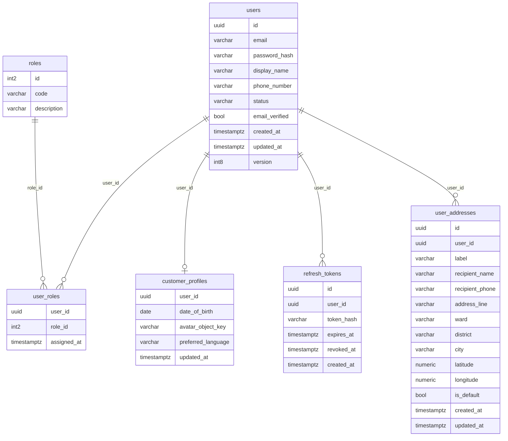
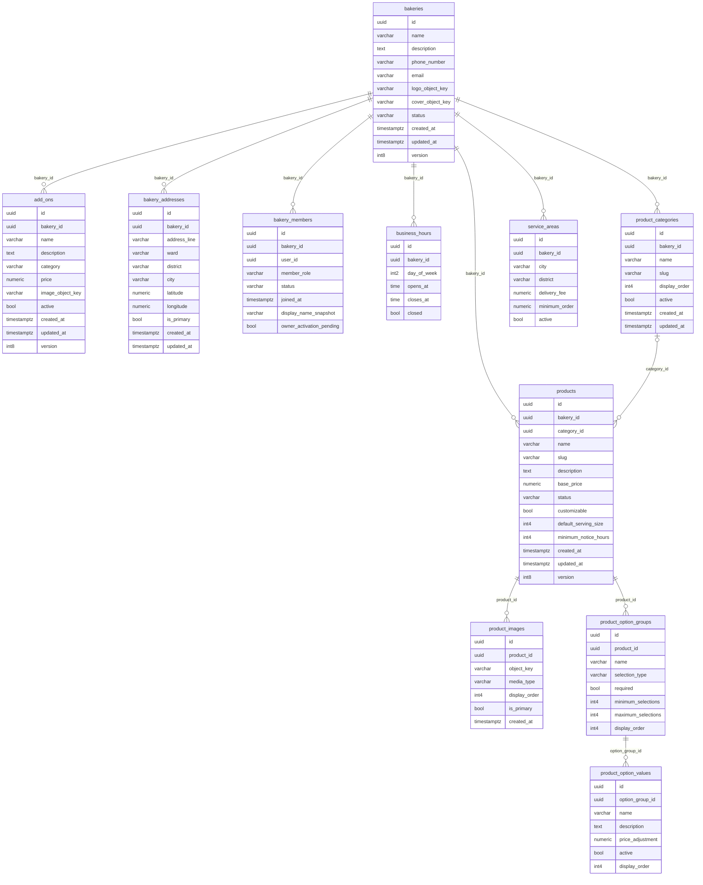
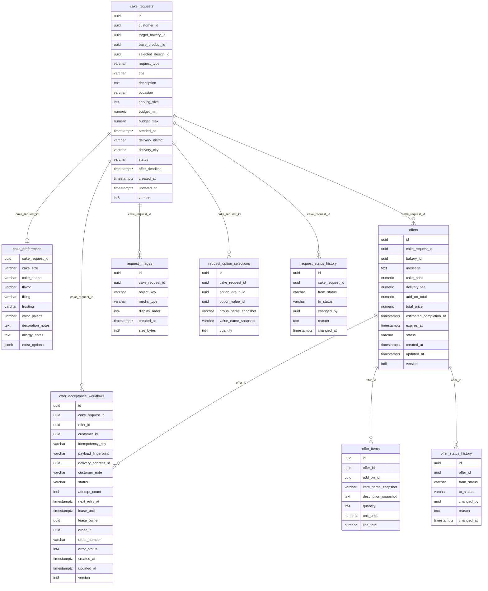
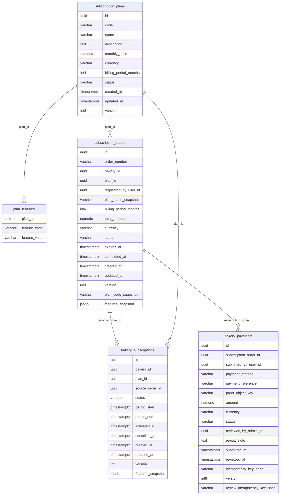
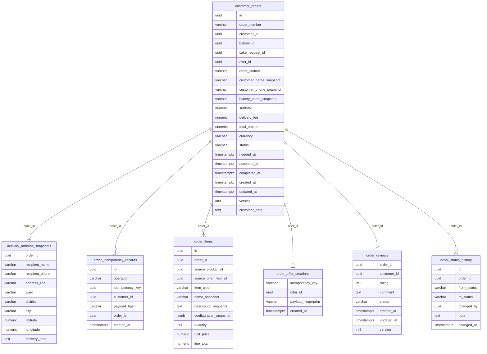
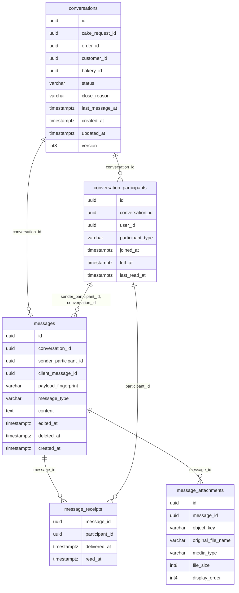
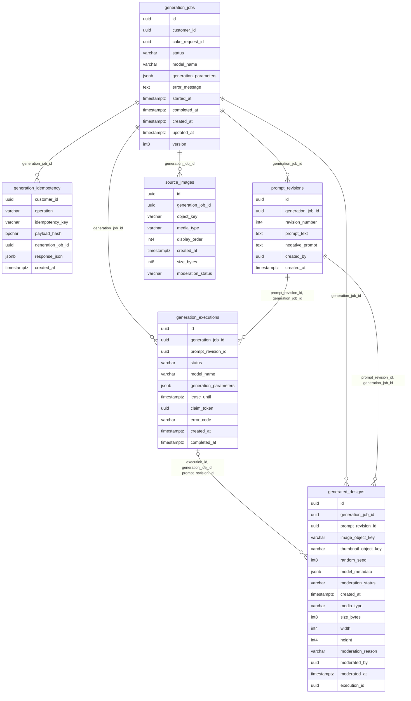

# Cơ sở dữ liệu và dòng dữ liệu Backend

7 database nghiệp vụ logic, 49 application tables, 17 file migration. Stack audit có 6 DB chạy ứng dụng/Flyway (43 bảng); Cake AI apply DDL vào DB riêng chỉ để kiểm schema (6 bảng), không có ứng dụng AI chạy. Flyway history không tính application table.

Thông tin DB đang có được đọc bằng BEGIN READ ONLY trong [existing metadata](evidence/existing-database-metadata.json). [Audit metadata](evidence/isolated-database-metadata.json) là schema sau migration nguồn mới. DB audit cùng một PostgreSQL instance nhưng user/database độc lập, không dùng lại volume của project bakery-local.

| Service | DB audit | Chế độ | Bảng nghiệp vụ | PostgreSQL |
|---|---|---|---|---|
| identity-service | identity_db | APPLICATION_FLYWAY | 6 | PostgreSQL 17.11 on x86_64-pc-linux-musl, compiled by gcc (Alpine 15.2.0) 15.2.0, 64-bit |
| bakery-service | bakery_db | APPLICATION_FLYWAY | 11 | PostgreSQL 17.11 on x86_64-pc-linux-musl, compiled by gcc (Alpine 15.2.0) 15.2.0, 64-bit |
| marketplace-service | marketplace_db | APPLICATION_FLYWAY | 9 | PostgreSQL 17.11 on x86_64-pc-linux-musl, compiled by gcc (Alpine 15.2.0) 15.2.0, 64-bit |
| subscription-service | subscription_db | APPLICATION_FLYWAY | 5 | PostgreSQL 17.11 on x86_64-pc-linux-musl, compiled by gcc (Alpine 15.2.0) 15.2.0, 64-bit |
| order-service | order_db | APPLICATION_FLYWAY | 7 | PostgreSQL 17.11 on x86_64-pc-linux-musl, compiled by gcc (Alpine 15.2.0) 15.2.0, 64-bit |
| chat-service | chat_db | APPLICATION_FLYWAY | 5 | PostgreSQL 17.11 on x86_64-pc-linux-musl, compiled by gcc (Alpine 15.2.0) 15.2.0, 64-bit |
| cake-ai-service | cake_ai_audit_schema | DDL_ONLY_NO_RUNNING_APPLICATION | 6 | PostgreSQL 17.11 on x86_64-pc-linux-musl, compiled by gcc (Alpine 15.2.0) 15.2.0, 64-bit |

## Ranh giới và nhất quán

UUID liên service là tham chiếu logic, không có FK xuyên DB. Identity sở hữu user/address/role; Bakery sở hữu catalog/membership; Marketplace giữ RFQ và commercial offer snapshot; Order giữ snapshot bất biến để lịch sử không đổi theo catalog; Subscription giữ plan/order/period snapshots; Chat giữ participant/message/receipt; Cake AI giữ revision/execution/design.

JPA @Transactional/TransactionTemplate bảo đảm trong từng datasource. REST ngoài transaction ở acceptance/approval không có XA; lease, idempotency và retry cung cấp nhất quán cuối cùng. Snapshot PII có chủ đích trong Order và không được in từ DB ở audit.

## Migration đã áp dụng

### identity-service

| Version | Script | Checksum | Success |
|---|---|---|---|
| 1 | V1__init_schema.sql | 614128868 | True |
| 2 | V2__seed_reference_data.sql | -1575144113 | True |

### bakery-service

| Version | Script | Checksum | Success |
|---|---|---|---|
| 1 | V1__init_schema.sql | 1533722610 | True |
| 2 | V2__member_display_snapshot.sql | -354642168 | True |
| 3 | V3__pending_owner_activation.sql | 357794335 | True |

### marketplace-service

| Version | Script | Checksum | Success |
|---|---|---|---|
| 1 | V1__init_schema.sql | 226949264 | True |
| 2 | V2__acceptance_workflow.sql | 1428283382 | True |

### subscription-service

| Version | Script | Checksum | Success |
|---|---|---|---|
| 1 | V1__init_schema.sql | 1189625265 | True |
| 2 | V2__seed_reference_data.sql | 1976342328 | True |
| 3 | V3__payment_idempotency.sql | 1462194315 | True |
| 4 | V4__subscription_snapshots.sql | -1885683841 | True |

### order-service

| Version | Script | Checksum | Success |
|---|---|---|---|
| 1 | V1__init_schema.sql | 1416040399 | True |
| 2 | V2__order_creation_idempotency.sql | 1364393665 | True |
| 3 | V3__offer_idempotency.sql | -1917223588 | True |

### chat-service

| Version | Script | Checksum | Success |
|---|---|---|---|
| 1 | V1__init_schema.sql | 1364923608 | True |

### cake-ai-service

Cake AI: DDL nguồn được chạy tuần tự bằng psql vào DB schema-only. Không tạo Flyway history giả và không gọi đây là migration do ứng dụng chạy.

## Từng bảng: columns, constraints, indexes, readers/writers

### identity-service · `customer_profiles`

Database `identity_db`, schema `public`. Entity: CustomerProfile [CustomerProfile.java:16](../../backend/identity-service/src/main/java/com/se193262/identityservice/feature/user/CustomerProfile.java#L16).

Thông tin hồ sơ CUSTOMER, phụ thuộc user nội bộ Identity. PK/FK/check bên dưới là định nghĩa thực trong PostgreSQL.

| Column | Type | Nullable | Default | Length / precision / scale |
|---|---|---|---|---|
| user_id | uuid / uuid | NO | None | None / None / None |
| date_of_birth | date / date | YES | None | None / None / None |
| avatar_object_key | character varying / varchar | YES | None | 512 / None / None |
| preferred_language | character varying / varchar | NO | 'vi'::character varying | 10 / None / None |
| updated_at | timestamp with time zone / timestamptz | NO | CURRENT_TIMESTAMP | None / None / None |

| Constraint | Loại p/u/f/c/x | Định nghĩa |
|---|---|---|
| customer_profiles_pkey | p | PRIMARY KEY (user_id) |
| fk_customer_profiles_user | f | FOREIGN KEY (user_id) REFERENCES users(id) ON DELETE CASCADE |

| Index | Định nghĩa |
|---|---|
| customer_profiles_pkey | CREATE UNIQUE INDEX customer_profiles_pkey ON public.customer_profiles USING btree (user_id) |

Audit/state columns: `updated_at`. Các enum/check hợp lệ nằm trong constraints; field không có check không được coi đã được DB enforce.

| API | Đọc/ghi/lock từ trace |
|---|---|

Nguồn entity/JDBC khác (gồm scheduler và cascade): [CustomerProfile.java:17](../../backend/identity-service/src/main/java/com/se193262/identityservice/feature/user/CustomerProfile.java#L17). Nếu bảng collection/history không hiện API trực tiếp, xem owner entity/cascade trong các liên kết này; không suy diễn bảng không được sử dụng.

### identity-service · `refresh_tokens`

Database `identity_db`, schema `public`. Entity: RefreshToken [RefreshToken.java:17](../../backend/identity-service/src/main/java/com/se193262/identityservice/feature/authentication/RefreshToken.java#L17).

Hash refresh, expiry/revokedAt để rotation và revoke family. PK/FK/check bên dưới là định nghĩa thực trong PostgreSQL.

| Column | Type | Nullable | Default | Length / precision / scale |
|---|---|---|---|---|
| id | uuid / uuid | NO | gen_random_uuid() | None / None / None |
| user_id | uuid / uuid | NO | None | None / None / None |
| token_hash | character varying / varchar | NO | None | 255 / None / None |
| expires_at | timestamp with time zone / timestamptz | NO | None | None / None / None |
| revoked_at | timestamp with time zone / timestamptz | YES | None | None / None / None |
| created_at | timestamp with time zone / timestamptz | NO | CURRENT_TIMESTAMP | None / None / None |

| Constraint | Loại p/u/f/c/x | Định nghĩa |
|---|---|---|
| ck_refresh_tokens_expiry | c | CHECK ((expires_at > created_at)) |
| fk_refresh_tokens_user | f | FOREIGN KEY (user_id) REFERENCES users(id) ON DELETE CASCADE |
| refresh_tokens_pkey | p | PRIMARY KEY (id) |
| refresh_tokens_token_hash_key | u | UNIQUE (token_hash) |

| Index | Định nghĩa |
|---|---|
| idx_refresh_tokens_expires_at | CREATE INDEX idx_refresh_tokens_expires_at ON public.refresh_tokens USING btree (expires_at) |
| idx_refresh_tokens_user_id | CREATE INDEX idx_refresh_tokens_user_id ON public.refresh_tokens USING btree (user_id) |
| refresh_tokens_pkey | CREATE UNIQUE INDEX refresh_tokens_pkey ON public.refresh_tokens USING btree (id) |
| refresh_tokens_token_hash_key | CREATE UNIQUE INDEX refresh_tokens_token_hash_key ON public.refresh_tokens USING btree (token_hash) |

Audit/state columns: `created_at`. Các enum/check hợp lệ nằm trong constraints; field không có check không được coi đã được DB enforce.

| API | Đọc/ghi/lock từ trace |
|---|---|
| [IDN-002](BACKEND_API_DETAILED_SPECIFICATION_VI.md#idn-002) | WRITE TokenSessionService.save |
| [IDN-003](BACKEND_API_DETAILED_SPECIFICATION_VI.md#idn-003) | READ TokenSessionService.findByTokenHashForUpdate |
| [IDN-005](BACKEND_API_DETAILED_SPECIFICATION_VI.md#idn-005) | CHECK/LOCK TokenSessionService.revokeAllActiveByUserId; READ TokenSessionService.findByTokenHashForUpdate; WRITE TokenSessionService.save |

Nguồn entity/JDBC khác (gồm scheduler và cascade): [RefreshToken.java:18](../../backend/identity-service/src/main/java/com/se193262/identityservice/feature/authentication/RefreshToken.java#L18). Nếu bảng collection/history không hiện API trực tiếp, xem owner entity/cascade trong các liên kết này; không suy diễn bảng không được sử dụng.

### identity-service · `roles`

Database `identity_db`, schema `public`. Entity: Role [Role.java:8](../../backend/identity-service/src/main/java/com/se193262/identityservice/feature/user/Role.java#L8).

Danh mục CUSTOMER/BAKERY_OWNER/ADMIN. PK/FK/check bên dưới là định nghĩa thực trong PostgreSQL.

| Column | Type | Nullable | Default | Length / precision / scale |
|---|---|---|---|---|
| id | smallint / int2 | NO | None | None / 16 / 0 |
| code | character varying / varchar | NO | None | 50 / None / None |
| description | character varying / varchar | YES | None | 255 / None / None |

| Constraint | Loại p/u/f/c/x | Định nghĩa |
|---|---|---|
| roles_code_check | c | CHECK (((code)::text = ANY ((ARRAY['CUSTOMER'::character varying, 'BAKERY_OWNER'::character varying, 'ADMIN'::character varying])::text[]))) |
| roles_code_key | u | UNIQUE (code) |
| roles_pkey | p | PRIMARY KEY (id) |

| Index | Định nghĩa |
|---|---|
| roles_code_key | CREATE UNIQUE INDEX roles_code_key ON public.roles USING btree (code) |
| roles_pkey | CREATE UNIQUE INDEX roles_pkey ON public.roles USING btree (id) |

Audit/state columns: . Các enum/check hợp lệ nằm trong constraints; field không có check không được coi đã được DB enforce.

| API | Đọc/ghi/lock từ trace |
|---|---|
| [IDN-006](BACKEND_API_DETAILED_SPECIFICATION_VI.md#idn-006) | READ AuthenticationServiceImpl.findByCode |
| [IDN-008](BACKEND_API_DETAILED_SPECIFICATION_VI.md#idn-008) | READ UserContextService.SQL JOIN |
| [IDN-009](BACKEND_API_DETAILED_SPECIFICATION_VI.md#idn-009) | READ UserContextService.SQL FROM; READ UserContextService.SQL JOIN |
| [IDN-010](BACKEND_API_DETAILED_SPECIFICATION_VI.md#idn-010) | READ UserContextService.SQL JOIN |

Nguồn entity/JDBC khác (gồm scheduler và cascade): [BakeryJwtAuthenticationConverter.java:18](../../backend/identity-service/src/main/java/com/se193262/identityservice/config/BakeryJwtAuthenticationConverter.java#L18), [BakeryJwtAuthenticationConverter.java:19](../../backend/identity-service/src/main/java/com/se193262/identityservice/config/BakeryJwtAuthenticationConverter.java#L19), [BakeryJwtAuthenticationConverter.java:20](../../backend/identity-service/src/main/java/com/se193262/identityservice/config/BakeryJwtAuthenticationConverter.java#L20), [JwtTokenService.java:38](../../backend/identity-service/src/main/java/com/se193262/identityservice/feature/authentication/JwtTokenService.java#L38), [JwtTokenService.java:55](../../backend/identity-service/src/main/java/com/se193262/identityservice/feature/authentication/JwtTokenService.java#L55), [UserProfileResponse.java:22](../../backend/identity-service/src/main/java/com/se193262/identityservice/feature/user/dto/UserProfileResponse.java#L22), [UserProfileResponse.java:29](../../backend/identity-service/src/main/java/com/se193262/identityservice/feature/user/dto/UserProfileResponse.java#L29), [UserProfileResponse.java:44](../../backend/identity-service/src/main/java/com/se193262/identityservice/feature/user/dto/UserProfileResponse.java#L44), [Role.java:9](../../backend/identity-service/src/main/java/com/se193262/identityservice/feature/user/Role.java#L9), [User.java:68](../../backend/identity-service/src/main/java/com/se193262/identityservice/feature/user/User.java#L68), [User.java:95](../../backend/identity-service/src/main/java/com/se193262/identityservice/feature/user/User.java#L95), [User.java:139](../../backend/identity-service/src/main/java/com/se193262/identityservice/feature/user/User.java#L139), [UserContextService.java:37](../../backend/identity-service/src/main/java/com/se193262/identityservice/feature/user/UserContextService.java#L37), [UserContextService.java:40](../../backend/identity-service/src/main/java/com/se193262/identityservice/feature/user/UserContextService.java#L40), [UserContextService.java:81](../../backend/identity-service/src/main/java/com/se193262/identityservice/feature/user/UserContextService.java#L81), [UserContextService.java:86](../../backend/identity-service/src/main/java/com/se193262/identityservice/feature/user/UserContextService.java#L86), [UserRepository.java:13](../../backend/identity-service/src/main/java/com/se193262/identityservice/feature/user/UserRepository.java#L13), [UserRepository.java:17](../../backend/identity-service/src/main/java/com/se193262/identityservice/feature/user/UserRepository.java#L17). Nếu bảng collection/history không hiện API trực tiếp, xem owner entity/cascade trong các liên kết này; không suy diễn bảng không được sử dụng.

### identity-service · `user_addresses`

Database `identity_db`, schema `public`. Entity: JDBC/record hoặc collection table; xem SQL catalogue.

Sổ địa chỉ giao của user; chưa có public CRUD API. PK/FK/check bên dưới là định nghĩa thực trong PostgreSQL.

| Column | Type | Nullable | Default | Length / precision / scale |
|---|---|---|---|---|
| id | uuid / uuid | NO | gen_random_uuid() | None / None / None |
| user_id | uuid / uuid | NO | None | None / None / None |
| label | character varying / varchar | NO | None | 80 / None / None |
| recipient_name | character varying / varchar | NO | None | 120 / None / None |
| recipient_phone | character varying / varchar | NO | None | 30 / None / None |
| address_line | character varying / varchar | NO | None | 255 / None / None |
| ward | character varying / varchar | YES | None | 120 / None / None |
| district | character varying / varchar | NO | None | 120 / None / None |
| city | character varying / varchar | NO | None | 120 / None / None |
| latitude | numeric / numeric | YES | None | None / 9 / 6 |
| longitude | numeric / numeric | YES | None | None / 10 / 6 |
| is_default | boolean / bool | NO | false | None / None / None |
| created_at | timestamp with time zone / timestamptz | NO | CURRENT_TIMESTAMP | None / None / None |
| updated_at | timestamp with time zone / timestamptz | NO | CURRENT_TIMESTAMP | None / None / None |

| Constraint | Loại p/u/f/c/x | Định nghĩa |
|---|---|---|
| ck_user_addresses_latitude | c | CHECK (((latitude IS NULL) OR ((latitude >= ('-90'::integer)::numeric) AND (latitude <= (90)::numeric)))) |
| ck_user_addresses_longitude | c | CHECK (((longitude IS NULL) OR ((longitude >= ('-180'::integer)::numeric) AND (longitude <= (180)::numeric)))) |
| fk_user_addresses_user | f | FOREIGN KEY (user_id) REFERENCES users(id) ON DELETE CASCADE |
| user_addresses_pkey | p | PRIMARY KEY (id) |

| Index | Định nghĩa |
|---|---|
| idx_user_addresses_user_id | CREATE INDEX idx_user_addresses_user_id ON public.user_addresses USING btree (user_id) |
| uq_user_addresses_one_default | CREATE UNIQUE INDEX uq_user_addresses_one_default ON public.user_addresses USING btree (user_id) WHERE (is_default = true) |
| user_addresses_pkey | CREATE UNIQUE INDEX user_addresses_pkey ON public.user_addresses USING btree (id) |

Audit/state columns: `created_at`, `updated_at`. Các enum/check hợp lệ nằm trong constraints; field không có check không được coi đã được DB enforce.

| API | Đọc/ghi/lock từ trace |
|---|---|
| [IDN-010](BACKEND_API_DETAILED_SPECIFICATION_VI.md#idn-010) | READ UserContextService.SQL FROM |

Nguồn entity/JDBC khác (gồm scheduler và cascade): [UserContextService.java:49](../../backend/identity-service/src/main/java/com/se193262/identityservice/feature/user/UserContextService.java#L49). Nếu bảng collection/history không hiện API trực tiếp, xem owner entity/cascade trong các liên kết này; không suy diễn bảng không được sử dụng.

### identity-service · `user_roles`

Database `identity_db`, schema `public`. Entity: JDBC/record hoặc collection table; xem SQL catalogue.

Quan hệ nhiều role trên một user; grant OWNER không xóa CUSTOMER. PK/FK/check bên dưới là định nghĩa thực trong PostgreSQL.

| Column | Type | Nullable | Default | Length / precision / scale |
|---|---|---|---|---|
| user_id | uuid / uuid | NO | None | None / None / None |
| role_id | smallint / int2 | NO | None | None / 16 / 0 |
| assigned_at | timestamp with time zone / timestamptz | NO | CURRENT_TIMESTAMP | None / None / None |

| Constraint | Loại p/u/f/c/x | Định nghĩa |
|---|---|---|
| fk_user_roles_role | f | FOREIGN KEY (role_id) REFERENCES roles(id) ON DELETE RESTRICT |
| fk_user_roles_user | f | FOREIGN KEY (user_id) REFERENCES users(id) ON DELETE CASCADE |
| user_roles_pkey | p | PRIMARY KEY (user_id, role_id) |

| Index | Định nghĩa |
|---|---|
| idx_user_roles_role_id | CREATE INDEX idx_user_roles_role_id ON public.user_roles USING btree (role_id) |
| user_roles_pkey | CREATE UNIQUE INDEX user_roles_pkey ON public.user_roles USING btree (user_id, role_id) |

Audit/state columns: `assigned_at`. Các enum/check hợp lệ nằm trong constraints; field không có check không được coi đã được DB enforce.

| API | Đọc/ghi/lock từ trace |
|---|---|
| [IDN-008](BACKEND_API_DETAILED_SPECIFICATION_VI.md#idn-008) | READ UserContextService.SQL FROM |
| [IDN-009](BACKEND_API_DETAILED_SPECIFICATION_VI.md#idn-009) | READ UserContextService.SQL FROM; WRITE UserContextService.SQL INTO |
| [IDN-010](BACKEND_API_DETAILED_SPECIFICATION_VI.md#idn-010) | READ UserContextService.SQL FROM |

Nguồn entity/JDBC khác (gồm scheduler và cascade): [User.java:64](../../backend/identity-service/src/main/java/com/se193262/identityservice/feature/user/User.java#L64), [UserContextService.java:37](../../backend/identity-service/src/main/java/com/se193262/identityservice/feature/user/UserContextService.java#L37), [UserContextService.java:85](../../backend/identity-service/src/main/java/com/se193262/identityservice/feature/user/UserContextService.java#L85). Nếu bảng collection/history không hiện API trực tiếp, xem owner entity/cascade trong các liên kết này; không suy diễn bảng không được sử dụng.

### identity-service · `users`

Database `identity_db`, schema `public`. Entity: User [User.java:24](../../backend/identity-service/src/main/java/com/se193262/identityservice/feature/user/User.java#L24).

Danh tính, password hash, trạng thái tài khoản và audit timestamps. PK/FK/check bên dưới là định nghĩa thực trong PostgreSQL.

| Column | Type | Nullable | Default | Length / precision / scale |
|---|---|---|---|---|
| id | uuid / uuid | NO | gen_random_uuid() | None / None / None |
| email | character varying / varchar | NO | None | 320 / None / None |
| password_hash | character varying / varchar | NO | None | 255 / None / None |
| display_name | character varying / varchar | NO | None | 120 / None / None |
| phone_number | character varying / varchar | YES | None | 30 / None / None |
| status | character varying / varchar | NO | 'ACTIVE'::character varying | 30 / None / None |
| email_verified | boolean / bool | NO | false | None / None / None |
| created_at | timestamp with time zone / timestamptz | NO | CURRENT_TIMESTAMP | None / None / None |
| updated_at | timestamp with time zone / timestamptz | NO | CURRENT_TIMESTAMP | None / None / None |
| version | bigint / int8 | NO | 0 | None / 64 / 0 |

| Constraint | Loại p/u/f/c/x | Định nghĩa |
|---|---|---|
| ck_users_status | c | CHECK (((status)::text = ANY ((ARRAY['PENDING'::character varying, 'ACTIVE'::character varying, 'BLOCKED'::character varying, 'DELETED'::character varying])::text[]))) |
| users_email_key | u | UNIQUE (email) |
| users_pkey | p | PRIMARY KEY (id) |

| Index | Định nghĩa |
|---|---|
| users_email_key | CREATE UNIQUE INDEX users_email_key ON public.users USING btree (email) |
| users_pkey | CREATE UNIQUE INDEX users_pkey ON public.users USING btree (id) |

Audit/state columns: `status`, `created_at`, `updated_at`, `version`. Các enum/check hợp lệ nằm trong constraints; field không có check không được coi đã được DB enforce.

| API | Đọc/ghi/lock từ trace |
|---|---|
| [IDN-002](BACKEND_API_DETAILED_SPECIFICATION_VI.md#idn-002) | READ AuthenticationServiceImpl.findById |
| [IDN-004](BACKEND_API_DETAILED_SPECIFICATION_VI.md#idn-004) | READ AuthenticationServiceImpl.findById |
| [IDN-005](BACKEND_API_DETAILED_SPECIFICATION_VI.md#idn-005) | READ TokenSessionService.findById |
| [IDN-006](BACKEND_API_DETAILED_SPECIFICATION_VI.md#idn-006) | READ AuthenticationServiceImpl.existsByEmail; WRITE AuthenticationServiceImpl.save |
| [IDN-008](BACKEND_API_DETAILED_SPECIFICATION_VI.md#idn-008) | READ UserContextService.SQL FROM |
| [IDN-009](BACKEND_API_DETAILED_SPECIFICATION_VI.md#idn-009) | READ UserContextService.SQL FROM |
| [IDN-010](BACKEND_API_DETAILED_SPECIFICATION_VI.md#idn-010) | READ UserContextService.SQL FROM |

Nguồn entity/JDBC khác (gồm scheduler và cascade): [SecurityConfig.java:80](../../backend/identity-service/src/main/java/com/se193262/identityservice/config/SecurityConfig.java#L80), [SecurityConfig.java:82](../../backend/identity-service/src/main/java/com/se193262/identityservice/config/SecurityConfig.java#L82), [SecurityConfig.java:84](../../backend/identity-service/src/main/java/com/se193262/identityservice/config/SecurityConfig.java#L84), [User.java:25](../../backend/identity-service/src/main/java/com/se193262/identityservice/feature/user/User.java#L25), [UserContextController.java:9](../../backend/identity-service/src/main/java/com/se193262/identityservice/feature/user/UserContextController.java#L9), [UserContextService.java:23](../../backend/identity-service/src/main/java/com/se193262/identityservice/feature/user/UserContextService.java#L23). Nếu bảng collection/history không hiện API trực tiếp, xem owner entity/cascade trong các liên kết này; không suy diễn bảng không được sử dụng.

## ER vật lý — identity-service

### bakery-service · `add_ons`

Database `bakery_db`, schema `public`. Entity: AddOn [AddOn.java:21](../../backend/bakery-service/src/main/java/com/se193262/bakeryservice/feature/addon/entity/AddOn.java#L21), AddOn [CatalogContracts.java:23](../../backend/bakery-service/src/main/java/com/se193262/bakeryservice/feature/catalog/dto/CatalogContracts.java#L23).

Phụ kiện có category/price/active, disable thay delete. PK/FK/check bên dưới là định nghĩa thực trong PostgreSQL.

| Column | Type | Nullable | Default | Length / precision / scale |
|---|---|---|---|---|
| id | uuid / uuid | NO | gen_random_uuid() | None / None / None |
| bakery_id | uuid / uuid | NO | None | None / None / None |
| name | character varying / varchar | NO | None | 160 / None / None |
| description | text / text | YES | None | None / None / None |
| category | character varying / varchar | NO | None | 80 / None / None |
| price | numeric / numeric | NO | None | None / 12 / 2 |
| image_object_key | character varying / varchar | YES | None | 512 / None / None |
| active | boolean / bool | NO | true | None / None / None |
| created_at | timestamp with time zone / timestamptz | NO | CURRENT_TIMESTAMP | None / None / None |
| updated_at | timestamp with time zone / timestamptz | NO | CURRENT_TIMESTAMP | None / None / None |
| version | bigint / int8 | NO | 0 | None / 64 / 0 |

| Constraint | Loại p/u/f/c/x | Định nghĩa |
|---|---|---|
| add_ons_pkey | p | PRIMARY KEY (id) |
| ck_add_ons_price | c | CHECK ((price >= (0)::numeric)) |
| fk_add_ons_bakery | f | FOREIGN KEY (bakery_id) REFERENCES bakeries(id) ON DELETE CASCADE |

| Index | Định nghĩa |
|---|---|
| add_ons_pkey | CREATE UNIQUE INDEX add_ons_pkey ON public.add_ons USING btree (id) |
| idx_add_ons_bakery_id | CREATE INDEX idx_add_ons_bakery_id ON public.add_ons USING btree (bakery_id) |

Audit/state columns: `created_at`, `updated_at`, `version`. Các enum/check hợp lệ nằm trong constraints; field không có check không được coi đã được DB enforce.

| API | Đọc/ghi/lock từ trace |
|---|---|
| [BKR-010](BACKEND_API_DETAILED_SPECIFICATION_VI.md#bkr-010) | READ AddOnServiceImpl.findAllByBakery_IdOrderByNameAsc |
| [BKR-011](BACKEND_API_DETAILED_SPECIFICATION_VI.md#bkr-011) | WRITE AddOnServiceImpl.saveAndFlush |
| [BKR-012](BACKEND_API_DETAILED_SPECIFICATION_VI.md#bkr-012) | READ AddOnServiceImpl.findByIdAndBakery_Id; WRITE AddOnServiceImpl.flush |
| [BKR-013](BACKEND_API_DETAILED_SPECIFICATION_VI.md#bkr-013) | READ AddOnServiceImpl.findByIdAndBakery_Id; WRITE AddOnServiceImpl.flush |
| [BKR-014](BACKEND_API_DETAILED_SPECIFICATION_VI.md#bkr-014) | READ AddOnServiceImpl.findByIdAndBakery_Id; WRITE AddOnServiceImpl.flush |
| [BKR-034](BACKEND_API_DETAILED_SPECIFICATION_VI.md#bkr-034) | READ PublicProductService.findAllByBakery_IdOrderByNameAsc |
| [BKR-035](BACKEND_API_DETAILED_SPECIFICATION_VI.md#bkr-035) | READ PublicProductService.findAllByBakery_IdOrderByNameAsc |
| [BKR-039](BACKEND_API_DETAILED_SPECIFICATION_VI.md#bkr-039) | READ CatalogServiceImpl.SQL from |
| [BKR-040](BACKEND_API_DETAILED_SPECIFICATION_VI.md#bkr-040) | READ CatalogServiceImpl.SQL from |
| [BKR-041](BACKEND_API_DETAILED_SPECIFICATION_VI.md#bkr-041) | READ CatalogQuoteService.findByIdAndBakery_Id |

Nguồn entity/JDBC khác (gồm scheduler và cascade): [AddOn.java:22](../../backend/bakery-service/src/main/java/com/se193262/bakeryservice/feature/addon/entity/AddOn.java#L22), [CatalogServiceImpl.java:110](../../backend/bakery-service/src/main/java/com/se193262/bakeryservice/feature/catalog/CatalogServiceImpl.java#L110). Nếu bảng collection/history không hiện API trực tiếp, xem owner entity/cascade trong các liên kết này; không suy diễn bảng không được sử dụng.

### bakery-service · `bakeries`

Database `bakery_db`, schema `public`. Entity: Bakery [Bakery.java:18](../../backend/bakery-service/src/main/java/com/se193262/bakeryservice/feature/bakery/entity/Bakery.java#L18), Bakery [CatalogContracts.java:15](../../backend/bakery-service/src/main/java/com/se193262/bakeryservice/feature/catalog/dto/CatalogContracts.java#L15).

Hồ sơ bakery, status và object keys logo/cover. PK/FK/check bên dưới là định nghĩa thực trong PostgreSQL.

| Column | Type | Nullable | Default | Length / precision / scale |
|---|---|---|---|---|
| id | uuid / uuid | NO | gen_random_uuid() | None / None / None |
| name | character varying / varchar | NO | None | 180 / None / None |
| description | text / text | YES | None | None / None / None |
| phone_number | character varying / varchar | NO | None | 30 / None / None |
| email | character varying / varchar | YES | None | 320 / None / None |
| logo_object_key | character varying / varchar | YES | None | 512 / None / None |
| cover_object_key | character varying / varchar | YES | None | 512 / None / None |
| status | character varying / varchar | NO | 'DRAFT'::character varying | 30 / None / None |
| created_at | timestamp with time zone / timestamptz | NO | CURRENT_TIMESTAMP | None / None / None |
| updated_at | timestamp with time zone / timestamptz | NO | CURRENT_TIMESTAMP | None / None / None |
| version | bigint / int8 | NO | 0 | None / 64 / 0 |

| Constraint | Loại p/u/f/c/x | Định nghĩa |
|---|---|---|
| bakeries_pkey | p | PRIMARY KEY (id) |
| ck_bakeries_status | c | CHECK (((status)::text = ANY ((ARRAY['DRAFT'::character varying, 'PENDING_APPROVAL'::character varying, 'ACTIVE'::character varying, 'SUSPENDED'::character varying, 'CLOSED'::character varying])::text[]))) |

| Index | Định nghĩa |
|---|---|
| bakeries_pkey | CREATE UNIQUE INDEX bakeries_pkey ON public.bakeries USING btree (id) |

Audit/state columns: `status`, `created_at`, `updated_at`, `version`. Các enum/check hợp lệ nằm trong constraints; field không có check không được coi đã được DB enforce.

| API | Đọc/ghi/lock từ trace |
|---|---|
| [BKR-001](BACKEND_API_DETAILED_SPECIFICATION_VI.md#bkr-001) | READ BakeryServiceImpl.search |
| [BKR-002](BACKEND_API_DETAILED_SPECIFICATION_VI.md#bkr-002) | READ BakeryMemberServiceImpl.existsById; READ BakeryServiceImpl.findById |
| [BKR-003](BACKEND_API_DETAILED_SPECIFICATION_VI.md#bkr-003) | READ BakeryServiceImpl.findById; WRITE BakeryServiceImpl.flush |
| [BKR-004](BACKEND_API_DETAILED_SPECIFICATION_VI.md#bkr-004) | READ BakeryServiceImpl.findById; READ PublicBakeryService.search |
| [BKR-005](BACKEND_API_DETAILED_SPECIFICATION_VI.md#bkr-005) | WRITE BakeryServiceImpl.saveAndFlush |
| [BKR-006](BACKEND_API_DETAILED_SPECIFICATION_VI.md#bkr-006) | READ BakeryServiceImpl.findById |
| [BKR-007](BACKEND_API_DETAILED_SPECIFICATION_VI.md#bkr-007) | READ BakeryServiceImpl.findById; WRITE BakeryServiceImpl.flush; WRITE BakeryServiceImpl.saveAndFlush |
| [BKR-008](BACKEND_API_DETAILED_SPECIFICATION_VI.md#bkr-008) | READ BakeryServiceImpl.findById; READ PublicBakeryService.findById |
| [BKR-009](BACKEND_API_DETAILED_SPECIFICATION_VI.md#bkr-009) | READ BakeryServiceImpl.findById; WRITE BakeryServiceImpl.flush |
| [BKR-010](BACKEND_API_DETAILED_SPECIFICATION_VI.md#bkr-010) | READ AddOnServiceImpl.findById |
| [BKR-011](BACKEND_API_DETAILED_SPECIFICATION_VI.md#bkr-011) | READ AddOnServiceImpl.findById |
| [BKR-015](BACKEND_API_DETAILED_SPECIFICATION_VI.md#bkr-015) | READ ProductCategoryServiceImpl.findById |
| [BKR-016](BACKEND_API_DETAILED_SPECIFICATION_VI.md#bkr-016) | READ ProductCategoryServiceImpl.findById |
| [BKR-019](BACKEND_API_DETAILED_SPECIFICATION_VI.md#bkr-019) | READ BakeryServiceImpl.findById; WRITE BakeryServiceImpl.flush |
| [BKR-020](BACKEND_API_DETAILED_SPECIFICATION_VI.md#bkr-020) | READ BakeryServiceImpl.findById; WRITE BakeryServiceImpl.flush |
| [BKR-021](BACKEND_API_DETAILED_SPECIFICATION_VI.md#bkr-021) | READ BakeryMemberServiceImpl.existsById |
| [BKR-022](BACKEND_API_DETAILED_SPECIFICATION_VI.md#bkr-022) | READ BakeryServiceImpl.findById |
| [BKR-023](BACKEND_API_DETAILED_SPECIFICATION_VI.md#bkr-023) | READ BakeryServiceImpl.findById |
| [BKR-024](BACKEND_API_DETAILED_SPECIFICATION_VI.md#bkr-024) | READ ProductServiceImpl.findById |
| [BKR-025](BACKEND_API_DETAILED_SPECIFICATION_VI.md#bkr-025) | READ ProductServiceImpl.findById |
| [BKR-033](BACKEND_API_DETAILED_SPECIFICATION_VI.md#bkr-033) | READ BakeryServiceImpl.findById; WRITE BakeryServiceImpl.flush |
| [BKR-036](BACKEND_API_DETAILED_SPECIFICATION_VI.md#bkr-036) | READ BakeryInternalService.findById |
| [BKR-037](BACKEND_API_DETAILED_SPECIFICATION_VI.md#bkr-037) | READ BakeryInternalService.existsById |
| [BKR-039](BACKEND_API_DETAILED_SPECIFICATION_VI.md#bkr-039) | READ CatalogServiceImpl.SQL from |
| [BKR-040](BACKEND_API_DETAILED_SPECIFICATION_VI.md#bkr-040) | READ CatalogServiceImpl.SQL from |

Nguồn entity/JDBC khác (gồm scheduler và cascade): [AddOnController.java:26](../../backend/bakery-service/src/main/java/com/se193262/bakeryservice/feature/addon/controller/AddOnController.java#L26), [AddOnServiceImpl.java:86](../../backend/bakery-service/src/main/java/com/se193262/bakeryservice/feature/addon/service/impl/AddOnServiceImpl.java#L86), [AdminBakeryController.java:25](../../backend/bakery-service/src/main/java/com/se193262/bakeryservice/feature/bakery/controller/AdminBakeryController.java#L25), [BakeryController.java:28](../../backend/bakery-service/src/main/java/com/se193262/bakeryservice/feature/bakery/controller/BakeryController.java#L28), [BakeryOnboardingController.java:21](../../backend/bakery-service/src/main/java/com/se193262/bakeryservice/feature/bakery/controller/BakeryOnboardingController.java#L21), [InternalBakeryController.java:19](../../backend/bakery-service/src/main/java/com/se193262/bakeryservice/feature/bakery/controller/InternalBakeryController.java#L19), [PublicBakeryController.java:17](../../backend/bakery-service/src/main/java/com/se193262/bakeryservice/feature/bakery/controller/PublicBakeryController.java#L17), [Bakery.java:19](../../backend/bakery-service/src/main/java/com/se193262/bakeryservice/feature/bakery/entity/Bakery.java#L19), [BakeryOnboardingServiceImpl.java:26](../../backend/bakery-service/src/main/java/com/se193262/bakeryservice/feature/bakery/service/impl/BakeryOnboardingServiceImpl.java#L26), [BakeryOnboardingServiceImpl.java:31](../../backend/bakery-service/src/main/java/com/se193262/bakeryservice/feature/bakery/service/impl/BakeryOnboardingServiceImpl.java#L31), [BakeryOnboardingServiceImpl.java:33](../../backend/bakery-service/src/main/java/com/se193262/bakeryservice/feature/bakery/service/impl/BakeryOnboardingServiceImpl.java#L33), [BakeryOnboardingServiceImpl.java:43](../../backend/bakery-service/src/main/java/com/se193262/bakeryservice/feature/bakery/service/impl/BakeryOnboardingServiceImpl.java#L43), [BakeryOnboardingServiceImpl.java:58](../../backend/bakery-service/src/main/java/com/se193262/bakeryservice/feature/bakery/service/impl/BakeryOnboardingServiceImpl.java#L58), [BakeryOnboardingServiceImpl.java:59](../../backend/bakery-service/src/main/java/com/se193262/bakeryservice/feature/bakery/service/impl/BakeryOnboardingServiceImpl.java#L59), [BakeryOnboardingServiceImpl.java:60](../../backend/bakery-service/src/main/java/com/se193262/bakeryservice/feature/bakery/service/impl/BakeryOnboardingServiceImpl.java#L60), [BakeryOnboardingServiceImpl.java:61](../../backend/bakery-service/src/main/java/com/se193262/bakeryservice/feature/bakery/service/impl/BakeryOnboardingServiceImpl.java#L61), [BakeryOnboardingServiceImpl.java:70](../../backend/bakery-service/src/main/java/com/se193262/bakeryservice/feature/bakery/service/impl/BakeryOnboardingServiceImpl.java#L70), [BakeryOnboardingServiceImpl.java:78](../../backend/bakery-service/src/main/java/com/se193262/bakeryservice/feature/bakery/service/impl/BakeryOnboardingServiceImpl.java#L78), [BakeryServiceImpl.java:215](../../backend/bakery-service/src/main/java/com/se193262/bakeryservice/feature/bakery/service/impl/BakeryServiceImpl.java#L215), [BakeryServiceImpl.java:228](../../backend/bakery-service/src/main/java/com/se193262/bakeryservice/feature/bakery/service/impl/BakeryServiceImpl.java#L228), [CatalogServiceImpl.java:27](../../backend/bakery-service/src/main/java/com/se193262/bakeryservice/feature/catalog/CatalogServiceImpl.java#L27), [ProductCategoryController.java:22](../../backend/bakery-service/src/main/java/com/se193262/bakeryservice/feature/category/controller/ProductCategoryController.java#L22), [BakeryMemberController.java:16](../../backend/bakery-service/src/main/java/com/se193262/bakeryservice/feature/member/controller/BakeryMemberController.java#L16), [ProductController.java:31](../../backend/bakery-service/src/main/java/com/se193262/bakeryservice/feature/product/controller/ProductController.java#L31), [ProductServiceImpl.java:230](../../backend/bakery-service/src/main/java/com/se193262/bakeryservice/feature/product/service/impl/ProductServiceImpl.java#L230), [SubscriptionEntitlementClient.java:47](../../backend/bakery-service/src/main/java/com/se193262/bakeryservice/infrastructure/client/SubscriptionEntitlementClient.java#L47), [BakeryOwnerActivationJob.java:27](../../backend/bakery-service/src/main/java/com/se193262/bakeryservice/infrastructure/scheduler/BakeryOwnerActivationJob.java#L27), [BakeryOwnerActivationJob.java:29](../../backend/bakery-service/src/main/java/com/se193262/bakeryservice/infrastructure/scheduler/BakeryOwnerActivationJob.java#L29), [BakeryOwnerActivationJob.java:31](../../backend/bakery-service/src/main/java/com/se193262/bakeryservice/infrastructure/scheduler/BakeryOwnerActivationJob.java#L31), [BakeryOwnerActivationJob.java:32](../../backend/bakery-service/src/main/java/com/se193262/bakeryservice/infrastructure/scheduler/BakeryOwnerActivationJob.java#L32), [SecurityConfig.java:56](../../backend/bakery-service/src/main/java/com/se193262/bakeryservice/security/SecurityConfig.java#L56), [SecurityConfig.java:58](../../backend/bakery-service/src/main/java/com/se193262/bakeryservice/security/SecurityConfig.java#L58), [SecurityConfig.java:59](../../backend/bakery-service/src/main/java/com/se193262/bakeryservice/security/SecurityConfig.java#L59), [SecurityConfig.java:63](../../backend/bakery-service/src/main/java/com/se193262/bakeryservice/security/SecurityConfig.java#L63), [SecurityConfig.java:65](../../backend/bakery-service/src/main/java/com/se193262/bakeryservice/security/SecurityConfig.java#L65), [SecurityConfig.java:67](../../backend/bakery-service/src/main/java/com/se193262/bakeryservice/security/SecurityConfig.java#L67), [SecurityConfig.java:70](../../backend/bakery-service/src/main/java/com/se193262/bakeryservice/security/SecurityConfig.java#L70), [SecurityConfig.java:79](../../backend/bakery-service/src/main/java/com/se193262/bakeryservice/security/SecurityConfig.java#L79), [SecurityConfig.java:80](../../backend/bakery-service/src/main/java/com/se193262/bakeryservice/security/SecurityConfig.java#L80), [SecurityConfig.java:83](../../backend/bakery-service/src/main/java/com/se193262/bakeryservice/security/SecurityConfig.java#L83), [SecurityConfig.java:84](../../backend/bakery-service/src/main/java/com/se193262/bakeryservice/security/SecurityConfig.java#L84), [SecurityConfig.java:86](../../backend/bakery-service/src/main/java/com/se193262/bakeryservice/security/SecurityConfig.java#L86), [SecurityConfig.java:88](../../backend/bakery-service/src/main/java/com/se193262/bakeryservice/security/SecurityConfig.java#L88), [SecurityConfig.java:91](../../backend/bakery-service/src/main/java/com/se193262/bakeryservice/security/SecurityConfig.java#L91), [SecurityConfig.java:92](../../backend/bakery-service/src/main/java/com/se193262/bakeryservice/security/SecurityConfig.java#L92), [SecurityConfig.java:93](../../backend/bakery-service/src/main/java/com/se193262/bakeryservice/security/SecurityConfig.java#L93), [SecurityConfig.java:95](../../backend/bakery-service/src/main/java/com/se193262/bakeryservice/security/SecurityConfig.java#L95), [SecurityConfig.java:98](../../backend/bakery-service/src/main/java/com/se193262/bakeryservice/security/SecurityConfig.java#L98), [SecurityConfig.java:99](../../backend/bakery-service/src/main/java/com/se193262/bakeryservice/security/SecurityConfig.java#L99), [SecurityConfig.java:100](../../backend/bakery-service/src/main/java/com/se193262/bakeryservice/security/SecurityConfig.java#L100), [SecurityConfig.java:103](../../backend/bakery-service/src/main/java/com/se193262/bakeryservice/security/SecurityConfig.java#L103), [SecurityConfig.java:104](../../backend/bakery-service/src/main/java/com/se193262/bakeryservice/security/SecurityConfig.java#L104), [SecurityConfig.java:105](../../backend/bakery-service/src/main/java/com/se193262/bakeryservice/security/SecurityConfig.java#L105), [SecurityConfig.java:106](../../backend/bakery-service/src/main/java/com/se193262/bakeryservice/security/SecurityConfig.java#L106), [SecurityConfig.java:109](../../backend/bakery-service/src/main/java/com/se193262/bakeryservice/security/SecurityConfig.java#L109), [SecurityConfig.java:110](../../backend/bakery-service/src/main/java/com/se193262/bakeryservice/security/SecurityConfig.java#L110), [SecurityConfig.java:111](../../backend/bakery-service/src/main/java/com/se193262/bakeryservice/security/SecurityConfig.java#L111), [SecurityConfig.java:114](../../backend/bakery-service/src/main/java/com/se193262/bakeryservice/security/SecurityConfig.java#L114), [SecurityConfig.java:115](../../backend/bakery-service/src/main/java/com/se193262/bakeryservice/security/SecurityConfig.java#L115), [SecurityConfig.java:118](../../backend/bakery-service/src/main/java/com/se193262/bakeryservice/security/SecurityConfig.java#L118), [SecurityConfig.java:119](../../backend/bakery-service/src/main/java/com/se193262/bakeryservice/security/SecurityConfig.java#L119), [SecurityConfig.java:122](../../backend/bakery-service/src/main/java/com/se193262/bakeryservice/security/SecurityConfig.java#L122). Nếu bảng collection/history không hiện API trực tiếp, xem owner entity/cascade trong các liên kết này; không suy diễn bảng không được sử dụng.

### bakery-service · `bakery_addresses`

Database `bakery_db`, schema `public`. Entity: BakeryAddress [BakeryAddress.java:19](../../backend/bakery-service/src/main/java/com/se193262/bakeryservice/feature/bakery/entity/BakeryAddress.java#L19).

Địa chỉ vận hành; primary address phục vụ checklist. PK/FK/check bên dưới là định nghĩa thực trong PostgreSQL.

| Column | Type | Nullable | Default | Length / precision / scale |
|---|---|---|---|---|
| id | uuid / uuid | NO | gen_random_uuid() | None / None / None |
| bakery_id | uuid / uuid | NO | None | None / None / None |
| address_line | character varying / varchar | NO | None | 255 / None / None |
| ward | character varying / varchar | YES | None | 120 / None / None |
| district | character varying / varchar | NO | None | 120 / None / None |
| city | character varying / varchar | NO | None | 120 / None / None |
| latitude | numeric / numeric | YES | None | None / 9 / 6 |
| longitude | numeric / numeric | YES | None | None / 10 / 6 |
| is_primary | boolean / bool | NO | false | None / None / None |
| created_at | timestamp with time zone / timestamptz | NO | CURRENT_TIMESTAMP | None / None / None |
| updated_at | timestamp with time zone / timestamptz | NO | CURRENT_TIMESTAMP | None / None / None |

| Constraint | Loại p/u/f/c/x | Định nghĩa |
|---|---|---|
| bakery_addresses_pkey | p | PRIMARY KEY (id) |
| ck_bakery_addresses_latitude | c | CHECK (((latitude IS NULL) OR ((latitude >= ('-90'::integer)::numeric) AND (latitude <= (90)::numeric)))) |
| ck_bakery_addresses_longitude | c | CHECK (((longitude IS NULL) OR ((longitude >= ('-180'::integer)::numeric) AND (longitude <= (180)::numeric)))) |
| fk_bakery_addresses_bakery | f | FOREIGN KEY (bakery_id) REFERENCES bakeries(id) ON DELETE CASCADE |

| Index | Định nghĩa |
|---|---|
| bakery_addresses_pkey | CREATE UNIQUE INDEX bakery_addresses_pkey ON public.bakery_addresses USING btree (id) |
| idx_bakery_addresses_bakery_id | CREATE INDEX idx_bakery_addresses_bakery_id ON public.bakery_addresses USING btree (bakery_id) |
| uq_bakery_addresses_one_primary | CREATE UNIQUE INDEX uq_bakery_addresses_one_primary ON public.bakery_addresses USING btree (bakery_id) WHERE (is_primary = true) |

Audit/state columns: `created_at`, `updated_at`. Các enum/check hợp lệ nằm trong constraints; field không có check không được coi đã được DB enforce.

| API | Đọc/ghi/lock từ trace |
|---|---|
| [BKR-001](BACKEND_API_DETAILED_SPECIFICATION_VI.md#bkr-001) | READ BakeryServiceImpl.findAllByBakery_Id |
| [BKR-002](BACKEND_API_DETAILED_SPECIFICATION_VI.md#bkr-002) | READ BakeryServiceImpl.findAllByBakery_Id |
| [BKR-003](BACKEND_API_DETAILED_SPECIFICATION_VI.md#bkr-003) | READ BakeryServiceImpl.findAllByBakery_Id |
| [BKR-004](BACKEND_API_DETAILED_SPECIFICATION_VI.md#bkr-004) | READ BakeryServiceImpl.findAllByBakery_Id; READ PublicBakeryService.findAllByBakery_Id |
| [BKR-005](BACKEND_API_DETAILED_SPECIFICATION_VI.md#bkr-005) | READ BakeryServiceImpl.findAllByBakery_Id |
| [BKR-006](BACKEND_API_DETAILED_SPECIFICATION_VI.md#bkr-006) | READ BakeryServiceImpl.findAllByBakery_Id |
| [BKR-007](BACKEND_API_DETAILED_SPECIFICATION_VI.md#bkr-007) | READ BakeryServiceImpl.findAllByBakery_Id; WRITE BakeryServiceImpl.deleteAll; WRITE BakeryServiceImpl.flush; WRITE BakeryServiceImpl.saveAll |
| [BKR-008](BACKEND_API_DETAILED_SPECIFICATION_VI.md#bkr-008) | READ BakeryServiceImpl.findAllByBakery_Id |
| [BKR-009](BACKEND_API_DETAILED_SPECIFICATION_VI.md#bkr-009) | READ BakeryServiceImpl.findAllByBakery_Id |
| [BKR-022](BACKEND_API_DETAILED_SPECIFICATION_VI.md#bkr-022) | READ BakeryServiceImpl.findAllByBakery_Id |
| [BKR-023](BACKEND_API_DETAILED_SPECIFICATION_VI.md#bkr-023) | READ BakeryServiceImpl.findAllByBakery_Id; WRITE BakeryServiceImpl.deleteAll; WRITE BakeryServiceImpl.flush; WRITE BakeryServiceImpl.saveAll |
| [BKR-033](BACKEND_API_DETAILED_SPECIFICATION_VI.md#bkr-033) | READ BakeryServiceImpl.findAllByBakery_Id |
| [BKR-034](BACKEND_API_DETAILED_SPECIFICATION_VI.md#bkr-034) | READ PublicProductService.findAllByBakery_Id |
| [BKR-036](BACKEND_API_DETAILED_SPECIFICATION_VI.md#bkr-036) | READ BakeryInternalService.findAllByBakery_Id |

Nguồn entity/JDBC khác (gồm scheduler và cascade): [BakeryAddress.java:20](../../backend/bakery-service/src/main/java/com/se193262/bakeryservice/feature/bakery/entity/BakeryAddress.java#L20). Nếu bảng collection/history không hiện API trực tiếp, xem owner entity/cascade trong các liên kết này; không suy diễn bảng không được sử dụng.

### bakery-service · `bakery_members`

Database `bakery_db`, schema `public`. Entity: BakeryMember [BakeryMember.java:20](../../backend/bakery-service/src/main/java/com/se193262/bakeryservice/feature/member/entity/BakeryMember.java#L20).

Membership user–bakery, OWNER/ACTIVE và pending owner activation. PK/FK/check bên dưới là định nghĩa thực trong PostgreSQL.

| Column | Type | Nullable | Default | Length / precision / scale |
|---|---|---|---|---|
| id | uuid / uuid | NO | gen_random_uuid() | None / None / None |
| bakery_id | uuid / uuid | NO | None | None / None / None |
| user_id | uuid / uuid | NO | None | None / None / None |
| member_role | character varying / varchar | NO | None | 30 / None / None |
| status | character varying / varchar | NO | 'ACTIVE'::character varying | 30 / None / None |
| joined_at | timestamp with time zone / timestamptz | NO | CURRENT_TIMESTAMP | None / None / None |
| display_name_snapshot | character varying / varchar | YES | None | 120 / None / None |
| owner_activation_pending | boolean / bool | NO | false | None / None / None |

| Constraint | Loại p/u/f/c/x | Định nghĩa |
|---|---|---|
| bakery_members_pkey | p | PRIMARY KEY (id) |
| ck_bakery_members_role | c | CHECK (((member_role)::text = 'OWNER'::text)) |
| ck_bakery_members_status | c | CHECK (((status)::text = ANY ((ARRAY['INVITED'::character varying, 'ACTIVE'::character varying, 'INACTIVE'::character varying])::text[]))) |
| fk_bakery_members_bakery | f | FOREIGN KEY (bakery_id) REFERENCES bakeries(id) ON DELETE CASCADE |
| uq_bakery_members_bakery_user | u | UNIQUE (bakery_id, user_id) |

| Index | Định nghĩa |
|---|---|
| bakery_members_pkey | CREATE UNIQUE INDEX bakery_members_pkey ON public.bakery_members USING btree (id) |
| idx_bakery_members_pending_owner_activation | CREATE INDEX idx_bakery_members_pending_owner_activation ON public.bakery_members USING btree (bakery_id) WHERE (owner_activation_pending AND ((status)::text = 'ACTIVE'::text)) |
| idx_bakery_members_user_id | CREATE INDEX idx_bakery_members_user_id ON public.bakery_members USING btree (user_id) |
| uq_bakery_members_bakery_user | CREATE UNIQUE INDEX uq_bakery_members_bakery_user ON public.bakery_members USING btree (bakery_id, user_id) |

Audit/state columns: `status`. Các enum/check hợp lệ nằm trong constraints; field không có check không được coi đã được DB enforce.

| API | Đọc/ghi/lock từ trace |
|---|---|
| [BKR-002](BACKEND_API_DETAILED_SPECIFICATION_VI.md#bkr-002) | READ BakeryMemberServiceImpl.findAllByBakery_IdOrderByJoinedAtAsc |
| [BKR-003](BACKEND_API_DETAILED_SPECIFICATION_VI.md#bkr-003) | READ BakeryOnboardingServiceImpl.findPendingActivations; WRITE BakeryOnboardingServiceImpl.markOwnerActivationComplete |
| [BKR-005](BACKEND_API_DETAILED_SPECIFICATION_VI.md#bkr-005) | WRITE BakeryServiceImpl.save |
| [BKR-006](BACKEND_API_DETAILED_SPECIFICATION_VI.md#bkr-006) | READ BakeryOnboardingServiceImpl.findFirstByUserIdAndStatusOrderByJoinedAtAscIdAsc |
| [BKR-007](BACKEND_API_DETAILED_SPECIFICATION_VI.md#bkr-007) | CHECK/LOCK BakeryOnboardingServiceImpl.tryLockOnboarding; READ BakeryOnboardingServiceImpl.findFirstByUserIdAndStatusOrderByJoinedAtAscIdAsc; WRITE BakeryServiceImpl.save |
| [BKR-021](BACKEND_API_DETAILED_SPECIFICATION_VI.md#bkr-021) | READ BakeryMemberServiceImpl.findAllByBakery_IdOrderByJoinedAtAsc |
| [BKR-022](BACKEND_API_DETAILED_SPECIFICATION_VI.md#bkr-022) | READ BakeryOnboardingServiceImpl.findByBakery_IdAndUserId; WRITE BakeryOnboardingServiceImpl.markOwnerActivationComplete |
| [BKR-037](BACKEND_API_DETAILED_SPECIFICATION_VI.md#bkr-037) | READ BakeryInternalService.findByBakery_IdAndUserId |
| [BKR-038](BACKEND_API_DETAILED_SPECIFICATION_VI.md#bkr-038) | READ BakeryOnboardingServiceImpl.findPendingActivations; WRITE BakeryOnboardingServiceImpl.markOwnerActivationComplete |
| [BKR-042](BACKEND_API_DETAILED_SPECIFICATION_VI.md#bkr-042) | READ CatalogServiceImpl.SQL from |

Nguồn entity/JDBC khác (gồm scheduler và cascade): [CatalogServiceImpl.java:66](../../backend/bakery-service/src/main/java/com/se193262/bakeryservice/feature/catalog/CatalogServiceImpl.java#L66), [BakeryMember.java:21](../../backend/bakery-service/src/main/java/com/se193262/bakeryservice/feature/member/entity/BakeryMember.java#L21). Nếu bảng collection/history không hiện API trực tiếp, xem owner entity/cascade trong các liên kết này; không suy diễn bảng không được sử dụng.

### bakery-service · `business_hours`

Database `bakery_db`, schema `public`. Entity: BusinessHour [BakeryOperationsDto.java:45](../../backend/bakery-service/src/main/java/com/se193262/bakeryservice/feature/bakery/dto/BakeryOperationsDto.java#L45), BusinessHour [BusinessHour.java:16](../../backend/bakery-service/src/main/java/com/se193262/bakeryservice/feature/bakery/entity/BusinessHour.java#L16).

Giờ mở/đóng theo weekday của bakery. PK/FK/check bên dưới là định nghĩa thực trong PostgreSQL.

| Column | Type | Nullable | Default | Length / precision / scale |
|---|---|---|---|---|
| id | uuid / uuid | NO | gen_random_uuid() | None / None / None |
| bakery_id | uuid / uuid | NO | None | None / None / None |
| day_of_week | smallint / int2 | NO | None | None / 16 / 0 |
| opens_at | time without time zone / time | YES | None | None / None / None |
| closes_at | time without time zone / time | YES | None | None / None / None |
| closed | boolean / bool | NO | false | None / None / None |

| Constraint | Loại p/u/f/c/x | Định nghĩa |
|---|---|---|
| business_hours_pkey | p | PRIMARY KEY (id) |
| ck_business_hours_day | c | CHECK (((day_of_week >= 1) AND (day_of_week <= 7))) |
| ck_business_hours_time | c | CHECK (((closed = true) OR ((opens_at IS NOT NULL) AND (closes_at IS NOT NULL) AND (opens_at < closes_at)))) |
| fk_business_hours_bakery | f | FOREIGN KEY (bakery_id) REFERENCES bakeries(id) ON DELETE CASCADE |
| uq_business_hours_bakery_day | u | UNIQUE (bakery_id, day_of_week) |

| Index | Định nghĩa |
|---|---|
| business_hours_pkey | CREATE UNIQUE INDEX business_hours_pkey ON public.business_hours USING btree (id) |
| uq_business_hours_bakery_day | CREATE UNIQUE INDEX uq_business_hours_bakery_day ON public.business_hours USING btree (bakery_id, day_of_week) |

Audit/state columns: . Các enum/check hợp lệ nằm trong constraints; field không có check không được coi đã được DB enforce.

| API | Đọc/ghi/lock từ trace |
|---|---|
| [BKR-001](BACKEND_API_DETAILED_SPECIFICATION_VI.md#bkr-001) | READ BakeryServiceImpl.findAllByBakery_Id |
| [BKR-002](BACKEND_API_DETAILED_SPECIFICATION_VI.md#bkr-002) | READ BakeryServiceImpl.findAllByBakery_Id |
| [BKR-003](BACKEND_API_DETAILED_SPECIFICATION_VI.md#bkr-003) | READ BakeryServiceImpl.findAllByBakery_Id |
| [BKR-004](BACKEND_API_DETAILED_SPECIFICATION_VI.md#bkr-004) | READ BakeryServiceImpl.findAllByBakery_Id |
| [BKR-005](BACKEND_API_DETAILED_SPECIFICATION_VI.md#bkr-005) | READ BakeryServiceImpl.findAllByBakery_Id |
| [BKR-006](BACKEND_API_DETAILED_SPECIFICATION_VI.md#bkr-006) | READ BakeryServiceImpl.findAllByBakery_Id |
| [BKR-007](BACKEND_API_DETAILED_SPECIFICATION_VI.md#bkr-007) | READ BakeryServiceImpl.findAllByBakery_Id; WRITE BakeryServiceImpl.deleteAll; WRITE BakeryServiceImpl.flush; WRITE BakeryServiceImpl.saveAll |
| [BKR-008](BACKEND_API_DETAILED_SPECIFICATION_VI.md#bkr-008) | READ BakeryServiceImpl.findAllByBakery_Id |
| [BKR-009](BACKEND_API_DETAILED_SPECIFICATION_VI.md#bkr-009) | READ BakeryServiceImpl.findAllByBakery_Id |
| [BKR-022](BACKEND_API_DETAILED_SPECIFICATION_VI.md#bkr-022) | READ BakeryServiceImpl.findAllByBakery_Id |
| [BKR-023](BACKEND_API_DETAILED_SPECIFICATION_VI.md#bkr-023) | READ BakeryServiceImpl.findAllByBakery_Id; WRITE BakeryServiceImpl.deleteAll; WRITE BakeryServiceImpl.flush; WRITE BakeryServiceImpl.saveAll |
| [BKR-033](BACKEND_API_DETAILED_SPECIFICATION_VI.md#bkr-033) | READ BakeryServiceImpl.findAllByBakery_Id |

Nguồn entity/JDBC khác (gồm scheduler và cascade): [BusinessHour.java:17](../../backend/bakery-service/src/main/java/com/se193262/bakeryservice/feature/bakery/entity/BusinessHour.java#L17). Nếu bảng collection/history không hiện API trực tiếp, xem owner entity/cascade trong các liên kết này; không suy diễn bảng không được sử dụng.

### bakery-service · `product_categories`

Database `bakery_db`, schema `public`. Entity: ProductCategory [ProductCategory.java:19](../../backend/bakery-service/src/main/java/com/se193262/bakeryservice/feature/category/entity/ProductCategory.java#L19).

Phân loại catalog theo bakery, unique slug trong bakery. PK/FK/check bên dưới là định nghĩa thực trong PostgreSQL.

| Column | Type | Nullable | Default | Length / precision / scale |
|---|---|---|---|---|
| id | uuid / uuid | NO | gen_random_uuid() | None / None / None |
| bakery_id | uuid / uuid | NO | None | None / None / None |
| name | character varying / varchar | NO | None | 120 / None / None |
| slug | character varying / varchar | NO | None | 140 / None / None |
| display_order | integer / int4 | NO | 0 | None / 32 / 0 |
| active | boolean / bool | NO | true | None / None / None |
| created_at | timestamp with time zone / timestamptz | NO | CURRENT_TIMESTAMP | None / None / None |
| updated_at | timestamp with time zone / timestamptz | NO | CURRENT_TIMESTAMP | None / None / None |

| Constraint | Loại p/u/f/c/x | Định nghĩa |
|---|---|---|
| fk_product_categories_bakery | f | FOREIGN KEY (bakery_id) REFERENCES bakeries(id) ON DELETE CASCADE |
| product_categories_pkey | p | PRIMARY KEY (id) |
| uq_product_categories_bakery_slug | u | UNIQUE (bakery_id, slug) |

| Index | Định nghĩa |
|---|---|
| product_categories_pkey | CREATE UNIQUE INDEX product_categories_pkey ON public.product_categories USING btree (id) |
| uq_product_categories_bakery_slug | CREATE UNIQUE INDEX uq_product_categories_bakery_slug ON public.product_categories USING btree (bakery_id, slug) |

Audit/state columns: `created_at`, `updated_at`. Các enum/check hợp lệ nằm trong constraints; field không có check không được coi đã được DB enforce.

| API | Đọc/ghi/lock từ trace |
|---|---|
| [BKR-015](BACKEND_API_DETAILED_SPECIFICATION_VI.md#bkr-015) | READ ProductCategoryServiceImpl.findAllByBakery_IdOrderByDisplayOrderAsc |
| [BKR-016](BACKEND_API_DETAILED_SPECIFICATION_VI.md#bkr-016) | READ ProductCategoryServiceImpl.existsByBakery_IdAndSlug; WRITE ProductCategoryServiceImpl.saveAndFlush |
| [BKR-017](BACKEND_API_DETAILED_SPECIFICATION_VI.md#bkr-017) | READ ProductCategoryServiceImpl.findByIdAndBakery_Id; WRITE ProductCategoryServiceImpl.delete; WRITE ProductCategoryServiceImpl.flush |
| [BKR-018](BACKEND_API_DETAILED_SPECIFICATION_VI.md#bkr-018) | READ ProductCategoryServiceImpl.existsByBakery_IdAndSlugAndIdNot; READ ProductCategoryServiceImpl.findByIdAndBakery_Id; WRITE ProductCategoryServiceImpl.flush |
| [BKR-025](BACKEND_API_DETAILED_SPECIFICATION_VI.md#bkr-025) | READ ProductServiceImpl.findById |
| [BKR-026](BACKEND_API_DETAILED_SPECIFICATION_VI.md#bkr-026) | READ ProductServiceImpl.findById |

Nguồn entity/JDBC khác (gồm scheduler và cascade): [ProductCategory.java:20](../../backend/bakery-service/src/main/java/com/se193262/bakeryservice/feature/category/entity/ProductCategory.java#L20). Nếu bảng collection/history không hiện API trực tiếp, xem owner entity/cascade trong các liên kết này; không suy diễn bảng không được sử dụng.

### bakery-service · `product_images`

Database `bakery_db`, schema `public`. Entity: ProductImage [ProductImage.java:17](../../backend/bakery-service/src/main/java/com/se193262/bakeryservice/feature/product/entity/ProductImage.java#L17).

Object key và primary/order ảnh sản phẩm. PK/FK/check bên dưới là định nghĩa thực trong PostgreSQL.

| Column | Type | Nullable | Default | Length / precision / scale |
|---|---|---|---|---|
| id | uuid / uuid | NO | gen_random_uuid() | None / None / None |
| product_id | uuid / uuid | NO | None | None / None / None |
| object_key | character varying / varchar | NO | None | 512 / None / None |
| media_type | character varying / varchar | NO | None | 100 / None / None |
| display_order | integer / int4 | NO | 0 | None / 32 / 0 |
| is_primary | boolean / bool | NO | false | None / None / None |
| created_at | timestamp with time zone / timestamptz | NO | CURRENT_TIMESTAMP | None / None / None |

| Constraint | Loại p/u/f/c/x | Định nghĩa |
|---|---|---|
| fk_product_images_product | f | FOREIGN KEY (product_id) REFERENCES products(id) ON DELETE CASCADE |
| product_images_pkey | p | PRIMARY KEY (id) |

| Index | Định nghĩa |
|---|---|
| product_images_pkey | CREATE UNIQUE INDEX product_images_pkey ON public.product_images USING btree (id) |
| uq_product_images_one_primary | CREATE UNIQUE INDEX uq_product_images_one_primary ON public.product_images USING btree (product_id) WHERE (is_primary = true) |

Audit/state columns: `created_at`. Các enum/check hợp lệ nằm trong constraints; field không có check không được coi đã được DB enforce.

| API | Đọc/ghi/lock từ trace |
|---|---|
| [BKR-029](BACKEND_API_DETAILED_SPECIFICATION_VI.md#bkr-029) | READ ProductServiceImpl.countByProduct_Id; READ ProductServiceImpl.existsByProduct_IdAndIsPrimaryTrue; WRITE ProductServiceImpl.saveAndFlush |
| [BKR-030](BACKEND_API_DETAILED_SPECIFICATION_VI.md#bkr-030) | READ ProductServiceImpl.findByIdAndProduct_Id; WRITE ProductServiceImpl.delete; WRITE ProductServiceImpl.flush |
| [BKR-032](BACKEND_API_DETAILED_SPECIFICATION_VI.md#bkr-032) | READ ProductServiceImpl.existsByProduct_IdAndIsPrimaryTrue |
| [BKR-034](BACKEND_API_DETAILED_SPECIFICATION_VI.md#bkr-034) | READ PublicProductService.findAllByProduct_IdOrderByDisplayOrderAsc |
| [BKR-035](BACKEND_API_DETAILED_SPECIFICATION_VI.md#bkr-035) | READ PublicProductService.findAllByProduct_IdOrderByDisplayOrderAsc |

Nguồn entity/JDBC khác (gồm scheduler và cascade): [ProductImage.java:18](../../backend/bakery-service/src/main/java/com/se193262/bakeryservice/feature/product/entity/ProductImage.java#L18). Nếu bảng collection/history không hiện API trực tiếp, xem owner entity/cascade trong các liên kết này; không suy diễn bảng không được sử dụng.

### bakery-service · `product_option_groups`

Database `bakery_db`, schema `public`. Entity: ProductOptionGroup [ProductOptionGroup.java:17](../../backend/bakery-service/src/main/java/com/se193262/bakeryservice/feature/product/entity/ProductOptionGroup.java#L17).

Nhóm chọn SINGLE/MULTIPLE, required/min/max/order của sản phẩm. PK/FK/check bên dưới là định nghĩa thực trong PostgreSQL.

| Column | Type | Nullable | Default | Length / precision / scale |
|---|---|---|---|---|
| id | uuid / uuid | NO | gen_random_uuid() | None / None / None |
| product_id | uuid / uuid | NO | None | None / None / None |
| name | character varying / varchar | NO | None | 120 / None / None |
| selection_type | character varying / varchar | NO | None | 30 / None / None |
| required | boolean / bool | NO | false | None / None / None |
| minimum_selections | integer / int4 | NO | 0 | None / 32 / 0 |
| maximum_selections | integer / int4 | NO | 1 | None / 32 / 0 |
| display_order | integer / int4 | NO | 0 | None / 32 / 0 |

| Constraint | Loại p/u/f/c/x | Định nghĩa |
|---|---|---|
| ck_product_option_groups_range | c | CHECK (((minimum_selections >= 0) AND (maximum_selections >= minimum_selections))) |
| ck_product_option_groups_type | c | CHECK (((selection_type)::text = ANY ((ARRAY['SINGLE'::character varying, 'MULTIPLE'::character varying])::text[]))) |
| fk_product_option_groups_product | f | FOREIGN KEY (product_id) REFERENCES products(id) ON DELETE CASCADE |
| product_option_groups_pkey | p | PRIMARY KEY (id) |

| Index | Định nghĩa |
|---|---|
| idx_product_option_groups_product_id | CREATE INDEX idx_product_option_groups_product_id ON public.product_option_groups USING btree (product_id) |
| product_option_groups_pkey | CREATE UNIQUE INDEX product_option_groups_pkey ON public.product_option_groups USING btree (id) |

Audit/state columns: . Các enum/check hợp lệ nằm trong constraints; field không có check không được coi đã được DB enforce.

| API | Đọc/ghi/lock từ trace |
|---|---|
| [BKR-031](BACKEND_API_DETAILED_SPECIFICATION_VI.md#bkr-031) | READ ProductServiceImpl.findAllByProduct_IdOrderByDisplayOrderAsc; WRITE ProductServiceImpl.flush; WRITE ProductServiceImpl.saveAndFlush |
| [BKR-032](BACKEND_API_DETAILED_SPECIFICATION_VI.md#bkr-032) | READ ProductServiceImpl.findAllByProduct_IdOrderByDisplayOrderAsc |
| [BKR-034](BACKEND_API_DETAILED_SPECIFICATION_VI.md#bkr-034) | READ PublicProductService.findAllByProduct_IdOrderByDisplayOrderAsc |
| [BKR-035](BACKEND_API_DETAILED_SPECIFICATION_VI.md#bkr-035) | READ PublicProductService.findAllByProduct_IdOrderByDisplayOrderAsc |
| [BKR-039](BACKEND_API_DETAILED_SPECIFICATION_VI.md#bkr-039) | READ CatalogServiceImpl.SQL from |
| [BKR-040](BACKEND_API_DETAILED_SPECIFICATION_VI.md#bkr-040) | READ CatalogServiceImpl.SQL from |
| [BKR-041](BACKEND_API_DETAILED_SPECIFICATION_VI.md#bkr-041) | READ CatalogQuoteService.findAllByProduct_IdOrderByDisplayOrderAsc |

Nguồn entity/JDBC khác (gồm scheduler và cascade): [CatalogServiceImpl.java:149](../../backend/bakery-service/src/main/java/com/se193262/bakeryservice/feature/catalog/CatalogServiceImpl.java#L149), [CatalogServiceImpl.java:171](../../backend/bakery-service/src/main/java/com/se193262/bakeryservice/feature/catalog/CatalogServiceImpl.java#L171), [ProductOptionGroup.java:18](../../backend/bakery-service/src/main/java/com/se193262/bakeryservice/feature/product/entity/ProductOptionGroup.java#L18). Nếu bảng collection/history không hiện API trực tiếp, xem owner entity/cascade trong các liên kết này; không suy diễn bảng không được sử dụng.

### bakery-service · `product_option_values`

Database `bakery_db`, schema `public`. Entity: ProductOptionValue [ProductOptionValue.java:16](../../backend/bakery-service/src/main/java/com/se193262/bakeryservice/feature/product/entity/ProductOptionValue.java#L16).

Giá điều chỉnh/active của lựa chọn trong nhóm. PK/FK/check bên dưới là định nghĩa thực trong PostgreSQL.

| Column | Type | Nullable | Default | Length / precision / scale |
|---|---|---|---|---|
| id | uuid / uuid | NO | gen_random_uuid() | None / None / None |
| option_group_id | uuid / uuid | NO | None | None / None / None |
| name | character varying / varchar | NO | None | 120 / None / None |
| description | text / text | YES | None | None / None / None |
| price_adjustment | numeric / numeric | NO | 0 | None / 12 / 2 |
| active | boolean / bool | NO | true | None / None / None |
| display_order | integer / int4 | NO | 0 | None / 32 / 0 |

| Constraint | Loại p/u/f/c/x | Định nghĩa |
|---|---|---|
| fk_product_option_values_group | f | FOREIGN KEY (option_group_id) REFERENCES product_option_groups(id) ON DELETE CASCADE |
| product_option_values_pkey | p | PRIMARY KEY (id) |

| Index | Định nghĩa |
|---|---|
| idx_product_option_values_group_id | CREATE INDEX idx_product_option_values_group_id ON public.product_option_values USING btree (option_group_id) |
| product_option_values_pkey | CREATE UNIQUE INDEX product_option_values_pkey ON public.product_option_values USING btree (id) |

Audit/state columns: . Các enum/check hợp lệ nằm trong constraints; field không có check không được coi đã được DB enforce.

| API | Đọc/ghi/lock từ trace |
|---|---|
| [BKR-031](BACKEND_API_DETAILED_SPECIFICATION_VI.md#bkr-031) | READ ProductServiceImpl.findAllByOptionGroup_Product_Id; WRITE ProductServiceImpl.flush; WRITE ProductServiceImpl.save |
| [BKR-032](BACKEND_API_DETAILED_SPECIFICATION_VI.md#bkr-032) | READ ProductServiceImpl.findAllByOptionGroup_Product_Id |
| [BKR-034](BACKEND_API_DETAILED_SPECIFICATION_VI.md#bkr-034) | READ PublicProductService.findAllByOptionGroup_Product_Id |
| [BKR-035](BACKEND_API_DETAILED_SPECIFICATION_VI.md#bkr-035) | READ PublicProductService.findAllByOptionGroup_Product_Id |
| [BKR-039](BACKEND_API_DETAILED_SPECIFICATION_VI.md#bkr-039) | READ CatalogServiceImpl.SQL join |
| [BKR-040](BACKEND_API_DETAILED_SPECIFICATION_VI.md#bkr-040) | READ CatalogServiceImpl.SQL join |
| [BKR-041](BACKEND_API_DETAILED_SPECIFICATION_VI.md#bkr-041) | READ CatalogQuoteService.findAllByOptionGroup_Product_Id |

Nguồn entity/JDBC khác (gồm scheduler và cascade): [CatalogServiceImpl.java:149](../../backend/bakery-service/src/main/java/com/se193262/bakeryservice/feature/catalog/CatalogServiceImpl.java#L149), [ProductOptionValue.java:17](../../backend/bakery-service/src/main/java/com/se193262/bakeryservice/feature/product/entity/ProductOptionValue.java#L17). Nếu bảng collection/history không hiện API trực tiếp, xem owner entity/cascade trong các liên kết này; không suy diễn bảng không được sử dụng.

### bakery-service · `products`

Database `bakery_db`, schema `public`. Entity: Product [Product.java:24](../../backend/bakery-service/src/main/java/com/se193262/bakeryservice/feature/product/entity/Product.java#L24).

Sản phẩm có giá gốc, trạng thái, notice/customizable và optimistic version. PK/FK/check bên dưới là định nghĩa thực trong PostgreSQL.

| Column | Type | Nullable | Default | Length / precision / scale |
|---|---|---|---|---|
| id | uuid / uuid | NO | gen_random_uuid() | None / None / None |
| bakery_id | uuid / uuid | NO | None | None / None / None |
| category_id | uuid / uuid | YES | None | None / None / None |
| name | character varying / varchar | NO | None | 180 / None / None |
| slug | character varying / varchar | NO | None | 200 / None / None |
| description | text / text | YES | None | None / None / None |
| base_price | numeric / numeric | NO | None | None / 12 / 2 |
| status | character varying / varchar | NO | 'DRAFT'::character varying | 30 / None / None |
| customizable | boolean / bool | NO | false | None / None / None |
| default_serving_size | integer / int4 | YES | None | None / 32 / 0 |
| minimum_notice_hours | integer / int4 | NO | 0 | None / 32 / 0 |
| created_at | timestamp with time zone / timestamptz | NO | CURRENT_TIMESTAMP | None / None / None |
| updated_at | timestamp with time zone / timestamptz | NO | CURRENT_TIMESTAMP | None / None / None |
| version | bigint / int8 | NO | 0 | None / 64 / 0 |

| Constraint | Loại p/u/f/c/x | Định nghĩa |
|---|---|---|
| ck_products_base_price | c | CHECK ((base_price >= (0)::numeric)) |
| ck_products_notice | c | CHECK ((minimum_notice_hours >= 0)) |
| ck_products_serving_size | c | CHECK (((default_serving_size IS NULL) OR (default_serving_size > 0))) |
| ck_products_status | c | CHECK (((status)::text = ANY ((ARRAY['DRAFT'::character varying, 'PUBLISHED'::character varying, 'HIDDEN'::character varying, 'ARCHIVED'::character varying])::text[]))) |
| fk_products_bakery | f | FOREIGN KEY (bakery_id) REFERENCES bakeries(id) ON DELETE CASCADE |
| fk_products_category | f | FOREIGN KEY (category_id) REFERENCES product_categories(id) ON DELETE SET NULL |
| products_pkey | p | PRIMARY KEY (id) |
| uq_products_bakery_slug | u | UNIQUE (bakery_id, slug) |

| Index | Định nghĩa |
|---|---|
| idx_products_bakery_status | CREATE INDEX idx_products_bakery_status ON public.products USING btree (bakery_id, status) |
| idx_products_category_id | CREATE INDEX idx_products_category_id ON public.products USING btree (category_id) |
| products_pkey | CREATE UNIQUE INDEX products_pkey ON public.products USING btree (id) |
| uq_products_bakery_slug | CREATE UNIQUE INDEX uq_products_bakery_slug ON public.products USING btree (bakery_id, slug) |

Audit/state columns: `status`, `created_at`, `updated_at`, `version`. Các enum/check hợp lệ nằm trong constraints; field không có check không được coi đã được DB enforce.

| API | Đọc/ghi/lock từ trace |
|---|---|
| [BKR-017](BACKEND_API_DETAILED_SPECIFICATION_VI.md#bkr-017) | READ ProductCategoryServiceImpl.findAllByCategory_Id; WRITE ProductCategoryServiceImpl.flush |
| [BKR-024](BACKEND_API_DETAILED_SPECIFICATION_VI.md#bkr-024) | READ ProductServiceImpl.findManagement |
| [BKR-025](BACKEND_API_DETAILED_SPECIFICATION_VI.md#bkr-025) | READ ProductServiceImpl.existsByBakery_IdAndSlug; WRITE ProductServiceImpl.saveAndFlush |
| [BKR-026](BACKEND_API_DETAILED_SPECIFICATION_VI.md#bkr-026) | READ ProductServiceImpl.existsByBakery_IdAndSlugAndIdNot; READ ProductServiceImpl.findByIdAndBakery_Id; WRITE ProductServiceImpl.flush |
| [BKR-027](BACKEND_API_DETAILED_SPECIFICATION_VI.md#bkr-027) | READ ProductServiceImpl.findByIdAndBakery_Id; WRITE ProductServiceImpl.flush |
| [BKR-028](BACKEND_API_DETAILED_SPECIFICATION_VI.md#bkr-028) | READ ProductServiceImpl.findByIdAndBakery_Id; WRITE ProductServiceImpl.flush |
| [BKR-029](BACKEND_API_DETAILED_SPECIFICATION_VI.md#bkr-029) | READ ProductServiceImpl.findByIdAndBakery_Id |
| [BKR-030](BACKEND_API_DETAILED_SPECIFICATION_VI.md#bkr-030) | READ ProductServiceImpl.findByIdAndBakery_Id |
| [BKR-031](BACKEND_API_DETAILED_SPECIFICATION_VI.md#bkr-031) | READ ProductServiceImpl.findByIdAndBakery_Id; READ ProductServiceImpl.getReferenceById |
| [BKR-032](BACKEND_API_DETAILED_SPECIFICATION_VI.md#bkr-032) | READ ProductServiceImpl.findByIdAndBakery_Id; WRITE ProductServiceImpl.flush |
| [BKR-034](BACKEND_API_DETAILED_SPECIFICATION_VI.md#bkr-034) | READ PublicProductService.findPublicCandidates |
| [BKR-035](BACKEND_API_DETAILED_SPECIFICATION_VI.md#bkr-035) | READ PublicProductService.findById |
| [BKR-039](BACKEND_API_DETAILED_SPECIFICATION_VI.md#bkr-039) | READ CatalogServiceImpl.SQL from |
| [BKR-040](BACKEND_API_DETAILED_SPECIFICATION_VI.md#bkr-040) | READ CatalogServiceImpl.SQL from |
| [BKR-041](BACKEND_API_DETAILED_SPECIFICATION_VI.md#bkr-041) | READ CatalogQuoteService.findByIdAndBakery_Id |

Nguồn entity/JDBC khác (gồm scheduler và cascade): [CatalogServiceImpl.java:99](../../backend/bakery-service/src/main/java/com/se193262/bakeryservice/feature/catalog/CatalogServiceImpl.java#L99), [ProductController.java:31](../../backend/bakery-service/src/main/java/com/se193262/bakeryservice/feature/product/controller/ProductController.java#L31), [PublicProductController.java:18](../../backend/bakery-service/src/main/java/com/se193262/bakeryservice/feature/product/controller/PublicProductController.java#L18), [Product.java:25](../../backend/bakery-service/src/main/java/com/se193262/bakeryservice/feature/product/entity/Product.java#L25), [Product.java:106](../../backend/bakery-service/src/main/java/com/se193262/bakeryservice/feature/product/entity/Product.java#L106), [ProductServiceImpl.java:230](../../backend/bakery-service/src/main/java/com/se193262/bakeryservice/feature/product/service/impl/ProductServiceImpl.java#L230), [ProductServiceImpl.java:259](../../backend/bakery-service/src/main/java/com/se193262/bakeryservice/feature/product/service/impl/ProductServiceImpl.java#L259), [SecurityConfig.java:64](../../backend/bakery-service/src/main/java/com/se193262/bakeryservice/security/SecurityConfig.java#L64), [SecurityConfig.java:88](../../backend/bakery-service/src/main/java/com/se193262/bakeryservice/security/SecurityConfig.java#L88), [SecurityConfig.java:91](../../backend/bakery-service/src/main/java/com/se193262/bakeryservice/security/SecurityConfig.java#L91), [SecurityConfig.java:92](../../backend/bakery-service/src/main/java/com/se193262/bakeryservice/security/SecurityConfig.java#L92), [SecurityConfig.java:93](../../backend/bakery-service/src/main/java/com/se193262/bakeryservice/security/SecurityConfig.java#L93), [SecurityConfig.java:100](../../backend/bakery-service/src/main/java/com/se193262/bakeryservice/security/SecurityConfig.java#L100), [SecurityConfig.java:106](../../backend/bakery-service/src/main/java/com/se193262/bakeryservice/security/SecurityConfig.java#L106), [SecurityConfig.java:111](../../backend/bakery-service/src/main/java/com/se193262/bakeryservice/security/SecurityConfig.java#L111), [SecurityConfig.java:115](../../backend/bakery-service/src/main/java/com/se193262/bakeryservice/security/SecurityConfig.java#L115), [SecurityConfig.java:122](../../backend/bakery-service/src/main/java/com/se193262/bakeryservice/security/SecurityConfig.java#L122). Nếu bảng collection/history không hiện API trực tiếp, xem owner entity/cascade trong các liên kết này; không suy diễn bảng không được sử dụng.

### bakery-service · `service_areas`

Database `bakery_db`, schema `public`. Entity: ServiceArea [BakeryOperationsDto.java:35](../../backend/bakery-service/src/main/java/com/se193262/bakeryservice/feature/bakery/dto/BakeryOperationsDto.java#L35), ServiceArea [ServiceArea.java:16](../../backend/bakery-service/src/main/java/com/se193262/bakeryservice/feature/bakery/entity/ServiceArea.java#L16).

Vùng giao, phí giao và minimum order của bakery. PK/FK/check bên dưới là định nghĩa thực trong PostgreSQL.

| Column | Type | Nullable | Default | Length / precision / scale |
|---|---|---|---|---|
| id | uuid / uuid | NO | gen_random_uuid() | None / None / None |
| bakery_id | uuid / uuid | NO | None | None / None / None |
| city | character varying / varchar | NO | None | 120 / None / None |
| district | character varying / varchar | NO | None | 120 / None / None |
| delivery_fee | numeric / numeric | NO | 0 | None / 12 / 2 |
| minimum_order | numeric / numeric | NO | 0 | None / 12 / 2 |
| active | boolean / bool | NO | true | None / None / None |

| Constraint | Loại p/u/f/c/x | Định nghĩa |
|---|---|---|
| ck_service_areas_delivery_fee | c | CHECK ((delivery_fee >= (0)::numeric)) |
| ck_service_areas_minimum_order | c | CHECK ((minimum_order >= (0)::numeric)) |
| fk_service_areas_bakery | f | FOREIGN KEY (bakery_id) REFERENCES bakeries(id) ON DELETE CASCADE |
| service_areas_pkey | p | PRIMARY KEY (id) |
| uq_service_areas_bakery_location | u | UNIQUE (bakery_id, city, district) |

| Index | Định nghĩa |
|---|---|
| idx_service_areas_location | CREATE INDEX idx_service_areas_location ON public.service_areas USING btree (city, district) WHERE (active = true) |
| service_areas_pkey | CREATE UNIQUE INDEX service_areas_pkey ON public.service_areas USING btree (id) |
| uq_service_areas_bakery_location | CREATE UNIQUE INDEX uq_service_areas_bakery_location ON public.service_areas USING btree (bakery_id, city, district) |

Audit/state columns: . Các enum/check hợp lệ nằm trong constraints; field không có check không được coi đã được DB enforce.

| API | Đọc/ghi/lock từ trace |
|---|---|
| [BKR-001](BACKEND_API_DETAILED_SPECIFICATION_VI.md#bkr-001) | READ BakeryServiceImpl.findAllByBakery_Id |
| [BKR-002](BACKEND_API_DETAILED_SPECIFICATION_VI.md#bkr-002) | READ BakeryServiceImpl.findAllByBakery_Id |
| [BKR-003](BACKEND_API_DETAILED_SPECIFICATION_VI.md#bkr-003) | READ BakeryServiceImpl.findAllByBakery_Id |
| [BKR-004](BACKEND_API_DETAILED_SPECIFICATION_VI.md#bkr-004) | READ BakeryServiceImpl.findAllByBakery_Id |
| [BKR-005](BACKEND_API_DETAILED_SPECIFICATION_VI.md#bkr-005) | READ BakeryServiceImpl.findAllByBakery_Id |
| [BKR-006](BACKEND_API_DETAILED_SPECIFICATION_VI.md#bkr-006) | READ BakeryServiceImpl.findAllByBakery_Id |
| [BKR-007](BACKEND_API_DETAILED_SPECIFICATION_VI.md#bkr-007) | READ BakeryServiceImpl.findAllByBakery_Id; WRITE BakeryServiceImpl.deleteAll; WRITE BakeryServiceImpl.flush; WRITE BakeryServiceImpl.saveAll |
| [BKR-008](BACKEND_API_DETAILED_SPECIFICATION_VI.md#bkr-008) | READ BakeryServiceImpl.findAllByBakery_Id |
| [BKR-009](BACKEND_API_DETAILED_SPECIFICATION_VI.md#bkr-009) | READ BakeryServiceImpl.findAllByBakery_Id |
| [BKR-022](BACKEND_API_DETAILED_SPECIFICATION_VI.md#bkr-022) | READ BakeryServiceImpl.findAllByBakery_Id |
| [BKR-023](BACKEND_API_DETAILED_SPECIFICATION_VI.md#bkr-023) | READ BakeryServiceImpl.findAllByBakery_Id; WRITE BakeryServiceImpl.deleteAll; WRITE BakeryServiceImpl.flush; WRITE BakeryServiceImpl.saveAll |
| [BKR-033](BACKEND_API_DETAILED_SPECIFICATION_VI.md#bkr-033) | READ BakeryServiceImpl.findAllByBakery_Id |
| [BKR-036](BACKEND_API_DETAILED_SPECIFICATION_VI.md#bkr-036) | READ BakeryInternalService.findAllByBakery_Id |
| [BKR-039](BACKEND_API_DETAILED_SPECIFICATION_VI.md#bkr-039) | READ CatalogServiceImpl.SQL from |
| [BKR-040](BACKEND_API_DETAILED_SPECIFICATION_VI.md#bkr-040) | READ CatalogServiceImpl.SQL from |
| [BKR-041](BACKEND_API_DETAILED_SPECIFICATION_VI.md#bkr-041) | READ CatalogQuoteService.findAllByBakery_Id |

Nguồn entity/JDBC khác (gồm scheduler và cascade): [ServiceArea.java:17](../../backend/bakery-service/src/main/java/com/se193262/bakeryservice/feature/bakery/entity/ServiceArea.java#L17), [CatalogServiceImpl.java:31](../../backend/bakery-service/src/main/java/com/se193262/bakeryservice/feature/catalog/CatalogServiceImpl.java#L31). Nếu bảng collection/history không hiện API trực tiếp, xem owner entity/cascade trong các liên kết này; không suy diễn bảng không được sử dụng.

## ER vật lý — bakery-service

### marketplace-service · `cake_preferences`

Database `marketplace_db`, schema `public`. Entity: CakePreference [CakePreference.java:10](../../backend/marketplace-service/src/main/java/com/se193262/marketplaceservice/feature/cakerequest/CakePreference.java#L10).

Sở thích bánh và extra JSON options của RFQ. PK/FK/check bên dưới là định nghĩa thực trong PostgreSQL.

| Column | Type | Nullable | Default | Length / precision / scale |
|---|---|---|---|---|
| cake_request_id | uuid / uuid | NO | None | None / None / None |
| cake_size | character varying / varchar | YES | None | 80 / None / None |
| cake_shape | character varying / varchar | YES | None | 80 / None / None |
| flavor | character varying / varchar | YES | None | 120 / None / None |
| filling | character varying / varchar | YES | None | 120 / None / None |
| frosting | character varying / varchar | YES | None | 120 / None / None |
| color_palette | character varying / varchar | YES | None | 255 / None / None |
| decoration_notes | text / text | YES | None | None / None / None |
| allergy_notes | text / text | YES | None | None / None / None |
| extra_options | jsonb / jsonb | NO | '{}'::jsonb | None / None / None |

| Constraint | Loại p/u/f/c/x | Định nghĩa |
|---|---|---|
| cake_preferences_pkey | p | PRIMARY KEY (cake_request_id) |
| fk_cake_preferences_request | f | FOREIGN KEY (cake_request_id) REFERENCES cake_requests(id) ON DELETE CASCADE |

| Index | Định nghĩa |
|---|---|
| cake_preferences_pkey | CREATE UNIQUE INDEX cake_preferences_pkey ON public.cake_preferences USING btree (cake_request_id) |

Audit/state columns: . Các enum/check hợp lệ nằm trong constraints; field không có check không được coi đã được DB enforce.

| API | Đọc/ghi/lock từ trace |
|---|---|
| [MKT-002](BACKEND_API_DETAILED_SPECIFICATION_VI.md#mkt-002) | READ CakeRequestData.findById; READ CakeRequestReader.findById; WRITE CakeRequestData.deleteById; WRITE CakeRequestData.save |
| [MKT-003](BACKEND_API_DETAILED_SPECIFICATION_VI.md#mkt-003) | READ CakeRequestReader.findById |
| [MKT-004](BACKEND_API_DETAILED_SPECIFICATION_VI.md#mkt-004) | READ CakeRequestData.findById; READ CakeRequestReader.findById; WRITE CakeRequestData.deleteById; WRITE CakeRequestData.save |
| [MKT-005](BACKEND_API_DETAILED_SPECIFICATION_VI.md#mkt-005) | READ CakeRequestReader.findById |
| [MKT-009](BACKEND_API_DETAILED_SPECIFICATION_VI.md#mkt-009) | READ CakeRequestReader.findById |
| [MKT-010](BACKEND_API_DETAILED_SPECIFICATION_VI.md#mkt-010) | READ CakeRequestReader.findById |
| [MKT-018](BACKEND_API_DETAILED_SPECIFICATION_VI.md#mkt-018) | READ CakeRequestReader.findById |

Nguồn entity/JDBC khác (gồm scheduler và cascade): [CakePreference.java:11](../../backend/marketplace-service/src/main/java/com/se193262/marketplaceservice/feature/cakerequest/CakePreference.java#L11). Nếu bảng collection/history không hiện API trực tiếp, xem owner entity/cascade trong các liên kết này; không suy diễn bảng không được sử dụng.

### marketplace-service · `cake_requests`

Database `marketplace_db`, schema `public`. Entity: CakeRequest [CakeRequest.java:9](../../backend/marketplace-service/src/main/java/com/se193262/marketplaceservice/feature/cakerequest/CakeRequest.java#L9).

RFQ customer, loại OPEN/TARGETED, deadline/neededAt/budget/state/version. PK/FK/check bên dưới là định nghĩa thực trong PostgreSQL.

| Column | Type | Nullable | Default | Length / precision / scale |
|---|---|---|---|---|
| id | uuid / uuid | NO | gen_random_uuid() | None / None / None |
| customer_id | uuid / uuid | NO | None | None / None / None |
| target_bakery_id | uuid / uuid | YES | None | None / None / None |
| base_product_id | uuid / uuid | YES | None | None / None / None |
| selected_design_id | uuid / uuid | YES | None | None / None / None |
| request_type | character varying / varchar | NO | None | 40 / None / None |
| title | character varying / varchar | NO | None | 180 / None / None |
| description | text / text | NO | None | None / None / None |
| occasion | character varying / varchar | YES | None | 100 / None / None |
| serving_size | integer / int4 | YES | None | None / 32 / 0 |
| budget_min | numeric / numeric | YES | None | None / 12 / 2 |
| budget_max | numeric / numeric | YES | None | None / 12 / 2 |
| needed_at | timestamp with time zone / timestamptz | NO | None | None / None / None |
| delivery_district | character varying / varchar | NO | None | 120 / None / None |
| delivery_city | character varying / varchar | NO | None | 120 / None / None |
| status | character varying / varchar | NO | 'DRAFT'::character varying | 30 / None / None |
| offer_deadline | timestamp with time zone / timestamptz | YES | None | None / None / None |
| created_at | timestamp with time zone / timestamptz | NO | CURRENT_TIMESTAMP | None / None / None |
| updated_at | timestamp with time zone / timestamptz | NO | CURRENT_TIMESTAMP | None / None / None |
| version | bigint / int8 | NO | 0 | None / 64 / 0 |

| Constraint | Loại p/u/f/c/x | Định nghĩa |
|---|---|---|
| cake_requests_pkey | p | PRIMARY KEY (id) |
| ck_cake_requests_budget | c | CHECK ((((budget_min IS NULL) OR (budget_min >= (0)::numeric)) AND ((budget_max IS NULL) OR (budget_max >= (0)::numeric)) AND ((budget_min IS NULL) OR (budget_max IS NULL) OR (budget_max >= budget_min)))) |
| ck_cake_requests_serving_size | c | CHECK (((serving_size IS NULL) OR (serving_size > 0))) |
| ck_cake_requests_status | c | CHECK (((status)::text = ANY ((ARRAY['DRAFT'::character varying, 'OPEN'::character varying, 'OFFER_SELECTED'::character varying, 'CLOSED'::character varying, 'CANCELLED'::character varying])::text[]))) |
| ck_cake_requests_target | c | CHECK (((((request_type)::text = 'OPEN_CUSTOM'::text) AND (target_bakery_id IS NULL) AND (base_product_id IS NULL)) OR (((request_type)::text = 'TARGETED_PRODUCT_CUSTOM'::text) AND (target_bakery_id IS NOT NULL) AND (base_product_id IS NOT NULL)))) |
| ck_cake_requests_type | c | CHECK (((request_type)::text = ANY ((ARRAY['OPEN_CUSTOM'::character varying, 'TARGETED_PRODUCT_CUSTOM'::character varying])::text[]))) |

| Index | Định nghĩa |
|---|---|
| cake_requests_pkey | CREATE UNIQUE INDEX cake_requests_pkey ON public.cake_requests USING btree (id) |
| idx_cake_requests_base_product_id | CREATE INDEX idx_cake_requests_base_product_id ON public.cake_requests USING btree (base_product_id) |
| idx_cake_requests_customer_id | CREATE INDEX idx_cake_requests_customer_id ON public.cake_requests USING btree (customer_id) |
| idx_cake_requests_open_location | CREATE INDEX idx_cake_requests_open_location ON public.cake_requests USING btree (delivery_city, delivery_district, offer_deadline) WHERE ((status)::text = 'OPEN'::text) |
| idx_cake_requests_target_bakery_id | CREATE INDEX idx_cake_requests_target_bakery_id ON public.cake_requests USING btree (target_bakery_id) |

Audit/state columns: `status`, `created_at`, `updated_at`, `version`. Các enum/check hợp lệ nằm trong constraints; field không có check không được coi đã được DB enforce.

| API | Đọc/ghi/lock từ trace |
|---|---|
| [MKT-001](BACKEND_API_DETAILED_SPECIFICATION_VI.md#mkt-001) | READ CakeRequestServiceImpl.findAll |
| [MKT-002](BACKEND_API_DETAILED_SPECIFICATION_VI.md#mkt-002) | WRITE CakeRequestServiceImpl.saveAndFlush |
| [MKT-003](BACKEND_API_DETAILED_SPECIFICATION_VI.md#mkt-003) | READ CakeRequestReader.findById; READ CakeRequestServiceImpl.exists |
| [MKT-004](BACKEND_API_DETAILED_SPECIFICATION_VI.md#mkt-004) | READ CakeRequestReader.findById; WRITE CakeRequestServiceImpl.flush |
| [MKT-005](BACKEND_API_DETAILED_SPECIFICATION_VI.md#mkt-005) | READ CakeRequestReader.findById; WRITE CakeRequestServiceImpl.flush |
| [MKT-006](BACKEND_API_DETAILED_SPECIFICATION_VI.md#mkt-006) | READ CakeRequestReader.findById |
| [MKT-007](BACKEND_API_DETAILED_SPECIFICATION_VI.md#mkt-007) | READ CakeRequestReader.findById |
| [MKT-008](BACKEND_API_DETAILED_SPECIFICATION_VI.md#mkt-008) | READ CakeRequestReader.findById |
| [MKT-009](BACKEND_API_DETAILED_SPECIFICATION_VI.md#mkt-009) | READ CakeRequestReader.findById; WRITE CakeRequestServiceImpl.flush |
| [MKT-010](BACKEND_API_DETAILED_SPECIFICATION_VI.md#mkt-010) | READ CakeRequestReader.findById; WRITE CakeRequestServiceImpl.flush |
| [MKT-012](BACKEND_API_DETAILED_SPECIFICATION_VI.md#mkt-012) | READ CakeRequestReader.findById |
| [MKT-013](BACKEND_API_DETAILED_SPECIFICATION_VI.md#mkt-013) | READ CakeRequestReader.findById |
| [MKT-014](BACKEND_API_DETAILED_SPECIFICATION_VI.md#mkt-014) | READ CakeRequestReader.findById |
| [MKT-015](BACKEND_API_DETAILED_SPECIFICATION_VI.md#mkt-015) | READ CakeRequestReader.findById |
| [MKT-016](BACKEND_API_DETAILED_SPECIFICATION_VI.md#mkt-016) | READ MarketplaceChatAuthorizationService.findById |
| [MKT-017](BACKEND_API_DETAILED_SPECIFICATION_VI.md#mkt-017) | READ CakeRequestReader.findById |
| [MKT-018](BACKEND_API_DETAILED_SPECIFICATION_VI.md#mkt-018) | READ CakeRequestReader.findById |

Nguồn entity/JDBC khác (gồm scheduler và cascade): [CakeRequest.java:10](../../backend/marketplace-service/src/main/java/com/se193262/marketplaceservice/feature/cakerequest/CakeRequest.java#L10). Nếu bảng collection/history không hiện API trực tiếp, xem owner entity/cascade trong các liên kết này; không suy diễn bảng không được sử dụng.

### marketplace-service · `offer_acceptance_workflows`

Database `marketplace_db`, schema `public`. Entity: OfferAcceptanceWorkflow [OfferAcceptanceWorkflow.java:8](../../backend/marketplace-service/src/main/java/com/se193262/marketplaceservice/feature/offer/OfferAcceptanceWorkflow.java#L8).

Durable orchestration/idempotency, claim lease/retry/result order của accept. PK/FK/check bên dưới là định nghĩa thực trong PostgreSQL.

| Column | Type | Nullable | Default | Length / precision / scale |
|---|---|---|---|---|
| id | uuid / uuid | NO | None | None / None / None |
| cake_request_id | uuid / uuid | NO | None | None / None / None |
| offer_id | uuid / uuid | NO | None | None / None / None |
| customer_id | uuid / uuid | NO | None | None / None / None |
| idempotency_key | character varying / varchar | NO | None | 128 / None / None |
| payload_fingerprint | character varying / varchar | NO | None | 64 / None / None |
| delivery_address_id | uuid / uuid | NO | None | None / None / None |
| customer_note | character varying / varchar | YES | None | 2000 / None / None |
| status | character varying / varchar | NO | None | 20 / None / None |
| attempt_count | integer / int4 | NO | 0 | None / 32 / 0 |
| next_retry_at | timestamp with time zone / timestamptz | NO | None | None / None / None |
| lease_until | timestamp with time zone / timestamptz | YES | None | None / None / None |
| lease_owner | uuid / uuid | YES | None | None / None / None |
| order_id | uuid / uuid | YES | None | None / None / None |
| order_number | character varying / varchar | YES | None | 40 / None / None |
| error_status | integer / int4 | YES | None | None / 32 / 0 |
| created_at | timestamp with time zone / timestamptz | NO | None | None / None / None |
| updated_at | timestamp with time zone / timestamptz | NO | None | None / None / None |
| version | bigint / int8 | NO | 0 | None / 64 / 0 |

| Constraint | Loại p/u/f/c/x | Định nghĩa |
|---|---|---|
| offer_acceptance_workflows_cake_request_id_fkey | f | FOREIGN KEY (cake_request_id) REFERENCES cake_requests(id) |
| offer_acceptance_workflows_customer_id_idempotency_key_key | u | UNIQUE (customer_id, idempotency_key) |
| offer_acceptance_workflows_offer_id_fkey | f | FOREIGN KEY (offer_id) REFERENCES offers(id) |
| offer_acceptance_workflows_pkey | p | PRIMARY KEY (id) |
| offer_acceptance_workflows_status_check | c | CHECK (((status)::text = ANY ((ARRAY['PREPARED'::character varying, 'RETRYING'::character varying, 'SUCCEEDED'::character varying, 'FAILED'::character varying])::text[]))) |

| Index | Định nghĩa |
|---|---|
| idx_acceptance_due | CREATE INDEX idx_acceptance_due ON public.offer_acceptance_workflows USING btree (next_retry_at) WHERE ((status)::text = ANY ((ARRAY['PREPARED'::character varying, 'RETRYING'::character varying])::text[])) |
| offer_acceptance_workflows_customer_id_idempotency_key_key | CREATE UNIQUE INDEX offer_acceptance_workflows_customer_id_idempotency_key_key ON public.offer_acceptance_workflows USING btree (customer_id, idempotency_key) |
| offer_acceptance_workflows_pkey | CREATE UNIQUE INDEX offer_acceptance_workflows_pkey ON public.offer_acceptance_workflows USING btree (id) |
| uq_acceptance_reserved_request | CREATE UNIQUE INDEX uq_acceptance_reserved_request ON public.offer_acceptance_workflows USING btree (cake_request_id) WHERE ((status)::text = ANY ((ARRAY['PREPARED'::character varying, 'RETRYING'::character varying, 'SUCCEEDED'::character varying])::text[])) |

Audit/state columns: `status`, `lease_until`, `lease_owner`, `error_status`, `created_at`, `updated_at`, `version`. Các enum/check hợp lệ nằm trong constraints; field không có check không được coi đã được DB enforce.

| API | Đọc/ghi/lock từ trace |
|---|---|
| [MKT-004](BACKEND_API_DETAILED_SPECIFICATION_VI.md#mkt-004) | READ MarketplaceAccess.existsByCakeRequestIdAndStatusIn |
| [MKT-005](BACKEND_API_DETAILED_SPECIFICATION_VI.md#mkt-005) | READ MarketplaceAccess.existsByCakeRequestIdAndStatusIn |
| [MKT-006](BACKEND_API_DETAILED_SPECIFICATION_VI.md#mkt-006) | READ MarketplaceAccess.existsByCakeRequestIdAndStatusIn |
| [MKT-007](BACKEND_API_DETAILED_SPECIFICATION_VI.md#mkt-007) | READ MarketplaceAccess.existsByCakeRequestIdAndStatusIn |
| [MKT-008](BACKEND_API_DETAILED_SPECIFICATION_VI.md#mkt-008) | READ MarketplaceAccess.existsByCakeRequestIdAndStatusIn |
| [MKT-009](BACKEND_API_DETAILED_SPECIFICATION_VI.md#mkt-009) | READ MarketplaceAccess.existsByCakeRequestIdAndStatusIn |
| [MKT-010](BACKEND_API_DETAILED_SPECIFICATION_VI.md#mkt-010) | READ MarketplaceAccess.existsByCakeRequestIdAndStatusIn |
| [MKT-013](BACKEND_API_DETAILED_SPECIFICATION_VI.md#mkt-013) | READ MarketplaceAccess.existsByCakeRequestIdAndStatusIn |
| [MKT-014](BACKEND_API_DETAILED_SPECIFICATION_VI.md#mkt-014) | CHECK/LOCK AcceptanceTransactions.claim; READ AcceptanceTransactions.findByCustomerIdAndIdempotencyKey; READ AcceptanceTransactions.findById; READ MarketplaceAccess.existsByCakeRequestIdAndStatusIn; WRITE AcceptanceTransactions.flush; WRITE AcceptanceTransactions.saveAndFlush |
| [MKT-015](BACKEND_API_DETAILED_SPECIFICATION_VI.md#mkt-015) | READ MarketplaceAccess.existsByCakeRequestIdAndStatusIn |
| [MKT-018](BACKEND_API_DETAILED_SPECIFICATION_VI.md#mkt-018) | READ OfferAcceptanceServiceImpl.findByOfferIdAndStatusIn |

Nguồn entity/JDBC khác (gồm scheduler và cascade): [OfferAcceptanceWorkflow.java:9](../../backend/marketplace-service/src/main/java/com/se193262/marketplaceservice/feature/offer/OfferAcceptanceWorkflow.java#L9). Nếu bảng collection/history không hiện API trực tiếp, xem owner entity/cascade trong các liên kết này; không suy diễn bảng không được sử dụng.

### marketplace-service · `offer_items`

Database `marketplace_db`, schema `public`. Entity: OfferItem [OfferItem.java:8](../../backend/marketplace-service/src/main/java/com/se193262/marketplaceservice/feature/offer/OfferItem.java#L8).

Add-on name/description/quantity/price snapshots của offer. PK/FK/check bên dưới là định nghĩa thực trong PostgreSQL.

| Column | Type | Nullable | Default | Length / precision / scale |
|---|---|---|---|---|
| id | uuid / uuid | NO | gen_random_uuid() | None / None / None |
| offer_id | uuid / uuid | NO | None | None / None / None |
| add_on_id | uuid / uuid | YES | None | None / None / None |
| item_name_snapshot | character varying / varchar | NO | None | 160 / None / None |
| description_snapshot | text / text | YES | None | None / None / None |
| quantity | integer / int4 | NO | None | None / 32 / 0 |
| unit_price | numeric / numeric | NO | None | None / 12 / 2 |
| line_total | numeric / numeric | NO | None | None / 12 / 2 |

| Constraint | Loại p/u/f/c/x | Định nghĩa |
|---|---|---|
| ck_offer_items_price | c | CHECK (((unit_price >= (0)::numeric) AND (line_total = (unit_price * (quantity)::numeric)))) |
| ck_offer_items_quantity | c | CHECK ((quantity > 0)) |
| fk_offer_items_offer | f | FOREIGN KEY (offer_id) REFERENCES offers(id) ON DELETE CASCADE |
| offer_items_pkey | p | PRIMARY KEY (id) |

| Index | Định nghĩa |
|---|---|
| idx_offer_items_offer_id | CREATE INDEX idx_offer_items_offer_id ON public.offer_items USING btree (offer_id) |
| offer_items_pkey | CREATE UNIQUE INDEX offer_items_pkey ON public.offer_items USING btree (id) |

Audit/state columns: . Các enum/check hợp lệ nằm trong constraints; field không có check không được coi đã được DB enforce.

| API | Đọc/ghi/lock từ trace |
|---|---|
| [MKT-008](BACKEND_API_DETAILED_SPECIFICATION_VI.md#mkt-008) | READ OfferData.findByOfferIdOrderByIdAsc; WRITE OfferData.deleteByOfferId; WRITE OfferData.flush; WRITE OfferData.save |
| [MKT-012](BACKEND_API_DETAILED_SPECIFICATION_VI.md#mkt-012) | READ OfferData.findByOfferIdOrderByIdAsc |
| [MKT-013](BACKEND_API_DETAILED_SPECIFICATION_VI.md#mkt-013) | READ OfferData.findByOfferIdOrderByIdAsc; WRITE OfferData.deleteByOfferId; WRITE OfferData.flush; WRITE OfferData.save |
| [MKT-015](BACKEND_API_DETAILED_SPECIFICATION_VI.md#mkt-015) | READ OfferData.findByOfferIdOrderByIdAsc |
| [MKT-018](BACKEND_API_DETAILED_SPECIFICATION_VI.md#mkt-018) | READ OfferAcceptanceServiceImpl.findByOfferIdOrderByIdAsc |

Nguồn entity/JDBC khác (gồm scheduler và cascade): [OfferItem.java:9](../../backend/marketplace-service/src/main/java/com/se193262/marketplaceservice/feature/offer/OfferItem.java#L9). Nếu bảng collection/history không hiện API trực tiếp, xem owner entity/cascade trong các liên kết này; không suy diễn bảng không được sử dụng.

### marketplace-service · `offer_status_history`

Database `marketplace_db`, schema `public`. Entity: OfferStatusHistory [OfferStatusHistory.java:8](../../backend/marketplace-service/src/main/java/com/se193262/marketplaceservice/feature/offer/OfferStatusHistory.java#L8).

Lịch sử transition offer và lý do. PK/FK/check bên dưới là định nghĩa thực trong PostgreSQL.

| Column | Type | Nullable | Default | Length / precision / scale |
|---|---|---|---|---|
| id | uuid / uuid | NO | gen_random_uuid() | None / None / None |
| offer_id | uuid / uuid | NO | None | None / None / None |
| from_status | character varying / varchar | YES | None | 30 / None / None |
| to_status | character varying / varchar | NO | None | 30 / None / None |
| changed_by | uuid / uuid | NO | None | None / None / None |
| reason | text / text | YES | None | None / None / None |
| changed_at | timestamp with time zone / timestamptz | NO | CURRENT_TIMESTAMP | None / None / None |

| Constraint | Loại p/u/f/c/x | Định nghĩa |
|---|---|---|
| fk_offer_status_history_offer | f | FOREIGN KEY (offer_id) REFERENCES offers(id) ON DELETE CASCADE |
| offer_status_history_pkey | p | PRIMARY KEY (id) |

| Index | Định nghĩa |
|---|---|
| idx_offer_status_history_offer_time | CREATE INDEX idx_offer_status_history_offer_time ON public.offer_status_history USING btree (offer_id, changed_at) |
| offer_status_history_pkey | CREATE UNIQUE INDEX offer_status_history_pkey ON public.offer_status_history USING btree (id) |

Audit/state columns: `from_status`, `to_status`. Các enum/check hợp lệ nằm trong constraints; field không có check không được coi đã được DB enforce.

| API | Đọc/ghi/lock từ trace |
|---|---|
| [MKT-005](BACKEND_API_DETAILED_SPECIFICATION_VI.md#mkt-005) | WRITE OfferTransitions.save |
| [MKT-008](BACKEND_API_DETAILED_SPECIFICATION_VI.md#mkt-008) | READ OfferData.findTop100ByOfferIdOrderByChangedAtDesc; WRITE OfferTransitions.save |
| [MKT-012](BACKEND_API_DETAILED_SPECIFICATION_VI.md#mkt-012) | READ OfferData.findTop100ByOfferIdOrderByChangedAtDesc |
| [MKT-013](BACKEND_API_DETAILED_SPECIFICATION_VI.md#mkt-013) | READ OfferData.findTop100ByOfferIdOrderByChangedAtDesc |
| [MKT-014](BACKEND_API_DETAILED_SPECIFICATION_VI.md#mkt-014) | WRITE OfferTransitions.save |
| [MKT-015](BACKEND_API_DETAILED_SPECIFICATION_VI.md#mkt-015) | READ OfferData.findTop100ByOfferIdOrderByChangedAtDesc; WRITE OfferTransitions.save |

Nguồn entity/JDBC khác (gồm scheduler và cascade): [OfferStatusHistory.java:9](../../backend/marketplace-service/src/main/java/com/se193262/marketplaceservice/feature/offer/OfferStatusHistory.java#L9). Nếu bảng collection/history không hiện API trực tiếp, xem owner entity/cascade trong các liên kết này; không suy diễn bảng không được sử dụng.

### marketplace-service · `offers`

Database `marketplace_db`, schema `public`. Entity: Offer [Offer.java:9](../../backend/marketplace-service/src/main/java/com/se193262/marketplaceservice/feature/offer/Offer.java#L9).

Báo giá một bakery/request, giá/status/expiry/version. PK/FK/check bên dưới là định nghĩa thực trong PostgreSQL.

| Column | Type | Nullable | Default | Length / precision / scale |
|---|---|---|---|---|
| id | uuid / uuid | NO | gen_random_uuid() | None / None / None |
| cake_request_id | uuid / uuid | NO | None | None / None / None |
| bakery_id | uuid / uuid | NO | None | None / None / None |
| message | text / text | YES | None | None / None / None |
| cake_price | numeric / numeric | NO | None | None / 12 / 2 |
| delivery_fee | numeric / numeric | NO | 0 | None / 12 / 2 |
| add_on_total | numeric / numeric | NO | 0 | None / 12 / 2 |
| total_price | numeric / numeric | NO | None | None / 12 / 2 |
| estimated_completion_at | timestamp with time zone / timestamptz | NO | None | None / None / None |
| expires_at | timestamp with time zone / timestamptz | NO | None | None / None / None |
| status | character varying / varchar | NO | 'PENDING'::character varying | 30 / None / None |
| created_at | timestamp with time zone / timestamptz | NO | CURRENT_TIMESTAMP | None / None / None |
| updated_at | timestamp with time zone / timestamptz | NO | CURRENT_TIMESTAMP | None / None / None |
| version | bigint / int8 | NO | 0 | None / 64 / 0 |

| Constraint | Loại p/u/f/c/x | Định nghĩa |
|---|---|---|
| ck_offers_expiry | c | CHECK ((expires_at > created_at)) |
| ck_offers_prices | c | CHECK (((cake_price >= (0)::numeric) AND (delivery_fee >= (0)::numeric) AND (add_on_total >= (0)::numeric) AND (total_price = ((cake_price + delivery_fee) + add_on_total)))) |
| ck_offers_status | c | CHECK (((status)::text = ANY ((ARRAY['PENDING'::character varying, 'ACCEPTED'::character varying, 'REJECTED'::character varying, 'WITHDRAWN'::character varying, 'EXPIRED'::character varying])::text[]))) |
| fk_offers_request | f | FOREIGN KEY (cake_request_id) REFERENCES cake_requests(id) ON DELETE CASCADE |
| offers_pkey | p | PRIMARY KEY (id) |
| uq_offers_request_bakery | u | UNIQUE (cake_request_id, bakery_id) |

| Index | Định nghĩa |
|---|---|
| idx_offers_bakery_id | CREATE INDEX idx_offers_bakery_id ON public.offers USING btree (bakery_id) |
| idx_offers_request_status | CREATE INDEX idx_offers_request_status ON public.offers USING btree (cake_request_id, status) |
| offers_pkey | CREATE UNIQUE INDEX offers_pkey ON public.offers USING btree (id) |
| uq_offers_one_accepted_per_request | CREATE UNIQUE INDEX uq_offers_one_accepted_per_request ON public.offers USING btree (cake_request_id) WHERE ((status)::text = 'ACCEPTED'::text) |
| uq_offers_request_bakery | CREATE UNIQUE INDEX uq_offers_request_bakery ON public.offers USING btree (cake_request_id, bakery_id) |

Audit/state columns: `status`, `created_at`, `updated_at`, `version`. Các enum/check hợp lệ nằm trong constraints; field không có check không được coi đã được DB enforce.

| API | Đọc/ghi/lock từ trace |
|---|---|
| [MKT-004](BACKEND_API_DETAILED_SPECIFICATION_VI.md#mkt-004) | READ CakeRequestServiceImpl.existsByCakeRequestId |
| [MKT-005](BACKEND_API_DETAILED_SPECIFICATION_VI.md#mkt-005) | READ OfferTransitions.findTop100ByCakeRequestIdAndStatusAndIdNot; WRITE OfferTransitions.flush |
| [MKT-008](BACKEND_API_DETAILED_SPECIFICATION_VI.md#mkt-008) | READ OfferServiceImpl.existsByCakeRequestIdAndBakeryId; WRITE OfferServiceImpl.flush; WRITE OfferServiceImpl.saveAndFlush |
| [MKT-011](BACKEND_API_DETAILED_SPECIFICATION_VI.md#mkt-011) | READ OfferServiceImpl.findAll |
| [MKT-012](BACKEND_API_DETAILED_SPECIFICATION_VI.md#mkt-012) | READ OfferServiceImpl.findById |
| [MKT-013](BACKEND_API_DETAILED_SPECIFICATION_VI.md#mkt-013) | READ OfferServiceImpl.findById; WRITE OfferServiceImpl.flush |
| [MKT-014](BACKEND_API_DETAILED_SPECIFICATION_VI.md#mkt-014) | READ AcceptanceTransactions.findById; READ OfferTransitions.findTop100ByCakeRequestIdAndStatusAndIdNot; WRITE OfferTransitions.flush |
| [MKT-015](BACKEND_API_DETAILED_SPECIFICATION_VI.md#mkt-015) | READ OfferServiceImpl.findById; WRITE OfferServiceImpl.flush |
| [MKT-016](BACKEND_API_DETAILED_SPECIFICATION_VI.md#mkt-016) | READ MarketplaceChatAuthorizationService.existsByCakeRequestIdAndBakeryIdAndStatus; READ MarketplaceChatAuthorizationService.existsByCakeRequestIdAndBakeryIdAndStatusAndExpiresAtAfter |
| [MKT-018](BACKEND_API_DETAILED_SPECIFICATION_VI.md#mkt-018) | READ OfferAcceptanceServiceImpl.findById |

Nguồn entity/JDBC khác (gồm scheduler và cascade): [CakeRequestReader.java:21](../../backend/marketplace-service/src/main/java/com/se193262/marketplaceservice/feature/cakerequest/CakeRequestReader.java#L21), [CakeRequestReader.java:32](../../backend/marketplace-service/src/main/java/com/se193262/marketplaceservice/feature/cakerequest/CakeRequestReader.java#L32), [CakeRequestReader.java:41](../../backend/marketplace-service/src/main/java/com/se193262/marketplaceservice/feature/cakerequest/CakeRequestReader.java#L41), [CakeRequestReader.java:67](../../backend/marketplace-service/src/main/java/com/se193262/marketplaceservice/feature/cakerequest/CakeRequestReader.java#L67), [CakeRequestReader.java:69](../../backend/marketplace-service/src/main/java/com/se193262/marketplaceservice/feature/cakerequest/CakeRequestReader.java#L69), [CakeRequestServiceImpl.java:30](../../backend/marketplace-service/src/main/java/com/se193262/marketplaceservice/feature/cakerequest/CakeRequestServiceImpl.java#L30), [CakeRequestServiceImpl.java:44](../../backend/marketplace-service/src/main/java/com/se193262/marketplaceservice/feature/cakerequest/CakeRequestServiceImpl.java#L44), [CakeRequestServiceImpl.java:56](../../backend/marketplace-service/src/main/java/com/se193262/marketplaceservice/feature/cakerequest/CakeRequestServiceImpl.java#L56), [CakeRequestServiceImpl.java:102](../../backend/marketplace-service/src/main/java/com/se193262/marketplaceservice/feature/cakerequest/CakeRequestServiceImpl.java#L102), [CakeRequestResponse.java:34](../../backend/marketplace-service/src/main/java/com/se193262/marketplaceservice/feature/cakerequest/dto/CakeRequestResponse.java#L34), [MarketplaceChatAuthorizationService.java:17](../../backend/marketplace-service/src/main/java/com/se193262/marketplaceservice/feature/cakerequest/MarketplaceChatAuthorizationService.java#L17), [MarketplaceChatAuthorizationService.java:21](../../backend/marketplace-service/src/main/java/com/se193262/marketplaceservice/feature/cakerequest/MarketplaceChatAuthorizationService.java#L21), [MarketplaceChatAuthorizationService.java:23](../../backend/marketplace-service/src/main/java/com/se193262/marketplaceservice/feature/cakerequest/MarketplaceChatAuthorizationService.java#L23), [MarketplaceChatAuthorizationService.java:43](../../backend/marketplace-service/src/main/java/com/se193262/marketplaceservice/feature/cakerequest/MarketplaceChatAuthorizationService.java#L43), [MarketplaceChatAuthorizationService.java:45](../../backend/marketplace-service/src/main/java/com/se193262/marketplaceservice/feature/cakerequest/MarketplaceChatAuthorizationService.java#L45), [MarketplaceContextController.java:15](../../backend/marketplace-service/src/main/java/com/se193262/marketplaceservice/feature/cakerequest/MarketplaceContextController.java#L15), [MarketplaceContextController.java:20](../../backend/marketplace-service/src/main/java/com/se193262/marketplaceservice/feature/cakerequest/MarketplaceContextController.java#L20), [MarketplaceContextController.java:23](../../backend/marketplace-service/src/main/java/com/se193262/marketplaceservice/feature/cakerequest/MarketplaceContextController.java#L23), [MarketplaceContextController.java:42](../../backend/marketplace-service/src/main/java/com/se193262/marketplaceservice/feature/cakerequest/MarketplaceContextController.java#L42), [MarketplaceContextController.java:45](../../backend/marketplace-service/src/main/java/com/se193262/marketplaceservice/feature/cakerequest/MarketplaceContextController.java#L45), [AcceptanceTransactions.java:20](../../backend/marketplace-service/src/main/java/com/se193262/marketplaceservice/feature/offer/AcceptanceTransactions.java#L20), [AcceptanceTransactions.java:29](../../backend/marketplace-service/src/main/java/com/se193262/marketplaceservice/feature/offer/AcceptanceTransactions.java#L29), [AcceptanceTransactions.java:36](../../backend/marketplace-service/src/main/java/com/se193262/marketplaceservice/feature/offer/AcceptanceTransactions.java#L36), [AcceptanceTransactions.java:57](../../backend/marketplace-service/src/main/java/com/se193262/marketplaceservice/feature/offer/AcceptanceTransactions.java#L57), [AcceptanceTransactions.java:125](../../backend/marketplace-service/src/main/java/com/se193262/marketplaceservice/feature/offer/AcceptanceTransactions.java#L125), [MarketplaceExpirationService.java:13](../../backend/marketplace-service/src/main/java/com/se193262/marketplaceservice/feature/offer/MarketplaceExpirationService.java#L13), [MarketplaceExpirationService.java:21](../../backend/marketplace-service/src/main/java/com/se193262/marketplaceservice/feature/offer/MarketplaceExpirationService.java#L21), [MarketplaceExpirationService.java:27](../../backend/marketplace-service/src/main/java/com/se193262/marketplaceservice/feature/offer/MarketplaceExpirationService.java#L27), [MarketplaceExpirationService.java:37](../../backend/marketplace-service/src/main/java/com/se193262/marketplaceservice/feature/offer/MarketplaceExpirationService.java#L37), [Offer.java:10](../../backend/marketplace-service/src/main/java/com/se193262/marketplaceservice/feature/offer/Offer.java#L10), [OfferAcceptanceServiceImpl.java:21](../../backend/marketplace-service/src/main/java/com/se193262/marketplaceservice/feature/offer/OfferAcceptanceServiceImpl.java#L21), [OfferAcceptanceServiceImpl.java:33](../../backend/marketplace-service/src/main/java/com/se193262/marketplaceservice/feature/offer/OfferAcceptanceServiceImpl.java#L33), [OfferAcceptanceServiceImpl.java:41](../../backend/marketplace-service/src/main/java/com/se193262/marketplaceservice/feature/offer/OfferAcceptanceServiceImpl.java#L41), [OfferAcceptanceServiceImpl.java:97](../../backend/marketplace-service/src/main/java/com/se193262/marketplaceservice/feature/offer/OfferAcceptanceServiceImpl.java#L97), [OfferController.java:25](../../backend/marketplace-service/src/main/java/com/se193262/marketplaceservice/feature/offer/OfferController.java#L25), [OfferController.java:31](../../backend/marketplace-service/src/main/java/com/se193262/marketplaceservice/feature/offer/OfferController.java#L31), [OfferController.java:36](../../backend/marketplace-service/src/main/java/com/se193262/marketplaceservice/feature/offer/OfferController.java#L36), [OfferController.java:42](../../backend/marketplace-service/src/main/java/com/se193262/marketplaceservice/feature/offer/OfferController.java#L42), [OfferController.java:48](../../backend/marketplace-service/src/main/java/com/se193262/marketplaceservice/feature/offer/OfferController.java#L48), [OfferController.java:54](../../backend/marketplace-service/src/main/java/com/se193262/marketplaceservice/feature/offer/OfferController.java#L54), [OfferRules.java:39](../../backend/marketplace-service/src/main/java/com/se193262/marketplaceservice/feature/offer/OfferRules.java#L39), [OfferServiceImpl.java:22](../../backend/marketplace-service/src/main/java/com/se193262/marketplaceservice/feature/offer/OfferServiceImpl.java#L22), [OfferServiceImpl.java:33](../../backend/marketplace-service/src/main/java/com/se193262/marketplaceservice/feature/offer/OfferServiceImpl.java#L33), [OfferServiceImpl.java:42](../../backend/marketplace-service/src/main/java/com/se193262/marketplaceservice/feature/offer/OfferServiceImpl.java#L42), [OfferServiceImpl.java:59](../../backend/marketplace-service/src/main/java/com/se193262/marketplaceservice/feature/offer/OfferServiceImpl.java#L59), [OfferServiceImpl.java:77](../../backend/marketplace-service/src/main/java/com/se193262/marketplaceservice/feature/offer/OfferServiceImpl.java#L77), [OfferServiceImpl.java:80](../../backend/marketplace-service/src/main/java/com/se193262/marketplaceservice/feature/offer/OfferServiceImpl.java#L80), [OfferServiceImpl.java:85](../../backend/marketplace-service/src/main/java/com/se193262/marketplaceservice/feature/offer/OfferServiceImpl.java#L85), [OfferServiceImpl.java:121](../../backend/marketplace-service/src/main/java/com/se193262/marketplaceservice/feature/offer/OfferServiceImpl.java#L121), [OfferServiceImpl.java:135](../../backend/marketplace-service/src/main/java/com/se193262/marketplaceservice/feature/offer/OfferServiceImpl.java#L135), [OfferServiceImpl.java:181](../../backend/marketplace-service/src/main/java/com/se193262/marketplaceservice/feature/offer/OfferServiceImpl.java#L181), [OfferTransitions.java:12](../../backend/marketplace-service/src/main/java/com/se193262/marketplaceservice/feature/offer/OfferTransitions.java#L12), [OfferTransitions.java:15](../../backend/marketplace-service/src/main/java/com/se193262/marketplaceservice/feature/offer/OfferTransitions.java#L15), [OfferTransitions.java:18](../../backend/marketplace-service/src/main/java/com/se193262/marketplaceservice/feature/offer/OfferTransitions.java#L18), [OfferTransitions.java:42](../../backend/marketplace-service/src/main/java/com/se193262/marketplaceservice/feature/offer/OfferTransitions.java#L42), [OfferTransitions.java:48](../../backend/marketplace-service/src/main/java/com/se193262/marketplaceservice/feature/offer/OfferTransitions.java#L48), [MarketplaceScheduler.java:15](../../backend/marketplace-service/src/main/java/com/se193262/marketplaceservice/infrastructure/scheduler/MarketplaceScheduler.java#L15), [MarketplaceScheduler.java:25](../../backend/marketplace-service/src/main/java/com/se193262/marketplaceservice/infrastructure/scheduler/MarketplaceScheduler.java#L25), [MarketplaceScheduler.java:31](../../backend/marketplace-service/src/main/java/com/se193262/marketplaceservice/infrastructure/scheduler/MarketplaceScheduler.java#L31), [MarketplaceScheduler.java:45](../../backend/marketplace-service/src/main/java/com/se193262/marketplaceservice/infrastructure/scheduler/MarketplaceScheduler.java#L45). Nếu bảng collection/history không hiện API trực tiếp, xem owner entity/cascade trong các liên kết này; không suy diễn bảng không được sử dụng.

### marketplace-service · `request_images`

Database `marketplace_db`, schema `public`. Entity: RequestImage [RequestImage.java:8](../../backend/marketplace-service/src/main/java/com/se193262/marketplaceservice/feature/cakerequest/RequestImage.java#L8).

Object key/media/size/order của ảnh tham khảo. PK/FK/check bên dưới là định nghĩa thực trong PostgreSQL.

| Column | Type | Nullable | Default | Length / precision / scale |
|---|---|---|---|---|
| id | uuid / uuid | NO | gen_random_uuid() | None / None / None |
| cake_request_id | uuid / uuid | NO | None | None / None / None |
| object_key | character varying / varchar | NO | None | 512 / None / None |
| media_type | character varying / varchar | NO | None | 100 / None / None |
| display_order | integer / int4 | NO | 0 | None / 32 / 0 |
| created_at | timestamp with time zone / timestamptz | NO | CURRENT_TIMESTAMP | None / None / None |
| size_bytes | bigint / int8 | NO | 0 | None / 64 / 0 |

| Constraint | Loại p/u/f/c/x | Định nghĩa |
|---|---|---|
| fk_request_images_request | f | FOREIGN KEY (cake_request_id) REFERENCES cake_requests(id) ON DELETE CASCADE |
| request_images_pkey | p | PRIMARY KEY (id) |
| request_images_size_bytes_check | c | CHECK ((size_bytes >= 0)) |

| Index | Định nghĩa |
|---|---|
| idx_request_images_request_id | CREATE INDEX idx_request_images_request_id ON public.request_images USING btree (cake_request_id) |
| request_images_pkey | CREATE UNIQUE INDEX request_images_pkey ON public.request_images USING btree (id) |

Audit/state columns: `created_at`. Các enum/check hợp lệ nằm trong constraints; field không có check không được coi đã được DB enforce.

| API | Đọc/ghi/lock từ trace |
|---|---|
| [MKT-002](BACKEND_API_DETAILED_SPECIFICATION_VI.md#mkt-002) | READ CakeRequestReader.findTop100ByCakeRequestIdOrderByDisplayOrderAsc |
| [MKT-003](BACKEND_API_DETAILED_SPECIFICATION_VI.md#mkt-003) | READ CakeRequestReader.findTop100ByCakeRequestIdOrderByDisplayOrderAsc |
| [MKT-004](BACKEND_API_DETAILED_SPECIFICATION_VI.md#mkt-004) | READ CakeRequestReader.findTop100ByCakeRequestIdOrderByDisplayOrderAsc; READ CakeRequestServiceImpl.findTop100ByCakeRequestIdOrderByDisplayOrderAsc |
| [MKT-005](BACKEND_API_DETAILED_SPECIFICATION_VI.md#mkt-005) | READ CakeRequestReader.findTop100ByCakeRequestIdOrderByDisplayOrderAsc |
| [MKT-006](BACKEND_API_DETAILED_SPECIFICATION_VI.md#mkt-006) | WRITE RequestImageServiceImpl.saveAllAndFlush |
| [MKT-007](BACKEND_API_DETAILED_SPECIFICATION_VI.md#mkt-007) | READ RequestImageServiceImpl.findById; WRITE RequestImageServiceImpl.delete |
| [MKT-009](BACKEND_API_DETAILED_SPECIFICATION_VI.md#mkt-009) | READ CakeRequestReader.findTop100ByCakeRequestIdOrderByDisplayOrderAsc |
| [MKT-010](BACKEND_API_DETAILED_SPECIFICATION_VI.md#mkt-010) | READ CakeRequestReader.findTop100ByCakeRequestIdOrderByDisplayOrderAsc |

Nguồn entity/JDBC khác (gồm scheduler và cascade): [RequestImage.java:9](../../backend/marketplace-service/src/main/java/com/se193262/marketplaceservice/feature/cakerequest/RequestImage.java#L9). Nếu bảng collection/history không hiện API trực tiếp, xem owner entity/cascade trong các liên kết này; không suy diễn bảng không được sử dụng.

### marketplace-service · `request_option_selections`

Database `marketplace_db`, schema `public`. Entity: RequestOptionSelection [RequestOptionSelection.java:7](../../backend/marketplace-service/src/main/java/com/se193262/marketplaceservice/feature/cakerequest/RequestOptionSelection.java#L7).

Snapshot lựa chọn base product trong RFQ targeted. PK/FK/check bên dưới là định nghĩa thực trong PostgreSQL.

| Column | Type | Nullable | Default | Length / precision / scale |
|---|---|---|---|---|
| id | uuid / uuid | NO | gen_random_uuid() | None / None / None |
| cake_request_id | uuid / uuid | NO | None | None / None / None |
| option_group_id | uuid / uuid | NO | None | None / None / None |
| option_value_id | uuid / uuid | NO | None | None / None / None |
| group_name_snapshot | character varying / varchar | NO | None | 120 / None / None |
| value_name_snapshot | character varying / varchar | NO | None | 120 / None / None |
| quantity | integer / int4 | NO | 1 | None / 32 / 0 |

| Constraint | Loại p/u/f/c/x | Định nghĩa |
|---|---|---|
| ck_request_option_selections_quantity | c | CHECK ((quantity > 0)) |
| fk_request_option_selections_request | f | FOREIGN KEY (cake_request_id) REFERENCES cake_requests(id) ON DELETE CASCADE |
| request_option_selections_pkey | p | PRIMARY KEY (id) |

| Index | Định nghĩa |
|---|---|
| idx_request_option_selections_external_options | CREATE INDEX idx_request_option_selections_external_options ON public.request_option_selections USING btree (option_group_id, option_value_id) |
| idx_request_option_selections_request_id | CREATE INDEX idx_request_option_selections_request_id ON public.request_option_selections USING btree (cake_request_id) |
| request_option_selections_pkey | CREATE UNIQUE INDEX request_option_selections_pkey ON public.request_option_selections USING btree (id) |

Audit/state columns: . Các enum/check hợp lệ nằm trong constraints; field không có check không được coi đã được DB enforce.

| API | Đọc/ghi/lock từ trace |
|---|---|
| [MKT-002](BACKEND_API_DETAILED_SPECIFICATION_VI.md#mkt-002) | READ CakeRequestReader.findByCakeRequestIdOrderByIdAsc; WRITE CakeRequestData.deleteByCakeRequestId; WRITE CakeRequestData.flush; WRITE CakeRequestData.save |
| [MKT-003](BACKEND_API_DETAILED_SPECIFICATION_VI.md#mkt-003) | READ CakeRequestReader.findByCakeRequestIdOrderByIdAsc |
| [MKT-004](BACKEND_API_DETAILED_SPECIFICATION_VI.md#mkt-004) | READ CakeRequestReader.findByCakeRequestIdOrderByIdAsc; WRITE CakeRequestData.deleteByCakeRequestId; WRITE CakeRequestData.flush; WRITE CakeRequestData.save |
| [MKT-005](BACKEND_API_DETAILED_SPECIFICATION_VI.md#mkt-005) | READ CakeRequestReader.findByCakeRequestIdOrderByIdAsc |
| [MKT-009](BACKEND_API_DETAILED_SPECIFICATION_VI.md#mkt-009) | READ CakeRequestReader.findByCakeRequestIdOrderByIdAsc |
| [MKT-010](BACKEND_API_DETAILED_SPECIFICATION_VI.md#mkt-010) | READ CakeRequestReader.findByCakeRequestIdOrderByIdAsc |
| [MKT-018](BACKEND_API_DETAILED_SPECIFICATION_VI.md#mkt-018) | READ CakeRequestReader.findByCakeRequestIdOrderByIdAsc |

Nguồn entity/JDBC khác (gồm scheduler và cascade): [RequestOptionSelection.java:8](../../backend/marketplace-service/src/main/java/com/se193262/marketplaceservice/feature/cakerequest/RequestOptionSelection.java#L8). Nếu bảng collection/history không hiện API trực tiếp, xem owner entity/cascade trong các liên kết này; không suy diễn bảng không được sử dụng.

### marketplace-service · `request_status_history`

Database `marketplace_db`, schema `public`. Entity: RequestStatusHistory [RequestStatusHistory.java:8](../../backend/marketplace-service/src/main/java/com/se193262/marketplaceservice/feature/cakerequest/RequestStatusHistory.java#L8).

Dòng lịch sử transition RFQ và actor/note. PK/FK/check bên dưới là định nghĩa thực trong PostgreSQL.

| Column | Type | Nullable | Default | Length / precision / scale |
|---|---|---|---|---|
| id | uuid / uuid | NO | gen_random_uuid() | None / None / None |
| cake_request_id | uuid / uuid | NO | None | None / None / None |
| from_status | character varying / varchar | YES | None | 30 / None / None |
| to_status | character varying / varchar | NO | None | 30 / None / None |
| changed_by | uuid / uuid | NO | None | None / None / None |
| reason | text / text | YES | None | None / None / None |
| changed_at | timestamp with time zone / timestamptz | NO | CURRENT_TIMESTAMP | None / None / None |

| Constraint | Loại p/u/f/c/x | Định nghĩa |
|---|---|---|
| fk_request_status_history_request | f | FOREIGN KEY (cake_request_id) REFERENCES cake_requests(id) ON DELETE CASCADE |
| request_status_history_pkey | p | PRIMARY KEY (id) |

| Index | Định nghĩa |
|---|---|
| idx_request_status_history_request_time | CREATE INDEX idx_request_status_history_request_time ON public.request_status_history USING btree (cake_request_id, changed_at) |
| request_status_history_pkey | CREATE UNIQUE INDEX request_status_history_pkey ON public.request_status_history USING btree (id) |

Audit/state columns: `from_status`, `to_status`. Các enum/check hợp lệ nằm trong constraints; field không có check không được coi đã được DB enforce.

| API | Đọc/ghi/lock từ trace |
|---|---|
| [MKT-002](BACKEND_API_DETAILED_SPECIFICATION_VI.md#mkt-002) | READ CakeRequestReader.findTop100ByCakeRequestIdOrderByChangedAtDesc; WRITE CakeRequestData.save |
| [MKT-003](BACKEND_API_DETAILED_SPECIFICATION_VI.md#mkt-003) | READ CakeRequestReader.findTop100ByCakeRequestIdOrderByChangedAtDesc |
| [MKT-004](BACKEND_API_DETAILED_SPECIFICATION_VI.md#mkt-004) | READ CakeRequestReader.findTop100ByCakeRequestIdOrderByChangedAtDesc |
| [MKT-005](BACKEND_API_DETAILED_SPECIFICATION_VI.md#mkt-005) | READ CakeRequestReader.findTop100ByCakeRequestIdOrderByChangedAtDesc; WRITE CakeRequestData.save |
| [MKT-009](BACKEND_API_DETAILED_SPECIFICATION_VI.md#mkt-009) | READ CakeRequestReader.findTop100ByCakeRequestIdOrderByChangedAtDesc; WRITE CakeRequestData.save |
| [MKT-010](BACKEND_API_DETAILED_SPECIFICATION_VI.md#mkt-010) | READ CakeRequestReader.findTop100ByCakeRequestIdOrderByChangedAtDesc |
| [MKT-014](BACKEND_API_DETAILED_SPECIFICATION_VI.md#mkt-014) | WRITE CakeRequestData.save |

Nguồn entity/JDBC khác (gồm scheduler và cascade): [RequestStatusHistory.java:9](../../backend/marketplace-service/src/main/java/com/se193262/marketplaceservice/feature/cakerequest/RequestStatusHistory.java#L9). Nếu bảng collection/history không hiện API trực tiếp, xem owner entity/cascade trong các liên kết này; không suy diễn bảng không được sử dụng.

## ER vật lý — marketplace-service

### subscription-service · `bakery_payments`

Database `subscription_db`, schema `public`. Entity: BakeryPayment [BakeryPayment.java:22](../../backend/subscription-service/src/main/java/com/se193262/subscriptionservice/feature/payment/entity/BakeryPayment.java#L22).

Chứng từ/reference/proof/idempotency và quyết định reviewer. PK/FK/check bên dưới là định nghĩa thực trong PostgreSQL.

| Column | Type | Nullable | Default | Length / precision / scale |
|---|---|---|---|---|
| id | uuid / uuid | NO | gen_random_uuid() | None / None / None |
| subscription_order_id | uuid / uuid | NO | None | None / None / None |
| submitted_by_user_id | uuid / uuid | NO | None | None / None / None |
| payment_method | character varying / varchar | NO | None | 50 / None / None |
| payment_reference | character varying / varchar | YES | None | 120 / None / None |
| proof_object_key | character varying / varchar | YES | None | 512 / None / None |
| amount | numeric / numeric | NO | None | None / 12 / 2 |
| currency | character varying / varchar | NO | 'VND'::character varying | 3 / None / None |
| status | character varying / varchar | NO | 'SUBMITTED'::character varying | 30 / None / None |
| reviewed_by_admin_id | uuid / uuid | YES | None | None / None / None |
| review_note | text / text | YES | None | None / None / None |
| submitted_at | timestamp with time zone / timestamptz | NO | CURRENT_TIMESTAMP | None / None / None |
| reviewed_at | timestamp with time zone / timestamptz | YES | None | None / None / None |
| idempotency_key_hash | character varying / varchar | YES | None | 64 / None / None |
| version | bigint / int8 | NO | 0 | None / 64 / 0 |
| review_idempotency_key_hash | character varying / varchar | YES | None | 64 / None / None |

| Constraint | Loại p/u/f/c/x | Định nghĩa |
|---|---|---|
| bakery_payments_payment_reference_key | u | UNIQUE (payment_reference) |
| bakery_payments_pkey | p | PRIMARY KEY (id) |
| ck_bakery_payments_amount | c | CHECK ((amount > (0)::numeric)) |
| ck_bakery_payments_evidence | c | CHECK (((payment_reference IS NOT NULL) OR (proof_object_key IS NOT NULL))) |
| ck_bakery_payments_review | c | CHECK (((((status)::text = 'SUBMITTED'::text) AND (reviewed_by_admin_id IS NULL) AND (reviewed_at IS NULL)) OR (((status)::text = ANY ((ARRAY['APPROVED'::character varying, 'REJECTED'::character varying])::text[])) AND (reviewed_by_admin_id IS NOT NULL) AND (reviewed_at IS NOT NULL)))) |
| ck_bakery_payments_status | c | CHECK (((status)::text = ANY ((ARRAY['SUBMITTED'::character varying, 'APPROVED'::character varying, 'REJECTED'::character varying])::text[]))) |
| fk_bakery_payments_order | f | FOREIGN KEY (subscription_order_id) REFERENCES subscription_orders(id) ON DELETE CASCADE |

| Index | Định nghĩa |
|---|---|
| bakery_payments_payment_reference_key | CREATE UNIQUE INDEX bakery_payments_payment_reference_key ON public.bakery_payments USING btree (payment_reference) |
| bakery_payments_pkey | CREATE UNIQUE INDEX bakery_payments_pkey ON public.bakery_payments USING btree (id) |
| idx_bakery_payments_order_id | CREATE INDEX idx_bakery_payments_order_id ON public.bakery_payments USING btree (subscription_order_id) |
| idx_bakery_payments_status | CREATE INDEX idx_bakery_payments_status ON public.bakery_payments USING btree (status) |
| uq_bakery_payments_idempotency_key_hash | CREATE UNIQUE INDEX uq_bakery_payments_idempotency_key_hash ON public.bakery_payments USING btree (idempotency_key_hash) WHERE (idempotency_key_hash IS NOT NULL) |
| uq_bakery_payments_review_key | CREATE UNIQUE INDEX uq_bakery_payments_review_key ON public.bakery_payments USING btree (review_idempotency_key_hash) WHERE (review_idempotency_key_hash IS NOT NULL) |

Audit/state columns: `submitted_by_user_id`, `status`, `reviewed_by_admin_id`, `submitted_at`, `reviewed_at`, `version`. Các enum/check hợp lệ nằm trong constraints; field không có check không được coi đã được DB enforce.

| API | Đọc/ghi/lock từ trace |
|---|---|
| [SUB-001](BACKEND_API_DETAILED_SPECIFICATION_VI.md#sub-001) | READ BakeryPaymentServiceImpl.findAll |
| [SUB-002](BACKEND_API_DETAILED_SPECIFICATION_VI.md#sub-002) | READ BakeryPaymentServiceImpl.findById; WRITE BakeryPaymentServiceImpl.flush |
| [SUB-003](BACKEND_API_DETAILED_SPECIFICATION_VI.md#sub-003) | READ BakeryPaymentServiceImpl.findById; WRITE BakeryPaymentServiceImpl.flush |
| [SUB-010](BACKEND_API_DETAILED_SPECIFICATION_VI.md#sub-010) | READ SubscriptionOrderServiceImpl.findAllByOrder_IdOrderBySubmittedAtAsc |
| [SUB-011](BACKEND_API_DETAILED_SPECIFICATION_VI.md#sub-011) | READ SubscriptionOrderServiceImpl.findAllByOrder_IdOrderBySubmittedAtAsc |
| [SUB-012](BACKEND_API_DETAILED_SPECIFICATION_VI.md#sub-012) | READ BakeryPaymentServiceImpl.findByIdempotencyKeyHash; READ BakeryPaymentServiceImpl.findByPaymentReference; WRITE BakeryPaymentServiceImpl.saveAndFlush |

Nguồn entity/JDBC khác (gồm scheduler và cascade): [BakeryPayment.java:23](../../backend/subscription-service/src/main/java/com/se193262/subscriptionservice/feature/payment/entity/BakeryPayment.java#L23). Nếu bảng collection/history không hiện API trực tiếp, xem owner entity/cascade trong các liên kết này; không suy diễn bảng không được sử dụng.

### subscription-service · `bakery_subscriptions`

Database `subscription_db`, schema `public`. Entity: BakerySubscription [BakerySubscription.java:27](../../backend/subscription-service/src/main/java/com/se193262/subscriptionservice/feature/subscription/entity/BakerySubscription.java#L27).

Kỳ sử dụng ACTIVE/SCHEDULED/EXPIRED với snapshot entitlement. PK/FK/check bên dưới là định nghĩa thực trong PostgreSQL.

| Column | Type | Nullable | Default | Length / precision / scale |
|---|---|---|---|---|
| id | uuid / uuid | NO | gen_random_uuid() | None / None / None |
| bakery_id | uuid / uuid | NO | None | None / None / None |
| plan_id | uuid / uuid | NO | None | None / None / None |
| source_order_id | uuid / uuid | NO | None | None / None / None |
| status | character varying / varchar | NO | 'SCHEDULED'::character varying | 30 / None / None |
| period_start | timestamp with time zone / timestamptz | NO | None | None / None / None |
| period_end | timestamp with time zone / timestamptz | NO | None | None / None / None |
| activated_at | timestamp with time zone / timestamptz | YES | None | None / None / None |
| cancelled_at | timestamp with time zone / timestamptz | YES | None | None / None / None |
| created_at | timestamp with time zone / timestamptz | NO | CURRENT_TIMESTAMP | None / None / None |
| updated_at | timestamp with time zone / timestamptz | NO | CURRENT_TIMESTAMP | None / None / None |
| version | bigint / int8 | NO | 0 | None / 64 / 0 |
| features_snapshot | jsonb / jsonb | NO | None | None / None / None |

| Constraint | Loại p/u/f/c/x | Định nghĩa |
|---|---|---|
| bakery_subscriptions_pkey | p | PRIMARY KEY (id) |
| bakery_subscriptions_source_order_id_key | u | UNIQUE (source_order_id) |
| ck_bakery_subscriptions_period | c | CHECK ((period_end > period_start)) |
| ck_bakery_subscriptions_status | c | CHECK (((status)::text = ANY ((ARRAY['SCHEDULED'::character varying, 'ACTIVE'::character varying, 'EXPIRED'::character varying, 'CANCELLED'::character varying])::text[]))) |
| fk_bakery_subscriptions_order | f | FOREIGN KEY (source_order_id) REFERENCES subscription_orders(id) ON DELETE RESTRICT |
| fk_bakery_subscriptions_plan | f | FOREIGN KEY (plan_id) REFERENCES subscription_plans(id) ON DELETE RESTRICT |

| Index | Định nghĩa |
|---|---|
| bakery_subscriptions_pkey | CREATE UNIQUE INDEX bakery_subscriptions_pkey ON public.bakery_subscriptions USING btree (id) |
| bakery_subscriptions_source_order_id_key | CREATE UNIQUE INDEX bakery_subscriptions_source_order_id_key ON public.bakery_subscriptions USING btree (source_order_id) |
| idx_bakery_subscriptions_bakery_period | CREATE INDEX idx_bakery_subscriptions_bakery_period ON public.bakery_subscriptions USING btree (bakery_id, period_start, period_end) |
| idx_bakery_subscriptions_plan_id | CREATE INDEX idx_bakery_subscriptions_plan_id ON public.bakery_subscriptions USING btree (plan_id) |
| uq_bakery_subscriptions_one_active | CREATE UNIQUE INDEX uq_bakery_subscriptions_one_active ON public.bakery_subscriptions USING btree (bakery_id) WHERE ((status)::text = 'ACTIVE'::text) |

Audit/state columns: `status`, `created_at`, `updated_at`, `version`. Các enum/check hợp lệ nằm trong constraints; field không có check không được coi đã được DB enforce.

| API | Đọc/ghi/lock từ trace |
|---|---|
| [SUB-002](BACKEND_API_DETAILED_SPECIFICATION_VI.md#sub-002) | CHECK/LOCK BakeryPaymentServiceImpl.tryLockBakery; READ BakeryPaymentServiceImpl.findAllByBakeryIdOrderByPeriodStartDesc; READ BakeryPaymentServiceImpl.findBySourceOrder_Id; WRITE BakeryPaymentServiceImpl.flush; WRITE BakeryPaymentServiceImpl.saveAndFlush |
| [SUB-008](BACKEND_API_DETAILED_SPECIFICATION_VI.md#sub-008) | READ BakerySubscriptionServiceImpl.findAllByBakeryIdAndStatusInOrderByPeriodStartAsc |
| [SUB-010](BACKEND_API_DETAILED_SPECIFICATION_VI.md#sub-010) | CHECK/LOCK SubscriptionOrderServiceImpl.tryLockBakery; READ SubscriptionOrderServiceImpl.findBySourceOrder_Id |
| [SUB-011](BACKEND_API_DETAILED_SPECIFICATION_VI.md#sub-011) | READ SubscriptionOrderServiceImpl.findBySourceOrder_Id |
| [SUB-016](BACKEND_API_DETAILED_SPECIFICATION_VI.md#sub-016) | READ BakerySubscriptionServiceImpl.findAllByBakeryIdAndStatusInOrderByPeriodStartAsc |

Nguồn entity/JDBC khác (gồm scheduler và cascade): [BakerySubscription.java:28](../../backend/subscription-service/src/main/java/com/se193262/subscriptionservice/feature/subscription/entity/BakerySubscription.java#L28). Nếu bảng collection/history không hiện API trực tiếp, xem owner entity/cascade trong các liên kết này; không suy diễn bảng không được sử dụng.

### subscription-service · `plan_features`

Database `subscription_db`, schema `public`. Entity: JDBC/record hoặc collection table; xem SQL catalogue.

Map feature key/value của plan. PK/FK/check bên dưới là định nghĩa thực trong PostgreSQL.

| Column | Type | Nullable | Default | Length / precision / scale |
|---|---|---|---|---|
| plan_id | uuid / uuid | NO | None | None / None / None |
| feature_code | character varying / varchar | NO | None | 80 / None / None |
| feature_value | character varying / varchar | NO | None | 255 / None / None |

| Constraint | Loại p/u/f/c/x | Định nghĩa |
|---|---|---|
| fk_plan_features_plan | f | FOREIGN KEY (plan_id) REFERENCES subscription_plans(id) ON DELETE CASCADE |
| plan_features_pkey | p | PRIMARY KEY (plan_id, feature_code) |

| Index | Định nghĩa |
|---|---|
| plan_features_pkey | CREATE UNIQUE INDEX plan_features_pkey ON public.plan_features USING btree (plan_id, feature_code) |

Audit/state columns: . Các enum/check hợp lệ nằm trong constraints; field không có check không được coi đã được DB enforce.

| API | Đọc/ghi/lock từ trace |
|---|---|

Nguồn entity/JDBC khác (gồm scheduler và cascade): [SubscriptionPlan.java:49](../../backend/subscription-service/src/main/java/com/se193262/subscriptionservice/feature/plan/entity/SubscriptionPlan.java#L49). Nếu bảng collection/history không hiện API trực tiếp, xem owner entity/cascade trong các liên kết này; không suy diễn bảng không được sử dụng.

### subscription-service · `subscription_orders`

Database `subscription_db`, schema `public`. Entity: SubscriptionOrder [SubscriptionOrder.java:26](../../backend/subscription-service/src/main/java/com/se193262/subscriptionservice/feature/subscriptionorder/entity/SubscriptionOrder.java#L26).

Đơn mua gói giữ plan/name/code/price/features snapshot và expiry. PK/FK/check bên dưới là định nghĩa thực trong PostgreSQL.

| Column | Type | Nullable | Default | Length / precision / scale |
|---|---|---|---|---|
| id | uuid / uuid | NO | gen_random_uuid() | None / None / None |
| order_number | character varying / varchar | NO | None | 40 / None / None |
| bakery_id | uuid / uuid | NO | None | None / None / None |
| plan_id | uuid / uuid | NO | None | None / None / None |
| requested_by_user_id | uuid / uuid | NO | None | None / None / None |
| plan_name_snapshot | character varying / varchar | NO | None | 120 / None / None |
| billing_period_months | integer / int4 | NO | None | None / 32 / 0 |
| total_amount | numeric / numeric | NO | None | None / 12 / 2 |
| currency | character varying / varchar | NO | 'VND'::character varying | 3 / None / None |
| status | character varying / varchar | NO | 'PENDING_PAYMENT'::character varying | 30 / None / None |
| expires_at | timestamp with time zone / timestamptz | NO | None | None / None / None |
| completed_at | timestamp with time zone / timestamptz | YES | None | None / None / None |
| created_at | timestamp with time zone / timestamptz | NO | CURRENT_TIMESTAMP | None / None / None |
| updated_at | timestamp with time zone / timestamptz | NO | CURRENT_TIMESTAMP | None / None / None |
| version | bigint / int8 | NO | 0 | None / 64 / 0 |
| plan_code_snapshot | character varying / varchar | NO | None | 50 / None / None |
| features_snapshot | jsonb / jsonb | NO | None | None / None / None |

| Constraint | Loại p/u/f/c/x | Định nghĩa |
|---|---|---|
| ck_subscription_orders_amount | c | CHECK ((total_amount >= (0)::numeric)) |
| ck_subscription_orders_expiry | c | CHECK ((expires_at > created_at)) |
| ck_subscription_orders_period | c | CHECK ((billing_period_months > 0)) |
| ck_subscription_orders_status | c | CHECK (((status)::text = ANY ((ARRAY['PENDING_PAYMENT'::character varying, 'PAYMENT_REVIEW'::character varying, 'COMPLETED'::character varying, 'REJECTED'::character varying, 'CANCELLED'::character varying, 'EXPIRED'::character varying])::text[]))) |
| fk_subscription_orders_plan | f | FOREIGN KEY (plan_id) REFERENCES subscription_plans(id) ON DELETE RESTRICT |
| subscription_orders_order_number_key | u | UNIQUE (order_number) |
| subscription_orders_pkey | p | PRIMARY KEY (id) |

| Index | Định nghĩa |
|---|---|
| idx_subscription_orders_bakery_id | CREATE INDEX idx_subscription_orders_bakery_id ON public.subscription_orders USING btree (bakery_id) |
| idx_subscription_orders_plan_id | CREATE INDEX idx_subscription_orders_plan_id ON public.subscription_orders USING btree (plan_id) |
| idx_subscription_orders_status | CREATE INDEX idx_subscription_orders_status ON public.subscription_orders USING btree (status) |
| subscription_orders_order_number_key | CREATE UNIQUE INDEX subscription_orders_order_number_key ON public.subscription_orders USING btree (order_number) |
| subscription_orders_pkey | CREATE UNIQUE INDEX subscription_orders_pkey ON public.subscription_orders USING btree (id) |

Audit/state columns: `status`, `completed_at`, `created_at`, `updated_at`, `version`. Các enum/check hợp lệ nằm trong constraints; field không có check không được coi đã được DB enforce.

| API | Đọc/ghi/lock từ trace |
|---|---|
| [SUB-002](BACKEND_API_DETAILED_SPECIFICATION_VI.md#sub-002) | WRITE BakeryPaymentServiceImpl.flush |
| [SUB-003](BACKEND_API_DETAILED_SPECIFICATION_VI.md#sub-003) | WRITE BakeryPaymentServiceImpl.flush |
| [SUB-006](BACKEND_API_DETAILED_SPECIFICATION_VI.md#sub-006) | READ SubscriptionPlanServiceImpl.existsByPlan_Id |
| [SUB-009](BACKEND_API_DETAILED_SPECIFICATION_VI.md#sub-009) | READ SubscriptionOrderServiceImpl.findAllByBakeryId; READ SubscriptionOrderServiceImpl.findAllByBakeryIdAndStatus |
| [SUB-010](BACKEND_API_DETAILED_SPECIFICATION_VI.md#sub-010) | READ SubscriptionOrderServiceImpl.existsByBakeryIdAndStatus; READ SubscriptionOrderServiceImpl.existsByBakeryIdAndStatusInAndExpiresAtAfter; READ SubscriptionOrderServiceImpl.findByOrderNumber; WRITE SubscriptionOrderServiceImpl.saveAndFlush |
| [SUB-011](BACKEND_API_DETAILED_SPECIFICATION_VI.md#sub-011) | READ SubscriptionOrderServiceImpl.findById |
| [SUB-012](BACKEND_API_DETAILED_SPECIFICATION_VI.md#sub-012) | READ BakeryPaymentServiceImpl.findById; WRITE BakeryPaymentServiceImpl.flush |

Nguồn entity/JDBC khác (gồm scheduler và cascade): [SubscriptionOrder.java:27](../../backend/subscription-service/src/main/java/com/se193262/subscriptionservice/feature/subscriptionorder/entity/SubscriptionOrder.java#L27). Nếu bảng collection/history không hiện API trực tiếp, xem owner entity/cascade trong các liên kết này; không suy diễn bảng không được sử dụng.

### subscription-service · `subscription_plans`

Database `subscription_db`, schema `public`. Entity: SubscriptionPlan [SubscriptionPlan.java:26](../../backend/subscription-service/src/main/java/com/se193262/subscriptionservice/feature/plan/entity/SubscriptionPlan.java#L26).

Gói nền tảng, giá/currency/billing months/status. PK/FK/check bên dưới là định nghĩa thực trong PostgreSQL.

| Column | Type | Nullable | Default | Length / precision / scale |
|---|---|---|---|---|
| id | uuid / uuid | NO | gen_random_uuid() | None / None / None |
| code | character varying / varchar | NO | None | 50 / None / None |
| name | character varying / varchar | NO | None | 120 / None / None |
| description | text / text | YES | None | None / None / None |
| monthly_price | numeric / numeric | NO | None | None / 12 / 2 |
| currency | character varying / varchar | NO | 'VND'::character varying | 3 / None / None |
| billing_period_months | integer / int4 | NO | 1 | None / 32 / 0 |
| status | character varying / varchar | NO | 'ACTIVE'::character varying | 30 / None / None |
| created_at | timestamp with time zone / timestamptz | NO | CURRENT_TIMESTAMP | None / None / None |
| updated_at | timestamp with time zone / timestamptz | NO | CURRENT_TIMESTAMP | None / None / None |
| version | bigint / int8 | NO | 0 | None / 64 / 0 |

| Constraint | Loại p/u/f/c/x | Định nghĩa |
|---|---|---|
| ck_subscription_plans_period | c | CHECK ((billing_period_months > 0)) |
| ck_subscription_plans_price | c | CHECK ((monthly_price >= (0)::numeric)) |
| ck_subscription_plans_status | c | CHECK (((status)::text = ANY ((ARRAY['ACTIVE'::character varying, 'INACTIVE'::character varying, 'ARCHIVED'::character varying])::text[]))) |
| subscription_plans_code_key | u | UNIQUE (code) |
| subscription_plans_pkey | p | PRIMARY KEY (id) |

| Index | Định nghĩa |
|---|---|
| subscription_plans_code_key | CREATE UNIQUE INDEX subscription_plans_code_key ON public.subscription_plans USING btree (code) |
| subscription_plans_pkey | CREATE UNIQUE INDEX subscription_plans_pkey ON public.subscription_plans USING btree (id) |

Audit/state columns: `status`, `created_at`, `updated_at`, `version`. Các enum/check hợp lệ nằm trong constraints; field không có check không được coi đã được DB enforce.

| API | Đọc/ghi/lock từ trace |
|---|---|
| [SUB-004](BACKEND_API_DETAILED_SPECIFICATION_VI.md#sub-004) | READ SubscriptionPlanServiceImpl.findAll |
| [SUB-005](BACKEND_API_DETAILED_SPECIFICATION_VI.md#sub-005) | READ SubscriptionPlanServiceImpl.existsByCode; WRITE SubscriptionPlanServiceImpl.saveAndFlush |
| [SUB-006](BACKEND_API_DETAILED_SPECIFICATION_VI.md#sub-006) | READ SubscriptionPlanServiceImpl.existsByCodeAndIdNot; READ SubscriptionPlanServiceImpl.findById; WRITE SubscriptionPlanServiceImpl.flush |
| [SUB-007](BACKEND_API_DETAILED_SPECIFICATION_VI.md#sub-007) | READ SubscriptionPlanServiceImpl.findById; WRITE SubscriptionPlanServiceImpl.flush |
| [SUB-010](BACKEND_API_DETAILED_SPECIFICATION_VI.md#sub-010) | READ SubscriptionOrderServiceImpl.findById |
| [SUB-013](BACKEND_API_DETAILED_SPECIFICATION_VI.md#sub-013) | READ SubscriptionPlanServiceImpl.findAllByStatusOrderByMonthlyPriceAsc |
| [SUB-015](BACKEND_API_DETAILED_SPECIFICATION_VI.md#sub-015) | READ SubscriptionPlanServiceImpl.findByIdAndStatus |

Nguồn entity/JDBC khác (gồm scheduler và cascade): [SubscriptionPlan.java:27](../../backend/subscription-service/src/main/java/com/se193262/subscriptionservice/feature/plan/entity/SubscriptionPlan.java#L27). Nếu bảng collection/history không hiện API trực tiếp, xem owner entity/cascade trong các liên kết này; không suy diễn bảng không được sử dụng.

## ER vật lý — subscription-service

### order-service · `customer_orders`

Database `order_db`, schema `public`. Entity: CustomerOrder [CustomerOrder.java:22](../../backend/order-service/src/main/java/com/se193262/orderservice/feature/order/CustomerOrder.java#L22).

Đơn bánh bất biến theo commercial snapshot, lifecycle và optimistic version. PK/FK/check bên dưới là định nghĩa thực trong PostgreSQL.

| Column | Type | Nullable | Default | Length / precision / scale |
|---|---|---|---|---|
| id | uuid / uuid | NO | gen_random_uuid() | None / None / None |
| order_number | character varying / varchar | NO | None | 40 / None / None |
| customer_id | uuid / uuid | NO | None | None / None / None |
| bakery_id | uuid / uuid | NO | None | None / None / None |
| cake_request_id | uuid / uuid | YES | None | None / None / None |
| offer_id | uuid / uuid | YES | None | None / None / None |
| order_source | character varying / varchar | NO | None | 30 / None / None |
| customer_name_snapshot | character varying / varchar | NO | None | 120 / None / None |
| customer_phone_snapshot | character varying / varchar | NO | None | 30 / None / None |
| bakery_name_snapshot | character varying / varchar | NO | None | 180 / None / None |
| subtotal | numeric / numeric | NO | None | None / 12 / 2 |
| delivery_fee | numeric / numeric | NO | 0 | None / 12 / 2 |
| total_amount | numeric / numeric | NO | None | None / 12 / 2 |
| currency | character varying / varchar | NO | 'VND'::character varying | 3 / None / None |
| status | character varying / varchar | NO | 'PENDING'::character varying | 30 / None / None |
| needed_at | timestamp with time zone / timestamptz | NO | None | None / None / None |
| accepted_at | timestamp with time zone / timestamptz | YES | None | None / None / None |
| completed_at | timestamp with time zone / timestamptz | YES | None | None / None / None |
| created_at | timestamp with time zone / timestamptz | NO | CURRENT_TIMESTAMP | None / None / None |
| updated_at | timestamp with time zone / timestamptz | NO | CURRENT_TIMESTAMP | None / None / None |
| version | bigint / int8 | NO | 0 | None / 64 / 0 |
| customer_note | text / text | YES | None | None / None / None |

| Constraint | Loại p/u/f/c/x | Định nghĩa |
|---|---|---|
| ck_customer_orders_amounts | c | CHECK (((subtotal >= (0)::numeric) AND (delivery_fee >= (0)::numeric) AND (total_amount = (subtotal + delivery_fee)))) |
| ck_customer_orders_source | c | CHECK (((((order_source)::text = 'DIRECT_CATALOG'::text) AND (cake_request_id IS NULL) AND (offer_id IS NULL)) OR (((order_source)::text = 'ACCEPTED_OFFER'::text) AND (cake_request_id IS NOT NULL) AND (offer_id IS NOT NULL)))) |
| ck_customer_orders_status | c | CHECK (((status)::text = ANY ((ARRAY['PENDING'::character varying, 'CONFIRMED'::character varying, 'BAKING'::character varying, 'READY'::character varying, 'DELIVERING'::character varying, 'COMPLETED'::character varying, 'CANCELLED'::character varying])::text[]))) |
| customer_orders_offer_id_key | u | UNIQUE (offer_id) |
| customer_orders_order_number_key | u | UNIQUE (order_number) |
| customer_orders_pkey | p | PRIMARY KEY (id) |

| Index | Định nghĩa |
|---|---|
| customer_orders_offer_id_key | CREATE UNIQUE INDEX customer_orders_offer_id_key ON public.customer_orders USING btree (offer_id) |
| customer_orders_order_number_key | CREATE UNIQUE INDEX customer_orders_order_number_key ON public.customer_orders USING btree (order_number) |
| customer_orders_pkey | CREATE UNIQUE INDEX customer_orders_pkey ON public.customer_orders USING btree (id) |
| idx_customer_orders_bakery_status | CREATE INDEX idx_customer_orders_bakery_status ON public.customer_orders USING btree (bakery_id, status) |
| idx_customer_orders_cake_request_id | CREATE INDEX idx_customer_orders_cake_request_id ON public.customer_orders USING btree (cake_request_id) |
| idx_customer_orders_customer_id | CREATE INDEX idx_customer_orders_customer_id ON public.customer_orders USING btree (customer_id) |

Audit/state columns: `status`, `completed_at`, `created_at`, `updated_at`, `version`. Các enum/check hợp lệ nằm trong constraints; field không có check không được coi đã được DB enforce.

| API | Đọc/ghi/lock từ trace |
|---|---|
| [ORD-002](BACKEND_API_DETAILED_SPECIFICATION_VI.md#ord-002) | READ OrderQueryPersistenceService.findAll |
| [ORD-003](BACKEND_API_DETAILED_SPECIFICATION_VI.md#ord-003) | READ OrderPersistenceService.findByOfferId; WRITE OrderPersistenceService.saveAndFlush |
| [ORD-004](BACKEND_API_DETAILED_SPECIFICATION_VI.md#ord-004) | READ OrderQueryPersistenceService.findById |
| [ORD-007](BACKEND_API_DETAILED_SPECIFICATION_VI.md#ord-007) | READ ReviewServiceImpl.findById |
| [ORD-008](BACKEND_API_DETAILED_SPECIFICATION_VI.md#ord-008) | READ OrderQueryPersistenceService.findById; WRITE OrderQueryPersistenceService.saveAndFlush |
| [ORD-009](BACKEND_API_DETAILED_SPECIFICATION_VI.md#ord-009) | READ OfferOrderRepository.SQL join |
| [ORD-010](BACKEND_API_DETAILED_SPECIFICATION_VI.md#ord-010) | READ OrderQueryPersistenceService.findById |

Nguồn entity/JDBC khác (gồm scheduler và cascade): [CustomerOrder.java:23](../../backend/order-service/src/main/java/com/se193262/orderservice/feature/order/CustomerOrder.java#L23), [OfferOrderRepository.java:32](../../backend/order-service/src/main/java/com/se193262/orderservice/feature/order/OfferOrderRepository.java#L32), [OfferOrderRepository.java:84](../../backend/order-service/src/main/java/com/se193262/orderservice/feature/order/OfferOrderRepository.java#L84). Nếu bảng collection/history không hiện API trực tiếp, xem owner entity/cascade trong các liên kết này; không suy diễn bảng không được sử dụng.

### order-service · `delivery_address_snapshots`

Database `order_db`, schema `public`. Entity: DeliveryAddressSnapshot [DeliveryAddressSnapshot.java:15](../../backend/order-service/src/main/java/com/se193262/orderservice/feature/order/DeliveryAddressSnapshot.java#L15).

Địa chỉ giao chụp tại lúc đặt, không bị address book thay đổi. PK/FK/check bên dưới là định nghĩa thực trong PostgreSQL.

| Column | Type | Nullable | Default | Length / precision / scale |
|---|---|---|---|---|
| order_id | uuid / uuid | NO | None | None / None / None |
| recipient_name | character varying / varchar | NO | None | 120 / None / None |
| recipient_phone | character varying / varchar | NO | None | 30 / None / None |
| address_line | character varying / varchar | NO | None | 255 / None / None |
| ward | character varying / varchar | YES | None | 120 / None / None |
| district | character varying / varchar | NO | None | 120 / None / None |
| city | character varying / varchar | NO | None | 120 / None / None |
| latitude | numeric / numeric | YES | None | None / 9 / 6 |
| longitude | numeric / numeric | YES | None | None / 10 / 6 |
| delivery_note | text / text | YES | None | None / None / None |

| Constraint | Loại p/u/f/c/x | Định nghĩa |
|---|---|---|
| ck_delivery_address_latitude | c | CHECK (((latitude IS NULL) OR ((latitude >= ('-90'::integer)::numeric) AND (latitude <= (90)::numeric)))) |
| ck_delivery_address_longitude | c | CHECK (((longitude IS NULL) OR ((longitude >= ('-180'::integer)::numeric) AND (longitude <= (180)::numeric)))) |
| delivery_address_snapshots_pkey | p | PRIMARY KEY (order_id) |
| fk_delivery_address_snapshots_order | f | FOREIGN KEY (order_id) REFERENCES customer_orders(id) ON DELETE CASCADE |

| Index | Định nghĩa |
|---|---|
| delivery_address_snapshots_pkey | CREATE UNIQUE INDEX delivery_address_snapshots_pkey ON public.delivery_address_snapshots USING btree (order_id) |

Audit/state columns: . Các enum/check hợp lệ nằm trong constraints; field không có check không được coi đã được DB enforce.

| API | Đọc/ghi/lock từ trace |
|---|---|

Nguồn entity/JDBC khác (gồm scheduler và cascade): [DeliveryAddressSnapshot.java:16](../../backend/order-service/src/main/java/com/se193262/orderservice/feature/order/DeliveryAddressSnapshot.java#L16), [OfferOrderRepository.java:122](../../backend/order-service/src/main/java/com/se193262/orderservice/feature/order/OfferOrderRepository.java#L122). Nếu bảng collection/history không hiện API trực tiếp, xem owner entity/cascade trong các liên kết này; không suy diễn bảng không được sử dụng.

### order-service · `order_idempotency_records`

Database `order_db`, schema `public`. Entity: OrderIdempotencyRecord [OrderIdempotencyRecord.java:17](../../backend/order-service/src/main/java/com/se193262/orderservice/feature/order/OrderIdempotencyRecord.java#L17).

Replay typed direct-order theo customer/key/fingerprint. PK/FK/check bên dưới là định nghĩa thực trong PostgreSQL.

| Column | Type | Nullable | Default | Length / precision / scale |
|---|---|---|---|---|
| id | uuid / uuid | NO | gen_random_uuid() | None / None / None |
| operation | character varying / varchar | NO | None | 40 / None / None |
| idempotency_key | uuid / uuid | NO | None | None / None / None |
| customer_id | uuid / uuid | NO | None | None / None / None |
| payload_hash | character varying / varchar | NO | None | 64 / None / None |
| order_id | uuid / uuid | NO | None | None / None / None |
| created_at | timestamp with time zone / timestamptz | NO | CURRENT_TIMESTAMP | None / None / None |

| Constraint | Loại p/u/f/c/x | Định nghĩa |
|---|---|---|
| fk_order_idempotency_records_order | f | FOREIGN KEY (order_id) REFERENCES customer_orders(id) ON DELETE CASCADE |
| order_idempotency_records_pkey | p | PRIMARY KEY (id) |
| uq_order_idempotency_records_operation_customer_key | u | UNIQUE (operation, customer_id, idempotency_key) |

| Index | Định nghĩa |
|---|---|
| idx_order_idempotency_records_order_id | CREATE INDEX idx_order_idempotency_records_order_id ON public.order_idempotency_records USING btree (order_id) |
| order_idempotency_records_pkey | CREATE UNIQUE INDEX order_idempotency_records_pkey ON public.order_idempotency_records USING btree (id) |
| uq_order_idempotency_records_operation_customer_key | CREATE UNIQUE INDEX uq_order_idempotency_records_operation_customer_key ON public.order_idempotency_records USING btree (operation, customer_id, idempotency_key) |

Audit/state columns: `created_at`. Các enum/check hợp lệ nằm trong constraints; field không có check không được coi đã được DB enforce.

| API | Đọc/ghi/lock từ trace |
|---|---|
| [ORD-003](BACKEND_API_DETAILED_SPECIFICATION_VI.md#ord-003) | READ OrderPersistenceService.findByOperationAndCustomerIdAndIdempotencyKey; WRITE OrderPersistenceService.saveAndFlush |

Nguồn entity/JDBC khác (gồm scheduler và cascade): [OrderIdempotencyRecord.java:18](../../backend/order-service/src/main/java/com/se193262/orderservice/feature/order/OrderIdempotencyRecord.java#L18). Nếu bảng collection/history không hiện API trực tiếp, xem owner entity/cascade trong các liên kết này; không suy diễn bảng không được sử dụng.

### order-service · `order_items`

Database `order_db`, schema `public`. Entity: OrderItem [OrderItem.java:20](../../backend/order-service/src/main/java/com/se193262/orderservice/feature/order/OrderItem.java#L20).

Cake/add-on line items với giá/tên/config snapshots. PK/FK/check bên dưới là định nghĩa thực trong PostgreSQL.

| Column | Type | Nullable | Default | Length / precision / scale |
|---|---|---|---|---|
| id | uuid / uuid | NO | gen_random_uuid() | None / None / None |
| order_id | uuid / uuid | NO | None | None / None / None |
| source_product_id | uuid / uuid | YES | None | None / None / None |
| source_offer_item_id | uuid / uuid | YES | None | None / None / None |
| item_type | character varying / varchar | NO | None | 30 / None / None |
| name_snapshot | character varying / varchar | NO | None | 180 / None / None |
| description_snapshot | text / text | YES | None | None / None / None |
| configuration_snapshot | jsonb / jsonb | NO | '{}'::jsonb | None / None / None |
| quantity | integer / int4 | NO | None | None / 32 / 0 |
| unit_price | numeric / numeric | NO | None | None / 12 / 2 |
| line_total | numeric / numeric | NO | None | None / 12 / 2 |

| Constraint | Loại p/u/f/c/x | Định nghĩa |
|---|---|---|
| ck_order_items_price | c | CHECK (((unit_price >= (0)::numeric) AND (line_total = (unit_price * (quantity)::numeric)))) |
| ck_order_items_quantity | c | CHECK ((quantity > 0)) |
| ck_order_items_type | c | CHECK (((item_type)::text = ANY ((ARRAY['CAKE'::character varying, 'ADD_ON'::character varying, 'SERVICE'::character varying])::text[]))) |
| fk_order_items_order | f | FOREIGN KEY (order_id) REFERENCES customer_orders(id) ON DELETE CASCADE |
| order_items_pkey | p | PRIMARY KEY (id) |

| Index | Định nghĩa |
|---|---|
| idx_order_items_order_id | CREATE INDEX idx_order_items_order_id ON public.order_items USING btree (order_id) |
| idx_order_items_source_product_id | CREATE INDEX idx_order_items_source_product_id ON public.order_items USING btree (source_product_id) |
| order_items_pkey | CREATE UNIQUE INDEX order_items_pkey ON public.order_items USING btree (id) |

Audit/state columns: . Các enum/check hợp lệ nằm trong constraints; field không có check không được coi đã được DB enforce.

| API | Đọc/ghi/lock từ trace |
|---|---|
| [ORD-009](BACKEND_API_DETAILED_SPECIFICATION_VI.md#ord-009) | WRITE OfferOrderRepository.SQL into |

Nguồn entity/JDBC khác (gồm scheduler và cascade): [OfferOrderRepository.java:175](../../backend/order-service/src/main/java/com/se193262/orderservice/feature/order/OfferOrderRepository.java#L175), [OrderItem.java:21](../../backend/order-service/src/main/java/com/se193262/orderservice/feature/order/OrderItem.java#L21). Nếu bảng collection/history không hiện API trực tiếp, xem owner entity/cascade trong các liên kết này; không suy diễn bảng không được sử dụng.

### order-service · `order_offer_creations`

Database `order_db`, schema `public`. Entity: JDBC/record hoặc collection table; xem SQL catalogue.

Replay JDBC from-offer theo key/offer/customer/address fingerprint. PK/FK/check bên dưới là định nghĩa thực trong PostgreSQL.

| Column | Type | Nullable | Default | Length / precision / scale |
|---|---|---|---|---|
| idempotency_key | character varying / varchar | NO | None | 160 / None / None |
| offer_id | uuid / uuid | NO | None | None / None / None |
| payload_fingerprint | character varying / varchar | NO | None | 64 / None / None |
| created_at | timestamp with time zone / timestamptz | NO | CURRENT_TIMESTAMP | None / None / None |

| Constraint | Loại p/u/f/c/x | Định nghĩa |
|---|---|---|
| order_offer_creations_offer_id_fkey | f | FOREIGN KEY (offer_id) REFERENCES customer_orders(offer_id) |
| order_offer_creations_offer_id_key | u | UNIQUE (offer_id) |
| order_offer_creations_pkey | p | PRIMARY KEY (idempotency_key) |

| Index | Định nghĩa |
|---|---|
| order_offer_creations_offer_id_key | CREATE UNIQUE INDEX order_offer_creations_offer_id_key ON public.order_offer_creations USING btree (offer_id) |
| order_offer_creations_pkey | CREATE UNIQUE INDEX order_offer_creations_pkey ON public.order_offer_creations USING btree (idempotency_key) |

Audit/state columns: `created_at`. Các enum/check hợp lệ nằm trong constraints; field không có check không được coi đã được DB enforce.

| API | Đọc/ghi/lock từ trace |
|---|---|
| [ORD-009](BACKEND_API_DETAILED_SPECIFICATION_VI.md#ord-009) | READ OfferOrderRepository.SQL from |

Nguồn entity/JDBC khác (gồm scheduler và cascade): [OfferOrderRepository.java:32](../../backend/order-service/src/main/java/com/se193262/orderservice/feature/order/OfferOrderRepository.java#L32), [OfferOrderRepository.java:135](../../backend/order-service/src/main/java/com/se193262/orderservice/feature/order/OfferOrderRepository.java#L135). Nếu bảng collection/history không hiện API trực tiếp, xem owner entity/cascade trong các liên kết này; không suy diễn bảng không được sử dụng.

### order-service · `order_reviews`

Database `order_db`, schema `public`. Entity: OrderReview [OrderReview.java:20](../../backend/order-service/src/main/java/com/se193262/orderservice/feature/review/OrderReview.java#L20).

Một review/order, rating/comment và status soft-delete/moderation. PK/FK/check bên dưới là định nghĩa thực trong PostgreSQL.

| Column | Type | Nullable | Default | Length / precision / scale |
|---|---|---|---|---|
| order_id | uuid / uuid | NO | None | None / None / None |
| customer_id | uuid / uuid | NO | None | None / None / None |
| rating | smallint / int2 | NO | None | None / 16 / 0 |
| comment | text / text | YES | None | None / None / None |
| status | character varying / varchar | NO | 'PUBLISHED'::character varying | 30 / None / None |
| created_at | timestamp with time zone / timestamptz | NO | CURRENT_TIMESTAMP | None / None / None |
| updated_at | timestamp with time zone / timestamptz | NO | CURRENT_TIMESTAMP | None / None / None |
| version | bigint / int8 | NO | 0 | None / 64 / 0 |

| Constraint | Loại p/u/f/c/x | Định nghĩa |
|---|---|---|
| ck_order_reviews_rating | c | CHECK (((rating >= 1) AND (rating <= 5))) |
| ck_order_reviews_status | c | CHECK (((status)::text = ANY ((ARRAY['PUBLISHED'::character varying, 'HIDDEN'::character varying, 'DELETED'::character varying])::text[]))) |
| fk_order_reviews_order | f | FOREIGN KEY (order_id) REFERENCES customer_orders(id) ON DELETE CASCADE |
| order_reviews_pkey | p | PRIMARY KEY (order_id) |

| Index | Định nghĩa |
|---|---|
| idx_order_reviews_customer_id | CREATE INDEX idx_order_reviews_customer_id ON public.order_reviews USING btree (customer_id) |
| order_reviews_pkey | CREATE UNIQUE INDEX order_reviews_pkey ON public.order_reviews USING btree (order_id) |

Audit/state columns: `status`, `created_at`, `updated_at`, `version`. Các enum/check hợp lệ nằm trong constraints; field không có check không được coi đã được DB enforce.

| API | Đọc/ghi/lock từ trace |
|---|---|
| [ORD-001](BACKEND_API_DETAILED_SPECIFICATION_VI.md#ord-001) | READ ReviewServiceImpl.findById; WRITE ReviewServiceImpl.saveAndFlush |
| [ORD-005](BACKEND_API_DETAILED_SPECIFICATION_VI.md#ord-005) | READ ReviewServiceImpl.findByCustomerIdAndId; WRITE ReviewServiceImpl.saveAndFlush |
| [ORD-006](BACKEND_API_DETAILED_SPECIFICATION_VI.md#ord-006) | READ ReviewServiceImpl.findByCustomerIdAndId; WRITE ReviewServiceImpl.saveAndFlush |
| [ORD-007](BACKEND_API_DETAILED_SPECIFICATION_VI.md#ord-007) | READ ReviewServiceImpl.existsById; WRITE ReviewServiceImpl.saveAndFlush |

Nguồn entity/JDBC khác (gồm scheduler và cascade): [OrderReview.java:21](../../backend/order-service/src/main/java/com/se193262/orderservice/feature/review/OrderReview.java#L21). Nếu bảng collection/history không hiện API trực tiếp, xem owner entity/cascade trong các liên kết này; không suy diễn bảng không được sử dụng.

### order-service · `order_status_history`

Database `order_db`, schema `public`. Entity: OrderStatusHistory [OrderStatusHistory.java:17](../../backend/order-service/src/main/java/com/se193262/orderservice/feature/order/OrderStatusHistory.java#L17).

Dòng transition đơn, actor/note/time. PK/FK/check bên dưới là định nghĩa thực trong PostgreSQL.

| Column | Type | Nullable | Default | Length / precision / scale |
|---|---|---|---|---|
| id | uuid / uuid | NO | gen_random_uuid() | None / None / None |
| order_id | uuid / uuid | NO | None | None / None / None |
| from_status | character varying / varchar | YES | None | 30 / None / None |
| to_status | character varying / varchar | NO | None | 30 / None / None |
| changed_by | uuid / uuid | NO | None | None / None / None |
| note | text / text | YES | None | None / None / None |
| changed_at | timestamp with time zone / timestamptz | NO | CURRENT_TIMESTAMP | None / None / None |

| Constraint | Loại p/u/f/c/x | Định nghĩa |
|---|---|---|
| fk_order_status_history_order | f | FOREIGN KEY (order_id) REFERENCES customer_orders(id) ON DELETE CASCADE |
| order_status_history_pkey | p | PRIMARY KEY (id) |

| Index | Định nghĩa |
|---|---|
| idx_order_status_history_order_time | CREATE INDEX idx_order_status_history_order_time ON public.order_status_history USING btree (order_id, changed_at) |
| order_status_history_pkey | CREATE UNIQUE INDEX order_status_history_pkey ON public.order_status_history USING btree (id) |

Audit/state columns: `from_status`, `to_status`. Các enum/check hợp lệ nằm trong constraints; field không có check không được coi đã được DB enforce.

| API | Đọc/ghi/lock từ trace |
|---|---|

Nguồn entity/JDBC khác (gồm scheduler và cascade): [OfferOrderRepository.java:124](../../backend/order-service/src/main/java/com/se193262/orderservice/feature/order/OfferOrderRepository.java#L124), [OrderStatusHistory.java:18](../../backend/order-service/src/main/java/com/se193262/orderservice/feature/order/OrderStatusHistory.java#L18). Nếu bảng collection/history không hiện API trực tiếp, xem owner entity/cascade trong các liên kết này; không suy diễn bảng không được sử dụng.

## ER vật lý — order-service

### chat-service · `conversation_participants`

Database `chat_db`, schema `public`. Entity: ConversationParticipant [ConversationParticipant.java:16](../../backend/chat-service/src/main/java/com/se193262/chatservice/feature/conversation/ConversationParticipant.java#L16).

Thành viên, participant type, joined/left/lastReadAt. PK/FK/check bên dưới là định nghĩa thực trong PostgreSQL.

| Column | Type | Nullable | Default | Length / precision / scale |
|---|---|---|---|---|
| id | uuid / uuid | NO | gen_random_uuid() | None / None / None |
| conversation_id | uuid / uuid | NO | None | None / None / None |
| user_id | uuid / uuid | NO | None | None / None / None |
| participant_type | character varying / varchar | NO | None | 30 / None / None |
| joined_at | timestamp with time zone / timestamptz | NO | CURRENT_TIMESTAMP | None / None / None |
| left_at | timestamp with time zone / timestamptz | YES | None | None / None / None |
| last_read_at | timestamp with time zone / timestamptz | YES | None | None / None / None |

| Constraint | Loại p/u/f/c/x | Định nghĩa |
|---|---|---|
| ck_conversation_participants_type | c | CHECK (((participant_type)::text = ANY ((ARRAY['CUSTOMER'::character varying, 'BAKERY_OWNER'::character varying])::text[]))) |
| conversation_participants_pkey | p | PRIMARY KEY (id) |
| fk_conversation_participants_conversation | f | FOREIGN KEY (conversation_id) REFERENCES conversations(id) ON DELETE CASCADE |
| uq_conversation_participants_id_conversation | u | UNIQUE (id, conversation_id) |
| uq_conversation_participants_user | u | UNIQUE (conversation_id, user_id) |

| Index | Định nghĩa |
|---|---|
| conversation_participants_pkey | CREATE UNIQUE INDEX conversation_participants_pkey ON public.conversation_participants USING btree (id) |
| idx_conversation_participants_user_id | CREATE INDEX idx_conversation_participants_user_id ON public.conversation_participants USING btree (user_id) |
| uq_conversation_participants_id_conversation | CREATE UNIQUE INDEX uq_conversation_participants_id_conversation ON public.conversation_participants USING btree (id, conversation_id) |
| uq_conversation_participants_user | CREATE UNIQUE INDEX uq_conversation_participants_user ON public.conversation_participants USING btree (conversation_id, user_id) |

Audit/state columns: . Các enum/check hợp lệ nằm trong constraints; field không có check không được coi đã được DB enforce.

| API | Đọc/ghi/lock từ trace |
|---|---|
| [CHT-001](BACKEND_API_DETAILED_SPECIFICATION_VI.md#cht-001) | READ ConversationPersistenceService.findByConversationIdAndUserId; READ ConversationService.findByConversationIdAndUserId; WRITE ConversationPersistenceService.save |
| [CHT-002](BACKEND_API_DETAILED_SPECIFICATION_VI.md#cht-002) | READ ConversationPersistenceService.findByConversationIdAndUserId; READ ConversationService.findByConversationIdAndLeftAtIsNull; READ ConversationService.findByConversationIdAndUserId; WRITE ConversationPersistenceService.save |
| [CHT-003](BACKEND_API_DETAILED_SPECIFICATION_VI.md#cht-003) | READ ConversationPersistenceService.findByConversationIdAndUserId; READ ConversationService.findByConversationIdAndLeftAtIsNull; READ ConversationService.findByConversationIdAndUserId; WRITE ConversationPersistenceService.save |
| [CHT-004](BACKEND_API_DETAILED_SPECIFICATION_VI.md#cht-004) | READ ConversationPersistenceService.findByConversationIdAndUserId; READ ConversationService.findByConversationIdAndLeftAtIsNull; READ ConversationService.findByConversationIdAndUserId; WRITE ConversationPersistenceService.save |
| [CHT-005](BACKEND_API_DETAILED_SPECIFICATION_VI.md#cht-005) | READ ConversationPersistenceService.findByConversationIdAndUserId; READ ConversationService.findByConversationIdAndUserId; READ MessageService.findAllById; WRITE ConversationPersistenceService.save |
| [CHT-006](BACKEND_API_DETAILED_SPECIFICATION_VI.md#cht-006) | READ ConversationPersistenceService.findByConversationIdAndUserId; READ ConversationService.findByConversationIdAndUserId; READ MessagePersistenceService.findByConversationIdAndLeftAtIsNull; READ MessageService.findAllById; WRITE ConversationPersistenceService.save |
| [CHT-007](BACKEND_API_DETAILED_SPECIFICATION_VI.md#cht-007) | READ ConversationPersistenceService.findByConversationIdAndUserId; READ ConversationService.findByConversationIdAndUserId; READ MessagePersistenceService.findById; WRITE ConversationPersistenceService.save |
| [CHT-008](BACKEND_API_DETAILED_SPECIFICATION_VI.md#cht-008) | READ ConversationPersistenceService.findByConversationIdAndUserId; READ ConversationService.findByConversationIdAndUserId; READ MessagePersistenceService.findById; WRITE ConversationPersistenceService.save |

Nguồn entity/JDBC khác (gồm scheduler và cascade): [ConversationParticipant.java:17](../../backend/chat-service/src/main/java/com/se193262/chatservice/feature/conversation/ConversationParticipant.java#L17). Nếu bảng collection/history không hiện API trực tiếp, xem owner entity/cascade trong các liên kết này; không suy diễn bảng không được sử dụng.

### chat-service · `conversations`

Database `chat_db`, schema `public`. Entity: Conversation [Conversation.java:19](../../backend/chat-service/src/main/java/com/se193262/chatservice/feature/conversation/Conversation.java#L19).

Hội thoại RFQ–bakery, unique context, status và lastMessageAt. PK/FK/check bên dưới là định nghĩa thực trong PostgreSQL.

| Column | Type | Nullable | Default | Length / precision / scale |
|---|---|---|---|---|
| id | uuid / uuid | NO | gen_random_uuid() | None / None / None |
| cake_request_id | uuid / uuid | NO | None | None / None / None |
| order_id | uuid / uuid | YES | None | None / None / None |
| customer_id | uuid / uuid | NO | None | None / None / None |
| bakery_id | uuid / uuid | NO | None | None / None / None |
| status | character varying / varchar | NO | 'OPEN'::character varying | 30 / None / None |
| close_reason | character varying / varchar | YES | None | 500 / None / None |
| last_message_at | timestamp with time zone / timestamptz | YES | None | None / None / None |
| created_at | timestamp with time zone / timestamptz | NO | CURRENT_TIMESTAMP | None / None / None |
| updated_at | timestamp with time zone / timestamptz | NO | CURRENT_TIMESTAMP | None / None / None |
| version | bigint / int8 | NO | 0 | None / 64 / 0 |

| Constraint | Loại p/u/f/c/x | Định nghĩa |
|---|---|---|
| ck_conversations_status | c | CHECK (((status)::text = ANY ((ARRAY['OPEN'::character varying, 'CLOSED'::character varying, 'ARCHIVED'::character varying])::text[]))) |
| conversations_pkey | p | PRIMARY KEY (id) |
| uq_conversations_request_bakery | u | UNIQUE (cake_request_id, bakery_id) |

| Index | Định nghĩa |
|---|---|
| conversations_pkey | CREATE UNIQUE INDEX conversations_pkey ON public.conversations USING btree (id) |
| idx_conversations_bakery_id | CREATE INDEX idx_conversations_bakery_id ON public.conversations USING btree (bakery_id) |
| idx_conversations_customer_id | CREATE INDEX idx_conversations_customer_id ON public.conversations USING btree (customer_id) |
| idx_conversations_order_id | CREATE INDEX idx_conversations_order_id ON public.conversations USING btree (order_id) |
| uq_conversations_request_bakery | CREATE UNIQUE INDEX uq_conversations_request_bakery ON public.conversations USING btree (cake_request_id, bakery_id) |

Audit/state columns: `status`, `created_at`, `updated_at`, `version`. Các enum/check hợp lệ nằm trong constraints; field không có check không được coi đã được DB enforce.

| API | Đọc/ghi/lock từ trace |
|---|---|
| [CHT-001](BACKEND_API_DETAILED_SPECIFICATION_VI.md#cht-001) | READ ConversationService.findByBakery; READ ConversationService.findVisibleTo |
| [CHT-002](BACKEND_API_DETAILED_SPECIFICATION_VI.md#cht-002) | READ ConversationService.findByCakeRequestIdAndBakeryId; READ ConversationService.findById; WRITE ConversationPersistenceService.saveAndFlush |
| [CHT-003](BACKEND_API_DETAILED_SPECIFICATION_VI.md#cht-003) | READ ConversationService.findById |
| [CHT-004](BACKEND_API_DETAILED_SPECIFICATION_VI.md#cht-004) | READ ConversationPersistenceService.findById; READ ConversationService.findById |
| [CHT-005](BACKEND_API_DETAILED_SPECIFICATION_VI.md#cht-005) | READ ConversationService.findById |
| [CHT-006](BACKEND_API_DETAILED_SPECIFICATION_VI.md#cht-006) | READ ConversationService.findById; WRITE MessagePersistenceService.save |
| [CHT-007](BACKEND_API_DETAILED_SPECIFICATION_VI.md#cht-007) | READ ConversationService.findById |
| [CHT-008](BACKEND_API_DETAILED_SPECIFICATION_VI.md#cht-008) | READ ConversationService.findById |

Nguồn entity/JDBC khác (gồm scheduler và cascade): [SecurityConfig.java:107](../../backend/chat-service/src/main/java/com/se193262/chatservice/config/SecurityConfig.java#L107), [SecurityConfig.java:109](../../backend/chat-service/src/main/java/com/se193262/chatservice/config/SecurityConfig.java#L109), [Conversation.java:20](../../backend/chat-service/src/main/java/com/se193262/chatservice/feature/conversation/Conversation.java#L20), [ConversationController.java:32](../../backend/chat-service/src/main/java/com/se193262/chatservice/feature/conversation/ConversationController.java#L32), [ConversationController.java:41](../../backend/chat-service/src/main/java/com/se193262/chatservice/feature/conversation/ConversationController.java#L41), [ConversationController.java:50](../../backend/chat-service/src/main/java/com/se193262/chatservice/feature/conversation/ConversationController.java#L50), [ConversationController.java:54](../../backend/chat-service/src/main/java/com/se193262/chatservice/feature/conversation/ConversationController.java#L54), [ConversationController.java:55](../../backend/chat-service/src/main/java/com/se193262/chatservice/feature/conversation/ConversationController.java#L55), [ConversationController.java:56](../../backend/chat-service/src/main/java/com/se193262/chatservice/feature/conversation/ConversationController.java#L56), [ConversationService.java:79](../../backend/chat-service/src/main/java/com/se193262/chatservice/feature/conversation/ConversationService.java#L79), [ConversationService.java:80](../../backend/chat-service/src/main/java/com/se193262/chatservice/feature/conversation/ConversationService.java#L80), [ConversationService.java:106](../../backend/chat-service/src/main/java/com/se193262/chatservice/feature/conversation/ConversationService.java#L106), [ConversationService.java:169](../../backend/chat-service/src/main/java/com/se193262/chatservice/feature/conversation/ConversationService.java#L169), [ConversationService.java:177](../../backend/chat-service/src/main/java/com/se193262/chatservice/feature/conversation/ConversationService.java#L177), [ConversationService.java:179](../../backend/chat-service/src/main/java/com/se193262/chatservice/feature/conversation/ConversationService.java#L179), [ConversationService.java:181](../../backend/chat-service/src/main/java/com/se193262/chatservice/feature/conversation/ConversationService.java#L181), [MessageController.java:34](../../backend/chat-service/src/main/java/com/se193262/chatservice/feature/message/MessageController.java#L34), [MessagePersistenceService.java:69](../../backend/chat-service/src/main/java/com/se193262/chatservice/feature/message/MessagePersistenceService.java#L69). Nếu bảng collection/history không hiện API trực tiếp, xem owner entity/cascade trong các liên kết này; không suy diễn bảng không được sử dụng.

### chat-service · `message_attachments`

Database `chat_db`, schema `public`. Entity: MessageAttachment [MessageAttachment.java:12](../../backend/chat-service/src/main/java/com/se193262/chatservice/feature/message/MessageAttachment.java#L12).

Metadata/object key của file message. PK/FK/check bên dưới là định nghĩa thực trong PostgreSQL.

| Column | Type | Nullable | Default | Length / precision / scale |
|---|---|---|---|---|
| id | uuid / uuid | NO | gen_random_uuid() | None / None / None |
| message_id | uuid / uuid | NO | None | None / None / None |
| object_key | character varying / varchar | NO | None | 512 / None / None |
| original_file_name | character varying / varchar | NO | None | 255 / None / None |
| media_type | character varying / varchar | NO | None | 100 / None / None |
| file_size | bigint / int8 | NO | None | None / 64 / 0 |
| display_order | integer / int4 | NO | 0 | None / 32 / 0 |

| Constraint | Loại p/u/f/c/x | Định nghĩa |
|---|---|---|
| ck_message_attachments_size | c | CHECK ((file_size > 0)) |
| fk_message_attachments_message | f | FOREIGN KEY (message_id) REFERENCES messages(id) ON DELETE CASCADE |
| message_attachments_pkey | p | PRIMARY KEY (id) |

| Index | Định nghĩa |
|---|---|
| idx_message_attachments_message_id | CREATE INDEX idx_message_attachments_message_id ON public.message_attachments USING btree (message_id) |
| message_attachments_pkey | CREATE UNIQUE INDEX message_attachments_pkey ON public.message_attachments USING btree (id) |

Audit/state columns: . Các enum/check hợp lệ nằm trong constraints; field không có check không được coi đã được DB enforce.

| API | Đọc/ghi/lock từ trace |
|---|---|
| [CHT-005](BACKEND_API_DETAILED_SPECIFICATION_VI.md#cht-005) | READ MessageService.findByMessageIdInOrderByDisplayOrder |
| [CHT-006](BACKEND_API_DETAILED_SPECIFICATION_VI.md#cht-006) | READ MessageService.findByMessageIdInOrderByDisplayOrder; WRITE MessagePersistenceService.save |
| [CHT-007](BACKEND_API_DETAILED_SPECIFICATION_VI.md#cht-007) | READ MessagePersistenceService.findByMessageIdOrderByDisplayOrder |

Nguồn entity/JDBC khác (gồm scheduler và cascade): [MessageAttachment.java:13](../../backend/chat-service/src/main/java/com/se193262/chatservice/feature/message/MessageAttachment.java#L13). Nếu bảng collection/history không hiện API trực tiếp, xem owner entity/cascade trong các liên kết này; không suy diễn bảng không được sử dụng.

### chat-service · `message_receipts`

Database `chat_db`, schema `public`. Entity: MessageReceipt [MessageReceipt.java:10](../../backend/chat-service/src/main/java/com/se193262/chatservice/feature/message/MessageReceipt.java#L10).

Delivered/read theo message và participant, PK kép. PK/FK/check bên dưới là định nghĩa thực trong PostgreSQL.

| Column | Type | Nullable | Default | Length / precision / scale |
|---|---|---|---|---|
| message_id | uuid / uuid | NO | None | None / None / None |
| participant_id | uuid / uuid | NO | None | None / None / None |
| delivered_at | timestamp with time zone / timestamptz | YES | None | None / None / None |
| read_at | timestamp with time zone / timestamptz | YES | None | None / None / None |

| Constraint | Loại p/u/f/c/x | Định nghĩa |
|---|---|---|
| ck_message_receipts_times | c | CHECK (((read_at IS NULL) OR (delivered_at IS NULL) OR (read_at >= delivered_at))) |
| fk_message_receipts_message | f | FOREIGN KEY (message_id) REFERENCES messages(id) ON DELETE CASCADE |
| fk_message_receipts_participant | f | FOREIGN KEY (participant_id) REFERENCES conversation_participants(id) ON DELETE CASCADE |
| message_receipts_pkey | p | PRIMARY KEY (message_id, participant_id) |

| Index | Định nghĩa |
|---|---|
| idx_message_receipts_participant_id | CREATE INDEX idx_message_receipts_participant_id ON public.message_receipts USING btree (participant_id) |
| message_receipts_pkey | CREATE UNIQUE INDEX message_receipts_pkey ON public.message_receipts USING btree (message_id, participant_id) |

Audit/state columns: . Các enum/check hợp lệ nằm trong constraints; field không có check không được coi đã được DB enforce.

| API | Đọc/ghi/lock từ trace |
|---|---|
| [CHT-005](BACKEND_API_DETAILED_SPECIFICATION_VI.md#cht-005) | WRITE MessagePersistenceService.markDeliveredIfMissing; WRITE MessageReceiptRepository.SQL into |
| [CHT-006](BACKEND_API_DETAILED_SPECIFICATION_VI.md#cht-006) | WRITE MessagePersistenceService.save |
| [CHT-008](BACKEND_API_DETAILED_SPECIFICATION_VI.md#cht-008) | WRITE ChatMessageRepository.SQL into |

Nguồn entity/JDBC khác (gồm scheduler và cascade): [ChatMessageRepository.java:61](../../backend/chat-service/src/main/java/com/se193262/chatservice/feature/message/ChatMessageRepository.java#L61), [ChatMessageRepository.java:69](../../backend/chat-service/src/main/java/com/se193262/chatservice/feature/message/ChatMessageRepository.java#L69), [ChatMessageRepository.java:70](../../backend/chat-service/src/main/java/com/se193262/chatservice/feature/message/ChatMessageRepository.java#L70), [MessageReceipt.java:11](../../backend/chat-service/src/main/java/com/se193262/chatservice/feature/message/MessageReceipt.java#L11), [MessageReceiptRepository.java:14](../../backend/chat-service/src/main/java/com/se193262/chatservice/feature/message/MessageReceiptRepository.java#L14). Nếu bảng collection/history không hiện API trực tiếp, xem owner entity/cascade trong các liên kết này; không suy diễn bảng không được sử dụng.

### chat-service · `messages`

Database `chat_db`, schema `public`. Entity: ChatMessage [ChatMessage.java:16](../../backend/chat-service/src/main/java/com/se193262/chatservice/feature/message/ChatMessage.java#L16).

Message type/content/clientMessageId/fingerprint/tombstone. PK/FK/check bên dưới là định nghĩa thực trong PostgreSQL.

| Column | Type | Nullable | Default | Length / precision / scale |
|---|---|---|---|---|
| id | uuid / uuid | NO | gen_random_uuid() | None / None / None |
| conversation_id | uuid / uuid | NO | None | None / None / None |
| sender_participant_id | uuid / uuid | NO | None | None / None / None |
| client_message_id | uuid / uuid | NO | None | None / None / None |
| payload_fingerprint | character varying / varchar | NO | None | 64 / None / None |
| message_type | character varying / varchar | NO | 'TEXT'::character varying | 30 / None / None |
| content | text / text | YES | None | None / None / None |
| edited_at | timestamp with time zone / timestamptz | YES | None | None / None / None |
| deleted_at | timestamp with time zone / timestamptz | YES | None | None / None / None |
| created_at | timestamp with time zone / timestamptz | NO | CURRENT_TIMESTAMP | None / None / None |

| Constraint | Loại p/u/f/c/x | Định nghĩa |
|---|---|---|
| ck_messages_type | c | CHECK (((message_type)::text = ANY ((ARRAY['TEXT'::character varying, 'IMAGE'::character varying, 'FILE'::character varying, 'SYSTEM'::character varying])::text[]))) |
| fk_messages_conversation | f | FOREIGN KEY (conversation_id) REFERENCES conversations(id) ON DELETE CASCADE |
| fk_messages_sender_conversation | f | FOREIGN KEY (sender_participant_id, conversation_id) REFERENCES conversation_participants(id, conversation_id) ON DELETE RESTRICT |
| messages_client_message_id_key | u | UNIQUE (client_message_id) |
| messages_pkey | p | PRIMARY KEY (id) |

| Index | Định nghĩa |
|---|---|
| idx_messages_conversation_time | CREATE INDEX idx_messages_conversation_time ON public.messages USING btree (conversation_id, created_at) |
| idx_messages_sender_participant_id | CREATE INDEX idx_messages_sender_participant_id ON public.messages USING btree (sender_participant_id) |
| messages_client_message_id_key | CREATE UNIQUE INDEX messages_client_message_id_key ON public.messages USING btree (client_message_id) |
| messages_pkey | CREATE UNIQUE INDEX messages_pkey ON public.messages USING btree (id) |

Audit/state columns: `deleted_at`, `created_at`. Các enum/check hợp lệ nằm trong constraints; field không có check không được coi đã được DB enforce.

| API | Đọc/ghi/lock từ trace |
|---|---|
| [CHT-001](BACKEND_API_DETAILED_SPECIFICATION_VI.md#cht-001) | READ ConversationService.countUnread; READ ConversationService.findLatest |
| [CHT-005](BACKEND_API_DETAILED_SPECIFICATION_VI.md#cht-005) | READ MessageService.findPageBefore |
| [CHT-006](BACKEND_API_DETAILED_SPECIFICATION_VI.md#cht-006) | READ MessageService.findByClientMessageId; WRITE MessagePersistenceService.saveAndFlush |
| [CHT-007](BACKEND_API_DETAILED_SPECIFICATION_VI.md#cht-007) | READ MessagePersistenceService.findByIdAndConversationId |
| [CHT-008](BACKEND_API_DETAILED_SPECIFICATION_VI.md#cht-008) | READ ChatMessageRepository.SQL from; READ MessageService.existsById; READ MessageService.findByIdAndConversationId; WRITE MessagePersistenceService.markReadThrough |

Nguồn entity/JDBC khác (gồm scheduler và cascade): [AttachmentValidator.java:26](../../backend/chat-service/src/main/java/com/se193262/chatservice/feature/message/AttachmentValidator.java#L26), [AttachmentValidator.java:34](../../backend/chat-service/src/main/java/com/se193262/chatservice/feature/message/AttachmentValidator.java#L34), [AttachmentValidator.java:50](../../backend/chat-service/src/main/java/com/se193262/chatservice/feature/message/AttachmentValidator.java#L50), [ChatMessage.java:17](../../backend/chat-service/src/main/java/com/se193262/chatservice/feature/message/ChatMessage.java#L17), [ChatMessageRepository.java:63](../../backend/chat-service/src/main/java/com/se193262/chatservice/feature/message/ChatMessageRepository.java#L63), [MessageController.java:43](../../backend/chat-service/src/main/java/com/se193262/chatservice/feature/message/MessageController.java#L43), [MessageController.java:44](../../backend/chat-service/src/main/java/com/se193262/chatservice/feature/message/MessageController.java#L44), [MessageController.java:55](../../backend/chat-service/src/main/java/com/se193262/chatservice/feature/message/MessageController.java#L55), [MessageController.java:70](../../backend/chat-service/src/main/java/com/se193262/chatservice/feature/message/MessageController.java#L70), [MessageController.java:81](../../backend/chat-service/src/main/java/com/se193262/chatservice/feature/message/MessageController.java#L81), [MessagePersistenceService.java:69](../../backend/chat-service/src/main/java/com/se193262/chatservice/feature/message/MessagePersistenceService.java#L69), [MessageService.java:82](../../backend/chat-service/src/main/java/com/se193262/chatservice/feature/message/MessageService.java#L82), [MessageService.java:115](../../backend/chat-service/src/main/java/com/se193262/chatservice/feature/message/MessageService.java#L115), [MessageService.java:116](../../backend/chat-service/src/main/java/com/se193262/chatservice/feature/message/MessageService.java#L116), [MessageService.java:119](../../backend/chat-service/src/main/java/com/se193262/chatservice/feature/message/MessageService.java#L119), [MessageService.java:120](../../backend/chat-service/src/main/java/com/se193262/chatservice/feature/message/MessageService.java#L120), [MessageService.java:122](../../backend/chat-service/src/main/java/com/se193262/chatservice/feature/message/MessageService.java#L122), [MessageService.java:148](../../backend/chat-service/src/main/java/com/se193262/chatservice/feature/message/MessageService.java#L148), [MessageService.java:149](../../backend/chat-service/src/main/java/com/se193262/chatservice/feature/message/MessageService.java#L149), [MessageService.java:152](../../backend/chat-service/src/main/java/com/se193262/chatservice/feature/message/MessageService.java#L152), [MessageService.java:154](../../backend/chat-service/src/main/java/com/se193262/chatservice/feature/message/MessageService.java#L154), [MessageService.java:161](../../backend/chat-service/src/main/java/com/se193262/chatservice/feature/message/MessageService.java#L161). Nếu bảng collection/history không hiện API trực tiếp, xem owner entity/cascade trong các liên kết này; không suy diễn bảng không được sử dụng.

## ER vật lý — chat-service

### cake-ai-service · `generated_designs`

Database `cake_ai_audit_schema`, schema `public`. Entity: JDBC/record hoặc collection table; xem SQL catalogue.

Output design/thumbnail/size/dimensions/moderation/audit và execution provenance. PK/FK/check bên dưới là định nghĩa thực trong PostgreSQL.

| Column | Type | Nullable | Default | Length / precision / scale |
|---|---|---|---|---|
| id | uuid / uuid | NO | gen_random_uuid() | None / None / None |
| generation_job_id | uuid / uuid | NO | None | None / None / None |
| prompt_revision_id | uuid / uuid | NO | None | None / None / None |
| image_object_key | character varying / varchar | NO | None | 512 / None / None |
| thumbnail_object_key | character varying / varchar | YES | None | 512 / None / None |
| random_seed | bigint / int8 | YES | None | None / 64 / 0 |
| model_metadata | jsonb / jsonb | NO | '{}'::jsonb | None / None / None |
| moderation_status | character varying / varchar | NO | 'PENDING'::character varying | 30 / None / None |
| created_at | timestamp with time zone / timestamptz | NO | CURRENT_TIMESTAMP | None / None / None |
| media_type | character varying / varchar | YES | None | 100 / None / None |
| size_bytes | bigint / int8 | YES | None | None / 64 / 0 |
| width | integer / int4 | YES | None | None / 32 / 0 |
| height | integer / int4 | YES | None | None / 32 / 0 |
| moderation_reason | character varying / varchar | YES | None | 80 / None / None |
| moderated_by | uuid / uuid | YES | None | None / None / None |
| moderated_at | timestamp with time zone / timestamptz | YES | None | None / None / None |
| execution_id | uuid / uuid | YES | None | None / None / None |

| Constraint | Loại p/u/f/c/x | Định nghĩa |
|---|---|---|
| ck_generated_designs_moderation | c | CHECK (((moderation_status)::text = ANY ((ARRAY['PENDING'::character varying, 'APPROVED'::character varying, 'REJECTED'::character varying])::text[]))) |
| ck_generated_designs_seed | c | CHECK (((random_seed IS NULL) OR (random_seed >= 0))) |
| fk_generated_design_execution | f | FOREIGN KEY (execution_id, generation_job_id, prompt_revision_id) REFERENCES generation_executions(id, generation_job_id, prompt_revision_id) |
| fk_generated_designs_job | f | FOREIGN KEY (generation_job_id) REFERENCES generation_jobs(id) ON DELETE CASCADE |
| fk_generated_designs_prompt_job | f | FOREIGN KEY (prompt_revision_id, generation_job_id) REFERENCES prompt_revisions(id, generation_job_id) ON DELETE CASCADE |
| generated_designs_pkey | p | PRIMARY KEY (id) |

| Index | Định nghĩa |
|---|---|
| generated_designs_pkey | CREATE UNIQUE INDEX generated_designs_pkey ON public.generated_designs USING btree (id) |
| idx_generated_designs_job_id | CREATE INDEX idx_generated_designs_job_id ON public.generated_designs USING btree (generation_job_id) |
| idx_generated_designs_prompt_id | CREATE INDEX idx_generated_designs_prompt_id ON public.generated_designs USING btree (prompt_revision_id) |

Audit/state columns: `moderation_status`, `created_at`. Các enum/check hợp lệ nằm trong constraints; field không có check không được coi đã được DB enforce.

| API | Đọc/ghi/lock từ trace |
|---|---|
| [CAI-001](BACKEND_API_DETAILED_SPECIFICATION_VI.md#cai-001) | READ GenerationRepository.SQL from; WRITE GenerationRepository.SQL update |
| [CAI-002](BACKEND_API_DETAILED_SPECIFICATION_VI.md#cai-002) | READ GenerationRepository.SQL from |
| [CAI-005](BACKEND_API_DETAILED_SPECIFICATION_VI.md#cai-005) | READ GenerationRepository.SQL from |
| [CAI-009](BACKEND_API_DETAILED_SPECIFICATION_VI.md#cai-009) | READ DesignValidationService.SQL from |

Nguồn entity/JDBC khác (gồm scheduler và cascade): [DesignValidationService.java:26](../../backend/cake-ai-service/src/main/java/com/se193262/cakeaiservice/feature/design/DesignValidationService.java#L26), [GenerationQueue.java:105](../../backend/cake-ai-service/src/main/java/com/se193262/cakeaiservice/feature/generation/GenerationQueue.java#L105), [GenerationRepository.java:87](../../backend/cake-ai-service/src/main/java/com/se193262/cakeaiservice/feature/generation/GenerationRepository.java#L87), [GenerationRepository.java:92](../../backend/cake-ai-service/src/main/java/com/se193262/cakeaiservice/feature/generation/GenerationRepository.java#L92), [GenerationRepository.java:97](../../backend/cake-ai-service/src/main/java/com/se193262/cakeaiservice/feature/generation/GenerationRepository.java#L97), [GenerationRepository.java:109](../../backend/cake-ai-service/src/main/java/com/se193262/cakeaiservice/feature/generation/GenerationRepository.java#L109). Nếu bảng collection/history không hiện API trực tiếp, xem owner entity/cascade trong các liên kết này; không suy diễn bảng không được sử dụng.

### cake-ai-service · `generation_executions`

Database `cake_ai_audit_schema`, schema `public`. Entity: JDBC/record hoặc collection table; xem SQL catalogue.

Mỗi revision có execution queue/lease/claim token, fencing chống worker stale. PK/FK/check bên dưới là định nghĩa thực trong PostgreSQL.

| Column | Type | Nullable | Default | Length / precision / scale |
|---|---|---|---|---|
| id | uuid / uuid | NO | None | None / None / None |
| generation_job_id | uuid / uuid | NO | None | None / None / None |
| prompt_revision_id | uuid / uuid | NO | None | None / None / None |
| status | character varying / varchar | NO | 'QUEUED'::character varying | 30 / None / None |
| model_name | character varying / varchar | NO | None | 120 / None / None |
| generation_parameters | jsonb / jsonb | NO | None | None / None / None |
| lease_until | timestamp with time zone / timestamptz | YES | None | None / None / None |
| claim_token | uuid / uuid | YES | None | None / None / None |
| error_code | character varying / varchar | YES | None | 80 / None / None |
| created_at | timestamp with time zone / timestamptz | NO | CURRENT_TIMESTAMP | None / None / None |
| completed_at | timestamp with time zone / timestamptz | YES | None | None / None / None |

| Constraint | Loại p/u/f/c/x | Định nghĩa |
|---|---|---|
| generation_executions_generation_job_id_fkey | f | FOREIGN KEY (generation_job_id) REFERENCES generation_jobs(id) ON DELETE CASCADE |
| generation_executions_id_generation_job_id_prompt_revision__key | u | UNIQUE (id, generation_job_id, prompt_revision_id) |
| generation_executions_pkey | p | PRIMARY KEY (id) |
| generation_executions_prompt_revision_id_generation_job_id_fkey | f | FOREIGN KEY (prompt_revision_id, generation_job_id) REFERENCES prompt_revisions(id, generation_job_id) ON DELETE CASCADE |
| generation_executions_prompt_revision_id_key | u | UNIQUE (prompt_revision_id) |
| generation_executions_status_check | c | CHECK (((status)::text = ANY ((ARRAY['QUEUED'::character varying, 'PROCESSING'::character varying, 'SUCCEEDED'::character varying, 'FAILED'::character varying, 'CANCELLED'::character varying])::text[]))) |

| Index | Định nghĩa |
|---|---|
| generation_executions_id_generation_job_id_prompt_revision__key | CREATE UNIQUE INDEX generation_executions_id_generation_job_id_prompt_revision__key ON public.generation_executions USING btree (id, generation_job_id, prompt_revision_id) |
| generation_executions_pkey | CREATE UNIQUE INDEX generation_executions_pkey ON public.generation_executions USING btree (id) |
| generation_executions_prompt_revision_id_key | CREATE UNIQUE INDEX generation_executions_prompt_revision_id_key ON public.generation_executions USING btree (prompt_revision_id) |
| idx_generation_executions_queue | CREATE INDEX idx_generation_executions_queue ON public.generation_executions USING btree (status, created_at) |
| uq_generation_executions_active | CREATE UNIQUE INDEX uq_generation_executions_active ON public.generation_executions USING btree (generation_job_id) WHERE ((status)::text = ANY ((ARRAY['QUEUED'::character varying, 'PROCESSING'::character varying])::text[])) |

Audit/state columns: `status`, `lease_until`, `created_at`, `completed_at`. Các enum/check hợp lệ nằm trong constraints; field không có check không được coi đã được DB enforce.

| API | Đọc/ghi/lock từ trace |
|---|---|
| [CAI-004](BACKEND_API_DETAILED_SPECIFICATION_VI.md#cai-004) | WRITE GenerationRepository.SQL into |
| [CAI-006](BACKEND_API_DETAILED_SPECIFICATION_VI.md#cai-006) | WRITE GenerationQueue.SQL update |
| [CAI-007](BACKEND_API_DETAILED_SPECIFICATION_VI.md#cai-007) | WRITE GenerationRepository.SQL into |

Nguồn entity/JDBC khác (gồm scheduler và cascade): [GenerationQueue.java:30](../../backend/cake-ai-service/src/main/java/com/se193262/cakeaiservice/feature/generation/GenerationQueue.java#L30), [GenerationQueue.java:34](../../backend/cake-ai-service/src/main/java/com/se193262/cakeaiservice/feature/generation/GenerationQueue.java#L34), [GenerationQueue.java:47](../../backend/cake-ai-service/src/main/java/com/se193262/cakeaiservice/feature/generation/GenerationQueue.java#L47), [GenerationQueue.java:75](../../backend/cake-ai-service/src/main/java/com/se193262/cakeaiservice/feature/generation/GenerationQueue.java#L75), [GenerationQueue.java:84](../../backend/cake-ai-service/src/main/java/com/se193262/cakeaiservice/feature/generation/GenerationQueue.java#L84), [GenerationQueue.java:87](../../backend/cake-ai-service/src/main/java/com/se193262/cakeaiservice/feature/generation/GenerationQueue.java#L87), [GenerationQueue.java:106](../../backend/cake-ai-service/src/main/java/com/se193262/cakeaiservice/feature/generation/GenerationQueue.java#L106), [GenerationQueue.java:111](../../backend/cake-ai-service/src/main/java/com/se193262/cakeaiservice/feature/generation/GenerationQueue.java#L111), [GenerationRepository.java:57](../../backend/cake-ai-service/src/main/java/com/se193262/cakeaiservice/feature/generation/GenerationRepository.java#L57), [GenerationRepository.java:100](../../backend/cake-ai-service/src/main/java/com/se193262/cakeaiservice/feature/generation/GenerationRepository.java#L100). Nếu bảng collection/history không hiện API trực tiếp, xem owner entity/cascade trong các liên kết này; không suy diễn bảng không được sử dụng.

### cake-ai-service · `generation_idempotency`

Database `cake_ai_audit_schema`, schema `public`. Entity: JDBC/record hoặc collection table; xem SQL catalogue.

Customer/operation/key hash và response_json snapshot để replay AI command. PK/FK/check bên dưới là định nghĩa thực trong PostgreSQL.

| Column | Type | Nullable | Default | Length / precision / scale |
|---|---|---|---|---|
| customer_id | uuid / uuid | NO | None | None / None / None |
| operation | character varying / varchar | NO | None | 100 / None / None |
| idempotency_key | character varying / varchar | NO | None | 128 / None / None |
| payload_hash | character / bpchar | NO | None | 64 / None / None |
| generation_job_id | uuid / uuid | NO | None | None / None / None |
| response_json | jsonb / jsonb | NO | None | None / None / None |
| created_at | timestamp with time zone / timestamptz | NO | CURRENT_TIMESTAMP | None / None / None |

| Constraint | Loại p/u/f/c/x | Định nghĩa |
|---|---|---|
| generation_idempotency_generation_job_id_fkey | f | FOREIGN KEY (generation_job_id) REFERENCES generation_jobs(id) ON DELETE CASCADE |
| generation_idempotency_pkey | p | PRIMARY KEY (customer_id, operation, idempotency_key) |

| Index | Định nghĩa |
|---|---|
| generation_idempotency_pkey | CREATE UNIQUE INDEX generation_idempotency_pkey ON public.generation_idempotency USING btree (customer_id, operation, idempotency_key) |

Audit/state columns: `created_at`. Các enum/check hợp lệ nằm trong constraints; field không có check không được coi đã được DB enforce.

| API | Đọc/ghi/lock từ trace |
|---|---|
| [CAI-004](BACKEND_API_DETAILED_SPECIFICATION_VI.md#cai-004) | READ GenerationRepository.SQL from; WRITE GenerationRepository.SQL into |
| [CAI-007](BACKEND_API_DETAILED_SPECIFICATION_VI.md#cai-007) | READ GenerationRepository.SQL from; WRITE GenerationRepository.SQL into |

Nguồn entity/JDBC khác (gồm scheduler và cascade): [GenerationRepository.java:127](../../backend/cake-ai-service/src/main/java/com/se193262/cakeaiservice/feature/generation/GenerationRepository.java#L127), [GenerationRepository.java:136](../../backend/cake-ai-service/src/main/java/com/se193262/cakeaiservice/feature/generation/GenerationRepository.java#L136). Nếu bảng collection/history không hiện API trực tiếp, xem owner entity/cascade trong các liên kết này; không suy diễn bảng không được sử dụng.

### cake-ai-service · `generation_jobs`

Database `cake_ai_audit_schema`, schema `public`. Entity: GenerationJob [GenerationJob.java:11](../../backend/cake-ai-service/src/main/java/com/se193262/cakeaiservice/feature/generation/GenerationJob.java#L11).

Aggregate AI job và current processing state/model/error/version. PK/FK/check bên dưới là định nghĩa thực trong PostgreSQL.

| Column | Type | Nullable | Default | Length / precision / scale |
|---|---|---|---|---|
| id | uuid / uuid | NO | gen_random_uuid() | None / None / None |
| customer_id | uuid / uuid | NO | None | None / None / None |
| cake_request_id | uuid / uuid | NO | None | None / None / None |
| status | character varying / varchar | NO | 'QUEUED'::character varying | 30 / None / None |
| model_name | character varying / varchar | NO | None | 120 / None / None |
| generation_parameters | jsonb / jsonb | NO | '{}'::jsonb | None / None / None |
| error_message | text / text | YES | None | None / None / None |
| started_at | timestamp with time zone / timestamptz | YES | None | None / None / None |
| completed_at | timestamp with time zone / timestamptz | YES | None | None / None / None |
| created_at | timestamp with time zone / timestamptz | NO | CURRENT_TIMESTAMP | None / None / None |
| updated_at | timestamp with time zone / timestamptz | NO | CURRENT_TIMESTAMP | None / None / None |
| version | bigint / int8 | NO | 0 | None / 64 / 0 |

| Constraint | Loại p/u/f/c/x | Định nghĩa |
|---|---|---|
| ck_generation_jobs_status | c | CHECK (((status)::text = ANY ((ARRAY['QUEUED'::character varying, 'PROCESSING'::character varying, 'SUCCEEDED'::character varying, 'FAILED'::character varying, 'CANCELLED'::character varying])::text[]))) |
| ck_generation_jobs_times | c | CHECK (((completed_at IS NULL) OR (started_at IS NULL) OR (completed_at >= started_at))) |
| generation_jobs_pkey | p | PRIMARY KEY (id) |

| Index | Định nghĩa |
|---|---|
| generation_jobs_pkey | CREATE UNIQUE INDEX generation_jobs_pkey ON public.generation_jobs USING btree (id) |
| idx_generation_jobs_customer_id | CREATE INDEX idx_generation_jobs_customer_id ON public.generation_jobs USING btree (customer_id) |
| idx_generation_jobs_request_id | CREATE INDEX idx_generation_jobs_request_id ON public.generation_jobs USING btree (cake_request_id) |
| idx_generation_jobs_status_created | CREATE INDEX idx_generation_jobs_status_created ON public.generation_jobs USING btree (status, created_at) |

Audit/state columns: `status`, `completed_at`, `created_at`, `updated_at`, `version`. Các enum/check hợp lệ nằm trong constraints; field không có check không được coi đã được DB enforce.

| API | Đọc/ghi/lock từ trace |
|---|---|
| [CAI-001](BACKEND_API_DETAILED_SPECIFICATION_VI.md#cai-001) | READ GenerationRepository.SQL from |
| [CAI-002](BACKEND_API_DETAILED_SPECIFICATION_VI.md#cai-002) | READ GenerationRepository.SQL from |
| [CAI-003](BACKEND_API_DETAILED_SPECIFICATION_VI.md#cai-003) | READ GenerationRepository.SQL from |
| [CAI-004](BACKEND_API_DETAILED_SPECIFICATION_VI.md#cai-004) | READ GenerationRepository.SQL from; WRITE GenerationRepository.SQL into; WRITE GenerationRepository.SQL update |
| [CAI-005](BACKEND_API_DETAILED_SPECIFICATION_VI.md#cai-005) | READ GenerationRepository.SQL from |
| [CAI-006](BACKEND_API_DETAILED_SPECIFICATION_VI.md#cai-006) | READ GenerationRepository.SQL from; WRITE GenerationQueue.SQL update |
| [CAI-007](BACKEND_API_DETAILED_SPECIFICATION_VI.md#cai-007) | READ GenerationRepository.SQL from; WRITE GenerationRepository.SQL update |
| [CAI-008](BACKEND_API_DETAILED_SPECIFICATION_VI.md#cai-008) | READ DesignValidationService.SQL from |
| [CAI-009](BACKEND_API_DETAILED_SPECIFICATION_VI.md#cai-009) | READ DesignValidationService.SQL join |

Nguồn entity/JDBC khác (gồm scheduler và cascade): [DesignValidationService.java:26](../../backend/cake-ai-service/src/main/java/com/se193262/cakeaiservice/feature/design/DesignValidationService.java#L26), [DesignValidationService.java:51](../../backend/cake-ai-service/src/main/java/com/se193262/cakeaiservice/feature/design/DesignValidationService.java#L51), [GenerationJob.java:12](../../backend/cake-ai-service/src/main/java/com/se193262/cakeaiservice/feature/generation/GenerationJob.java#L12), [GenerationQueue.java:29](../../backend/cake-ai-service/src/main/java/com/se193262/cakeaiservice/feature/generation/GenerationQueue.java#L29), [GenerationQueue.java:40](../../backend/cake-ai-service/src/main/java/com/se193262/cakeaiservice/feature/generation/GenerationQueue.java#L40), [GenerationQueue.java:47](../../backend/cake-ai-service/src/main/java/com/se193262/cakeaiservice/feature/generation/GenerationQueue.java#L47), [GenerationQueue.java:77](../../backend/cake-ai-service/src/main/java/com/se193262/cakeaiservice/feature/generation/GenerationQueue.java#L77), [GenerationQueue.java:83](../../backend/cake-ai-service/src/main/java/com/se193262/cakeaiservice/feature/generation/GenerationQueue.java#L83), [GenerationQueue.java:90](../../backend/cake-ai-service/src/main/java/com/se193262/cakeaiservice/feature/generation/GenerationQueue.java#L90), [GenerationQueue.java:113](../../backend/cake-ai-service/src/main/java/com/se193262/cakeaiservice/feature/generation/GenerationQueue.java#L113), [GenerationRepository.java:21](../../backend/cake-ai-service/src/main/java/com/se193262/cakeaiservice/feature/generation/GenerationRepository.java#L21), [GenerationRepository.java:30](../../backend/cake-ai-service/src/main/java/com/se193262/cakeaiservice/feature/generation/GenerationRepository.java#L30), [GenerationRepository.java:38](../../backend/cake-ai-service/src/main/java/com/se193262/cakeaiservice/feature/generation/GenerationRepository.java#L38), [GenerationRepository.java:46](../../backend/cake-ai-service/src/main/java/com/se193262/cakeaiservice/feature/generation/GenerationRepository.java#L46), [GenerationRepository.java:61](../../backend/cake-ai-service/src/main/java/com/se193262/cakeaiservice/feature/generation/GenerationRepository.java#L61). Nếu bảng collection/history không hiện API trực tiếp, xem owner entity/cascade trong các liên kết này; không suy diễn bảng không được sử dụng.

### cake-ai-service · `prompt_revisions`

Database `cake_ai_audit_schema`, schema `public`. Entity: JDBC/record hoặc collection table; xem SQL catalogue.

Prompt và negative prompt theo revision số, immutable lịch sử. PK/FK/check bên dưới là định nghĩa thực trong PostgreSQL.

| Column | Type | Nullable | Default | Length / precision / scale |
|---|---|---|---|---|
| id | uuid / uuid | NO | gen_random_uuid() | None / None / None |
| generation_job_id | uuid / uuid | NO | None | None / None / None |
| revision_number | integer / int4 | NO | None | None / 32 / 0 |
| prompt_text | text / text | NO | None | None / None / None |
| negative_prompt | text / text | YES | None | None / None / None |
| created_by | uuid / uuid | NO | None | None / None / None |
| created_at | timestamp with time zone / timestamptz | NO | CURRENT_TIMESTAMP | None / None / None |

| Constraint | Loại p/u/f/c/x | Định nghĩa |
|---|---|---|
| ck_prompt_revisions_number | c | CHECK ((revision_number > 0)) |
| fk_prompt_revisions_job | f | FOREIGN KEY (generation_job_id) REFERENCES generation_jobs(id) ON DELETE CASCADE |
| prompt_revisions_pkey | p | PRIMARY KEY (id) |
| uq_prompt_revisions_id_job | u | UNIQUE (id, generation_job_id) |
| uq_prompt_revisions_job_revision | u | UNIQUE (generation_job_id, revision_number) |

| Index | Định nghĩa |
|---|---|
| idx_prompt_revisions_job_id | CREATE INDEX idx_prompt_revisions_job_id ON public.prompt_revisions USING btree (generation_job_id) |
| prompt_revisions_pkey | CREATE UNIQUE INDEX prompt_revisions_pkey ON public.prompt_revisions USING btree (id) |
| uq_prompt_revisions_id_job | CREATE UNIQUE INDEX uq_prompt_revisions_id_job ON public.prompt_revisions USING btree (id, generation_job_id) |
| uq_prompt_revisions_job_revision | CREATE UNIQUE INDEX uq_prompt_revisions_job_revision ON public.prompt_revisions USING btree (generation_job_id, revision_number) |

Audit/state columns: `created_by`, `created_at`. Các enum/check hợp lệ nằm trong constraints; field không có check không được coi đã được DB enforce.

| API | Đọc/ghi/lock từ trace |
|---|---|
| [CAI-004](BACKEND_API_DETAILED_SPECIFICATION_VI.md#cai-004) | READ GenerationRepository.SQL from; WRITE GenerationRepository.SQL into |
| [CAI-005](BACKEND_API_DETAILED_SPECIFICATION_VI.md#cai-005) | READ GenerationRepository.SQL from |
| [CAI-006](BACKEND_API_DETAILED_SPECIFICATION_VI.md#cai-006) | READ GenerationRepository.SQL from |
| [CAI-007](BACKEND_API_DETAILED_SPECIFICATION_VI.md#cai-007) | READ GenerationRepository.SQL from; WRITE GenerationRepository.SQL into |

Nguồn entity/JDBC khác (gồm scheduler và cascade): [GenerationRepository.java:53](../../backend/cake-ai-service/src/main/java/com/se193262/cakeaiservice/feature/generation/GenerationRepository.java#L53), [GenerationRepository.java:69](../../backend/cake-ai-service/src/main/java/com/se193262/cakeaiservice/feature/generation/GenerationRepository.java#L69). Nếu bảng collection/history không hiện API trực tiếp, xem owner entity/cascade trong các liên kết này; không suy diễn bảng không được sử dụng.

### cake-ai-service · `source_images`

Database `cake_ai_audit_schema`, schema `public`. Entity: JDBC/record hoặc collection table; xem SQL catalogue.

Object key/media/size/moderation ảnh input của job. PK/FK/check bên dưới là định nghĩa thực trong PostgreSQL.

| Column | Type | Nullable | Default | Length / precision / scale |
|---|---|---|---|---|
| id | uuid / uuid | NO | gen_random_uuid() | None / None / None |
| generation_job_id | uuid / uuid | NO | None | None / None / None |
| object_key | character varying / varchar | NO | None | 512 / None / None |
| media_type | character varying / varchar | NO | None | 100 / None / None |
| display_order | integer / int4 | NO | 0 | None / 32 / 0 |
| created_at | timestamp with time zone / timestamptz | NO | CURRENT_TIMESTAMP | None / None / None |
| size_bytes | bigint / int8 | YES | None | None / 64 / 0 |
| moderation_status | character varying / varchar | NO | 'PENDING'::character varying | 30 / None / None |

| Constraint | Loại p/u/f/c/x | Định nghĩa |
|---|---|---|
| fk_source_images_job | f | FOREIGN KEY (generation_job_id) REFERENCES generation_jobs(id) ON DELETE CASCADE |
| source_images_moderation_status_check | c | CHECK (((moderation_status)::text = ANY ((ARRAY['PENDING'::character varying, 'APPROVED'::character varying, 'REJECTED'::character varying])::text[]))) |
| source_images_pkey | p | PRIMARY KEY (id) |

| Index | Định nghĩa |
|---|---|
| idx_source_images_job_id | CREATE INDEX idx_source_images_job_id ON public.source_images USING btree (generation_job_id) |
| source_images_pkey | CREATE UNIQUE INDEX source_images_pkey ON public.source_images USING btree (id) |

Audit/state columns: `created_at`, `moderation_status`. Các enum/check hợp lệ nằm trong constraints; field không có check không được coi đã được DB enforce.

| API | Đọc/ghi/lock từ trace |
|---|---|
| [CAI-005](BACKEND_API_DETAILED_SPECIFICATION_VI.md#cai-005) | READ GenerationRepository.SQL from |

Nguồn entity/JDBC khác (gồm scheduler và cascade): [GenerationQueue.java:70](../../backend/cake-ai-service/src/main/java/com/se193262/cakeaiservice/feature/generation/GenerationQueue.java#L70), [GenerationQueue.java:104](../../backend/cake-ai-service/src/main/java/com/se193262/cakeaiservice/feature/generation/GenerationQueue.java#L104), [GenerationRepository.java:75](../../backend/cake-ai-service/src/main/java/com/se193262/cakeaiservice/feature/generation/GenerationRepository.java#L75), [GenerationRepository.java:80](../../backend/cake-ai-service/src/main/java/com/se193262/cakeaiservice/feature/generation/GenerationRepository.java#L80), [GenerationRepository.java:122](../../backend/cake-ai-service/src/main/java/com/se193262/cakeaiservice/feature/generation/GenerationRepository.java#L122). Nếu bảng collection/history không hiện API trực tiếp, xem owner entity/cascade trong các liên kết này; không suy diễn bảng không được sử dụng.

## ER vật lý — cake-ai-service

## Đồng bộ canonical SQL, entity và schema

Đối chiếu checksum/cột/constraint ở evidence; canonical SQL ngoài backend có thể là tài liệu cũ. Không sửa migration/checksum hay chạy Flyway repair. Bảng @Version như products/customer_orders/RFQ bảo vệ concurrent writes; DB constraints vẫn cần vì service validation trước write có race. Subscription advisory lock theo bakery và acceptance lease không phải global mutex cho toàn hệ thống.

## Các điểm transaction cần lưu ý

Refresh rotation có khóa ghi và giữ quyết định revoke qua ngoại lệ. Acceptance giữ workflow trước khi gọi Order, có thể tồn tại order trước khi Marketplace complete. Payment approve commit period rồi notify Bakery; retry/onboarding scheduler chịu trách nhiệm phần còn lại. Storage PUT/DELETE không commit cùng PostgreSQL; cleanup best effort có cửa sổ orphan. Review soft-delete giữ record; add-on delete là disable.
